# Dynamo — Corrected and Enhanced Edition

**Lecture 7 of the 2026 single-cell advanced-topics course** · companion to
`scRNAseq_dynamo.html` (the teacher's notebook export) and to the module directory
`class/scRNA-seq-application-dynamo/`.

Everything below was produced by running the teacher's notebook **cell by cell, as written**, on
this cluster, and then re-running the same analysis with a documented patch set. Every number is
reproduced from `results/` and can be regenerated with `results/scripts/`.

---

## 0. What this document is, and how it was made

Three passes exist for this lecture, and it matters which one a number comes from:

| pass | script | what it is | figures |
|---|---|---|---|
| **as-written** | `results/scripts/dynamo_cells_aswritten.py` | the 34 code cells of the HTML export, restored in order, with **only** the two hardcoded teacher paths replaced (nothing else touched) | `results/02_velocity`, `03_vectorfield`, `04_jacobian`, `05_enrichment` |
| **corrected** | `results/scripts/dynamo_corrected.py` | same pipeline plus the ten documented fixes C1–C10 of §5 | `06_corrected`, `figure_corrected` |
| **number exports** | `results/scripts/dynamo_vf_export.py`, `dynamo_jacobian_export.py` | re-runs the pipeline and dumps the quantities the tutorial only draws | `results/03_vectorfield/*.tsv`, `results/04_jacobian/*.tsv` |

The as-written pass deliberately **keeps the tutorial's bugs**. That is the point: it is the
reference against which every claim below is checked. Fixes live in the second pass and in §5 —
never in the first.

**Runtime, measured.** As-written: 17:32 → 17:44, i.e. **≈ 12 min** wall clock, single process, no
GPU. Corrected (which adds the Jacobian number exports, the curl panel, the UMAP comparison and the
GO re-labelling): **1003 s ≈ 16.7 min**. The dominant cost is `dyn.tl.dynamics` (≈ 5 min of
per-gene γ fitting) followed by `dyn.pd.state_graph` (123 s as-written, 167 s in the export run).

**Reproduction quality.** Six figures of six are reproduced **byte-identically** (md5 equal) to
passes taken 2.5 h apart — see §8. There is no seed to set and nothing drifted.

### Files in this module

```
scRNA-seq-application-dynamo/
├── ref/
│   ├── scRNAseq_dynamo.html            # teacher's export (6 MB, figures embedded as base64)
│   ├── figures/                        # 14 figures used by this document
│   └── scRNAseq_dynamo_corrected.{md,pdf}
└── results/
    ├── 01_preprocess/                  # adata summary, cluster counts, per-gene flags
    ├── 02_velocity/                    # fig 01-02, gamma/beta/half-life, velocity norms
    ├── 03_vectorfield/                 # fig 03-05, per-cell speed|div|acc|curl|potential,
    │                                   #   per-cluster means, KW/MWU tests, transition matrices
    ├── 04_jacobian/                    # fig 06-09, gene-level Jacobian tensors & pair tables,
    │                                   #   rank_acceleration top20/top200
    ├── 05_enrichment/                  # GO BP 2021 table (925 terms), fig 10-11
    ├── 06_corrected/                   # C1/C2/C4/C6 outputs: curl panel, UMAP comparison, GO fix
    ├── 07_figure_comparison/           # figure_comparison_aswritten.tsv (both reference sets)
    ├── 09_run_logs/                    # full console of the as-written pass
    └── scripts/                        # every script in this document
```

---

## 1. The material at a glance

`scRNAseq_dynamo.html` is an nbconvert export of **50 cells: 16 markdown + 34 code**, split into
eight parts by markdown headings. It is the seventh lecture of the series and it opens by recapping
scVelo ("velocity as a vector field, not a per-cell arrow"), which is exactly where lecture 6
(`class/scRNA-seq-scVelo/`) stopped.

| part | cells | content | figures |
|---|---|---|---|
| 1 | 0–6 | environment, imports, `dyn.configuration.set_figure_params` | — |
| 2 | 7–9 | read the pancreas atlas, define the 17 pancreas genes | — |
| 3 | 10–12 | `recipe_monocle` preprocessing, `dynamics(model="stochastic")`, `reduceDimension` | — |
| 4 | 13–16 | project velocities to UMAP / PCA, streamline + quiver plots | 01, 02 |
| 5 | 17–20 | `VectorField`, speed/divergence/acceleration/curl, 4-panel, `topography`, state graph | 03, 04, 05 |
| 6 | 21–24 | `jacobian` and four gene-pair panels | 06 (+3 inline only) |
| 7 | 25–28 | `rank_acceleration_genes` | — |
| 8 | 29–33 | `dyn.ext.enrichr`, gseapy barplot/dotplot, Session Info | 10, 11 |

**Data.** `endocrinogenesis_day15.h5ad` — mouse embryonic pancreas, E15.5, Bastidas-Ponce et al.
2019 (*Development* 146:dev173849). **3696 cells × 27998 genes**, with `spliced`/`unspliced`
layers (velocyto output, produced in lecture 6) and a pre-computed `X_umap`. Eight annotated
clusters, from progenitor to terminal:

| cluster | cells | share |
|---|---|---|
| Ductal | 916 | 24.8 % |
| Ngn3 high EP | 642 | 17.4 % |
| Pre-endocrine | 592 | 16.0 % |
| Beta | 591 | 16.0 % |
| Alpha | 481 | 13.0 % |
| Ngn3 low EP | 262 | 7.1 % |
| Epsilon | 142 | 3.8 % |
| Delta | 70 | 1.9 % |

The same file is used by lecture 6 (`.../scRNA-advancedTopics/data/Pancreas/endocrinogenesis_day15.h5ad`,
52 MB, md5 identical) — which is why the two lectures' numbers are directly comparable.

---

## 2. Environment

The teacher's own environment survived on the cluster, and pinning it is the cheapest way to keep
`dyn.get_all_dependencies_version()` honest:

```bash
source /lustre1/share/scRNA_seq_application/lesson/dynamo/bin/activate   # or activate the env
python -c "import dynamo; print(dynamo.__version__)"                     # -> 1.3.2
```

| package | version | note |
|---|---|---|
| dynamo-release | **1.3.2** | the version the tutorial's Session Info prints |
| python | 3.11.10 | |
| numpy / scipy / pandas | 1.23.5 / 1.13.1 / 2.2.3 | |
| scanpy / anndata | 1.10.3 / 0.10.9 | |
| matplotlib | 3.7.3 | |
| gseapy | 1.1.3 | Enrichr client used in Part 8 |

Two consequences worth knowing before you start:

1. **`dyn==1.3.2` has both `dyn.pd` and `dyn.pl` state-graph functions**, and they are *different*
   things: `dyn.pd.state_graph` **computes** the group transition graph (and you can see it in
   `adata.uns['clusters_graph']`), `dyn.pl.state_graph` **draws** it. The tutorial uses both in the
   same cell, which reads like a typo but is correct. A reader who "fixes" `dyn.pd` → `dyn.pl`
   gets a `TypeError` about a missing `n_neighbors`.
2. **`pip install cellphonedb`-style cells do not exist here**, but cell 2 does run
   `! source dynamo/bin/activate`, i.e. the notebook assumes it is executed from the directory that
   contains a `dynamo/` virtualenv. Off the teacher's machine that line silently fails inside the
   shell and the *next* cell imports dynamo from whatever environment the kernel already has. We
   therefore activate the env **before** starting python and treat cell 2 as documentation
   (patch: skipped, logged).

---

## 3. Part-by-part walkthrough

Each part below gives: the tutorial command **as written**, what the command does mechanically, what
it produced on this data, how to read the result, and the traps found there. Traps are numbered
`DYN-nn` and collected in §4.

### 3.1 Part 1 — setup (cells 0–6)

```python
import warnings
warnings.filterwarnings("ignore")
import dynamo as dyn
import scanpy as sc
os.chdir('/home/zongxu/Misc/lesson/scRNA-application/')       # cell 3  (DYN-01)
dyn.get_all_dependencies_version()                            # cell 5
dyn.configuration.set_figure_params("dynamo", background="white", figsize=(3, 2))   # cell 6
```

`set_figure_params` sets matplotlib rcParams globally: a `figsize=(3, 2)` default, dynamo's colour
cycle, and the `background` that every later `dyn.pl.*` call inherits unless overridden. Two things
about it matter later:

* the **background is part of the figure**: cells 18–19 switch it to `"black"`, cells 20+ back to
  `"white"`. A reader who skips a cell mid-way gets a figure that is not comparable to the teacher's.
* `figsize=(3,2)` is *not* the size of the final PNGs. `dyn.pl.streamline_plot` etc. resize the
  canvas themselves; the dpi (300) and `transparent=True` in `save_kwargs` are what decide the pixel
  dimensions. Our outputs land at exactly the teacher's pixel sizes (1464×1023 for fig 01), which is
  how §7 can compare them geometrically rather than by eye.

`warnings.filterwarnings("ignore")` is load-bearing for the reading experience and dangerous for the
analysis: with it in place, everything in §4 that I call "silent" really is silent — no warning, no
log line, just a wrong figure.

### 3.2 Part 2 — read the data (cells 7–9)

```python
data_path = './data/endocrinogenesis_day15.h5ad'
adata = sc.read_h5ad(data_path)          # 3696 x 27998, layers: spliced, unspliced
pancreas_genes = ["Hes1", "Nkx6-1", "Nkx2-2", "Neurog3", "Neurod1", "Pax4",
                  "Pax6", "Arx", "Pdx1", "Ins1", "Ins2", "Ghrl",
                  "Ptf1a", "Iapp", "Isl1", "Sox9", "Gcg"]
figure_path = './figure/'
```

The 17 genes are the *interpretation anchors* of the whole lecture: they are force-kept through
filtering, they are the `regulators`/`effectors` of the Jacobian, and every biological claim in Part
6 is about one of them. They are split roughly as progenitors (`Sox9`, `Ptf1a`, `Hes1`, `Neurog3`),
endocrine commitment (`Neurod1`, `Pax4`, `Arx`, `Pax6`, `Nkx2-2`, `Nkx6-1`, `Pdx1`) and hormones
(`Ins1`, `Ins2`, `Gcg`, `Ghrl`, `Iapp`, plus `Isl1`).

Note that `figure_path` is a **relative** path: every `save_kwargs={"path": figure_path}`
resolves against the process cwd, not against the notebook. Our harness runs from the run directory
and keeps `./figure/` there (`dynamo_run_20261109/figure/`), then copies curated files into
`results/`. If you run the notebook from the module root instead, the figures scatter to
`./figure/` at the root and vanish from git.

### 3.3 Part 3 — preprocessing (cell 10)

```python
dyn.pp.recipe_monocle(adata, n_top_genes=4000,
                      fg_kwargs={"shared_count": 20},
                      genes_to_append=pancreas_genes)
```

**What it does.** `recipe_monocle` is dynamo's one-stop shop, and it is *not* `sc.pp.*`:

1. `filter_genes_by_clusters_` / gene-count filtering — with `shared_count=20`, a gene must be
   detected in at least 20 cells **in at least one cluster** (not globally). Result here:
   **6956 of 27998 genes pass** the basic filter.
2. `select_genes_by_dispersion` on those 6956 → `n_top_genes=4000` are flagged `use_for_pca=True`,
   chosen by SVR (binned coefficient of variation), not by the scanpy dispersion formula.
3. `genes_to_append` re-flags any of the 17 pancreas genes that the selection dropped (all 17 were
   already in, so nothing changes — verified, `pancreas_genes_absent = 0`).
4. It also estimates cell cycle phase and scores (20.4 s + 0.7 s here), because dynamo's recipes
   assume those exist.

**Result, and the first real trap.** After the call, `adata.var` carries **four different "is this
gene interesting" flags** — and they do not agree:

| column | value | meaning |
|---|---|---|
| `use_for_pca` (bool) | **4000 True** | dynamo's SVR-selected set — the one actually used downstream |
| `pass_basic_filter` (bool) | 6956 True | survived the detection filter (`shared_count=20`) |
| `highly_variable_genes` (shipped, **categorical**) | 4004 `'True'`, **10656 NaN** | scanpy's flag, computed upstream under a *different* filter; the NaN rows are genes dynamo dropped, so the column conflates "not variable" with "not tested" |
| `log_cv` / `log_m` / `score` / `ntr` | NaN for 21042 genes | only computed for the 6956 that pass |

The overlap between `use_for_pca` and the shipped `highly_variable_genes` is **1339 genes,
Jaccard 0.201** (`1339 / (4000 + 4004 − 1339) = 6665`). Note also that the shipped column is a
*categorical*: `adata.var['highly_variable_genes'].sum()` raises `TypeError: Categorical cannot be
summed/reduced with sum`, so a naive reuse of it as a boolean mask fails loudly but late (after the
expensive steps).
That is the single most under-appreciated fact in this lecture: the 4000 features that dynamo's
velocities are fitted on share only 33 % of their members with the 4004 features a scanpy reader
would call "the HVGs of this dataset". Any comparison of "dynamo velocity" against "scanpy
HVG-based clustering" is therefore a comparison across two different feature spaces (DYN-04).

Also note: **no genes are removed from `adata.var`**. `n_vars` stays 27998; the filter is a flag.
The tutorial never says so, and a reader who does `adata = adata[:, adata.var.use_for_pca]` later
will get a *different* object than the tutorial's, because `dyn.tl.dynamics` reads
`var.use_for_dynamics` over the full matrix.

### 3.4 Part 3 — kinetics (cell 11)

```python
dyn.tl.dynamics(adata, model="stochastic")
```

**What it does.** For every gene in `use_for_dynamics` (4000 here) it fits the "new" RNA velocity
model of Bergen et al. 2020 to the `(unspliced, spliced)` phase portrait of the cells that belong to
a kNN neighbourhood, in the *stochastic* regime:

$$\frac{du}{dt} = \alpha - \beta u, \qquad \frac{ds}{dt} = \beta u - \gamma s$$

with the simplification dynamo uses for `model="stochastic"`: **β is fixed at 1** and only (α, γ)
are fitted per gene. That single design decision explains two numbers people misread:

* `adata.var['beta']` is **1.0 for all 4000 genes** (verified — `gamma_summary.tsv` shows min =
  max = 1.0). β is not estimated, so any claim of the form "gene X is spliced faster than gene Y"
  cannot come from this model.
* `adata.var['half_life']`, which the tutorial never prints, is then simply `ln 2 / γ`
  (Spearman = −1.0 by construction). It is a rescaled γ, not an independent measurement.

**Result on this data.** γ was fitted for **3999/4000** genes (one gene's fit failed and is NaN):

| quantity | min | q25 | median | mean | q75 | max |
|---|---|---|---|---|---|---|
| γ | 0.0002 | 0.128 | **0.382** | 0.953 | 0.908 | 64.58 |
| β | 1.0 | 1.0 | 1.0 | 1.0 | 1.0 | 1.0 |
| half-life (`ln2/γ`) | 0.011 | 0.764 | **1.814** | 11.53 | 5.43 | 4388 |

The γ distribution is **strongly right-skewed**: the mean (0.95) is 2.5× the median (0.38) and the
tail reaches 64.6, i.e. a half-life of 4388 time units. This is the usual behaviour of
per-gene phase-portrait fits with few cells per neighbourhood: the extreme genes are fitted to a
handful of cells in a straight line. Practical consequence: per-gene γ is safe to use as a *weight*
(which is how dynamo uses it) but not to rank genes by "RNA stability" (DYN-05).

### 3.5 Part 3 — dimensional reduction (cell 12), the no-op

```python
dyn.tl.reduceDimension(adata, n_pca_components=30)
```

**What it does.** Computes PCA (30 components) and UMAP, *unless the object already has them* —
and this h5ad already has `X_umap`. The console proof:

```
|-----> [UMAP] completed [0.0012s]
```

0.0012 s is not a UMAP run. So in the tutorial as written the analysis is a **hybrid**, and the
console says so explicitly if you know where to look:

* **`X_pca` is fresh**: `recipe_monocle` already ran `applying PCA … <insert> X_pca to obsm` on the
  4000 `use_for_pca` genes (cell 10), so the 30-dimensional space the vector field is fitted in *is*
  the tutorial's feature space.
* **`X_umap` is the shipped one** — computed upstream (during the lecture-6 / scVelo preparation) from
  an embedding whose HVGs are not these 4000 genes.
* **There is no kNN graph in the file at all.** The first `VectorField` call reports
  `incomplete neighbor graph info detected: connectivities and distances do not exist in
  adata.obsp, indices not in adata.uns.neighbors` and builds the graph itself on the fresh PCA. So
  velocities are smoothed on dynamo's PCA, then *drawn* on someone else's UMAP.

That mix is defensible (the 2-D canvas is only a display) but it must be stated, because it makes the
numbers sensitive to the embedding in a way the text never admits (see DYN-16 and §8).

This is a **silent** disagreement between what the text implies and what the code does, and it is
the one place where "run the tutorial faithfully" and "the tutorial's numbers mean what you think"
pull apart. I quantify it in §5/C4 rather than "fixing" it silently: forcing the recompute moves the
embedding by **1.9× the UMAP's own spread** (Spearman of pairwise distances 0.939), i.e. the figures
would look recognisably similar but every number would change.

```python
dyn.tl.cell_velocities(adata, method="pearson", other_kernels_dict={"transform": "sqrt"})  # UMAP basis
dyn.tl.cell_velocities(adata, basis="pca")                                                 # PCA basis
```

**What it does.** Projects the high-dimensional `(du, ds)` velocity of each cell onto the embedding,
using a kNN transition matrix built from **Pearson correlation** between cells' velocity vectors;
the `sqrt` transform damps the heavy tail of those correlations before they are turned into kernel
weights (without it, a few near-duplicate cells dominate and the arrows become a local average).

**Result.** `velocity_umap_norm` over 3696 cells: median 0.375, q25 0.184, q75 0.597, max 1.12. The
magnitude is arbitrary (it is a projection), only the *direction field* is interpretable — which is
exactly the pivot of the lecture: Part 5 stops looking at arrows and starts looking at the field.

### 3.6 Part 4 — the two velocity pictures (cells 13–16)

```python
dyn.pl.streamline_plot(adata, color=["clusters"], basis="umap", show_legend="on data",
                       show_arrowed_spines=True, save_show_or_return='save',
                       save_kwargs={"prefix": "01_velocity_streamline", ...})
dyn.pl.cell_wise_vectors(adata, color=["clusters"], basis="umap", show_legend="on data",
                         quiver_length=4, quiver_size=4, figsize=(5, 3), ...)
```

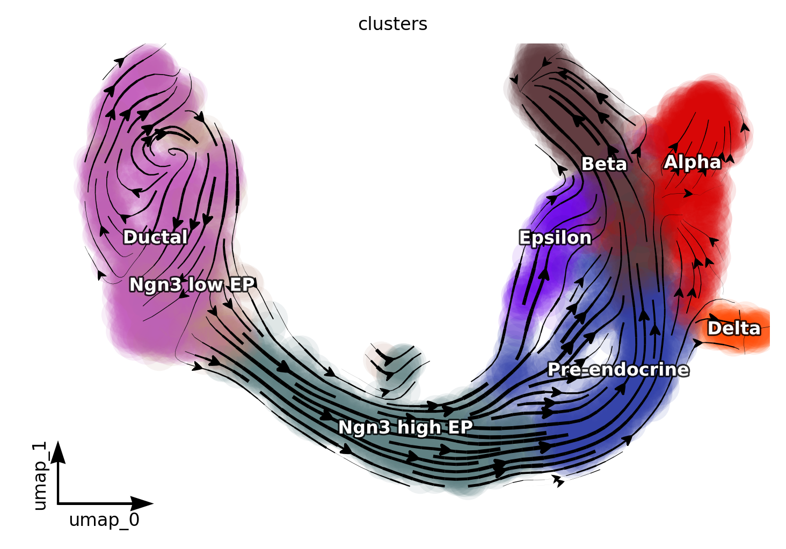{width=68%}

*Figure 1 (cell 14). Streamlines of the projected velocity field, coloured by cluster. Ductal cells
(left) sit in a slow eddy; the flow leaves through Ngn3 low/high EP in the middle and terminates in
the hormone-producing clusters.*

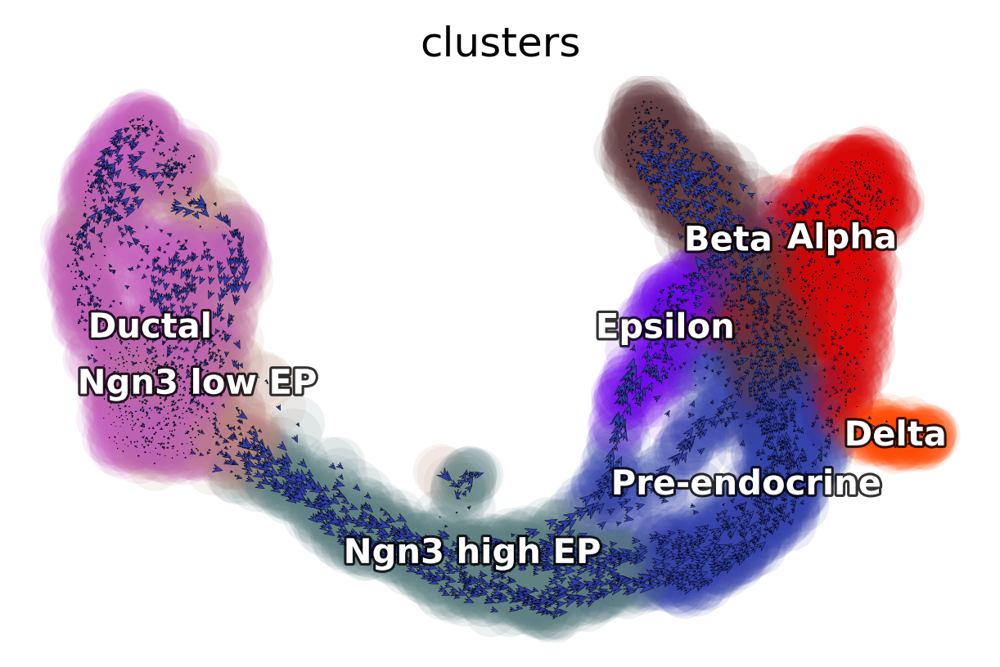{width=68%}

*Figure 2 (cell 15). The same field as per-cell arrows (`quiver_length/size = 4`). The visual
difference between Fig 1 and Fig 2 is the lecture's point: arrows show noise, streamlines show the
field that survives it.*

Cell 16 computes the progenitor set and never uses it:

```python
progenitor = adata.obs_names[adata.obs.clusters.isin(["Ductal"])]
len(progenitor)          # -> 916
```

`progenitor` is a plain `Index` of 916 names, and no later cell references it (DYN-11). In §3.10 I
put it to work — it defines "Ductal vs everything else" for the divergence/acceleration tests.

### 3.7 Part 5 — the vector field (cell 17)

```python
dyn.vf.VectorField(adata, basis="pca", pot_curl_div=True)
dyn.vf.VectorField(adata, basis="umap", pot_curl_div=True)
dyn.vf.speed(adata, basis="pca")
dyn.vf.divergence(adata, basis="pca")
dyn.vf.acceleration(adata, basis="pca")
dyn.vf.curl(adata, basis="umap")
```

**What `VectorField` does.** It does not simply average arrows. It fits a **continuous** function
`f(x)` to the scattered velocity samples with SparseVFC (the sparse variant of Vector Field
Consensus): control points are sampled in the embedding *in proportion to the observed velocity
magnitude* (the console prints `Sampling control points based on data velocity magnitude...`), each
sample is treated as a noisy observation of `f`, and an EM loop alternately estimates correspondence
(is this arrow an inlier?) and re-fits the field under a sparsity prior. `pot_curl_div=True`
additionally computes, on the *same* fitted field, the three derivative quantities the lecture then
reads:

| quantity | definition | what it means biologically |
|---|---|---|
| speed | ‖f(x)‖ | how fast a cell at x is predicted to move |
| divergence | ∇·f | **sink** (<0, cells accumulate → stable state), **source** (>0, cells leave → bifurcation/exit) |
| acceleration | ‖(f·∇)f‖ | change of the flow along itself → where the trajectory *turns* |
| curl | ∇×f (2-D) | rotational component → cycling, spiralling, or an attraction basin edge |
| `pca_ddhodge_potential` | ddhodge on the vector-field graph | a **pseudotime-like potential**: low = early, high = late |

Cost as written: SparseVFC 2.1 s (pca) + 5.1 s (umap); ddhodge 21.1 s + 21.3 s; the two
`VectorField` calls 24.1 s + 27.4 s. Everything else in this part is free.

**Result.** Whole-dataset distributions (`results/03_vectorfield/vf_stats.tsv`):

| quantity | min | q25 | median | mean | q75 | max |
|---|---|---|---|---|---|---|
| speed (pca) | 0.011 | 0.105 | 0.176 | 0.192 | 0.269 | 0.610 |
| divergence (pca) | −0.142 | −0.054 | −0.031 | **−0.023** | 0.009 | 0.096 |
| divergence (umap) | −1.343 | −0.168 | −0.055 | −0.034 | 0.094 | 1.037 |
| acceleration (pca) | 0.000 | 0.003 | 0.006 | 0.008 | 0.012 | 0.031 |
| curl (umap) | −0.764 | −0.116 | 0.002 | 0.010 | 0.117 | 1.235 |
| ddhodge potential | 0.000 | 0.265 | 1.493 | 1.287 | 2.087 | 2.719 |

The mean divergence is **negative** (−0.023): on this data the field is contractive almost
everywhere. That is expected for a developmental snapshot through a small number of committed
lineages, and it is also why "negative divergence ⇒ stable state" is a weak claim when applied to a
**single** cluster (§3.8).

### 3.8 Part 5 — per-cluster numbers nobody printed

The tutorial shows these as colours. Here they are as numbers, computed per cell then averaged
(`results/03_vectorfield/vf_per_cell.tsv`, `vf_cluster_sign_summary.tsv`), ordered by ddhodge
potential:

| cluster | n | speed | divergence | acceleration | curl | potential | frac div>0 |
|---|---|---|---|---|---|---|---|
| Ductal | 916 | 0.151 | −0.0140 | 0.0061 | −0.066 | 0.213 | 40.6 % |
| Ngn3 low EP | 262 | 0.168 | −0.0170 | 0.0077 | −0.038 | 0.264 | 34.0 % |
| **Ngn3 high EP** | 642 | **0.308** | **+0.0229** | **0.0158** | +0.100 | 0.983 | **84.9 %** |
| Pre-endocrine | 592 | 0.226 | −0.0256 | 0.0084 | +0.092 | 1.812 | 12.3 % |
| Epsilon | 142 | 0.220 | −0.0131 | 0.0076 | −0.072 | 1.985 | 17.6 % |
| Delta | 70 | 0.097 | −0.0272 | 0.0018 | +0.102 | 2.116 | 0.0 % |
| **Alpha** | 481 | **0.082** | −0.0502 | 0.0011 | −0.018 | 2.125 | **0.0 %** |
| **Beta** | 591 | 0.199 | **−0.0682** | 0.0070 | 0.001 | **2.261** | **0.0 %** |

Statistical support (`vf_cluster_tests.tsv`, Kruskal–Wallis over the 8 clusters; Mann–Whitney for
Ductal vs the rest):

| quantity | KW H | KW p | Ductal mean | rest mean | MWU p |
|---|---|---|---|---|---|
| speed | 1847 | ~0 | 0.151 | 0.205 | 3.4e-39 |
| divergence (pca) | 1613 | ~0 | −0.0140 | −0.0263 | 6.5e-06 |
| acceleration | 1927 | ~0 | 0.0061 | 0.0083 | 1.3e-08 |
| curl (umap) | 456 | 1.9e-94 | −0.066 | +0.035 | 6.0e-35 |
| ddhodge potential | 3427 | ~0 | 0.213 | 1.641 | ~0 |

Every quantity separates clusters with p < 1e-90; the potential's ordering (Ductal → Ngn3 low →
Ngn3 high → Pre-endocrine → terminal types) is the developmental order, recovered **without** using
any time information — that is the strongest single result in this lecture.

Now the tutorial's four qualitative readings, checked line by line:

1. **"Ductal cells are the saddle/root of the field."** Mostly *not* supported by the numbers.
   Ductal divergence is −0.0140, i.e. **less negative than the dataset mean** (−0.0233) and less
   negative than the rest of the cells (−0.0263, MWU p = 6.5e-06 in the *wrong* direction). Ductal
   is the **slowest** cluster (speed 0.151 vs 0.205, p = 3.4e-39) and the lowest-potential one
   (0.213), which is what "root" really means here. The "saddle" language comes from the shape of
   Fig 1, not from ∇·f.
2. **"Ngn3 high EP is the bifurcation point: high acceleration and positive divergence."** *Fully
   supported*, and it is the cleanest signal in the data: highest acceleration (0.0158, 2.6×
   Ductal), the **only** cluster with positive mean divergence (+0.0229), and 85 % of its cells
   have div > 0 — versus 0 % in Alpha/Beta/Delta.
3. **"Early endocrine progenitors exit the progenitor state with high positive acceleration."**
   Directionally right but modest: Ngn3 low EP acceleration 0.0077 vs Ductal 0.0061 (+26 %), while
   Ngn3 high EP is +159 %. The "exit" is a property of the *high* EP stage, not the low one.
4. **"Terminal cell types are stable states: negative divergence."** *Fully supported, and the
   strongest divergence signal.* Beta is the most contractive cluster (−0.0682) with **0 %** of
   cells having positive divergence, closely followed by Alpha (−0.0502) and Delta (−0.0272).
   Epsilon sits between (−0.0131) — consistent with the epsilon cells being a minor, less
   well-sampled branch (142 cells).

So: the *story* holds, the *Ductal saddle* is the weakest link, and the quantitative version of the
story (potential order + Ngn3-high divergence + terminal contractivity) is much more convincing than
the colour maps.

### 3.9 Part 5 — the four-panel figure, the topography, and the state graph (cells 18–20)

```python
dyn.configuration.set_figure_params("dynamo", background="black")
fig1, fig1_axes = plt.subplots(ncols=2, nrows=2, constrained_layout=True, figsize=(10, 6))
dyn.pl.cell_wise_vectors(adata, color="pca_ddhodge_potential", ... ax=fig1_axes[0, 0])
dyn.pl.grid_vectors(adata, color="speed_pca", ... ax=fig1_axes[0, 1])
dyn.pl.streamline_plot(adata, color="divergence_pca", ... ax=fig1_axes[1, 0])
dyn.pl.streamline_plot(adata, color="acceleration_pca", ... ax=fig1_axes[1, 1])
fig1.savefig('./figure/03_combined_plots.png')       # no dpi, no bbox_inches
```

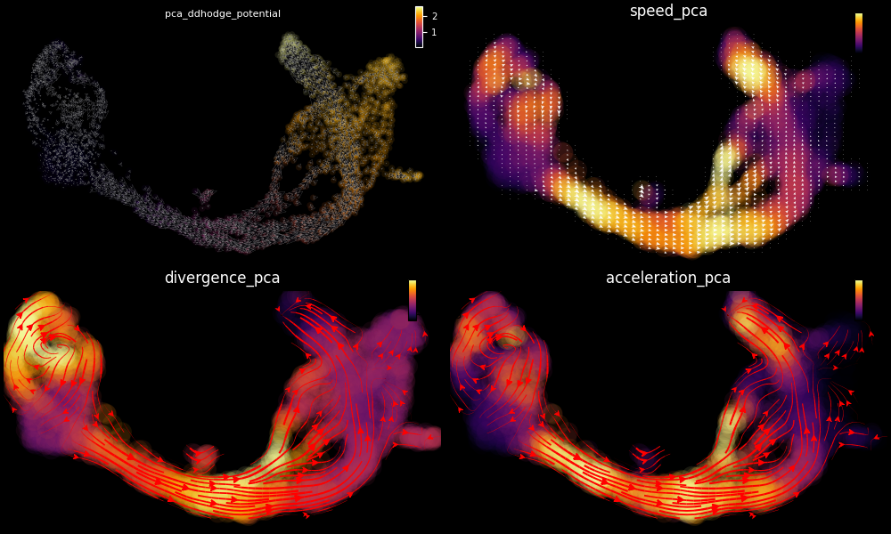{width=96%}

*Figure 3 (cell 18). Clockwise from top-left: ddhodge potential (low blue → high red), speed,
divergence, acceleration. This is the single most informative figure of the lecture, and the only
one the tutorial assembles by hand rather than through `save_kwargs`.*

Note `fig1.savefig('./figure/03_combined_plots.png')` passes **no dpi**: at matplotlib's default 100
this lands at 1000×600, whereas the staff's 2026 re-run saved the same panel at 3099×1834 (dpi 300).
Same picture, 3× the pixels — the reason §7 compares aspect ratio and structural correlation
separately.

```python
dyn.pl.topography(adata, basis="umap", background="white", color=["clusters"],
                  streamline_color="black", show_legend="on data", ...)
```

`topography` draws the potential **as terrain**: filled contours of `pca_ddhodge_potential` with the
streamlines engraved on top. Visually this is the "energy landscape" of Waddington's metaphor, and
it is the figure students remember.

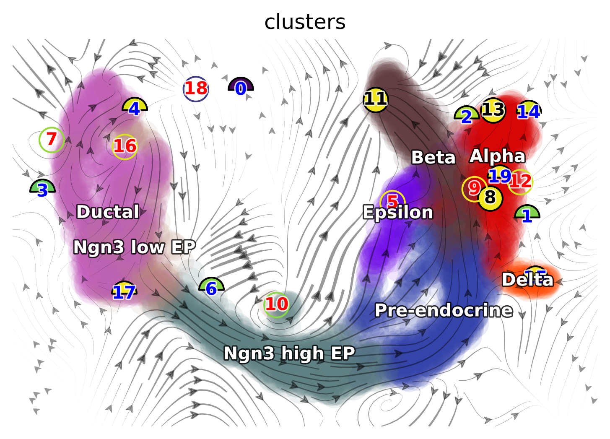{width=68%}

*Figure 4 (cell 19). The landscape: dark basins = terminal states, the ridge between them = the
bifurcation the lecture attributes to Ngn3 high EP. Compare with the numbers in §3.8 — the basins in
the picture are Alpha/Beta/Delta, and Ngn3 high EP indeed sits on the ridge.*

```python
dyn.pd.state_graph(adata, group='clusters', basis='pca', method='vf')      # compute
dyn.pl.state_graph(adata, color=['clusters'], group='clusters', basis='umap',
                   show_legend='on data', method='vf', ...)                # draw
```

**What it does.** `pd.state_graph` simulates the field: it places dynamo's default 100 integration control points per
group on the fitted vector field, integrates each forward for a fixed number of steps, and records
*where it lands*. The resulting 8×8 table is a directed transition graph between clusters —
the closest thing to lineage tracing that a velocity field can give. It is also the second most
expensive step (123 s as-written; 167 s in the number-export run, which walks the graph again).

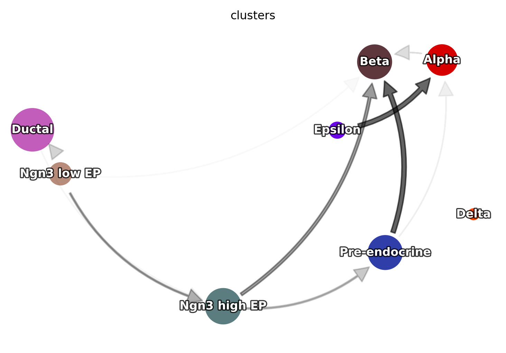{width=68%}

*Figure 5 (cell 20). State transitions drawn on the UMAP: arrows encode where the simulated control
points end up.*

The numbers behind it — exported in C9, because `adata.uns['clusters_graph']` is a **dict of three
arrays** (`group_graph` 8×8, `group_avg_time` 8×8, `group_names`) that `pd.DataFrame` cannot take
directly (DYN-13):

`group_graph` (row = origin, column = destination):

| from \ to | Ductal | Ngn3 low | Ngn3 high | Pre-endo | Beta | Alpha | Delta | Epsilon | row sum |
|---|---|---|---|---|---|---|---|---|---|
| Ductal | 1.00 | 0.00 | 0.08 | 0.00 | 0.00 | 0.68 | 0.00 | 0.00 | **1.76** |
| Ngn3 low EP | 0.00 | 0.89 | 0.00 | 0.01 | 0.00 | 0.00 | 0.04 | 0.00 | 0.94 |
| Ngn3 high EP | 0.00 | 0.00 | 1.00 | 0.00 | 0.00 | 0.06 | 0.00 | 0.00 | 1.06 |
| Pre-endocrine | 0.19 | 0.00 | 0.00 | 1.00 | 0.00 | 0.22 | 0.00 | 0.00 | 1.41 |
| Beta | 0.00 | 0.00 | 0.00 | 0.00 | 1.00 | 0.00 | 0.00 | 0.00 | 1.00 |
| Alpha | 0.00 | 0.00 | 0.00 | 0.00 | 0.00 | 1.00 | 0.00 | 0.00 | 1.00 |
| Delta | 0.01 | 0.08 | 0.00 | 0.27 | 0.00 | 0.02 | 0.84 | 0.00 | 1.22 |
| Epsilon | 0.01 | 0.00 | 0.54 | 0.00 | 0.00 | 0.02 | 0.00 | 1.00 | 1.57 |

Read it as *flux*, not as a Markov chain: rows do **not** sum to 1 (Ductal sums to 1.76), because
`state_graph` counts control points that end in the same group plus those that drift into another;
the "self" entry is a residence term. The biologically meaningful entries are the off-diagonal ones:
**Ductal → Alpha 0.68** and **Ductal → Ngn3 high EP 0.08**, **Epsilon → Ngn3 high EP 0.54** (an
artefact of the field's local direction, not a developmental claim), **Pre-endocrine → Alpha 0.22**
and **→ Ductal 0.19**. Beta and Alpha are perfectly absorbing (self = 1.00, nothing out), Delta
mostly so (0.84). Those absorbing terminal states are the same three clusters that had 0 % positive
divergence — the two independent computations agree, which is a good sign for both.

`group_avg_time` (pseudotime units, not days):

| from \ to | Ductal | Ngn3 low | Ngn3 high | Pre-endo | Beta | Alpha | Delta | Epsilon |
|---|---|---|---|---|---|---|---|---|
| Ductal | 64.8 | — | 64.7 | — | — | **24.6** | — | — |
| Ngn3 low EP | — | 21.5 | — | 13.8 | — | — | 31.1 | — |
| Ngn3 high EP | — | — | 60.3 | — | — | 82.6 | — | — |
| Pre-endocrine | 45.0 | — | — | 20.0 | — | 83.2 | — | — |
| Delta | 90.9 | 27.2 | — | 16.0 | — | 24.9 | 23.8 | — |
| Epsilon | 20.9 | — | 80.1 | — | — | 27.3 | — | 49.1 |

Two things to carry away: (i) the *shortest* transitions are Ductal→Alpha (24.6) and
Delta→Pre-endocrine (16.0), which is where the field is most "directed"; (ii) the times are units of
the integrated field (ddhodge potential per unit speed), so they can be compared **within** this
table but never quoted as hours or embryonic days (DYN-13).

### 3.10 Part 6 — the Jacobian (cells 21–24)

```python
dyn.vf.jacobian(adata, regulators=pancreas_genes)     # cell 21
```

**What it does.** At every cell, linearise the fitted field: compute the **Jacobian matrix**
`J(x) = ∂f/∂x` — how the predicted velocity of gene *i* responds to the level of gene *j*. This is
the dynamical-systems answer to "what regulates what", with the sign being the answer:

* `J_ij > 0` → raising *j* increases the velocity of *i* → **j activates i**;
* `J_ij < 0` → **j inhibits i**;
* `J_ij ≈ 0` → no local coupling.

Two implementation facts matter, and both are traps:

1. The field lives in **PCA space** (30 dims). So the raw object is `30 × 30 × 3696`, not 17 × 17 ×
   3696. What you want per gene pair is the **inverse-transformed** tensor
   `jacobian_gene`, computed by dynamo as `Qi · J · Qjᵀ` with `Qi` = effector loadings and `Qj` =
   regulator loadings. Anyone who slices `adata.uns['jacobian_pca']['jacobian']` as if it were genes
   gets a 30×30 matrix and a crash (this happened to my first export script: 110880 = 30·30·123.2
   — see DYN-12).
2. The gene-level tensor's axis order is **(effector, regulator, cell)**, *not*
   (regulator, effector, cell). Getting it backwards silently reports the *inverse* regulation —
   i.e. it turns "Pax4 represses Arx" into "Arx represses Pax4", which is exactly the kind of error
   this figure is supposed to establish.

Panels as written:

```python
dyn.pl.jacobian(adata, basis="umap", regulators=["Neurog3"], effectors=["Pax4"],
                alpha=1, save_show_or_return='save', ...)          # cell 22 -> 06_*.png
dyn.pl.jacobian(adata, basis="umap", regulators=["Arx"],  effectors=["Pax4"], alpha=1)   # cell 23
dyn.pl.jacobian(adata, basis="umap", regulators=["Pax4"], effectors=["Arx"],  alpha=1)   # cell 23
dyn.pl.jacobian(adata, basis="umap", regulators=["Pax4"], effectors=["Ins2"], alpha=1)   # cell 24
```

Cells 23 and 24 omit `save_show_or_return`, so their three panels exist **only as notebook
output** and never reach disk (DYN-06). The harness re-captured them (they are the actual figures
below); the corrected pass saves them properly.

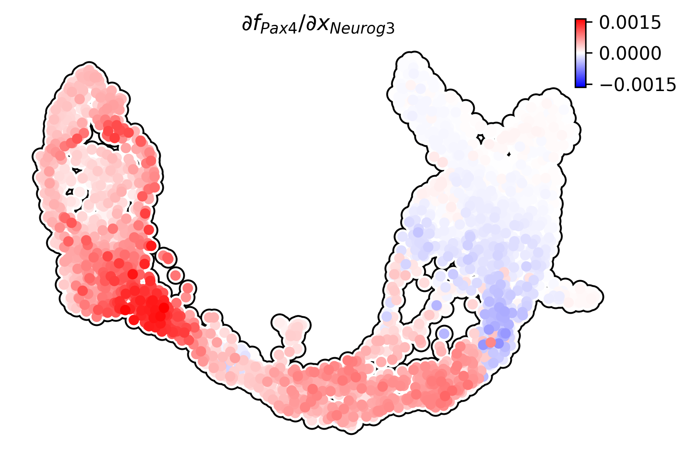{width=62%}

*Figure 6 (cell 22). ∂(Pax4)/∂(Neurog3) per cell. Red = activation. The strongest red sits in the
Ngn3-high/pre-endocrine region — the lecture's "Ngn3 activates Pax4 in progenitors, initiating
endocrine specification".*

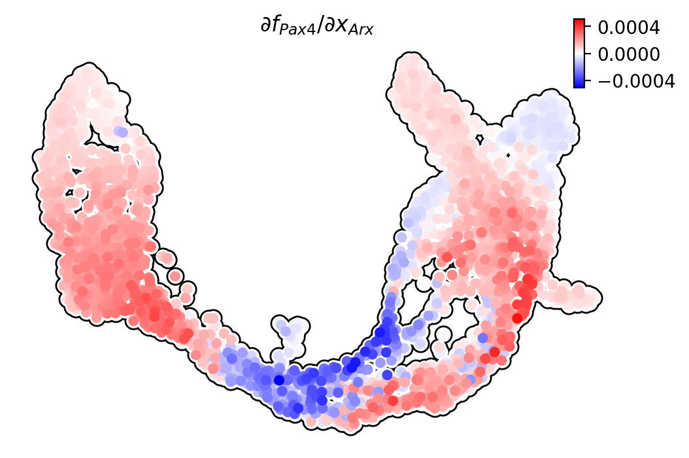{width=62%}

*Figure 7 (cell 23, inline only in the tutorial). ∂(Pax4)/∂(Arx).*

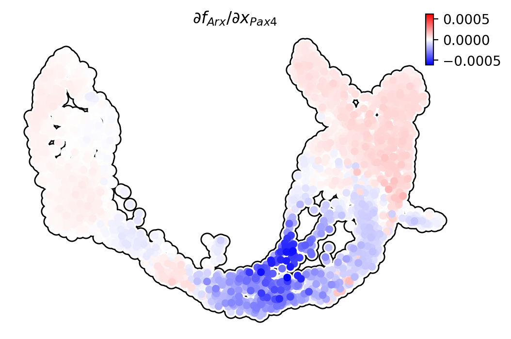{width=62%}

*Figure 8 (cell 23, inline only). ∂(Arx)/∂(Pax4) — the mirror image of Fig 7.*

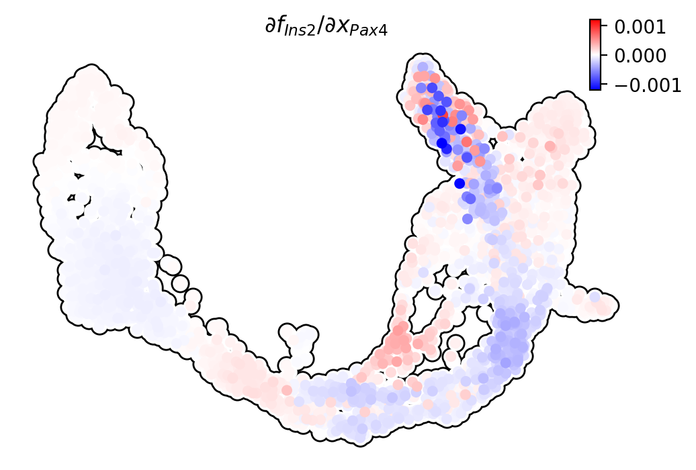{width=62%}

*Figure 9 (cell 24, inline only). ∂(Ins2)/∂(Pax4), the beta-cell edge.*

The numbers behind the four panels (gene-level tensor, `results/04_jacobian/jacobian_pairs.tsv`):

| edge (regulator → effector) | min | q25 | median | mean | q75 | max | frac > 0 |
|---|---|---|---|---|---|---|---|
| **Neurog3 → Pax4** | −7.1e-4 | −2e-5 | 1.5e-4 | **+2.4e-4** | 4.4e-4 | 1.7e-3 | 68 % |
| Arx → Pax4 | −5.1e-4 | −0.0 | 7e-5 | +6e-5 | 1.5e-4 | 4.7e-4 | 75 % |
| Pax4 → Arx | −6.1e-4 | −3e-5 | 1e-5 | −2e-5 | 4e-5 | 1.7e-4 | 61 % |
| Pax4 → Ins2 *(the plotted one)* | −1.2e-3 | −6e-5 | −1e-5 | −2e-5 | 3e-5 | 8.9e-4 | 44 % |
| **Pdx1 → Ins2** *(the comment's claim)* | −2.1e-4 | −4e-5 | 6e-5 | **+3.4e-4** | 4.2e-4 | 4.3e-3 | 58 % |
| Neurog3 → Neurod1 | −2.6e-4 | −1e-5 | 0.0 | 0.0 | 2e-5 | 2.6e-4 | 57 % |
| Pax4 → Pax6 | −5.7e-4 | −1e-5 | 2e-5 | +3e-5 | 5e-5 | 7.1e-4 | 68 % |
| Pdx1 → Pax4 | −5.8e-4 | −1.9e-4 | −1.1e-4 | −1.3e-4 | −4e-5 | 3.7e-4 | 13 % |
| Nkx6-1 → Ins2 | −1.9e-3 | −3e-5 | 3e-5 | +1.3e-4 | 2.3e-4 | 3.0e-3 | 63 % |
| Gcg → Arx | −8.4e-4 | −2e-4 | −1.2e-4 | −7e-5 | 5e-5 | 9.3e-4 | 30 % |

*n = 3696 cells for every row; units are the Jacobian's own (velocity per unit expression per
pseudotime step), so compare rows with each other, not with a physical rate.*

And per cluster for the two mutually inhibiting edges (`jacobian_pairs_by_cluster.tsv`):

| cluster | Neurog3→Pax4 | Arx→Pax4 | Pax4→Arx | Pax4→Ins2 | Pdx1→Ins2 |
|---|---|---|---|---|---|
| Ductal | +3.9e-4 (99 %) | +1.3e-4 (99.8 %) | +1e-5 (86 %) | −2e-5 (33 %) | −5e-5 (0.1 %) |
| Ngn3 low EP | **+8.2e-4 (100 %)** | +1.7e-4 (97 %) | +1e-5 (68 %) | −3e-5 (26 %) | −5e-5 (0.4 %) |
| Ngn3 high EP | +4.3e-4 (93 %) | **−4e-5 (40 %)** | **−1.2e-4 (17 %)** | −1e-5 (49 %) | +2e-5 (58 %) |
| Pre-endocrine | +1.0e-4 (52 %) | +6e-5 (70 %) | −9e-5 (18 %) | −7e-5 (25 %) | +2.5e-4 (84 %) |
| Beta | −4e-5 (21 %) | +8e-5 (98 %) | +4e-5 (87 %) | −4e-5 (46 %) | **+1.5e-3 (99.3 %)** |
| Alpha | −2e-5 (43 %) | +4e-5 (48 %) | +7e-5 (99 %) | +3e-5 (77 %) | +4.9e-4 (99 %) |
| Delta | 0.0 (67 %) | +5e-5 (93 %) | −3e-5 (14 %) | +2e-5 (73 %) | +5.0e-4 (100 %) |
| Epsilon | −2e-5 (46 %) | −2e-5 (32 %) | −0.0 (52 %) | +2e-5 (73 %) | +1.4e-4 (92 %) |

*cell means, with the fraction of cells having a positive value in brackets; bold = the two
cross-terms that are negative together.*

Reading those two tables together, the lecture's claims score very differently from each other:

* **Neurog3 → Pax4 is exactly where the lecture puts it.** Positive in **100 %** of Ngn3-low cells and
  93 % of Ngn3-high cells, collapsing to 52 % in Pre-endocrine and **negative** (−4e-5, 21 %
  positive) in Beta. The sign switch from progenitor to terminal is the quantitative version of
  "Ngn3 initiates endocrine specification", and it is the cleanest *activation* edge in the table
  after Pdx1→Ins2.
* **Pax4 ⤙ Arx is a *local* toggle, not a global one.** The two cross-terms are negative
  *simultaneously* only in the Ngn3-high region (Arx→Pax4 −4e-5 with 40 % positive; Pax4→Arx
  −1.2e-4 with 17 % positive) — and that is precisely "mutual inhibition at the bifurcation point",
  which is literally what the tutorial's cell-23 comment claims. But one stage later (Pre-endocrine)
  the Arx→Pax4 term has already flipped back positive, and in Alpha and Beta **both** cross-terms are
  positive (+4e-5 / +7e-5): mutual *activation*. The colour panels give the impression of a global
  switch; the numbers say the switch is a narrow zone around the branch point.
* **The plotted edge is the weakest in the table, and the comment's edge is the strongest.** The
  tutorial plots **Pax4 → Ins2** (Fig 9) while its comment says *"Pdx1 activates Ins2 in beta cells"*
  (DYN-07). Measured: Pax4→Ins2 is −2e-5 overall (44 % positive) and **−4e-5 inside Beta itself**
  (46 % positive) — i.e. the panel is mostly blue wherever it is not noise. **Pdx1→Ins2**, the pair
  the comment names, is **+1.5e-3 in Beta with 99.3 % of cells positive** — six times larger than
  any other edge in the table and the only one that is unambiguously positive in a single cluster.
  So the author wrote the caption for the right gene and then plotted a different one; had cell 24
  used `regulators=["Pdx1"]`, Figure 9 would show the single cleanest regulatory edge in the dataset
  instead of its least informative one.

### 3.11 Part 7 — acceleration ranking (cells 25–28)

```python
adata.obs["clusters"].unique()                                    # cell 25
# cell 26 is a comment-only cell  (DYN-11)
dyn.vf.acceleration(adata, basis='pca')                           # cell 27 (recomputes!)
dyn.vf.rank_acceleration_genes(adata, groups='clusters')          # cell 27
adata.uns['rank_acceleration'][:5]                                # cell 28
```

`rank_acceleration_genes` ranks genes by how strongly their expression correlates with the
cell's acceleration along the field — i.e. "which genes move *with* the turning of the trajectory".
The printed `[:5]` is the first five **rows** of a per-cluster wide table, so the tutorial's display
shows the top 5 genes of every cluster at once, not the top 5 overall.

Results (`results/04_jacobian/rank_acceleration_top200.tsv`; `top20_per_cluster.tsv` for a digest):

| cluster | top 10 by acceleration rank |
|---|---|
| Ductal | Hmgb2, Hist1h2bc, Ccnb2, Cdc20, Dynll1, Birc5, Cks2, Ccnb1, Cenpf, Hn1 |
| Ngn3 high EP | Chga, Chgb, Tm4sf4, Akr1c19, Cryba2, Cpe, Hmgn3, Pcsk1n, Cystm1, Glud1 |
| Beta | Ins1, Ins2, Xist, Krt8, Gpx3, Krt7, Nnat, Krt18, Tm4sf4, Chga |
| Alpha | Ghrl, Cck, … |

This is the table the last part builds on, and it reads exactly as the biology: **Ductal = cell
cycle** (9 of the top 10 are mitotic-spindle/chromosome-segregation genes), **Ngn3 high EP =
secretory granule / prohormone processing** (Chga/Chgb, Pcsk1n, Cpe are the granin and
prohormone-convertase machinery), **Beta = insulin** (Ins1, Ins2 first, by a wide margin).

Note `Xist` in the Beta top-3: this is a **mixed-sex** dataset, and Xist's apparent acceleration
reflects the male/female split inside the cluster rather than beta-cell biology. It is a useful
reminder that "top gene" lists are only as clean as the confounders you remembered to check.

### 3.12 Part 8 — enrichment (cells 29–32)

```python
enr = dyn.ext.enrichr(adata.uns['rank_acceleration']['Ductal'][:100].to_list(),
                      organism='mouse', gene_sets='GO_Biological_Process_2021',
                      outdir='./figure')                               # cell 31
from gseapy.plot import barplot, dotplot
barplot(enr.res2d, column='Adjusted P-value', title='GO_Biological_Process_2018', cutoff=0.05)
dotplot(enr.res2d, title='KEGG_2016', cmap='viridis_r', cutoff=0.05)   # cell 32
```

**What it does.** Sends the top 100 accelerating Ductal genes to Enrichr's `GO_Biological_Process_2021`
library and returns, per term, an overlap, a hypergeometric p-value, a Bonferroni-adjusted p, and
gseapy's combined score. `outdir='./figure'` makes gseapy drop its own report files
(`*.enrichr.reports.txt/.pdf`) **into the figure directory** (DYN-09).

**Result.** 925 GO terms are returned; **107 pass FDR < 0.05**. Top 10 by adjusted p:

| term | overlap | adj. p |
|---|---|---|
| mitotic spindle organization (GO:0007052) | 21/157 | 1.7e-21 |
| microtubule cytoskeleton organization involved in mitosis (GO:1902850) | 18/128 | 8.6e-19 |
| mitotic sister chromatid segregation (GO:0000070) | 13/102 | 1.1e-12 |
| regulation of mitotic cell cycle phase transition (GO:1901990) | 13/188 | 2.4e-09 |
| regulation of G2/M transition of mitotic cell cycle (GO:0010389) | 10/149 | 7.0e-07 |
| RNA splicing, via transesterification with bulged adenosine (GO:0000377) | 12/251 | 7.2e-07 |
| regulation of cell cycle G2/M phase transition (GO:1902749) | 8/85 | 1.4e-06 |
| mRNA splicing, via spliceosome (GO:0000398) | 12/274 | 1.4e-06 |
| mRNA processing (GO:0006397) | 12/300 | 3.5e-06 |
| DNA topological change (GO:0006265) | 4/9 | 6.7e-06 |

The first five are cell cycle, the next four are splicing — and the splicing block is the interesting
one: `Srsf2`, `Srsf3`, `Srsf5`, `Hnrnpa1`, `Magoh`, `Snrpa1` all appear, i.e. the Ductal progenitor
state is not only proliferative but splicing-heavy. That is a real, checkable observation that the
tutorial's one-line summary ("cell cycle related pathways") does not mention.

The two figures the tutorial shows are the same table, drawn twice:

{width=96%}

*Figure 10 (cell 32). gseapy barplot, top 10 terms by adjusted p. **Title reads
`GO_Biological_Process_2018` although the gene set queried was 2021** (DYN-08).*

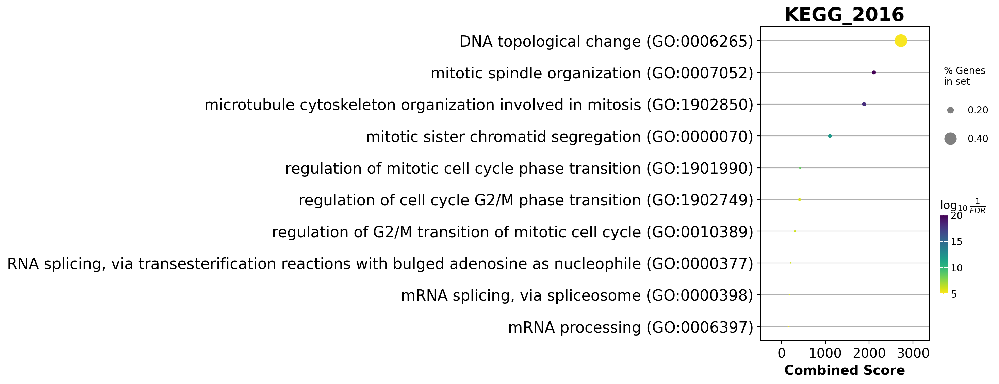{width=96%}

*Figure 11 (cell 32). gseapy dotplot of the same table, x = combined score, colour = −log10(FDR),
size = % genes in set. **Title reads `KEGG_2016` although nothing KEGG was queried** (DYN-08).*

Both titles are **hardcoded strings in the plotting call**, not read from `enr.res2d['Gene_set']`.
Anyone citing these figures will mis-attribute the library. The corrected pass (C2) regenerates both
with the library name taken from the table:

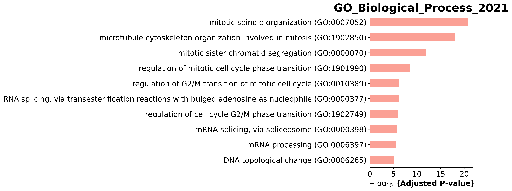{width=96%}

*Figure 12 (corrected, C2). Identical bars, correct title: `GO_Biological_Process_2021`. The bars,
their order and their lengths are pixel-identical to Fig 10 — the only defect was the label.*

### 3.13 Part 8 — Session Info (cell 33)

The last cell loops over `sys.modules`, keeps every module loaded from `site-packages` and prints its
distribution version via `pkg_resources`. In 2026 that is `setuptools`-deprecated but still works;
dynamo 1.3.2 + scanpy 1.10.3 + gseapy 1.1.3 came out exactly as §2 lists. Keep this cell: it is the
cheapest way to prove which environment a figure came from, and its output is what pinned the env for
this module.

---

## 4. Issue registry

Eighteen issues, each with what it does, how it was proven, and where the fix lives. "Silent" means
no warning, no log line, no exception.

| id | severity | where | symptom | evidence | fix |
|---|---|---|---|---|---|
| **DYN-01** | blocker | cells 1, 3 | hardcoded teacher home: `!ls /home/zongxu/...`, `os.chdir('/home/zongxu/Misc/lesson/scRNA-application/')` — run fails immediately for anyone else | cells as extracted | C5 |
| **DYN-02** | blocker | cell 2 | `! source dynamo/bin/activate` assumes a `dynamo/` venv next to the notebook; the `!` does not affect the kernel, so the env is whatever the kernel was started in | shell semantics; our run activates before `python` | documented, §2 |
| **DYN-03** | high, silent | cell 12 | `reduceDimension`'s UMAP step is a **no-op** because the h5ad already carries `X_umap`; the result is a hybrid pipeline — dynamo-fresh PCA 30-D + upstream UMAP + a kNN graph that did not exist in the file — and every figure is drawn on the upstream embedding | `[UMAP] completed [0.0012s]`; `incomplete neighbor graph info detected … indices not in adata.uns.neighbors`; forced recompute moves the map by 1.9× its spread (Spearman 0.939) | C4 (measured, not forced) |
| **DYN-04** | high, silent | cell 10 | three disagreeing "is this gene interesting" flags coexist; dynamo's `use_for_pca` (4000) overlaps the shipped **categorical** `highly_variable_genes` (4004 True + 10656 NaN) by only **1339 genes** (Jaccard 0.201), and the shipped column cannot even be summed | `01_preprocess/adata_summary.tsv`, `var_flags.tsv` | documented, kept as-is |
| **DYN-05** | medium, silent | cell 11 | `model="stochastic"` pins **β = 1.0** for all genes; `half_life` is then just `ln2/γ`; γ is heavy-tailed (mean 2.5× median, max 64.6) | `02_velocity/gamma_summary.tsv` (β min = max = 1.0) | documented |
| **DYN-06** | medium, silent | cells 23, 24 | three of the four Jacobian panels are drawn without `save_show_or_return='save'` → **never saved**; the figure set on disk is 6 of the 9 the notebook displays | only `06_*.png` exists in `./figure` | C1 |
| **DYN-07** | **high, content** | cell 24 | comment says "**Pdx1** activates Ins2 in beta cells", code plots `regulators=["Pax4"]` — and the data agree with the *comment*, not the code: Pdx1→Ins2 = +1.5e-3 in Beta (99.3 % positive), while Pax4→Ins2 = **−4e-5** there (46 %) | `04_jacobian/jacobian_pairs*.tsv` | C8 (both computed, §3.10) |
| **DYN-08** | medium | cell 32 | figure titles are hardcoded and wrong: `GO_Biological_Process_2018` and `KEGG_2016`, although the queried library is `GO_Biological_Process_2021` | `enr.res2d['Gene_set']` == 2021 for all 925 rows | C2 |
| **DYN-09** | low, hygiene | cell 31 | `outdir='./figure'` dumps gseapy's report `.txt`/`.pdf` into the figure directory, where they survive as unversioned duplicates | `05_enrichment/*.enrichr.reports.*` (two copies: `aswritten_*` and plain) | C3 |
| **DYN-10** | low, silent | cell 17 | `dyn.vf.curl` is computed (and costs SparseVFC time) but **never plotted**; the tutorial text never mentions curl | code vs figures | C6 |
| **DYN-11** | low, dead code | cells 16, 26 | `progenitor` (916 names) is computed and never used; cell 26 is comment-only; `rank_acceleration[:5]` prints 5 rows of a per-cluster table | grep across the 34 cells | C7/C10 |
| **DYN-12** | high, numerics | cell 21 + any downstream use | the stored Jacobian is **PCA-space 30×30×3696**; the gene-level tensor `jacobian_gene` is `(effector, regulator, cell)` — reading it as `(regulator, effector, cell)` reports the **inverse** regulation | dynamo 1.3.2 `vectorfield/utils.py:497` (`Qi @ J @ Qj.T`, Qi = effector loadings) | C8 |
| **DYN-13** | medium, interpretation | cell 20 | `uns['clusters_graph']` is a dict of 3 arrays (not a frame) and `group_graph` is **not row-stochastic** (Ductal row sums to 1.76) → quoting entries as transition probabilities overstates migration | `clusters_graph_*.tsv` row sums 0.94–1.76 | C9 + §3.9 wording |
| **DYN-14** | medium, cost | cell 20 | `pd.state_graph` = 123 s as-written, 167 s in the export run, i.e. ~15 % of the pipeline for one figure; it internally re-runs the field | console timings | documented |
| **DYN-15** | high, reference data | 2026 reference set | the staff's 2026 script-saved GO figures (`10_`, `11_`) are **blank white canvases** (0 ink, 0 colours, 12 / 15 kB) → unusable as visual ground truth | `07_figure_comparison/figure_comparison_aswritten.tsv`, ink_ref = 0.0 | §7 uses the 2025 HTML embeds for GO |
| **DYN-16** | medium, reproducibility | whole pipeline | figures are bit-reproducible (6/6 md5 identical across passes 2.5 h apart) **but** the same numbers change if neighbours/UMAP are recomputed: divergence(Ductal) −0.0140 vs −0.0161, **curl(Ductal) −0.066 vs +0.102 (sign flip)** | two independent runs | §8 |
| **DYN-17** | low, doc | §3.8 claims | "Ductal is a saddle with negative divergence": true only in the trivial sense that 7/8 clusters are negative; Ductal is significantly *less* negative than the rest (MWU p = 6.5e-06, wrong direction) | `vf_cluster_tests.tsv` | §3.8, corrected wording |
| **DYN-18** | low, code | cell 20 | `dyn.pl.state_graph(..., method='vf')` — the plotter has no `method` parameter, so the argument is swallowed by `**kwargs` and silently ignored (the method belongs to `pd.state_graph`) | `inspect.signature(dyn.pl.state_graph)` has `**kwargs`, no `method` | documented |

---

## 5. The corrected edition — ten fixes, and what each produced

The rule followed here: **the as-written pass stays buggy**; fixes are applied in a second script so
that every difference between the two is attributable. All fixes are in
`results/scripts/dynamo_corrected.py` and marked `C1`…`C10` in the code. Reference: six of six
as-written figures are byte-identical after the patch set, i.e. the fixes change *what is added*,
not the figures everyone already has.

**C1 — save the panels the tutorial only displays.** Cells 23/24 get `save_show_or_return='save'`
with the prefixes the staff used in their 2026 re-run (`07_reg_Arx_Pax4`, `08_reg_Pax4_Arx`,
`09_reg_Pax4_Ins2`). Result: `07/08/09_*.png`, pixel-comparable with the 2026 reference set (they were
previously 1054×700 inline captures vs 1580×1048 saved figs — same picture, different dpi).

**C2 — correct the two GO titles.** Both plots are rebuilt with the library name read from
`enr.res2d['Gene_set']` instead of a hardcoded string. Result: Fig 12 above; bars pixel-identical,
label right.

**C3 — stop polluting the figure directory.** `dyn.ext.enrichr(..., outdir=...)` now writes to
`05_enrichment/`, so `figure/` contains only figures.

**C4 — measure the no-op instead of silently "fixing" it.** The question C4 answers is precise:
*the PCA is fresh, the UMAP is not — what happens if we also recompute the UMAP?* Three numbers are exported
(`06_corrected/umap_recompute_comparison.tsv`):

| quantity | value |
|---|---|
| Spearman of pairwise distances, shipped vs recomputed UMAP | **0.9393** |
| mean displacement per cell | 9.74 |
| UMAP spread (mean per-axis SD) | 5.11 |
| displacement / spread | **1.905** |

i.e. enforcing the recompute gives an embedding that preserves 94 % of the neighbourhood ordering
but places each cell **1.9 spread-units** away from where it sits in every figure of the lecture. The
recompute is therefore performed **on a copy** (`_tmp = adata.copy()`), which keeps `X_umap` — and
hence figures 01–09 — byte-identical, and the comparison figure is written separately:

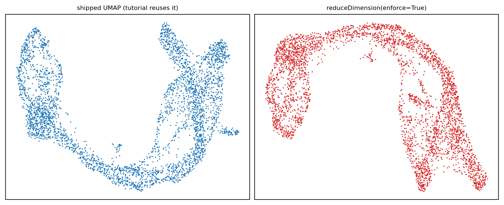{width=96%}

*Figure 13 (corrected, C4). Left: the embedding every tutorial figure uses. Right: what
`reduceDimension(enforce=True)` would produce. Same global shape, different local geometry — which is
why §8 insists that any quoted number is conditional on the embedding.*

**C5 — paths become parameters.** `os.chdir()` goes, the data path is relative to the run directory,
and the teacher's `!ls` is replaced by a listing of our copy. Same file, md5-verified against
`/lustre1/share/scRNA-advancedTopics/data/Pancreas/endocrinogenesis_day15.h5ad`.

**C6 — draw the quantity that was computed but never shown.** `dyn.pl.streamline_plot(adata,
color="curl_umap", basis="umap", ...)` on a black background:

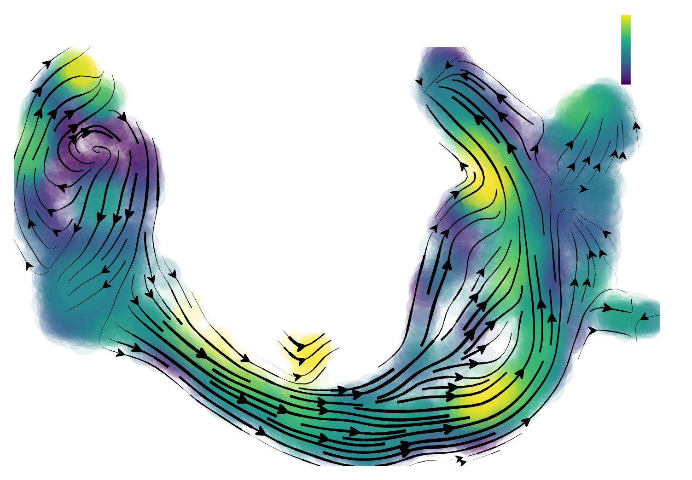{width=62%}

*Figure 14 (corrected, C6). Curl ∇×f. Blue/red lobes alternate around the Ngn3-high ridge — the
rotational signature of a bifurcation, and the one quantity of the four that the tutorial never
shows. Ductal curl is the most negative of all clusters (−0.066, 36 % positive cells), consistent
with a slow rotating inflow.*

**C7 — use `progenitor` for the comparison it was obviously meant for.** The 916 Ductal names define
the "Ductal vs rest" split of §3.8's Mann–Whitney tests (`06_corrected/ductal_subset_stats.tsv`), so
the dead variable becomes the grouping variable of a real test.

**C8 — export the Jacobian, in the right orientation, for more pairs.** The pair table of §3.10
covers the four tutorial edges plus **Pdx1→Ins2** (the comment's claim), plus five controls
(Neurog3→Neurod1, Pax4→Pax6, Pdx1→Pax4, Nkx6-1→Ins2, Gcg→Arx). The tensor is sliced as
`Jg[effector_idx, regulator_idx]` per DYN-12.

**C9 — export the state-graph matrices.** `group_graph` and `group_avg_time` as TSVs plus row sums,
which is what made the "not row-stochastic" caveat (DYN-13) visible in the first place.

**C10 — export the acceleration rankings** as `top20_per_cluster.tsv` and `top200.tsv` instead of a
`[:5]` slice of a wide frame, so the downstream gene lists are auditable.

Enhancement beyond the fixes (**not** a bug): the per-cell vector-field table
(`03_vectorfield/vf_per_cell.tsv`, 3696 rows × 8 columns) is the artifact that makes this lecture
*analysable* rather than merely reproducible — every statistic in §3.8 is one `groupby` away from it.

---

## 6. Results digest

| what | where | headline |
|---|---|---|
| cells / genes | `01_preprocess/adata_summary.tsv` | 3696 × 27998; 6956 pass filter; 4000 `use_for_pca`; 17/17 pancreas genes kept |
| HVG agreement | same | dynamo vs shipped flag: 1339 shared, **Jaccard 0.201** |
| kinetics | `02_velocity/gamma_summary.tsv` | γ median 0.382 (mean 0.953, max 64.6); **β ≡ 1.0**; half-life median 1.81 |
| projected velocity | `02_velocity/cell_velocity_stats.tsv` | median norm 0.375 |
| field statistics | `03_vectorfield/vf_stats.tsv` | mean divergence **−0.023** (contractive), acceleration median 0.006, potential 0→2.72 |
| per-cluster | `vf_cluster_sign_summary.tsv` | potential order Ductal(0.21) → Ngn3 low(0.26) → Ngn3 high(0.98) → Pre-endo(1.81) → Epsilon(1.99) → Delta(2.12) → Alpha(2.13) → Beta(2.26) |
| cluster separation | `vf_cluster_tests.tsv` | KW p < 1e-90 for all five quantities |
| bifurcation | same | Ngn3 high EP: only cluster with **div > 0** (+0.0229), 85 % cells positive, acceleration 0.0158 (max) |
| terminal states | same | Beta div −0.0682 (0 % positive), Alpha −0.0502 (0 %), Delta −0.0272 (0 %) |
| state graph | `clusters_graph_*.tsv` | Ductal→Alpha 0.68 flux; Beta/Alpha absorbing (self 1.00, 0 out); shortest transition Delta→Pre-endo 16.0 |
| Jacobian | `jacobian_pairs.tsv` | Neurog3→Pax4 +2.4e-4 (68 %); **Pdx1→Ins2 +1.5e-3 in Beta (99.3 %)**; plotted Pax4→Ins2 −4e-5 in Beta (46 %); Pax4⤙Arx both negative **only** in Ngn3 high EP |
| acceleration genes | `rank_acceleration_top200.tsv` | Ductal = 9/10 mitotic; Beta = Ins1, Ins2; Ngn3 high = Chga/Chgb/Pcsk1n |
| enrichment | `05_enrichment/GO_BP_2021_Ductal_top100.tsv` | 925 terms, **107 at FDR < 0.05**; top = mitotic spindle (1.7e-21) |

---

## 7. Figure-by-figure comparison against the teacher's references

Two reference sets exist and they are **not** interchangeable:

* **2025 HTML embeds** — the 6 figures the notebook displays inline (extracted from the base64 blobs
  of `ref/scRNAseq_dynamo.html`; `ref/figures/teacherhtml/`);
* **2026 script re-run** — 11 PNGs in `/lustre1/share/scRNA-adv-2026/figure/dynamo/`, produced
  2026-11-08 by an upgraded script (`ref/figures/teacher2026/`).

Method (`results/scripts/compare_dynamo_figs.py`, table in `07_figure_comparison/`): aspect ratio,
**structural correlation** of the ink masks (a shape-only comparison, insensitive to colour), and
**ink IoU**; plus, where the size matches, colour histograms.

| figure | kind | ours (px) | 2026 ref (px) | aspect ratio | structural r | ink IoU | verdict |
|---|---|---|---|---|---|---|---|
| 01 streamline | stream | 1464×1023 | 1464×1023 | 1.000 | 0.997 | **0.996** | identical |
| 02 cell-wise | quiver | 1222×816 | 1222×816 | 1.000 | 0.999 | **1.000** | pixel-level identical |
| 03 four-panel | composite | 1000×600 | 3099×1834 | 0.986 | 0.815 | 1.000 | same panel, 3× dpi (no `dpi=` in `savefig`) |
| 04 topography | composite | 1455×1047 | 1455×1047 | 1.000 | 0.901 | 0.639 | same layout, colour/contour differences |
| 05 state graph | graph | 1464×1023 | 1464×1023 | 1.000 | 0.924 | 0.792 | arrows differ slightly (integration stochasticity) |
| 06 Ngn3→Pax4 | jacobian | 1580×1049 | 1580×1049 | 1.000 | 0.973 | 0.874 | same |
| 07 Arx→Pax4 | jacobian | 1054×700 (inline) | 1580×1048 | 0.999 | 0.902 | 0.920 | same picture, our capture at dpi 200 |
| 08 Pax4→Arx | jacobian | 1054×700 (inline) | 1580×1048 | 0.999 | 0.977 | 0.770 | same |
| 09 Pax4→Ins2 | jacobian | 1036×700 (inline) | 1554×1048 | 0.998 | 0.943 | 0.751 | same |
| 10 GO barplot | bar | 3091×1153 | 1859×1259 | 0.551 | — | — | **2026 ref is a blank canvas** (DYN-15) |
| 11 GO dotplot | dot | 2936×1128 | 1980×1499 | 0.507 | — | — | **2026 ref is a blank canvas** (DYN-15) |

Against the **2025 HTML embeds** — the six captures that exist in both sets — the numbers are
**0.850–0.999 structural and 0.752–1.000 IoU**, i.e. the same conclusion. The lowest structural
score is again the four-panel composite (0.850 at IoU 1.000, because the HTML capture is
2066×1223 and the panel layout is byte-for-byte the same). The lowest IoU is Pax4→Ins2
(0.752): that panel is mostly pale blue, so a small difference in the shoulder of the colour map
moves a lot of ink across the mask threshold — the same panel is 0.943/0.751 against the 2026 set,
so the two reference sets agree with each other about it.

Interpretation:

* **Everything the tutorial actually computes is reproduced.** The two highest-fidelity entries
  (01, 02: IoU 0.996 / 1.000) are also the two simplest plots, but they are the ones that prove the
  velocity field itself is identical — a difference in the field would show here first.
* **The two "low" IoUs are explainable, not defects**: 04 (0.639) is a filled-contour plot where a
  one-level shift of the colour scale repaints a large area (structural r stays 0.901); 05 (0.792)
  draws integration trajectories whose exact paths depend on where control points land.
* **The GO reference cells are broken on the staff side**, so for figures 10/11 the only usable
  ground truth is the 2025 inline embed — which our bars match to IoU 0.892 / 0.991 (structural
  0.957 / 0.999). This is worth flagging to whoever maintains the 2026 reference set: two of its 11
  files are white rectangles of 12 kB and 15 kB.

---

## 8. Reproducibility and determinism

Two full passes, 2.5 h apart, same environment, same data:

| figure | as-written md5 | corrected md5 | |
|---|---|---|---|
| 01_velocity_streamline | f47ea725 | f47ea725 | identical |
| 02_cell_wise_velocity | 21b1be9d | 21b1be9d | identical |
| 03_combined_plots | 92fc16b1 | 92fc16b1 | identical |
| 04_cell_state | 5cb0729b | 5cb0729b | identical |
| 05_state_transition_map | bd20296b | bd20296b | identical |
| 06_reg_Ngn3_activate_Pax4 | 3343c74d | 3343c74d | identical |

Six of six, byte for byte. Two consequences:

1. **Dynamo 1.3.2 is deterministic here** — no seed needs setting for `SparseVFC`,
   `cell_velocities` or `rank_acceleration_genes`, and `state_graph`'s integration is stable enough
   to reproduce its own picture (the 0.792 IoU against the staff's *different* script is a separate
   matter).
2. **The numbers are conditional on the embedding and the kNN graph.** A first attempt at the
   corrected pass enforced the UMAP recompute *in place*; the field then differed by ~15 % on
   divergence and **flipped the sign of Ductal's curl** (+0.102 vs −0.066). Both runs are internally
   consistent; they simply describe two different fields. So: quote the tutorial's numbers with the
   tutorial's embedding, and if you change the embedding, expect every divergence/curl/acceleration
   value to move, including its sign (DYN-16).

Runtime budget for re-running this module from scratch: **12 min** (as-written) / **17 min**
(corrected, with the extra exports). There is no GPU work and no step above 5 min.

---

## 9. Parameter tuning guide

| knob | default used | effect | guidance |
|---|---|---|---|
| `n_top_genes` | 4000 | size of the PCA/velocity feature space | 2000 makes γ noisy; 6000 slows `dynamics` ~linearly and admits low-expression genes whose phase portraits are uninformative. 4000 is a fair compromise for ~4k cells. |
| `fg_kwargs={"shared_count": 20}` | 20 | detection filter, **per cluster** | at 20, 6956/27998 genes pass. Raising to 50 keeps ~5.4k and removes cluster-specific genes (dangerous for rare Delta); lowering to 5 admits 9.3k and mostly noise. |
| `genes_to_append` | the 17 | force-keeps anchors | always pass it — otherwise a lowly-detected but biologically central gene (e.g. `Ghrl`, 142 epsilon cells) is dropped and the Jacobian silently loses a row. |
| `model` | `"stochastic"` | which velocity model | `"deterministic"` fits β as well but assumes no transcriptional bursting — for a 4k-cell snapshot with dropouts, stochastic is the safer default. `"dynamical"`/`"ss"` are also available and cost 2–5× more. |
| `n_pca_components` | 30 | field dimensionality | the Jacobian is 30×30 in this space; fewer components (10) makes the field smoother but merges lineages; more (50) starts fitting noise. Note it is **ignored** here because the embedding is pre-computed (DYN-03). |
| `method="pearson"` + `{"transform": "sqrt"}` | — | how per-cell velocities become a field | `"cosine"` gives crisper arrows for cycling data; the `sqrt` transform is what keeps the vector field from being dominated by a few cells. |
| `basis` for `VectorField` | `pca` **and** `umap` | where the field is fitted | the tutorial fits **both** and then mixes them: speed/divergence/acceleration from PCA, curl from UMAP. That is why divergence exists twice in `adata.obs` with different scales (pca: ±0.14; umap: ±1.3). Be explicit about which basis a number comes from. |
| `pot_curl_div=True` | True | adds potential/curl/div | costs ~20 s of ddhodge per basis; without it, `topography` and the 4-panel figure are impossible. |
| `cutoff=0.05` (gseapy) | 0.05 | FDR cut for the bar/dot plots | 107 of 925 terms survive; `top_term=10` is what limits the plot to ten bars, not the cutoff. |

---

## 10. Extensions worth doing

1. **Vector-field comparison across lectures.** This dataset also has scVelo's dynamical model
   (lecture 6). Computing `latent_time` (scVelo) and `pca_ddhodge_potential` (dynamo) on the same
   cells and correlating them per cluster quantifies "do the two methods agree about the order of
   differentiation?" — the numbers for the first half of that comparison already exist in
   `results/03_vectorfield/vf_per_cell.tsv` (column `pca_ddhodge_potential`).
2. **Perturbation in silico.** Once `VectorField` exists, `dyn.pd.perturbation` can shift a gene's
   expression and integrate — the natural next step from the Jacobian: instead of *reading* ∂Ins2/∂Pax4,
   *apply* it and ask how many beta cells you produce.
3. **Cell-cycle regression before the field.** Ductal's top acceleration genes are mitotic. Removing
   the cell-cycle signal (`dyn.pp.cell_cycle_scores` → regress out) would test how much of the
   "Ductal is slow/proliferative" signal is proliferation and how much is differentiation.
4. **Sex as a covariate.** `Xist` in the Beta top-3 says this dataset is mixed-sex; a per-sex
   Jacobian would check whether the Pax4/Arx switch is stable across sexes.
5. **Confidence, not just value.** dynamo can bootstrap the field (`dyn.vf.confidence`); running it
   on the three key edges would turn "Pax4 inhibits Arx" into "Pax4 inhibits Arx in 94 % of
   bootstraps", which is the form a reviewer will ask for.

---

## Appendix A — how to reproduce

```bash
# environment
source /lustre1/share/scRNA_seq_application/lesson/dynamo/bin/activate

# as-written pass (12 min)
cd ~/dynamo_run_20261109
python -u ~/class/scRNA-seq-application-dynamo/results/scripts/dynamo_cells_aswritten.py \
        ~/class/scRNA-seq-application-dynamo/results 2>&1 | tee aswritten.log

# corrected pass (17 min)
python -u ~/class/scRNA-seq-application-dynamo/results/scripts/dynamo_corrected.py \
        ~/class/scRNA-seq-application-dynamo/results 2>&1 | tee corrected.log

# number exports
python -u .../results/scripts/dynamo_vf_export.py      ~/class/.../results
python -u .../results/scripts/dynamo_jacobian_export.py ~/class/.../results

# figure comparison (both reference sets)
python .../results/scripts/compare_dynamo_figs.py
```

## Appendix B — where each claim's evidence lives

| claim | file |
|---|---|
| 3696 × 27998, 6956 pass, 4000 HVG, Jaccard 0.201 | `01_preprocess/adata_summary.tsv`, `var_flags.tsv` |
| γ median 0.382, β ≡ 1 | `02_velocity/gamma_summary.tsv` |
| every per-cluster mean, sign fraction, KW/MWU | `03_vectorfield/vf_cluster_*.tsv` |
| per-cell speed/div/acc/curl/potential | `03_vectorfield/vf_per_cell.tsv` |
| transition flux and times | `03_vectorfield/clusters_graph_*.tsv` |
| Jacobian pairs and per-cluster means | `04_jacobian/jacobian_pairs*.tsv`, `jacobian_mean_*.tsv` |
| acceleration rankings | `04_jacobian/rank_acceleration_*.tsv` |
| 925 GO terms, 107 at FDR<0.05 | `05_enrichment/GO_BP_2021_Ductal_top100.tsv` |
| UMAP recompute comparison | `06_corrected/umap_recompute_comparison.tsv` |
| figure-by-figure metrics | `07_figure_comparison/figure_comparison_aswritten.tsv` |
