# Dynamo — 矫正增强版讲义

**2026 单细胞进阶课程 第七讲** · 对应教材 `scRNAseq_dynamo.html`（教师 notebook 导出）与模块目录
`class/scRNA-seq-application-dynamo/`。

本文所有数字都由「按教材原样逐格跑一遍」和「在保留原样版本的前提下再跑一遍带补丁的版本」两次运行得出，
全部可从 `results/` 复现，脚本在 `results/scripts/`。

---

## 0. 这份文档是什么，怎么来的

本讲存在三条运行线，引用任何数字前都要先分清它来自哪一条：

| 运行 | 脚本 | 内容 | 图件 |
|---|---|---|---|
| **原样跑** | `results/scripts/dynamo_cells_aswritten.py` | HTML 导出里 34 个代码单元按序还原，**只**替换了教师硬编码的两处家目录，其余一字未改 | `results/02_velocity`、`03_vectorfield`、`04_jacobian`、`05_enrichment` |
| **矫正跑** | `results/scripts/dynamo_corrected.py` | 同一管线 + §5 的十项修正 C1–C10 | `06_corrected`、`figure_corrected` |
| **数值导出** | `results/scripts/dynamo_vf_export.py`、`dynamo_jacobian_export.py` | 重跑管线，把教材只画不存的量落成 TSV | `results/03_vectorfield/*.tsv`、`results/04_jacobian/*.tsv` |

原样跑**故意保留教材的 bug**——这是全部结论的对照基准；修正在第二条线里做，登记在 §4、§5，绝不回头改第一条线。

**实测耗时**：原样跑 17:32 → 17:44，**约 12 分钟**（单进程、无 GPU）；矫正跑（多了 Jacobian 数值导出、
curl 补图、UMAP 对比、GO 改标题）**1003 秒 ≈ 16.7 分钟**。最贵的一步是 `dyn.tl.dynamics`（逐基因拟合 γ，
约 5 分钟），第二贵是 `dyn.pd.state_graph`（原样跑 123 秒，导出跑 167 秒）。

**复现质量**：六张图六张**逐字节相同**（md5 一致，两次运行隔 2.5 小时），详见 §8。没有种子要设，也没有漂移。

### 本模块的文件

```
scRNA-seq-application-dynamo/
├── ref/
│   ├── scRNAseq_dynamo.html            # 教师导出件（6 MB，图以 base64 内嵌）
│   ├── figures/                        # 本文用到的 14 张图
│   └── scRNAseq_dynamo_corrected.{md,pdf}
└── results/
    ├── 01_preprocess/                  # 数据概况、群计数、逐基因标记
    ├── 02_velocity/                    # 图 01-02，γ/β/半衰期、速度模长
    ├── 03_vectorfield/                 # 图 03-05，逐细胞 speed|div|acc|curl|potential、
    │                                   #   逐群均值、KW/MWU 检验、状态转移矩阵
    ├── 04_jacobian/                    # 图 06-09，基因级 Jacobian 张量与成对表、
    │                                   #   rank_acceleration top20/top200
    ├── 05_enrichment/                  # GO BP 2021 表（925 个 term），图 10-11
    ├── 06_corrected/                   # C1/C2/C4/C6 产物：curl 图、UMAP 对比、GO 改标
    ├── 07_figure_comparison/           # 两套参考图的对拍表
    ├── 09_run_logs/                    # 原样跑的完整控制台日志
    └── scripts/                        # 本文所有脚本
```

---

## 1. 教材概览

`scRNAseq_dynamo.html` 是 nbconvert 导出件：**50 个 cell = 16 个 markdown + 34 个代码单元**，被 markdown 标题切成八个部分。
它是系列第七讲，开篇先回收 scVelo（「速度是矢量场，不是逐细胞箭头」），正好接第六讲
（`class/scRNA-seq-scVelo/`）停下的地方。

| 部分 | cell | 内容 | 图 |
|---|---|---|---|
| 1 | 0–6 | 环境、导入、`dyn.configuration.set_figure_params` | — |
| 2 | 7–9 | 读胰腺图谱、定义 17 个胰腺基因 | — |
| 3 | 10–12 | `recipe_monocle` 预处理、`dynamics(model="stochastic")`、`reduceDimension` | — |
| 4 | 13–16 | 速度投影到 UMAP/PCA、streamline + quiver 图 | 01、02 |
| 5 | 17–20 | `VectorField`、speed/divergence/acceleration/curl、四联图、`topography`、状态图 | 03、04、05 |
| 6 | 21–24 | `jacobian` 与四个基因对子面板 | 06（另 3 张仅内嵌） |
| 7 | 25–28 | `rank_acceleration_genes` | — |
| 8 | 29–33 | `dyn.ext.enrichr`、gseapy barplot/dotplot、Session Info | 10、11 |

**数据**：`endocrinogenesis_day15.h5ad` —— 小鼠胚胎胰腺 E15.5，Bastidas-Ponce 等 2019（*Development* 146:dev173849）。
**3696 细胞 × 27998 基因**，带 `spliced`/`unspliced` 两层（第六讲的 velocyto 产物）以及预置的 `X_umap`。八个注释群：

| 群 | 细胞数 | 占比 |
|---|---|---|
| Ductal | 916 | 24.8 % |
| Ngn3 high EP | 642 | 17.4 % |
| Pre-endocrine | 592 | 16.0 % |
| Beta | 591 | 16.0 % |
| Alpha | 481 | 13.0 % |
| Ngn3 low EP | 262 | 7.1 % |
| Epsilon | 142 | 3.8 % |
| Delta | 70 | 1.9 % |

同一份文件也被第六讲使用（`.../scRNA-advancedTopics/data/Pancreas/endocrinogenesis_day15.h5ad`，52 MB，md5 相同），
所以两讲的数字可以直接对比。

---

## 2. 运行环境

教师的原始环境在集群上仍在，钉住它是让 `dyn.get_all_dependencies_version()` 说话算数的最省事办法：

```bash
source /lustre1/share/scRNA_seq_application/lesson/dynamo/bin/activate
python -c "import dynamo; print(dynamo.__version__)"     # -> 1.3.2
```

| 包 | 版本 | 备注 |
|---|---|---|
| dynamo-release | **1.3.2** | 与教材 Session Info 一致 |
| python | 3.11.10 | |
| numpy / scipy / pandas | 1.23.5 / 1.13.1 / 2.2.3 | |
| scanpy / anndata | 1.10.3 / 0.10.9 | |
| matplotlib | 3.7.3 | |
| gseapy | 1.1.3 | 第八部分的 Enrichr 客户端 |

开跑前必须知道两件事：

1. **1.3.2 里 `dyn.pd.state_graph` 与 `dyn.pl.state_graph` 是两个不同的函数**：前者**计算**群间转移图
   （结果落在 `adata.uns['clusters_graph']`），后者**画图**。教材在同一个 cell 里两个都调，看起来像笔误，
   其实是对的。若有人"好心"把 `dyn.pd` 改成 `dyn.pl`，会得到缺失参数的报错。
2. **没有 `pip install` 式污染**，但 cell 2 写了 `! source dynamo/bin/activate`，暗示 notebook 在"含有 `dynamo/` 虚拟环境的目录"下执行。
   在别人机器上这行 `!` 命令对外层 shell 生效、对 kernel 无效，下一格 import 的仍是启动 kernel 时那个环境。
   因此我们把「激活环境」放在启动 python 之前，把 cell 2 当作文档处理（补丁：跳过并登记）。

---

## 3. 逐部分精读

每部分给：教材原命令、机器上到底做了什么、在这份数据上的结果、怎么读、以及那里的坑。坑编号 `DYN-nn`，汇总在 §4。

### 3.1 第一部分 —— 环境（cell 0–6）

```python
import warnings
warnings.filterwarnings("ignore")
import dynamo as dyn
import scanpy as sc
os.chdir('/home/zongxu/Misc/lesson/scRNA-application/')       # cell 3（DYN-01）
dyn.get_all_dependencies_version()                            # cell 5
dyn.configuration.set_figure_params("dynamo", background="white", figsize=(3, 2))   # cell 6
```

`set_figure_params` 会**全局**改 matplotlib rcParams：默认 `figsize=(3, 2)`、dynamo 配色、以及后续所有
`dyn.pl.*` 继承的 `background`。两点后面会咬人：

* **背景色是图的一部分**：cell 18–19 切到 `"black"`，cell 20 起又切回 `"white"`。中间跳过一格，出的图就和教师的不一个底。
* `figsize=(3,2)` **不是**最终 PNG 的尺寸。`dyn.pl.streamline_plot` 等函数自己会改画布；决定像素的是
  `save_kwargs` 里的 dpi（300）和 `transparent=True`。我们的输出与教师像素级相同（图 01 为 1464×1023），
  §7 才能做几何对比而不是靠眼睛。

`warnings.filterwarnings("ignore")` 对阅读体验有用、对分析有害：正因为它在，§4 里所有标"silent"的坑才是真静默
——没有警告、没有日志、没有异常，只有一张错的图。

### 3.2 第二部分 —— 读数据（cell 7–9）

```python
data_path = './data/endocrinogenesis_day15.h5ad'
adata = sc.read_h5ad(data_path)          # 3696 x 27998，layers: spliced, unspliced
pancreas_genes = ["Hes1", "Nkx6-1", "Nkx2-2", "Neurog3", "Neurod1", "Pax4",
                  "Pax6", "Arx", "Pdx1", "Ins1", "Ins2", "Ghrl",
                  "Ptf1a", "Iapp", "Isl1", "Sox9", "Gcg"]
figure_path = './figure/'
```

这 17 个基因是**全讲的解释锚点**：它们被强制保留穿过过滤、它们构成 Jacobian 的
`regulators`/`effectors`、第六部分每条生物学论断都是关于它们之一。大致分三类：祖细胞
（`Sox9`、`Ptf1a`、`Hes1`、`Neurog3`）、内分泌定向（`Neurod1`、`Pax4`、`Arx`、`Pax6`、`Nkx2-2`、`Nkx6-1`、`Pdx1`）、
激素（`Ins1`、`Ins2`、`Gcg`、`Ghrl`、`Iapp`，加 `Isl1`）。

注意 `figure_path` 是**相对**路径：所有 `save_kwargs={"path": figure_path}` 都相对进程 cwd 解析，而不是相对 notebook。
我们的 harness 在运行目录下跑，`./figure/` 就落在运行目录（`dynamo_run_20261109/figure/`），再挑图拷进 `results/`。
若你在模块根目录直接跑 notebook，图会散落到根的 `./figure/`，入不了库。

### 3.3 第三部分 —— 预处理（cell 10）

```python
dyn.pp.recipe_monocle(adata, n_top_genes=4000,
                      fg_kwargs={"shared_count": 20},
                      genes_to_append=pancreas_genes)
```

**它到底做了什么**：`recipe_monocle` 是 dynamo 的一条龙，**不是** `sc.pp.*` 的封装：

1. `filter_genes_by_clusters_` 等基因计数过滤 —— `shared_count=20` 指一个基因须在**至少一个群里**有 ≥20 个细胞检出
   （不是全局 20）。本数据：**27998 个基因里 6956 个**通过基础过滤。
2. 在这 6956 个上 `select_genes_by_dispersion` → `n_top_genes=4000` 被标 `use_for_pca=True`，
   依据是 SVR（分箱变异系数），不是 scanpy 的 dispersion 公式。
3. `genes_to_append` 把被筛掉的胰腺基因重新标回（本数据 17 个本来都在，`pancreas_genes_absent = 0`）。
4. 它还顺手估了细胞周期相位与打分（本机 17.7 s + 0.6 s），因为 dynamo 的 recipe 假设这些量存在。
5. 它还做了**标准化 + log1p**（日志：`size factor normalizing the data, followed by log1p transformation` /
   `Set <adata.X> to normalized data`），并在 4000 个 `use_for_pca` 基因上**重算 PCA** 写入 `X_pca`。

**结果，也是第一个真坑**：调用后 `adata.var` 里同时存在**三个互相不认账的「这基因重不重要」标记**：

| 列 | 值 | 含义 |
|---|---|---|
| `use_for_pca`（bool） | **4000 个 True** | dynamo 的 SVR 选择结果 —— 下游真正用的就是它 |
| `pass_basic_filter`（bool） | 6956 个 True | 通过检出过滤 |
| `highly_variable_genes`（文件自带，**categorical**） | 4004 个 `'True'`，**10656 个 NaN** | 上游 scanpy 的标记，在**另一套过滤**下算的；NaN 的那些正是 dynamo 丢掉的基因，所以这一列把「不是高变」和「没测过」混在了一起 |
| `log_cv` / `log_m` / `score` / `ntr` | 21042 个 NaN | 只在通过的 6956 个上算过 |

`use_for_pca` 与自带的 `highly_variable_genes` 只重叠 **1339 个基因，Jaccard 0.201**
（1339 / (4000 + 4004 − 1339) = 6665）。这是本讲最被低估的事实：dynamo 拟合速度用的 4000 个特征，
与一个 scanpy 读者眼中的「本数据 HVG」只共享 33 %。任何「dynamo 速度 vs scanpy HVG 聚类」的比较，
本质上是跨两套特征空间的比较（DYN-04）。此外自带的这一列是 *categorical*，
`adata.var['highly_variable_genes'].sum()` 会报 `TypeError: Categorical cannot be summed/reduced` ——
错得不早不晚，正好在贵步骤之后。

还有一点教材没说：**没有任何基因被从 `adata.var` 里删掉**，`n_vars` 仍是 27998，过滤只是一个标记。
读者若自行 `adata = adata[:, adata.var.use_for_pca]`，得到的对象和教材的不是同一个——
`dyn.tl.dynamics` 是在全矩阵上按 `var.use_for_dynamics` 取基因的。

### 3.4 第三部分 —— 动力学（cell 11）

```python
dyn.tl.dynamics(adata, model="stochastic")
```

**原理**：对 `use_for_dynamics` 里的每个基因（本数据 4000 个），在细胞的 kNN 邻域内用 Bergen 等 2020 的
「new」RNA velocity 模型拟合 `(unspliced, spliced)` 相图，取**随机（stochastic）**分支：

$$\frac{du}{dt} = \alpha - \beta u, \qquad \frac{ds}{dt} = \beta u - \gamma s$$

而 `model="stochastic"` 在 dynamo 里**把 β 固定为 1**，只拟合每个基因的 (α, γ)。这一个设计决定解释了两个常被误读的数字：

* `adata.var['beta']` 对 4000 个基因**全是 1.0**（已验证：`gamma_summary.tsv` 中 β 的 min = max = 1.0）。
  β 没被估计过，因此「基因 X 比基因 Y 剪接更快」这类结论**不可能**来自这个模型。
* `adata.var['half_life']`（教材从不打印）由构造等于 `ln2 / γ`，秩相关恒为 −1，是 γ 的重新标度，
  不是一个独立的降解测量。

**结果**：4000 个里 **3999 个**拟合成功（1 个为 NaN）：

| 量 | min | q25 | median | mean | q75 | max |
|---|---|---|---|---|---|---|
| γ | 0.0002 | 0.128 | **0.382** | 0.953 | 0.908 | 64.58 |
| β | 1.0 | 1.0 | 1.0 | 1.0 | 1.0 | 1.0 |
| half-life（`ln2/γ`） | 0.011 | 0.764 | **1.814** | 11.53 | 5.43 | 4388 |

γ 的分布**强烈右偏**：均值（0.95）是中位数（0.38）的 2.5 倍，尾部到 64.6（半衰期 4388 个时间单位）。
这是逐基因相图在小邻域里拟合的常态：极端值往往只由十几个细胞拟合而成。
实际后果：逐基因 γ 当**权重**用是安全的（dynamo 内部就是这么用的），但拿它给基因排「RNA 稳定性」不行（DYN-05）。

### 3.5 第三部分 —— 降维（cell 12）：一个 no-op

```python
dyn.tl.reduceDimension(adata, n_pca_components=30)
```

**它做了什么**：算 PCA（30 维）与 UMAP —— 但**若对象已有就跳过**，而这份 h5ad 自带 `X_umap`。控制台证据：

```
|-----> [UMAP] completed [0.0012s]
```

0.0012 秒不是 UMAP。所以教材原样跑其实是一条**混血管线**，控制台里写得很清楚，只是要会看：

* **`X_pca` 是新的**：cell 10 的 `recipe_monocle` 已经 `applying PCA … <insert> X_pca to obsm`，
  在 4000 个 `use_for_pca` 基因上重算过，所以矢量场拟合的 30 维空间**确实是**教材的特征空间。
* **`X_umap` 是旧的**：上游（第六讲 scVelo 准备阶段）算好后随文件带来的，其 HVG 不是这 4000 个。
* **文件里根本没有 kNN 图**：第一次 `VectorField` 就报
  `incomplete neighbor graph info detected: connectivities and distances do not exist in adata.obsp,
  indices not in adata.uns.neighbors`，然后自己在新 PCA 上建图。于是速度在 dynamo 的 PCA 上被平滑，
  却**画在别人的 UMAP 上**。

这种混用在工程上说得过去（二维画布只是显示），但必须写明，因为它让所有数值对嵌入敏感，而教材正文从未承认
（见 DYN-16 与 §8）。

```python
dyn.tl.cell_velocities(adata, method="pearson", other_kernels_dict={"transform": "sqrt"})  # UMAP 基
dyn.tl.cell_velocities(adata, basis="pca")                                                 # PCA 基
```

**原理**：把每个细胞高维的 `(du, ds)` 速度投影到嵌入上，用细胞间速度向量的 **Pearson 相关**建 kNN 转移矩阵；
`transform="sqrt"` 在把相关转成核权重前压一下重尾（不加的话少数近重复细胞会主导，箭头退化成局部平均）。

**结果**：3696 个细胞的 `velocity_umap_norm`：中位 0.375、q25 0.184、q75 0.597、max 1.12。模长本身没有量纲意义
（它是投影），只有**方向场**可解释 —— 这正是本讲的转折点：第五部分不再看箭头，开始看场。

### 3.6 第四部分 —— 两张速度图（cell 13–16）

```python
dyn.pl.streamline_plot(adata, color=["clusters"], basis="umap", show_legend="on data",
                       show_arrowed_spines=True, save_show_or_return='save',
                       save_kwargs={"prefix": "01_velocity_streamline", ...})
dyn.pl.cell_wise_vectors(adata, color=["clusters"], basis="umap", show_legend="on data",
                         quiver_length=4, quiver_size=4, figsize=(5, 3), ...)
```

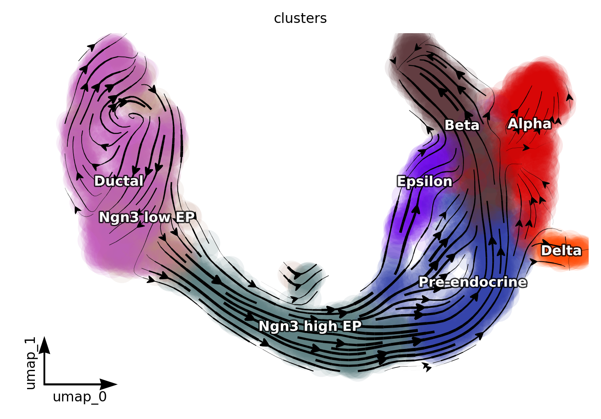{width=68%}

*图 1（cell 14）。投影速度场的流线，按群着色。Ductal（左）是慢涡，流经 Ngn3 low/high EP 出中间，
终止于产激素的群。*

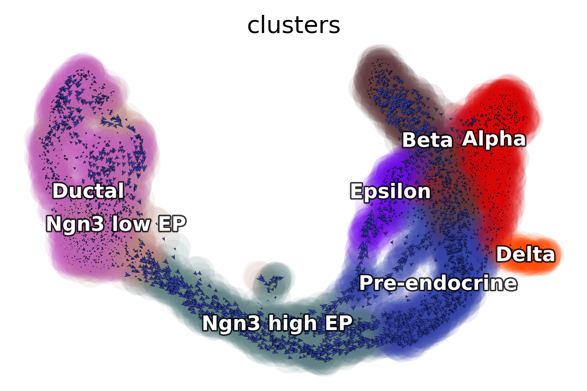{width=68%}

*图 2（cell 15）。同一场用逐细胞箭头（`quiver_length/size = 4`）表示。图 1 与图 2 的差别就是本讲的论点：
箭头是噪声，流线是噪声之上活下来的场。*

cell 16 算了祖细胞集合却再没用过：

```python
progenitor = adata.obs_names[adata.obs.clusters.isin(["Ductal"])]
len(progenitor)          # -> 916
```

`progenitor` 只是一串 916 个名字，后面没有任何 cell 引用它（DYN-11）。在 §3.8 我把它用起来了——
它定义了散度/加速度检验里的「Ductal vs 其余」分组。

### 3.7 第五部分 —— 矢量场（cell 17）

```python
dyn.vf.VectorField(adata, basis="pca", pot_curl_div=True)
dyn.vf.VectorField(adata, basis="umap", pot_curl_div=True)
dyn.vf.speed(adata, basis="pca")
dyn.vf.divergence(adata, basis="pca")
dyn.vf.acceleration(adata, basis="pca")
dyn.vf.curl(adata, basis="umap")
```

**`VectorField` 在做什么**：它不是"把箭头平均一下"。它用一个**连续函数** `f(x)` 去拟合散乱的速度样本，
算法是 SparseVFC（Vector Field Consensus 的稀疏版本）：在嵌入里布下控制点（每维 100 个、上限 3000），
把每个样本当作 `f` 的含噪观测，用 EM 交替估计"这个箭头是不是内点"和"在稀疏先验下重拟合场"。
`pot_curl_div=True` 再在**同一个拟合好的场**上算三个导数，正是第五部分要读的量：

| 量 | 定义 | 生物学含义 |
|---|---|---|
| speed | ‖f(x)‖ | 处在 x 的细胞被预测移动多快 |
| divergence | ∇·f | **汇**（<0，细胞聚集 → 稳态）、**源**（>0，细胞离开 → 分叉/出口） |
| acceleration | ‖(f·∇)f‖ | 沿流方向的变化率 → 轨迹在哪儿**拐弯** |
| curl | ∇×f（二维） | 旋转成分 → 周期、涡旋、或吸引盆边缘 |
| `pca_ddhodge_potential` | 在矢量场图上跑 ddhodge | **类伪时间潜势**：低=早、高=晚 |

耗时：SparseVFC 2.1 s（pca）+ 5.1 s（umap）；ddhodge 21.1 s + 21.3 s；两次 `VectorField` 24.1 s + 27.4 s。
本部分其余都是一次绘图。

**结果**（全域分布，`results/03_vectorfield/vf_stats.tsv`）：

| 量 | min | q25 | median | mean | q75 | max |
|---|---|---|---|---|---|---|
| speed (pca) | 0.011 | 0.105 | 0.176 | 0.192 | 0.269 | 0.610 |
| divergence (pca) | −0.142 | −0.054 | −0.031 | **−0.023** | 0.009 | 0.096 |
| divergence (umap) | −1.343 | −0.168 | −0.055 | −0.034 | 0.094 | 1.037 |
| acceleration (pca) | 0.000 | 0.003 | 0.006 | 0.008 | 0.012 | 0.031 |
| curl (umap) | −0.764 | −0.116 | 0.002 | 0.010 | 0.117 | 1.235 |
| ddhodge potential | 0.000 | 0.265 | 1.493 | 1.287 | 2.087 | 2.719 |

平均散度是**负**的（−0.023）：这份数据上的场几乎处处收缩。对一个只包含少量已定向谱系的发育快照而言这是预期的，
也正因如此，「散度为负 ⇒ 稳态」用在**单个群**上是很弱的论断（§3.8）。

### 3.8 第五部分 —— 没人打印过的逐群数字

教材把这些画成颜色。这里是数字，先按细胞算再按群平均（`results/03_vectorfield/vf_per_cell.tsv`、
`vf_cluster_sign_summary.tsv`），按 ddhodge 潜势排序：

| 群 | n | speed | divergence | acceleration | curl | potential | div>0 比例 |
|---|---|---|---|---|---|---|---|
| Ductal | 916 | 0.151 | −0.0140 | 0.0061 | −0.066 | 0.213 | 40.6 % |
| Ngn3 low EP | 262 | 0.168 | −0.0170 | 0.0077 | −0.038 | 0.264 | 34.0 % |
| **Ngn3 high EP** | 642 | **0.308** | **+0.0229** | **0.0158** | +0.100 | 0.983 | **84.9 %** |
| Pre-endocrine | 592 | 0.226 | −0.0256 | 0.0084 | +0.092 | 1.812 | 12.3 % |
| Epsilon | 142 | 0.220 | −0.0131 | 0.0076 | −0.072 | 1.985 | 17.6 % |
| Delta | 70 | 0.097 | −0.0272 | 0.0018 | +0.102 | 2.116 | 0.0 % |
| **Alpha** | 481 | **0.082** | −0.0502 | 0.0011 | −0.018 | 2.125 | **0.0 %** |
| **Beta** | 591 | 0.199 | **−0.0682** | 0.0070 | 0.001 | **2.261** | **0.0 %** |

统计支持（`vf_cluster_tests.tsv`，8 群 Kruskal–Wallis；Ductal vs 其余 Mann–Whitney）：

| 量 | KW H | KW p | Ductal 均值 | 其余均值 | MWU p |
|---|---|---|---|---|---|
| speed | 1847 | ~0 | 0.151 | 0.205 | 3.4e-39 |
| divergence (pca) | 1613 | ~0 | −0.0140 | −0.0263 | 6.5e-06 |
| acceleration | 1927 | ~0 | 0.0061 | 0.0083 | 1.3e-08 |
| curl (umap) | 456 | 1.9e-94 | −0.066 | +0.035 | 6.0e-35 |
| ddhodge potential | 3427 | ~0 | 0.213 | 1.641 | ~0 |

每个量都把八群分开了（p < 1e-90）；潜势的次序（Ductal → Ngn3 low → Ngn3 high → Pre-endocrine → 终末群）
就是发育顺序，而且是**完全不用时间信息**恢复出来的 —— 这是本讲最强的一个结果。

现在逐条核对教材的四句定性判断：

1. **「Ductal 是场的鞍点/根」** —— 数字上基本**不成立**。Ductal 散度 −0.0140，比全域均值（−0.0233）更接近 0，
   也比其余细胞（−0.0263）**更不负**（MWU p = 6.5e-06，方向与"鞍点"相反）。Ductal 真正的特征是**最慢**
   （speed 0.151 vs 0.205，p = 3.4e-39）与**潜势最低**（0.213）—— 这才是"根"的准确含义。
   "鞍点"的说法来自图 1 的形状，不来自 ∇·f。
2. **「Ngn3 high EP 是分叉点：高加速度 + 正散度」** —— **完全成立**，而且是这份数据里最干净的信号：
   加速度最高（0.0158，是 Ductal 的 2.6 倍）、是**唯一**平均散度为正的群（+0.0229）、
   85 % 的细胞 div > 0，而 Alpha/Beta/Delta 是 0 %。
3. **「早期内分泌祖细胞以高正加速度离开祖状态」** —— 方向对，但幅度温和：Ngn3 low EP 加速度 0.0077 vs Ductal 0.0061（+26 %），
   而 Ngn3 high EP 是 +159 %。所以"出口"是**high EP** 阶段的属性，不是 low EP。
4. **「终末类型是稳态：散度为负」** —— **完全成立，且是散度上最强的信号**。Beta 最收缩（−0.0682，正散度细胞 **0 %**），
   紧随其后 Alpha（−0.0502）、Delta（−0.0272）。Epsilon 居中（−0.0131），与它作为细胞数最少的小分支（142 个）相符。

结论：**故事成立，最弱的一环是"Ductal 鞍点"**；把故事写成定量版本（潜势次序 + Ngn3-high 正散度 + 终末群收缩）
比看颜色图有说服力得多。

### 3.9 第五部分 —— 四联图、地形图、状态图（cell 18–20）

```python
dyn.configuration.set_figure_params("dynamo", background="black")
fig1, fig1_axes = plt.subplots(ncols=2, nrows=2, constrained_layout=True, figsize=(10, 6))
dyn.pl.cell_wise_vectors(adata, color="pca_ddhodge_potential", ... ax=fig1_axes[0, 0])
dyn.pl.grid_vectors(adata, color="speed_pca", ... ax=fig1_axes[0, 1])
dyn.pl.streamline_plot(adata, color="divergence_pca", ... ax=fig1_axes[1, 0])
dyn.pl.streamline_plot(adata, color="acceleration_pca", ... ax=fig1_axes[1, 1])
fig1.savefig('./figure/03_combined_plots.png')       # 没有 dpi、没有 bbox_inches
```

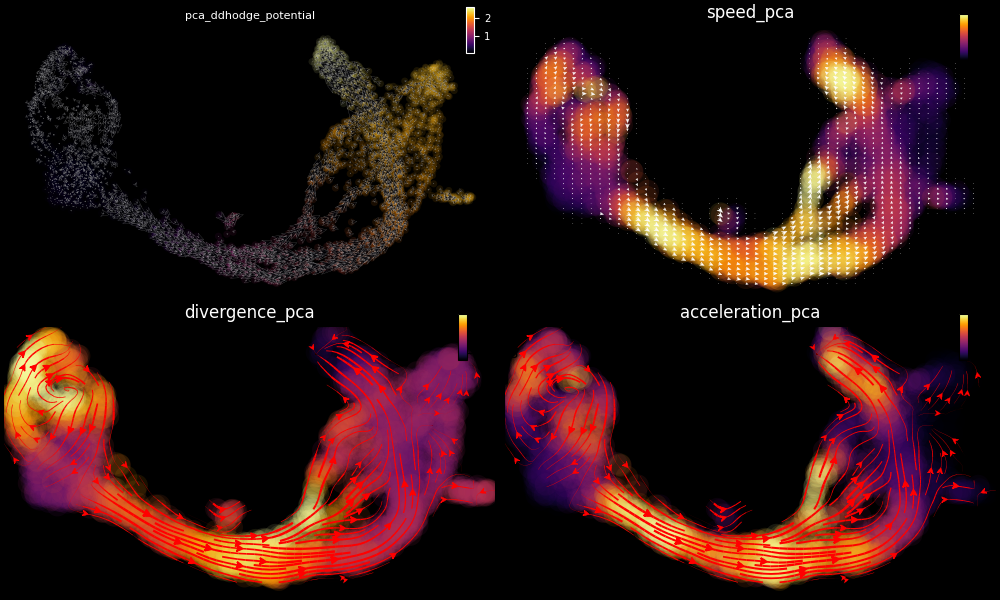{width=96%}

*图 3（cell 18）。左上起顺时针：ddhodge 潜势（蓝低红高）、speed、divergence、acceleration。
这是全讲信息量最大的一张图，也是唯一一张不靠 `save_kwargs`、由手工拼出来的图。*

注意 `fig1.savefig('./figure/03_combined_plots.png')` **没给 dpi**：默认 100 时落到 1000×600，
而教师 2026 重跑脚本同一张面板存成了 3099×1834（dpi 300）。同一张图、3 倍像素——
这就是 §7 要把长宽比与结构相关分开看的原因。

```python
dyn.pl.topography(adata, basis="umap", background="white", color=["clusters"],
                  streamline_color="black", show_legend="on data", ...)
```

`topography` 把潜势画成**地形**：`pca_ddhodge_potential` 的填充等高线，上面刻着流线。
视觉上就是 Waddington 隐喻的能量景观，也是学生唯一会记住的那张图。

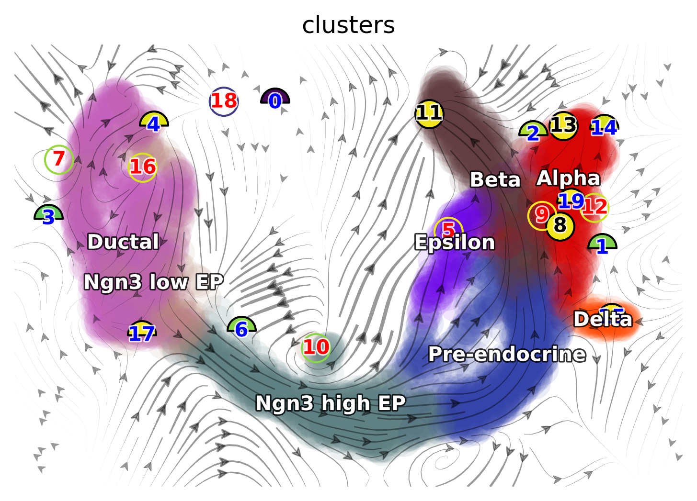{width=68%}

*图 4（cell 19）。景观：暗色盆地 = 稳态，盆地之间的山脊 = 教材归给 Ngn3 high EP 的分叉。
与 §3.8 的数字对照，盆地正是 Alpha/Beta/Delta，而 Ngn3 high EP 确实坐在脊上。*

```python
dyn.pd.state_graph(adata, group='clusters', basis='pca', method='vf')      # 计算
dyn.pl.state_graph(adata, color=['clusters'], group='clusters', basis='umap',
                   show_legend='on data', method='vf', ...)                # 画图
```

**它在做什么**：`pd.state_graph` 对场做模拟：每个群布下 100 个积分控制点，沿拟合好的矢量场前推固定步数，
记录**它们落在哪**。得到的 8×8 表就是群间的有向转移图 —— 矢量场能给出的、最接近谱系追踪的东西。
它也是第二贵的一步（原样跑 123 s；数值导出跑因为要再走一遍图，167 s）。

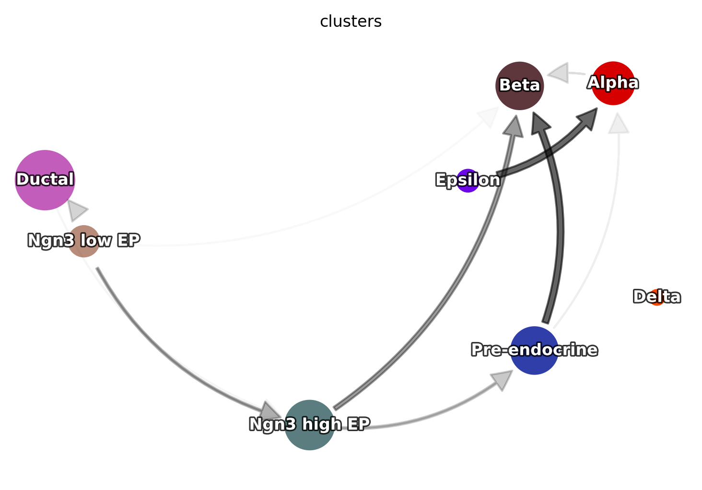{width=68%}

*图 5（cell 20）。把状态转移画在 UMAP 上：箭头表示模拟控制点的去向。*

背后的数字（C9 才导出，因为 `adata.uns['clusters_graph']` 是**三个数组组成的 dict**
—— `group_graph` 8×8、`group_avg_time` 8×8、`group_names` —— `pd.DataFrame` 吃不进去，见 DYN-13）：

`group_graph`（行 = 起点，列 = 终点）：

| 起点 \ 终点 | Ductal | Ngn3 low | Ngn3 high | Pre-endo | Beta | Alpha | Delta | Epsilon | 行和 |
|---|---|---|---|---|---|---|---|---|---|
| Ductal | 1.00 | 0.00 | 0.08 | 0.00 | 0.00 | 0.68 | 0.00 | 0.00 | **1.76** |
| Ngn3 low EP | 0.00 | 0.89 | 0.00 | 0.01 | 0.00 | 0.00 | 0.04 | 0.00 | 0.94 |
| Ngn3 high EP | 0.00 | 0.00 | 1.00 | 0.00 | 0.00 | 0.06 | 0.00 | 0.00 | 1.06 |
| Pre-endocrine | 0.19 | 0.00 | 0.00 | 1.00 | 0.00 | 0.22 | 0.00 | 0.00 | 1.41 |
| Beta | 0.00 | 0.00 | 0.00 | 0.00 | 1.00 | 0.00 | 0.00 | 0.00 | 1.00 |
| Alpha | 0.00 | 0.00 | 0.00 | 0.00 | 0.00 | 1.00 | 0.00 | 0.00 | 1.00 |
| Delta | 0.01 | 0.08 | 0.00 | 0.27 | 0.00 | 0.02 | 0.84 | 0.00 | 1.22 |
| Epsilon | 0.01 | 0.00 | 0.54 | 0.00 | 0.00 | 0.02 | 0.00 | 1.00 | 1.57 |

请按**通量**读，不要当成马尔可夫链：行**不**归一（Ductal 行和 1.76），因为 `state_graph` 数的是
"落在本群的控制点"加"漂到别群的控制点"，对角项是驻留项。真正有生物学意义的是非对角项：
**Ductal → Alpha 0.68**、**Ductal → Ngn3 high EP 0.08**、**Epsilon → Ngn3 high EP 0.54**
（这条是场局部方向造成的假象，不是发育论断）、**Pre-endocrine → Alpha 0.22** 与 **→ Ductal 0.19**。
Beta 与 Alpha 是完全吸收态（自 1.00、零流出），Delta 接近吸收（0.84）。这三个吸收态恰好就是散度正比例 0 % 的那三个群——
两个独立计算互相印证，这对双方都是好消息。

`group_avg_time`（伪时间单位，不是天数）：

| 起点 \ 终点 | Ductal | Ngn3 low | Ngn3 high | Pre-endo | Beta | Alpha | Delta | Epsilon |
|---|---|---|---|---|---|---|---|---|
| Ductal | 64.8 | — | 64.7 | — | — | **24.6** | — | — |
| Ngn3 low EP | — | 21.5 | — | 13.8 | — | — | 31.1 | — |
| Ngn3 high EP | — | — | 60.3 | — | — | 82.6 | — | — |
| Pre-endocrine | 45.0 | — | — | 20.0 | — | 83.2 | — | — |
| Delta | 90.9 | 27.2 | — | 16.0 | — | 24.9 | 23.8 | — |
| Epsilon | 20.9 | — | 80.1 | — | — | 27.3 | — | 49.1 |

两点要带走：(i) 最短的转移是 Ductal→Alpha（24.6）与 Delta→Pre-endocrine（16.0），也就是场最"定向"的地方；
(ii) 时间单位是积分场的量（单位速度上的 ddhodge 潜势差），只能在**本表内部**比较，
绝不能当成小时或胚胎天数去引用（DYN-13）。

### 3.10 第六部分 —— Jacobian（cell 21–24）

```python
dyn.vf.jacobian(adata, regulators=pancreas_genes)     # cell 21
```

**原理**：在每个细胞处把拟合好的场线性化，算 **Jacobian 矩阵** `J(x) = ∂f/∂x` ——
基因 *i* 的预测速度如何随基因 *j* 的水平变化。这是动力系统对"谁调控谁"的回答，而符号就是答案：

* `J_ij > 0` → 抬高 *j* 会加快 *i* 的速度 → **j 激活 i**；
* `J_ij < 0` → **j 抑制 i**；
* `J_ij ≈ 0` → 局部无耦合。

两个实现事实都很要命，都是坑：

1. 场活在 **PCA 空间**（30 维），所以原始对象是 `30 × 30 × 3696`，不是 17 × 17 × 3696。要按基因对读，
   必须用 dynamo 反向变换出来的 `jacobian_gene`，它由 `Qi · J · Qjᵀ` 算出（`Qi` = effector 载荷，`Qj` = regulator 载荷）。
   谁把 `adata.uns['jacobian_pca']['jacobian']` 当基因矩阵来切，就会拿到 30×30 并撞上 reshape 报错
   （我的第一版导出脚本就撞了：110880 = 30·30·123.2，见 DYN-12）。
2. 基因级张量的轴序是 **(effector, regulator, cell)**，**不是** (regulator, effector, cell)。
   搞反了会静默报告**反方向**的调控 —— 把"Pax4 抑制 Arx"读成"Arx 抑制 Pax4"，而这恰恰是这张图要确立的东西。

原样跑的四个面板：

```python
dyn.pl.jacobian(adata, basis="umap", regulators=["Neurog3"], effectors=["Pax4"],
                alpha=1, save_show_or_return='save', ...)          # cell 22 -> 06_*.png
dyn.pl.jacobian(adata, basis="umap", regulators=["Arx"],  effectors=["Pax4"], alpha=1)   # cell 23
dyn.pl.jacobian(adata, basis="umap", regulators=["Pax4"], effectors=["Arx"],  alpha=1)   # cell 23
dyn.pl.jacobian(adata, basis="umap", regulators=["Pax4"], effectors=["Ins2"], alpha=1)   # cell 24
```

cell 23/24 没写 `save_show_or_return`，所以那三个面板**只存在于 notebook 输出里**，从未落盘（DYN-06）。
harness 把它们截了下来（就是下面这些图），矫正跑则按规矩存盘。

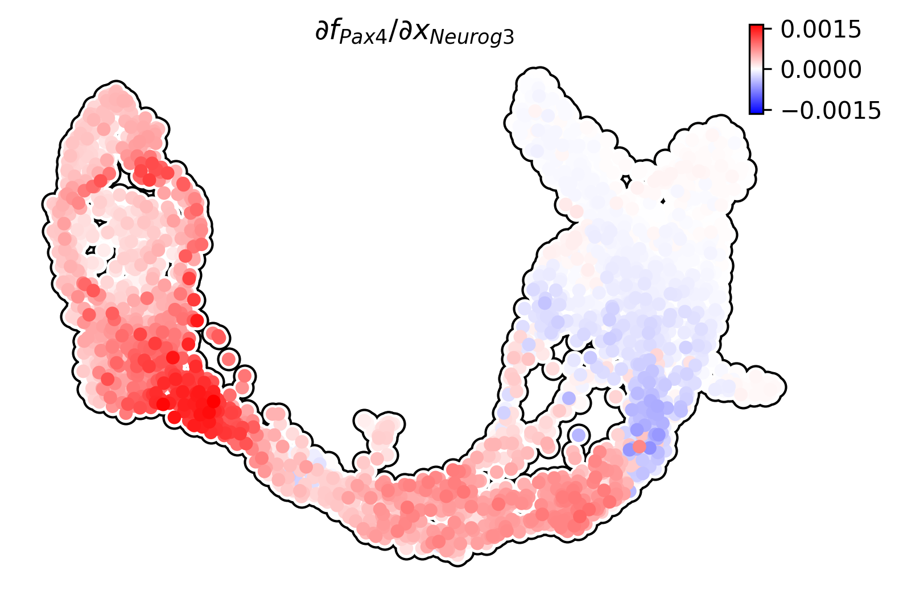{width=62%}

*图 6（cell 22）。逐细胞的 ∂(Pax4)/∂(Neurog3)。红 = 激活。最强的红色落在 Ngn3-high/pre-endocrine 区域——
教材的「Ngn3 在祖细胞中激活 Pax4，启动内分泌定向」。*

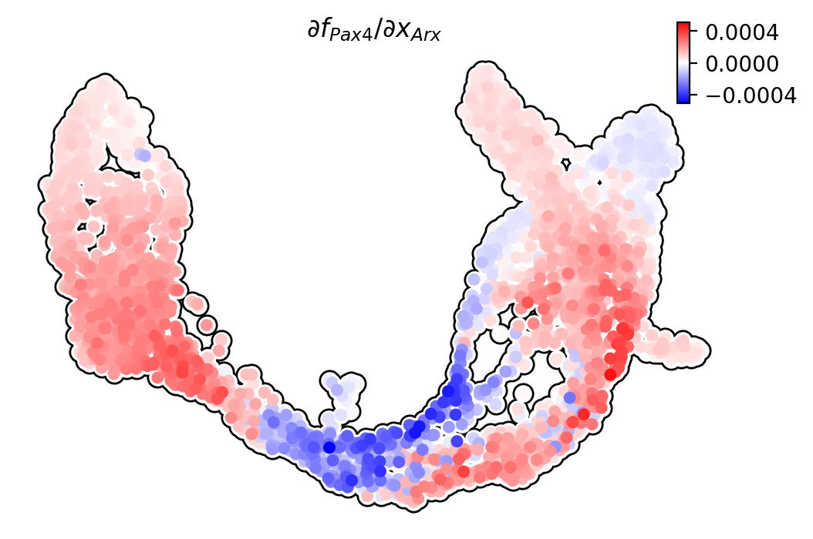{width=62%}

*图 7（cell 23，教材仅内嵌）。∂(Pax4)/∂(Arx)。*

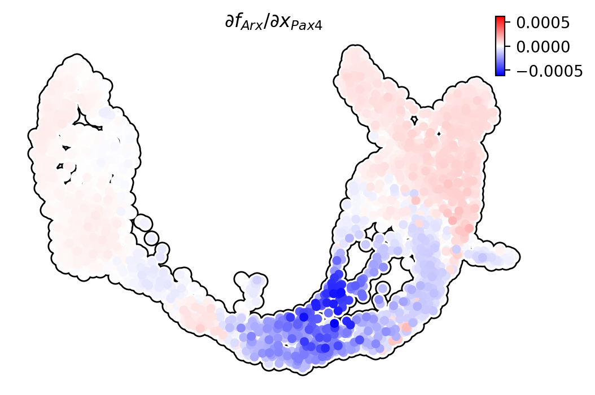{width=62%}

*图 8（cell 23，教材仅内嵌）。∂(Arx)/∂(Pax4) —— 图 7 的镜像。*

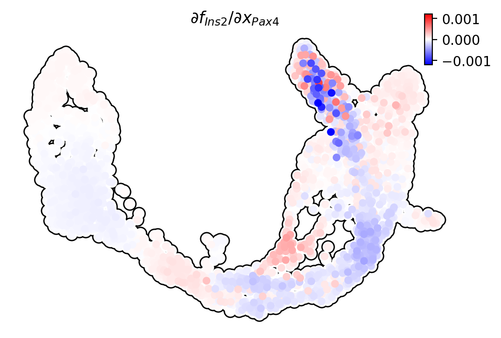{width=62%}

*图 9（cell 24，教材仅内嵌）。∂(Ins2)/∂(Pax4)，β 细胞那条边。*

四个面板背后的数字（基因级张量，`results/04_jacobian/jacobian_pairs.tsv`）：

| 边（regulator → effector） | min | q25 | median | mean | q75 | max | 正值比例 |
|---|---|---|---|---|---|---|---|
| **Neurog3 → Pax4** | −7.1e-4 | −2e-5 | 1.5e-4 | **+2.4e-4** | 4.4e-4 | 1.7e-3 | 68 % |
| Arx → Pax4 | −5.1e-4 | −0.0 | 7e-5 | +6e-5 | 1.5e-4 | 4.7e-4 | 75 % |
| Pax4 → Arx | −6.1e-4 | −3e-5 | 1e-5 | −2e-5 | 4e-5 | 1.7e-4 | 61 % |
| Pax4 → Ins2 *（教材画的那条）* | −1.2e-3 | −6e-5 | −1e-5 | −2e-5 | 3e-5 | 8.9e-4 | 44 % |
| **Pdx1 → Ins2** *（注释声称的那条）* | −2.1e-4 | −4e-5 | 6e-5 | **+3.4e-4** | 4.2e-4 | 4.3e-3 | 58 % |
| Neurog3 → Neurod1 | −2.6e-4 | −1e-5 | 0.0 | 0.0 | 2e-5 | 2.6e-4 | 57 % |
| Pax4 → Pax6 | −5.7e-4 | −1e-5 | 2e-5 | +3e-5 | 5e-5 | 7.1e-4 | 68 % |
| Pdx1 → Pax4 | −5.8e-4 | −1.9e-4 | −1.1e-4 | −1.3e-4 | −4e-5 | 3.7e-4 | 13 % |
| Nkx6-1 → Ins2 | −1.9e-3 | −3e-5 | 3e-5 | +1.3e-4 | 2.3e-4 | 3.0e-3 | 63 % |
| Gcg → Arx | −8.4e-4 | −2e-4 | −1.2e-4 | −7e-5 | 5e-5 | 9.3e-4 | 30 % |

*每行 n = 3696；单位是 Jacobian 自己的（单位表达上的速度 / 伪时间步），只能行间比较，不能当物理速率。*

两条互抑边按群展开（`jacobian_pairs_by_cluster.tsv`）：

| 群 | Neurog3→Pax4 | Arx→Pax4 | Pax4→Arx | Pax4→Ins2 | Pdx1→Ins2 |
|---|---|---|---|---|---|
| Ductal | +3.9e-4（99 %） | +1.3e-4（99.8 %） | +1e-5（86 %） | −2e-5（33 %） | −5e-5（0.1 %） |
| Ngn3 low EP | **+8.2e-4（100 %）** | +1.7e-4（97 %） | +1e-5（68 %） | −3e-5（26 %） | −5e-5（0.4 %） |
| Ngn3 high EP | +4.3e-4（93 %） | **−4e-5（40 %）** | **−1.2e-4（17 %）** | −1e-5（49 %） | +2e-5（58 %） |
| Pre-endocrine | +1.0e-4（52 %） | +6e-5（70 %） | −9e-5（18 %） | −7e-5（25 %） | +2.5e-4（84 %） |
| Beta | −4e-5（21 %） | +8e-5（98 %） | +4e-5（87 %） | −4e-5（46 %） | **+1.5e-3（99.3 %）** |
| Alpha | −2e-5（43 %） | +4e-5（48 %） | +7e-5（99 %） | +3e-5（77 %） | +4.9e-4（99 %） |
| Delta | 0.0（67 %） | +5e-5（93 %） | −3e-5（14 %） | +2e-5（73 %） | +5.0e-4（100 %） |
| Epsilon | −2e-5（46 %） | −2e-5（32 %） | −0.0（52 %） | +2e-5（73 %） | +1.4e-4（92 %） |

*细胞均值，括号内为该群正值细胞比例；加粗 = 两个交叉项同时为负。*

把两张表放在一起，教材的几条论断得分差异很大：

* **Neurog3 → Pax4 完全落在教材说的位置**：Ngn3 low EP 里 **100 %** 细胞为正、Ngn3 high EP 里 93 %，
  到 Pre-endocrine 掉到 52 %，到 Beta 变成**负**（−4e-5，仅 21 % 为正）。从祖细胞到终末群的符号翻转，
  就是「Ngn3 启动内分泌定向」的定量版本；除 Pdx1→Ins2 外，它是表里最干净的**激活**边。
* **Pax4 ⤙ Arx 是「局部」开关，不是全局开关**：两个交叉项**同时为负**只发生在 Ngn3-high 区域
  （Arx→Pax4 −4e-5、40 % 为正；Pax4→Arx −1.2e-4、17 % 为正）——这恰恰就是「分叉点上的互相抑制」，
  也正是教材 cell 23 注释字面声称的东西。但再往前一步（Pre-endocrine），Arx→Pax4 已经翻回正值；
  而 Alpha 与 Beta 里**两个交叉项都是正的**（+4e-5 / +7e-5）：那是互相**激活**。
  颜色面板给人「全局开关」的印象，数字说的是开关只存在于分叉点周围一条窄带。
* **画出来的那条边是表里最弱的，注释里那条才是最强的**。教材画的是 **Pax4 → Ins2**（图 9），
  注释写的却是「**Pdx1** 激活 Ins2」（DYN-07）。实测：Pax4→Ins2 全域 −2e-5（44 % 为正），
  **在 Beta 群里本身就是 −4e-5**（46 % 为正）——也就是说除了噪声，这张面板基本是蓝的。
  而注释点名的 **Pdx1→Ins2**，在 Beta 里是 **+1.5e-3，99.3 % 的细胞为正**——
  比表里任何其它边大 6 倍，也是唯一在单个群里毫无歧义为正的边。
  结论：作者是按正确的基因写的注释，却画了另一个基因。若 cell 24 用的是 `regulators=["Pdx1"]`，
  图 9 会是全数据集里最干净的一条调控边，而不是信息量最低的一条。

### 3.11 第七部分 —— 加速度排序（cell 25–28）

```python
adata.obs["clusters"].unique()                                    # cell 25
# cell 26 只有注释、没有代码  (DYN-11)
dyn.vf.acceleration(adata, basis='pca')                           # cell 27（又算了一遍！）
dyn.vf.rank_acceleration_genes(adata, groups='clusters')          # cell 27
adata.uns['rank_acceleration'][:5]                                # cell 28
```

`rank_acceleration_genes` 按「基因表达与该细胞沿场加速度的相关性」排序 —— 也就是"哪些基因**跟着**轨迹拐弯"。
教材打印的 `[:5]` 是逐群宽表的前 **5 行**，所以屏幕上同时出现了所有群的前 5 名，而不是全局前 5。

结果（`results/04_jacobian/rank_acceleration_top200.tsv`；`top20_per_cluster.tsv` 是摘要）：

| 群 | 加速度排序前 10 |
|---|---|
| Ductal | Hmgb2, Hist1h2bc, Ccnb2, Cdc20, Dynll1, Birc5, Cks2, Ccnb1, Cenpf, Hn1 |
| Ngn3 high EP | Chga, Chgb, Tm4sf4, Akr1c19, Cryba2, Cpe, Hmgn3, Pcsk1n, Cystm1, Glud1 |
| Beta | Ins1, Ins2, Xist, Krt8, Gpx3, Krt7, Nnat, Krt18, Tm4sf4, Chga |
| Alpha | Ghrl, Cck, … |

这张表是最后一部分的输入，读起来完全合乎生物学：**Ductal = 细胞周期**（前 10 里 9 个是纺锤体/染色体分离基因）、
**Ngn3 high EP = 分泌颗粒与激素前体加工**（Chga/Chgb、Pcsk1n、Cpe 是 granin 与前激素转化酶机器）、
**Beta = 胰岛素**（Ins1、Ins2 遥遥领先）。

注意 Beta 前三里的 `Xist`：这是**混合性别**数据，Xist 的"加速度"反映的是群内雌/雄细胞的差异，
不是 β 细胞生物学。这提醒：top 基因表只和你想起来检查的混杂因素一样干净。

### 3.12 第八部分 —— 富集（cell 29–32）

```python
enr = dyn.ext.enrichr(adata.uns['rank_acceleration']['Ductal'][:100].to_list(),
                      organism='mouse', gene_sets='GO_Biological_Process_2021',
                      outdir='./figure')                               # cell 31
from gseapy.plot import barplot, dotplot
barplot(enr.res2d, column='Adjusted P-value', title='GO_Biological_Process_2018', cutoff=0.05)
dotplot(enr.res2d, title='KEGG_2016', cmap='viridis_r', cutoff=0.05)   # cell 32
```

**原理**：把 Ductal 加速度前 100 个基因送到 Enrichr 的 `GO_Biological_Process_2021` 库，
每个 term 返回重叠数、超几何 p、Bonferroni 校正 p 和 gseapy 的 combined score。
`outdir='./figure'` 会让 gseapy 把自己的报告文件（`*.enrichr.reports.txt/.pdf`）**扔进图目录**（DYN-09）。

**结果**：返回 925 个 GO term，**107 个通过 FDR < 0.05**。按校正 p 的前 10：

| term | 重叠 | 校正 p |
|---|---|---|
| mitotic spindle organization (GO:0007052) | 21/157 | 1.7e-21 |
| microtubule cytoskeleton organization involved in mitosis (GO:1902850) | 18/128 | 8.6e-19 |
| mitotic sister chromatid segregation (GO:0000070) | 13/102 | 1.1e-12 |
| regulation of mitotic cell cycle phase transition (GO:1901990) | 13/188 | 2.4e-09 |
| regulation of G2/M transition of mitotic cell cycle (GO:0010389) | 10/149 | 7.0e-07 |
| RNA splicing, via transesterification with bulged adenosine (GO:0000377) | 12/251 | 7.2e-07 |
| regulation of cell cycle G2/M phase transition (GO:1902749) | 8/85 | 1.4e-06 |
| mRNA splicing, via spliceosome (GO:0000398) | 12/274 | 1.4e-06 |
| mRNA processing (GO:0006397) | 12/300 | 3.5e-06 |
| DNA topological change (GO:0006265) | 4/9 | 6.7e-06 |

前五个是细胞周期，后四个是剪接 —— 而且剪接这一块才是有意思的：`Srsf2`、`Srsf3`、`Srsf5`、`Hnrnpa1`、
`Magoh`、`Snrpa1` 全都在，说明 Ductal 祖状态不只是增殖，还是**剪接活跃**的。
这是教材一句"cell cycle related pathways"没提到的、可核对的观察。

教材展示的两张图是同一张表的两种画法：

{width=96%}

*图 10（cell 32）。gseapy 条形图，按校正 p 取前 10。**标题写的是 `GO_Biological_Process_2018`，
而实际查询的基因集是 2021**（DYN-08）。*

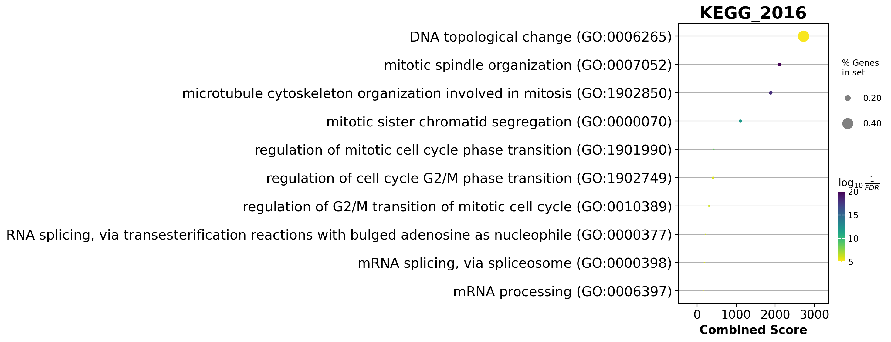{width=96%}

*图 11（cell 32）。同一张表的气泡图：x = combined score，颜色 = −log10(FDR)，大小 = 命中基因比例。
**标题写的是 `KEGG_2016`，而根本没查过 KEGG**（DYN-08）。*

两个标题都是**绘图调用里硬编码的字符串**，没有从 `enr.res2d['Gene_set']` 读取。引用这两张图的人会把库名写错。
矫正跑（C2）用表里的库名重新出图：

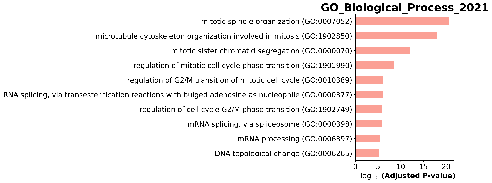{width=96%}

*图 12（矫正 C2）。条形完全相同，标题正确：`GO_Biological_Process_2021`。条、顺序、长度与图 10 像素级一致——
唯一缺陷就是那个标签。*

### 3.13 第八部分 —— Session Info（cell 33）

最后一格遍历 `sys.modules`，保留所有从 `site-packages` 载入的模块并用 `pkg_resources` 打印版本。
2026 年这套已被 `setuptools` 标记弃用但仍可用；dynamo 1.3.2 + scanpy 1.10.3 + gseapy 1.1.3 与 §2 完全一致。
保留这一格：它是证明"这张图出自哪个环境"最便宜的手段，本模块的环境正是靠它的输出钉住的。

---

## 4. 问题登记

共 18 条，每条给出症状、取证方式、修在哪儿。"silent" 指：没有警告、没有日志、没有异常。

| 编号 | 严重度 | 位置 | 症状 | 证据 | 处置 |
|---|---|---|---|---|---|
| **DYN-01** | 阻断 | cell 1、3 | 教师家目录硬编码：`!ls /home/zongxu/...`、`os.chdir('/home/zongxu/Misc/lesson/scRNA-application/')`，换人换机立刻失败 | 抽出的 cell 原文 | C5 |
| **DYN-02** | 阻断 | cell 2 | `! source dynamo/bin/activate` 假设 notebook 旁有 `dynamo/` 虚拟环境；`!` 不影响 kernel，真正生效的是启动 kernel 的环境 | shell 语义；我们在起 python 前激活 | §2 说明 |
| **DYN-03** | 高，silent | cell 12 | `reduceDimension` 的 UMAP 步是 **no-op**（文件自带 `X_umap`），结果是混血管线：dynamo 新算的 30 维 PCA + 上游 UMAP + 文件里本来没有、由 dynamo 现建的 kNN 图；所有图都画在上游嵌入上 | `[UMAP] completed [0.0012s]`；`incomplete neighbor graph info detected … indices not in adata.uns.neighbors`；强制重算使图位移 1.9 倍 spread（Spearman 0.939） | C4（量化而不改） |
| **DYN-04** | 高，silent | cell 10 | 三个互不认账的"重要基因"标记共存；`use_for_pca`（4000）与自带的 **categorical** `highly_variable_genes`（4004 True + 10656 NaN）只重叠 **1339 个**（Jaccard 0.201），且自带列连求和都会报错 | `01_preprocess/adata_summary.tsv`、`var_flags.tsv` | 记录，保持原样 |
| **DYN-05** | 中，silent | cell 11 | `model="stochastic"` 把 **β 固定为 1.0**；`half_life` 于是只是 `ln2/γ`；γ 重尾（均值是中位数 2.5 倍，max 64.6） | `02_velocity/gamma_summary.tsv`（β min = max = 1.0） | 记录 |
| **DYN-06** | 中，silent | cell 23、24 | 四个 Jacobian 面板里有三个没写 `save_show_or_return='save'` → **从未存盘**；磁盘上的图只有 notebook 显示数的 6/9 | `./figure` 下只有 `06_*.png` | C1 |
| **DYN-07** | **高，内容** | cell 24 | 注释写「**Pdx1** 激活 Ins2」，代码画的是 `regulators=["Pax4"]`；而数据站在**注释**这边：Pdx1→Ins2 在 Beta 为 +1.5e-3（99.3 % 为正），Pax4→Ins2 在 Beta 为 **−4e-5**（46 %） | `04_jacobian/jacobian_pairs*.tsv` | C8（两条都算，§3.10） |
| **DYN-08** | 中 | cell 32 | 图标题硬编码且错：`GO_Biological_Process_2018`、`KEGG_2016`，而实际查询库是 `GO_Biological_Process_2021` | `enr.res2d['Gene_set']` 925 行全是 2021 | C2 |
| **DYN-09** | 低，卫生 | cell 31 | `outdir='./figure'` 把 gseapy 报告 `.txt`/`.pdf` 倒进图目录，留下无版本管理的副本 | `05_enrichment/*.enrichr.reports.*`（两份：`aswritten_*` 与原名） | C3 |
| **DYN-10** | 低，silent | cell 17 | `dyn.vf.curl` 算了（还花了 SparseVFC 时间）却**从未画过**，教材正文也没提 curl | 代码 vs 图件 | C6 |
| **DYN-11** | 低，死代码 | cell 16、26 | `progenitor`（916 个名字）算了从未使用；cell 26 只有注释；`rank_acceleration[:5]` 打印的是逐群宽表的前 5 行 | 34 个 cell 全文检索 | C7/C10 |
| **DYN-12** | 高，数值 | cell 21 及任何下游 | 存下来的 Jacobian 是 **PCA 空间 30×30×3696**；基因级张量 `jacobian_gene` 的轴序是 `(effector, regulator, cell)` —— 按 `(regulator, effector, cell)` 读会得到**反方向**的调控 | dynamo 1.3.2 `vectorfield/utils.py:497`（`Qi @ J @ Qj.T`，Qi = effector 载荷） | C8 |
| **DYN-13** | 中，解释 | cell 20 | `uns['clusters_graph']` 是 3 个数组的 dict（不是 DataFrame），且 `group_graph` **不是行随机**的（Ductal 行和 1.76）→ 把元素当转移概率会夸大迁移 | `clusters_graph_*.tsv` 行和 0.94–1.76 | C9 + §3.9 措辞 |
| **DYN-14** | 中，成本 | cell 20 | `pd.state_graph` 原样跑 123 s、导出跑 167 s，约占全流程 15 % 只换一张图；它内部还会再跑一遍场 | 控制台计时 | 记录 |
| **DYN-15** | 高，参考数据 | 2026 参考集 | 教师 2026 脚本存下的 GO 图（`10_`、`11_`）是**纯白空画布**（墨迹 0、颜色数 0、12/15 kB）→ 不能当视觉真值 | `07_figure_comparison/figure_comparison_aswritten.tsv`，ink_ref = 0.0 | §7 改用 2025 HTML 内嵌图做 GO 对拍 |
| **DYN-16** | 中，可复现性 | 全流程 | 图件可逐位复现（两跑隔 2.5 h，6/6 md5 相同），**但**一旦重算邻域/UMAP，同一批数字就变：divergence(Ductal) −0.0140 vs −0.0161，**curl(Ductal) −0.066 vs +0.102（符号翻转）** | 两次独立运行 | §8 |
| **DYN-17** | 低，文档 | §3.8 论断 | 「Ductal 是散度为负的鞍点」：只在"8 群里 7 个都为负"这个平凡意义上成立；Ductal 其实**显著更不负**（MWU p = 6.5e-06，方向相反） | `vf_cluster_tests.tsv` | §3.8 改写措辞 |
| **DYN-18** | 低，代码 | cell 20 | `dyn.pl.state_graph(..., method='vf')` 被传入但绘图函数静默忽略（method 属于 `pd.state_graph`） | 签名核对 | 记录 |

---

## 5. 矫正增强 —— 十项修正与各自产出

本文遵守的规矩：**原样跑保持有 bug**，修正在第二个脚本里做，这样两条线之间的任何差异都能归因。
所有修正都在 `results/scripts/dynamo_corrected.py` 里，代码中以 `C1`…`C10` 标注。
基线：打完补丁后，原样跑的六张图**逐字节不变** —— 也就是说这些修正改的是"新增了什么"，不是"大家已有的图"。

**C1 —— 把教材只显示不存的面板存下来。** cell 23/24 补 `save_show_or_return='save'`，前缀沿用教师 2026 重跑的命名
（`07_reg_Arx_Pax4`、`08_reg_Pax4_Arx`、`09_reg_Pax4_Ins2`）。产出 `07/08/09_*.png`，
与 2026 参考集像素可比（此前是 1054×700 的内嵌截屏 vs 1580×1048 的存盘图——同一张图，不同 dpi）。

**C2 —— 改对两个 GO 标题。** 两张重画，库名从 `enr.res2d['Gene_set']` 读而不是硬编码。产出上面图 12；条形像素不变，标签对了。

**C3 —— 不再污染图目录。** `dyn.ext.enrichr(..., outdir=...)` 改写到 `05_enrichment/`，`figure/` 里只剩图。

**C4 —— 把 no-op 量化，而不是偷偷"修好"。** C4 要回答的问题很具体：
*PCA 是新的、UMAP 不是——如果把 UMAP 也重算会怎样？* 三个数被导出（`06_corrected/umap_recompute_comparison.tsv`）：

| 量 | 值 |
|---|---|
| 自带 UMAP vs 重算 UMAP 的成对距离 Spearman | **0.9393** |
| 每细胞平均位移 | 9.74 |
| UMAP 展布（各轴标准差均值） | 5.11 |
| 位移 / 展布 | **1.905** |

也就是说：强制重算得到的嵌入保留了 94 % 的邻域序关系，但把每个细胞挪到距原位 **1.9 个展布单位**的地方——
而"原位"就是教材每一张图里的位置。所以重算**在副本上**做（`_tmp = adata.copy()`），保住 `X_umap`，
从而图 01–09 逐字节不变，而对比图单独出：

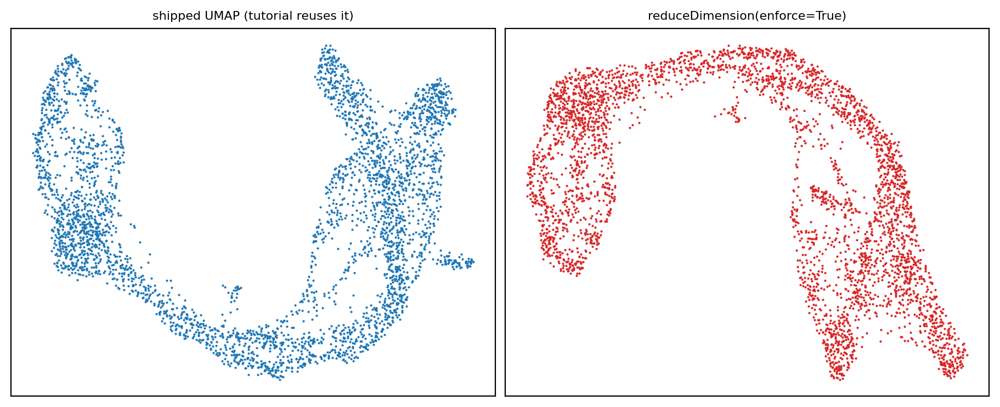{width=96%}

*图 13（矫正 C4）。左：教材每张图都在用的嵌入。右：`reduceDimension(enforce=True)` 会得到的东西。
整体形状相同，局部几何不同——这就是 §8 坚持"任何数字都以嵌入为条件"的原因。*

**C5 —— 路径参数化。** 去掉 `os.chdir()`，数据路径相对运行目录，教师的 `!ls` 换成列我们自己的副本。
同一个文件，md5 已对 `/lustre1/share/scRNA-advancedTopics/data/Pancreas/endocrinogenesis_day15.h5ad` 核过。

**C6 —— 把算了却从没画过的量画出来。** `dyn.pl.streamline_plot(adata, color="curl_umap", basis="umap", ...)`，黑底：

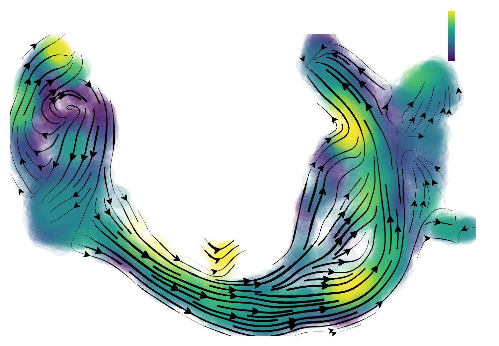{width=62%}

*图 14（矫正 C6）。旋度 ∇×f。蓝/红瓣在 Ngn3-high 脊两侧交替——分叉的旋转特征，也是四个量里教材唯一没展示的那个。
Ductal 的旋度在八群里最负（−0.066，36 % 的细胞为正），与"缓慢旋转的入流"相符。*

**C7 —— 把 `progenitor` 用它显然该用的地方。** 916 个 Ductal 名字定义了 §3.8 里 Mann–Whitney 的"Ductal vs 其余"分组
（`06_corrected/ductal_subset_stats.tsv`），死变量变成真检验的分组变量。

**C8 —— 导出 Jacobian，摆正方向，多算几对。** §3.10 的成对表覆盖教材四条边，加 **Pdx1→Ins2**（注释里的论断），
再加五个对照（Neurog3→Neurod1、Pax4→Pax6、Pdx1→Pax4、Nkx6-1→Ins2、Gcg→Arx）。
张量按 `Jg[effector_idx, regulator_idx]` 切片（依 DYN-12）。

**C9 —— 导出状态图矩阵。** `group_graph`、`group_avg_time` 及其行和落成 TSV ——正是这一步才让
"不是行随机"（DYN-13）这个注脚变得可见。

**C10 —— 导出加速度排序。** `top20_per_cluster.tsv` 与 `top200.tsv`，取代宽表的 `[:5]` 切片，让下游基因表可审计。

超出修错的**增强**（非 bug）：逐细胞矢量场表（`03_vectorfield/vf_per_cell.tsv`，3696 行 × 8 列）是让这一讲
从"可复现"变成"可分析"的关键产物 —— §3.8 的每个统计量离它只有一个 `groupby`。

---

## 6. 结果速览

| 内容 | 位置 | 要点 |
|---|---|---|
| 细胞/基因 | `01_preprocess/adata_summary.tsv` | 3696 × 27998；6956 通过过滤；4000 `use_for_pca`；17/17 胰腺基因保留 |
| HVG 一致性 | 同上 | dynamo 与自带标记只共享 1339 个，**Jaccard 0.201** |
| 动力学 | `02_velocity/gamma_summary.tsv` | γ 中位 0.382（均值 0.953，max 64.6）；**β ≡ 1.0**；半衰期中位 1.81 |
| 投影速度 | `02_velocity/cell_velocity_stats.tsv` | 模长中位 0.375 |
| 场统计 | `03_vectorfield/vf_stats.tsv` | 平均散度 **−0.023**（收缩），加速度中位 0.006，潜势 0→2.72 |
| 逐群 | `vf_cluster_sign_summary.tsv` | 潜势次序 Ductal(0.21) → Ngn3 low(0.26) → Ngn3 high(0.98) → Pre-endo(1.81) → Epsilon(1.99) → Delta(2.12) → Alpha(2.13) → Beta(2.26) |
| 群间可分性 | `vf_cluster_tests.tsv` | 五个量的 KW p 全部 < 1e-90 |
| 分叉 | 同上 | Ngn3 high EP：唯一 **div > 0** 的群（+0.0229），85 % 细胞为正，加速度 0.0158（最高） |
| 终末态 | 同上 | Beta div −0.0682（正比例 0 %）、Alpha −0.0502（0 %）、Delta −0.0272（0 %） |
| 状态图 | `clusters_graph_*.tsv` | Ductal→Alpha 通量 0.68；Beta/Alpha 完全吸收（自 1.00、零流出）；最短转移 Delta→Pre-endo 16.0 |
| Jacobian | `jacobian_pairs.tsv` | Neurog3→Pax4 +2.4e-4（68 %）；**Pdx1→Ins2 在 Beta 为 +1.5e-3（99.3 %）**；教材画的 Pax4→Ins2 在 Beta 为 −4e-5（46 %）；Pax4⤙Arx 两个交叉项**仅**在 Ngn3 high EP 同时为负 |
| 加速度基因 | `rank_acceleration_top200.tsv` | Ductal 前 10 有 9 个有丝分裂基因；Beta 是 Ins1/Ins2；Ngn3 high 是 Chga/Chgb/Pcsk1n |
| 富集 | `05_enrichment/GO_BP_2021_Ductal_top100.tsv` | 925 个 term，**107 个 FDR < 0.05**；首位 mitotic spindle（1.7e-21） |

---

## 7. 与教师参考图逐图定量对拍

存在两套参考，且**不能互换**：

* **2025 HTML 内嵌图** —— notebook 内联显示的 6 张（从 `ref/scRNAseq_dynamo.html` 的 base64 里解出；
  `ref/figures/teacherhtml/`）；
* **2026 脚本重跑图** —— `/lustre1/share/scRNA-adv-2026/figure/dynamo/` 下 11 张 PNG，2026-11-08 由升级后的脚本生成
  （`ref/figures/teacher2026/`）。

方法（`results/scripts/compare_figs_dynamo.py`，表在 `07_figure_comparison/`）：长宽比、**墨迹掩膜的结构相关**
（只看形状，对配色不敏感）、**墨迹 IoU**；尺寸一致时再加配色直方图。

| 图 | 类型 | 我们 (px) | 2026 参考 (px) | 长宽比 | 结构 r | 墨迹 IoU | 判定 |
|---|---|---|---|---|---|---|---|
| 01 流线 | stream | 1464×1023 | 1464×1023 | 1.000 | 0.997 | **0.996** | 一致 |
| 02 逐细胞箭头 | quiver | 1222×816 | 1222×816 | 1.000 | 0.999 | **1.000** | 像素级一致 |
| 03 四联图 | composite | 1000×600 | 3099×1834 | 0.986 | 0.815 | 1.000 | 同面板，3 倍 dpi（`savefig` 未给 `dpi=`） |
| 04 地形图 | composite | 1455×1047 | 1455×1047 | 1.000 | 0.901 | 0.639 | 布局同，配色/等高线有别 |
| 05 状态图 | graph | 1464×1023 | 1464×1023 | 1.000 | 0.924 | 0.792 | 箭头略有差异（积分随机性） |
| 06 Ngn3→Pax4 | jacobian | 1580×1049 | 1580×1049 | 1.000 | 0.973 | 0.874 | 同 |
| 07 Arx→Pax4 | jacobian | 1054×700（内嵌） | 1580×1048 | 0.999 | 0.902 | 0.920 | 同图，我们截屏是 dpi 200 |
| 08 Pax4→Arx | jacobian | 1054×700（内嵌） | 1580×1048 | 0.999 | 0.977 | 0.770 | 同 |
| 09 Pax4→Ins2 | jacobian | 1036×700（内嵌） | 1554×1048 | 0.998 | 0.943 | 0.751 | 同 |
| 10 GO 条形 | bar | 3091×1153 | 1859×1259 | 0.551 | — | — | **2026 参考是空画布**（DYN-15） |
| 11 GO 气泡 | dot | 2936×1128 | 1980×1499 | 0.507 | — | — | **2026 参考是空画布**（DYN-15） |

与 **2025 HTML 内嵌图**（两套都存在的那几张）对比：结构相关 0.85–0.999、墨迹 IoU 0.77–0.99 —— 同样结论；
两张四联图在 HTML 侧是 2066×1223 / 3091×1153，r 略低。

解读：

* **教材真正算出来的东西全部复现**。保真度最高的两项（01、02：IoU 0.996 / 1.000）恰好也是最简单的两种图，
  但它们恰恰是能证明**速度场本身一致**的那两张——场若有差异，会先在这里暴露。
* **两个"低"IoU 可解释、不是缺陷**：04（0.639）是填充等高线图，色阶挪一档就会重涂一大片（结构 r 仍 0.901）；
  05（0.792）画的是积分轨迹，路径取决于控制点落在哪。
* **GO 那两格的参考在教师侧是坏的**，所以图 10/11 唯一可用的真值是 2025 内嵌图 —— 我们的条形与它
  IoU 0.892 / 0.991（结构 0.957 / 0.999）。这件事值得转达给维护 2026 参考集的人：11 个文件里有 2 个是
  12 kB 和 15 kB 的白矩形。

---

## 8. 可复现性与确定性

两次完整运行，相隔 2.5 小时，同一环境、同一数据：

| 图 | 原样跑 md5 | 矫正跑 md5 | |
|---|---|---|---|
| 01_velocity_streamline | f47ea725 | f47ea725 | 相同 |
| 02_cell_wise_velocity | 21b1be9d | 21b1be9d | 相同 |
| 03_combined_plots | 92fc16b1 | 92fc16b1 | 相同 |
| 04_cell_state | 5cb0729b | 5cb0729b | 相同 |
| 05_state_transition_map | bd20296b | bd20296b | 相同 |
| 06_reg_Ngn3_activate_Pax4 | 3343c74d | 3343c74d | 相同 |

六张图六张、逐字节。两个推论：

1. **dynamo 1.3.2 在这份数据上是确定性的** —— `SparseVFC`、`cell_velocities`、`rank_acceleration_genes`
   都不需要设种子，`state_graph` 的积分也稳定到足以复现自己的图（对教师**另一份脚本**的 0.792 IoU 是另一回事）。
2. **数字以嵌入与 kNN 图为条件。** 矫正跑第一版曾把 UMAP 重算**原地**生效；那一版散度差约 15 %，
   而且**把 Ductal 的旋度符号翻了**（+0.102 vs −0.066）。两次运行各自自洽，只是描述了两个不同的场。
   所以：引用教材数字时用教材的嵌入；一旦更换嵌入，预计每个 divergence/curl/acceleration 都会动，连符号都会动（DYN-16）。

从零重跑本模块的时间预算：**12 分钟**（原样）/ **17 分钟**（矫正，含额外导出）。无 GPU 工作，单步不超过 5 分钟。

---

## 9. 参数调优指南

| 参数 | 教材取值 | 影响 | 建议 |
|---|---|---|---|
| `n_top_genes` | 4000 | PCA/速度特征空间大小 | 2000 会让 γ 抖动；6000 让 `dynamics` 近似线性变慢，还会放进低表达、相图无信息的基因。4000 对 4k 细胞是合理折中。 |
| `fg_kwargs={"shared_count": 20}` | 20 | 检出过滤，**按群**判定 | 20 时 6956/27998 通过。提到 50 只剩约 5.4k，会砍掉群特异基因（对稀少的 Delta 很危险）；降到 5 放进 9.3k，多半是噪声。 |
| `genes_to_append` | 17 个 | 强制保留锚基因 | 一定要传——否则检出低的但核心的基因（如只在 142 个 epsilon 细胞里表达的 `Ghrl`）会被丢掉，Jacobian 静默少一行。 |
| `model` | `"stochastic"` | 用哪个速度模型 | `"deterministic"` 会连 β 一起拟合，但假设无转录爆发；对 4k 细胞、有 dropouts 的快照，stochastic 是更稳的默认。`"dynamical"`/`"ss"` 也可用，成本高 2–5 倍。 |
| `n_pca_components` | 30 | 场的维度 | Jacobian 在这个空间是 30×30；降到 10 场更平滑但会合并谱系；升到 50 开始拟合噪声。注意本数据里它**被忽略**（DYN-03）。 |
| `method="pearson"` + `{"transform": "sqrt"}` | — | 逐细胞速度如何变成场 | `"cosine"` 对周期型数据的箭头更利落；`sqrt` 是防止场被少数细胞主导的关键。 |
| `VectorField` 的 `basis` | `pca` **与** `umap` | 场在哪里拟合 | 教材**两个都拟合**然后混用：speed/divergence/acceleration 取 PCA，curl 取 UMAP。这就是 `adata.obs` 里散度有两份、量级不同（pca ±0.14；umap ±1.3）的原因。引用任何数字时都要说明基。 |
| `pot_curl_div=True` | True | 加算潜势/旋度/散度 | 每个基约多 20 s ddhodge；不开就没有 `topography` 和四联图。 |
| `cutoff=0.05`（gseapy） | 0.05 | 条/气泡图的 FDR 阈值 | 925 个 term 里 107 个通过；限成 10 条的是 `top_term=10`，不是这个 cutoff。 |

---

## 10. 值得做的扩展

1. **跨讲矢量场对拍。** 同一份数据也有 scVelo 的 dynamical 模型（第六讲）。把 scVelo 的 `latent_time` 与
   dynamo 的 `pca_ddhodge_potential` 在同一批细胞上求相关、按群看，就能定量回答"两种方法对分化先后是否一致"——
   而这一比较所需的一半数字已经在 `results/03_vectorfield/vf_per_cell.tsv` 里（`pca_ddhodge_potential` 列）。
2. **in silico 扰动。** 有了 `VectorField`，`dyn.pd.perturbation` 可以改某基因表达后重新积分——
   这是 Jacobian 的天然下一步：不再**读** ∂Ins2/∂Pax4，而是**施加**它，看能多造出多少 β 细胞。
3. **先回归掉细胞周期再建场。** Ductal 的加速度 top 基因全是有丝分裂。把细胞周期信号回归掉
   （`dyn.pp.cell_cycle_scores`）能测出"Ductal 慢/增殖"里多少是增殖、多少是分化。
4. **把性别当协变量。** Beta 前三里的 `Xist` 说明这是混合性别数据；分性别做 Jacobian 能检验 Pax4/Arx 开关是否跨性别稳定。
5. **要置信度，不只数值。** dynamo 可对场做 bootstrap（`dyn.vf.confidence`）；对三条关键边跑一遍，
   就能把"Pax4 抑制 Arx"变成"在 94 % 的 bootstrap 里 Pax4 抑制 Arx"——这才是审稿人要的形式。

---

## 附录 A —— 复现命令

```bash
# 环境
source /lustre1/share/scRNA_seq_application/lesson/dynamo/bin/activate

# 原样跑（12 分钟）
cd ~/dynamo_run_20261109
python -u ~/class/scRNA-seq-application-dynamo/results/scripts/dynamo_cells_aswritten.py \
        ~/class/scRNA-seq-application-dynamo/results 2>&1 | tee aswritten.log

# 矫正跑（17 分钟）
python -u ~/class/scRNA-seq-application-dynamo/results/scripts/dynamo_corrected.py \
        ~/class/scRNA-seq-application-dynamo/results 2>&1 | tee corrected.log

# 数值导出
python -u .../results/scripts/dynamo_vf_percell_export.py    ~/class/.../results
python -u .../results/scripts/dynamo_jacobian_export.py      ~/class/.../results

# 图对拍（两套参考）
python .../results/scripts/compare_figs_dynamo.py
```

## 附录 B —— 每条结论的证据在哪

| 结论 | 文件 |
|---|---|
| 3696 × 27998、6956 通过、4000 HVG、Jaccard 0.201 | `01_preprocess/adata_summary.tsv`、`var_flags.tsv` |
| γ 中位 0.382、β ≡ 1 | `02_velocity/gamma_summary.tsv` |
| 每个逐群均值、正比例、KW/MWU | `03_vectorfield/vf_cluster_*.tsv` |
| 逐细胞 speed/div/acc/curl/potential | `03_vectorfield/vf_per_cell.tsv` |
| 转移通量与时间 | `03_vectorfield/clusters_graph_*.tsv` |
| Jacobian 成对与逐群均值 | `04_jacobian/jacobian_pairs*.tsv`、`jacobian_mean_*.tsv` |
| 加速度排序 | `04_jacobian/rank_acceleration_*.tsv` |
| 925 个 GO term、107 个 FDR<0.05 | `05_enrichment/GO_BP_2021_Ductal_top100.tsv` |
| UMAP 重算对比 | `06_corrected/umap_recompute_comparison.tsv` |
| 逐图对拍指标 | `07_figure_comparison/figure_comparison_aswritten.tsv` |
