# CellphoneDB — Corrected and Enhanced Edition

**Lecture 8 of the 2026 single-cell advanced-topics course** · companion to
`scRNAseq-cellchat.html` (the teacher's notebook export) and to the module directory
`class/scRNA-seq-cellchat/`.

Everything below was produced by running the teacher's notebook **cell by cell, as written**, on
this cluster, and then re-running the same analysis with a documented patch set. Every number is
reproduced from `results/` and can be regenerated with `results/scripts/`.

---

## 0. What this document is, and how it was made

Five passes exist for this lecture, and it matters which one a number comes from:

| pass | script | what it is | outputs |
|---|---|---|---|
| **as-written** | `results/scripts/cellchat_cells_aswritten.py` | the 34 code cells of the HTML export, restored in order, with **only** the shell magics neutralised and two notebook-display swaps (see §7) — every analysis parameter untouched (`threshold=0.1`, `iterations=1000`, `threads=5`, `pvalue=0.05`, `degs_analysis=False`) | `02_simple`, `03_statistical`, `04_figures` |
| **corrected** | `results/scripts/cellchat_corrected.py` | same pipeline plus the ten documented fixes C1–C10 of §7 | `05_corrected` |
| **evidence** | `results/scripts/cellchat_evidence.py` | independent re-reads of the produced tables: p-value structure, 9×9 matrix, row-order audit, `active_TFs` arm, single-thread determinism | `01_input`, `06_figure_comparison` |
| **DEG branch** | `results/scripts/cellchat_degs.py` | exercises `cpdb_degs_analysis_method` — the branch the tutorial switches off — and compares it against the permutation result | `07_degs` |
| **figures** | `results/scripts/cellchat_plots.py` | the five quantities the tutorial prints but never plots (matrix, p-value structure, threshold sweep, DEG agreement, top interactions) | `ref/figures/fig_05…fig_10` |

The as-written pass deliberately **keeps the tutorial's bugs**. That is the point: it is the
reference against which every claim below is checked. Fixes live in the second pass and in §7 —
never in the first.

**Runtime, measured.** As-written, single process, no GPU, from the log timestamps of the
CellphoneDB core logger:

| phase | start → end | wall clock |
|---|---|---|
| `cpdb_analysis_method.call` (simple scoring, 2440 interactions × 81 pairs) | 21:15:44 → 21:16:11 | **27 s** |
| `cpdb_statistical_analysis_method.call`, 1000 permutations | 21:16:11 → 21:16:52 | **41 s** (26 iterations/s) |
| interaction scoring inside the statistical call, 81 pairs | 21:16:52 → 21:16:54 + 22 s | **22 s** |
| two `plot_cpdb` dot plots (`ggplot.draw()`) | 21:16:54 → ~21:17:20 | ≈ 65 s |
| **whole pass** | 21:15:41 → ~21:17:20 | **≈ 100 s** |

The corrected pass costs **289.6 s**, of which **≈ 27 min** is the evidence arm (three single-thread
repeats at ≈ 9 min each, plus the threshold sweep, the `active_TFs` arm and the 100-iteration run).
Nothing here is expensive; the lecture is cheap and that is exactly why its statistics were never
scrutinised.

**Reproduction quality.** Single-thread runs are **byte-identical**: two repeats of the statistical
call produce the same `significant_means` md5 (`fcf4c9dc…`) and the same `pvalues` md5
(`9838804b…`). The tutorial's `threads=5` is **not** reproducible: a third run with it returns a
different md5 (`57ebc5bb…`) and a different count (4251 vs 4246). See §6 CPB-06.

### Files in this module

```
scRNA-seq-cellchat/
├── scRNAseq-cellchat.html              # teacher's export (5.6 MB, figures embedded as base64)
├── ref/
│   ├── figures/                        # 12 figures used by this document
│   ├── cellphonedb_analysis_results_guide.{md,pdf}
│   └── scRNAseq_cellphonedb_corrected[_zh].{md,pdf}
└── results/
    ├── 01_input/                       # metadata counts, microenvironments, 9x9 matrix,
    │                                   #   per-pair and top-interaction summaries
    ├── 02_simple/                      # the 4 tables of cpdb_analysis_method
    ├── 03_statistical/                 # the 8 tables of cpdb_statistical_analysis_method
    ├── 04_figures/                     # the 3 analysis figures of the tutorial
    ├── 05_corrected/                   # C1/C2/C5/C7 outputs: PV panel, search, tables
    ├── 06_figure_comparison/           # results_figcmp.tsv (both teacher reference sets)
    ├── 07_degs/                        # the DEGs branch: 8 tables + 2 dot plots
    ├── 09_run_logs/                    # full console of every pass, session info
    └── scripts/                        # every script in this document
```

---

## 1. The material at a glance

### 1.1 The directory is called "cellchat"; the lecture is CellphoneDB

`class/scRNA-seq-cellchat/` contains one file, an nbconvert export of **94 cells: 60 markdown +
34 code**. The name promises the R package *CellChat*; the body says, in its own second markdown
cell, "*this lecture is largely based on CellphoneDB*". Every one of the 34 code cells imports
`cellphonedb` or `ktplotspy`; there is not a single line of R, and `CellChat` is never mentioned
again. Two different methods share one biological question — *which cell types talk to each other,
through which ligand–receptor pairs* — and the lecture picked the Python one.

This matters practically: a reader who searches for `cellchat` in a Python environment will find
nothing, and a reader who follows the directory name into R will get a different algorithm
(CellChat's "communication probability" with a Hill function and a mass-action model) whose numbers
are not comparable with anything in this module.

### 1.2 The data

`data_cellphoneDB/` ships four small files and one zip, all byte-identical to the 2025 course copy
(md5 checked):

| file | contents |
|---|---|
| `normalised_log_counts.h5ad` | **3312 cells × 30800 genes**, log-normalised; `obs['cell_labels']` carries **42** curated labels |
| `metadata.tsv` | `barcode_sample` / `cell_type`, 3312 rows — the label file CellphoneDB actually reads |
| `microenvironment.tsv` | 9 `cell_type` values grouped into microenvironments (all under one) |
| `active_TFs.tsv` | per-cell-type active transcription factors, used only by the CellSign tables |
| `DEGs_inv_trophoblast.tsv` | a limma table (13809 rows, `cluster / gene / logFC / P.Value / adj.P.Val`), **never read** by the notebook |
| `v5.0.0/cellphonedb.zip` | the CellphoneDB **v5.0.0** database release |

The atlas is the decidua–placenta interface of Vento-Tormo et al. 2018 (*Nature* 563:347) — the same
object that made CellphoneDB famous. The tutorial keeps 42 labels in the matrix but restricts
analysis to **9** of them through `microenvironment.tsv`:

| cell type | cells | | cell type | cells |
|---|---|---|---|---|
| PV MMP11 | **13** | | iEVT | 37 |
| PV MYH11 | **7** | | VCT_CCC | 34 |
| PV STEAP4 | **15** | | GC | 19 |
| EVT_1 | 53 | | eEVT | 28 |
| EVT_2 | 24 | | **total** | **230 of 3312 (6.9 %)** |

Two of the nine clusters are nearly empty — **7 and 13 cells**. Keep those numbers in mind; they
decide what "10 % of cells express the gene" means in §2.2, and therefore what every number in this
document means.

### 1.3 The parts

| part | cells | content | figures |
|---|---|---|---|
| 1 | 0–6 | environment, versions, `download_database` (commented out), path variables | — |
| 2 | 7–11 | metadata, AnnData, the barcode check, `microenvironment.tsv` | — |
| 3 | 12–17 | **simple** scoring: `cpdb_analysis_method.call` → 4 tables | — |
| 4 | 18–27 | **statistical** scoring: `cpdb_statistical_analysis_method.call` → 8 tables | — |
| 5 | 28 | `search_utils.search_analysis_results` | — |
| 6 | 29–32 | ktplotspy: heatmap + 2 dot plots (the second faceted by classification) | 01–03 |
| 7 | 33 | Session Info | — |

Of the 16 images embedded in the HTML, **3 are analysis output** (the heatmap and the two dot plots);
the other **13 are paper schematics** copied from the CellphoneDB/method publications. A reader who
counts figures in the export and expects 16 results is counting 13 illustrations. CPB-17.

---

## 2. What the method actually computes

This section is read off the installed source (`cellphonedb 5.0.1`), not off the slides, because the
lecture's markdown and its code disagree in three places.

### 2.1 The object being tested

The database pairs a **ligand** with a **receptor** (or a receptor complex) and annotates the pair
with a `classification` (e.g. *Signaling by Transforming growth factor*) and a `directionality`
(ligand–receptor, receptor–ligand, or both). For each pair, and for each **ordered** cell-type pair
`A|B`, CellphoneDB asks one question:

> is the ligand's mean expression in `A` and the receptor's mean expression in `B` higher than what
> label shuffling produces by chance?

"Ordered" is why 9 cell types give **9 × 9 = 81** columns, not 36 or 45: `A|B` and `B|A` are two
different questions, and the diagonal (`A|A`, autocrine) is asked too.

### 2.2 The 10 % threshold is an admissibility mask, not a strength cut

`percent_analysis()` in `cpdb_statistical_analysis_helper.py` computes, per gene and per cluster,
`percents = (cells with expression > 0) / (cells in cluster)`, and then masks an interaction as
reportable only where

```python
((x > threshold) * (y > threshold)).astype(int)     # threshold = 0.1, strictly greater
```

Three consequences that the slides do not spell out:

1. **It is per gene, not per interaction.** Two weakly-but-broadly expressed genes pass; a strong
   ligand in a small cluster can fail.
2. **It is strictly greater**, so the smallest admissible cluster needs `floor(0.1 · n) + 1` positive
   cells. With **7 cells (PV MYH11)** that is **1 cell**; with **13 cells (PV MMP11)** it is **2
   cells**. One single cell out of seven expressing a gene makes every interaction using that gene
   "admissible" — and therefore eligible to become "significant" if the permutation cooperates.
3. **Failing the mask is not "not significant"; it is "not tested".** The p-value for such a cell is
   set to 1 and the entry is dropped from `significant_means`. 96 % of the result matrix is exactly
   this (§4.4).

### 2.3 The permutation

`shuffled_analysis()` shuffles the `cell_type` column of the metadata **globally**
(`np.random.shuffle(meta['cell_type'].values)` — cluster sizes preserved, labels exchangeable),
rebuilds the clusters, and recomputes the means. `shuffled_greater_than_real()` then counts

```python
shuffled_mean_analysis.values > real_mean_analysis.values     # strictly greater
```

and `p = count / iterations`. So with `iterations=1000`:

* **p = 0 is a censored value**: it means "no shuffle out of 1000 beat the observation", i.e. the true
  p is somewhere in `[0, 0.001)` — the smallest non-censored p in this run is **0.004**.
* The test is **one-sided** and it tests **mean expression**, not communication. There is no model of
  ligand diffusion, receptor occupancy or downstream response anywhere in the computation.
* The null hypothesis is "labels are exchangeable". For a tissue section where cell types are
  spatially segregated, that null is generous: shuffling destroys spatial structure that real
  signalling depends on, which biases significance **upwards**.

### 2.4 Complexes take the weakest subunit

`mean_analysis()` aggregates a complex by `min(axis=0)` over its members — for both the mean and the
percent. A heterodimer is therefore only as good as its least-expressed subunit. This is conservative
and it is the documented CellphoneDB convention, but it has a sharp edge: a complex whose α chain is
ubiquitous and whose β chain is expressed in 12 % of a 7-cell cluster is scored entirely by the β
chain, and the 12 %-of-7-cell arithmetic of §2.2 applies.

### 2.5 `active_TFs` and CellSign do not touch the statistics

`active_tfs_file_path` feeds only `CellSign_active_interactions` (6 rows here) and its deconvoluted
long form (28 rows). Removing the file changes the number of significant cells by **3 out of 4248**
(CPB-10). The lecture prints the table and never interprets it.

### 2.6 `microenvironment.tsv` silently deletes 33 cell types

The matrix has 42 labels; the microenvironments file has 9. CellphoneDB intersects them without a
warning, so 33 labels — including the two largest, `dS2` (588 cells) and `dS1` (318) — never enter
any pair. That is a legitimate design choice (you do compare fetal and maternal compartments
separately), but the lecture never states it, and the reader who loads
`normalised_log_counts.h5ad` afterwards sees 42 clusters and cannot reproduce 81 pairs. CPB-14.

---

## 3. Part by part: the as-written run

Each subsection gives what the cell does, the command as written, what came out, how to read it, the
traps, and how to extend it.

### Part 1 — environment (cells 0–6)

```python
# cell 0, as written
! pip install cellphonedb

# cell 3
display(HTML(db_releases_utils.get_remote_database_versions_html()['db_releases_html_table']))

# cell 5 — the download is commented out
# db_utils.download_database(cpdb_target_dir, cpdb_version)
```

*What it does.* Pins the database version (`v5.0.0`), points at a pre-staged zip, and asks the
CellphoneDB API which releases exist.

*Reading the result.* Cell 3 is the only place the lecture demonstrates version awareness; the zip
is already on disk, so the "download" is a no-op. Fine on a cluster without outbound access — but the
lecture never says so, and a student on a laptop gets a silent success with nothing downloaded.

*Traps.* `! pip install cellphonedb` is a shell magic that writes into whatever environment is
active. In this shared environment `cellphonedb 5.0.1` and `ktplotspy 0.3.3` are already correct; the
`pip install` would have resolved to the newest release and dragged `numpy`/`scipy`/`pandas` with it,
breaking the pinned versions *underneath a running analysis*. The driver prints
`[P1] skipped: ! pip install cellphonedb` instead. CPB-03.

*Tuning / extension.* `output_suffix="run1"` replaces the timestamp in output filenames — the one
switch that makes CellphoneDB output reproducible in name (CPB-11). `db_releases_utils` also exposes
`get_remote_database_versions_html()`, so a version check can be asserted in CI rather than eyeballed.

### Part 2 — metadata and the barcode check (cells 7–11)

```python
# cell 8-9, as written
adata = anndata.read_h5ad(counts_file_path)
list(adata.obs.index).sort() == list(metadata['barcode_sample']).sort()
```

*What it does.* Loads 3312 × 30800, then "checks" that the AnnData rows and the metadata rows are the
same barcodes.

*Reading the result.* It returns `True`. It is always `True`. `list(...).sort()` sorts **in place**
and returns `None`, so the expression is `None == None`. The check is a no-op: shuffle the metadata
rows and it still returns `True`. CPB-05. The real check is one line:

```python
assert list(adata.obs_names) == list(metadata['barcode_sample'])   # order matters too
```

*Why it matters here.* CellphoneDB matches by barcode, so a permuted metadata file would not crash —
it would silently assign labels to the wrong cells and produce a complete, plausible, entirely wrong
result matrix.

*Extension.* `microenv.groupby('microenvironment')['cell_type'].apply(lambda x: list(x.value_counts().index))`
(cell 11) is the only place the 9-versus-42 discrepancy is visible, and only if you read the printed
value counts.

### Part 3 — simple scoring (cells 12–17)

```python
cpdb_results = cpdb_analysis_method.call(
    cpdb_file_path='data/cellphoneDB/v5.0.0/cellphonedb.zip',
    meta_file_path='data/cellphoneDB/metadata.tsv',
    counts_file_path='data/cellphoneDB/normalised_log_counts.h5ad',
    counts_data='hgnc_symbol',
    microenvs_file_path='data/cellphoneDB/microenvironment.tsv',
    score_interactions=True, output_path='results/cellphoneDB/score/',
    separator='|', threads=5, threshold=0.1, result_precision=3,
    debug=False, output_suffix=None)
```

*What it does.* Computes, for every (interaction, pair), the mean expression of each partner in the
relevant cluster and the admissibility mask — **no statistics at all**. 27 s.

*What came out.* Four tables, and the four are not interchangeable:

| key | shape | rows are | what it holds |
|---|---|---|---|
| `means_result` | 2440 × 94 | interactions | mean expression, **NaN where the mask fails** |
| `deconvoluted` | 6825 × 49 | (interaction, gene) | per-gene mean, long form — 6825 = one row per gene slot per interaction |
| `deconvoluted_percents` | 6825 × 49 | (interaction, gene) | fraction of cells expressing that gene |
| `interaction_scores` | 2440 × 94 | interactions | product-of-participant-expressions score, computed under the same 10 % filter (`score_interactions_based_on_participant_expressions_product`) |

*How to read it.* `means_result` is 2440 interactions × (13 metadata columns + 81 pairs). `94 − 13 = 81`
is the whole analysis; the metadata block carries `id_cp_interaction`, `interacting_pair`,
`partner_a/b`, `gene_a/b`, `secreted`, `receptor_a/b`, `annotation_strategy`, `is_integrin`,
`directionality`, `classification`.

*Traps.* The key names differ between the two methods: simple returns `means_result`, statistical
returns `means`. A script that reuses `cpdb_results['means_result']` after the statistical call raises
`KeyError` — and the tutorial does exactly this kind of reuse across cells. CPB-09.

*Extension.* `deconvoluted` is the table to use when you want to know *which subunit* failed the mask;
`means_result` cannot tell you, because the complex was already reduced by `min`.

### Part 4 — statistical scoring (cells 18–27)

```python
cpdb_results = cpdb_statistical_analysis_method.call(
    ..., active_tfs_file_path='data/cellphoneDB/active_TFs.tsv',
    iterations=1000, threshold=0.1, threads=5, debug_seed=42, pvalue=0.05,
    subsampling=False, separator='|', output_path='results/cellphoneDB/sig/',
    output_suffix=None)
```

*What it does.* Repeats the mean computation 1000 times on shuffled labels, converts the count of
"shuffled beat real" into a p-value, then keeps entries with `p ≤ 0.05` **and** a passing mask.

*What came out.* Eight tables:

| key | shape | note |
|---|---|---|
| `means` | 2440 × 94 | same content as `means_result` |
| `pvalues` | 2440 × 94 | p **rounded to 1/1000**, `1.0` where untested |
| `significant_means` | 2440 × 95 | means where significant, NaN elsewhere; **one extra column** |
| `deconvoluted` | 6825 × 49 | long form, recomputed |
| `deconvoluted_percents` | 6825 × 49 | |
| `interaction_scores` | 2440 × 94 | |
| `CellSign_active_interactions` | 6 × 95 | needs `active_TFs.tsv` |
| `CellSign_active_interactions_deconvoluted` | 28 × 9 | |

*Reading the result.* 41 s for 1000 permutations over 197 640 (interaction, pair) cells — 26
iterations/s, i.e. ≈ 0.2 ms per cell per shuffle. **4248 cells pass** (2.1 % of everything tested),
spread over **417 distinct interactions** and **all 81 pairs** — no pair of cell types is silent, and
no interaction is significant everywhere.

*Traps.* `debug_seed=42` looks like a reproducibility switch and the core even logs
`Debug random seed enabled. Set to 42` — but with `threads=5` the result still varies between runs
(CPB-06). The seed fixes the sequence; it does not fix the order in which five threads consume it.

*Extension.* `subsampling=True` + `subsampling_num_cells` exists for atlases too large to shuffle;
`subsampling_log` must be set for non-log inputs. Neither is used here, and both change the numbers.

### Part 5 — the query (cell 28)

```python
search_results = search_utils.search_analysis_results(
    query_cell_types_1=['EVT_1','EVT_2','GC','eEVT','iEVT'],
    query_cell_types_2=['PV MMP11','PV MYH11','PV STEAP4'],
    query_genes=['TGFBR1'],
    query_interactions=['CSF1_CSF1R'],
    query_classifications=['Signaling by Transforming growth factor'],
    query_minimum_score=50, long_format=True, ...)
```

*What it does.* Filters the significant tables to the maternal–fetal interface pairs and to selected
genes/interactions/classes.

*Reading the result.* **58 rows, 5 interactions, 27 cell pairs**, scores 0.1–1.0, and every row is
TGF-β family: `TGFB1_TGFbeta_receptor1` (13), `TGFB1_TGFBR3` (12), `TGFB1_TGFbeta_receptor2` (12),
`TGFB2_TGFbeta_receptor2` (12), `GDF11_TGFR_AVR2B` (9).

*Traps — this cell is self-contradictory.* `CSF1_CSF1R` is not a TGF-β interaction, so the
`query_classifications` filter deletes it. Measured: the interaction filter alone returns **6 rows**
(CSF1–CSF1R, all `PV → EVT`), adding the gene filter returns **117** (the two filters are unioned —
`TGFBR1` *or* `CSF1_CSF1R`), and adding the classification filter collapses everything to the 58
TGF-β rows. The reader who scans the table for `CSF1_CSF1R`, does not find it, and concludes "CSF1
signalling is absent", has been misled by a filter combination, not by biology. CPB-12.

*Extension.* `long_format=True` is what makes the output readable; `long_format=False` returns the
same content pivoted. Do the filtering yourself in pandas if you need `AND` semantics.

### Part 6 — figures (cells 29–32)

```python
kpy.plot_cpdb_heatmap(pvals=cpdb_results['pvalues'], degs_analysis=False,
                      figsize=(5,5), title="Sum of significant interactions")

kpy.plot_cpdb(adata=adata,
              cell_type1="PV MYH11|PV STEAP4|PV MMPP11",      # <- typo, see CPB-04
              cell_type2="EVT_1|EVT_2|GC|iEVT|eEVT|VCT_CCC",
              means=cpdb_results['means'], pvals=cpdb_results['pvalues'],
              celltype_key="cell_labels", genes=["TGFB2","CSF1R"],
              max_size=3, highlight_size=0.75, degs_analysis=False,
              standard_scale=True,
              interaction_scores=cpdb_results['interaction_scores'],
              scale_alpha_by_interaction_scores=True)

p = kpy.plot_cpdb(..., genes=["TGFB2","CSF1R","COL1A1"], degs_analysis=False,
                  standard_scale=True)
p + facet_wrap("~ classification", ncol=1)
```

*What it does.* Three views of the same matrix: an auto heatmap of "sum of significant interactions"
per cell pair, a dot plot for two genes, and the same dot plot split by interaction classification.

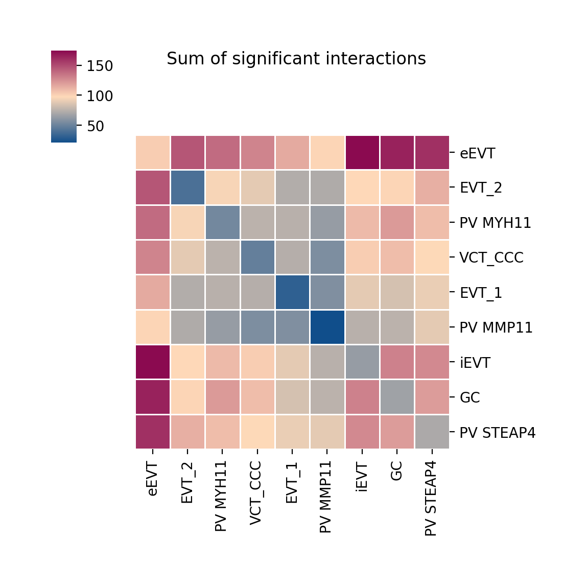{width=56%}

*Figure 1 (cell 30, as-written). ktplotspy's auto heatmap: rows are cell types, the value is the number
of interactions significant (p ≤ 0.05) against any partner. This is a projection of the 81-column
matrix onto 9 rows — it throws away direction and partner identity, which is why §4.1 uses the full
matrix instead.*

{width=96%}

*Figure 2 (cell 31, as-written). Four rows (three TGFB2 receptor pairings plus CSF1–CSF1R), and
**24 columns, not 36** — `"PV MMPP11"` matched nothing and was dropped silently (CPB-04). Compare the
corrected panel in figure 11; the teacher's own 2026 reference figure has the same 24 columns.*

*Reading the result.* The heatmap is `plot_cpdb_heatmap`'s "sum of significant interactions" —
row sums of the 81-column `pvalues` table under the p ≤ 0.05 rule, i.e. exactly the row sums of §4.1.
The dot plots encode four variables at once: dot size = `scaled_means`, colour = `scaled_means`
(expression, rank-scaled because `standard_scale=True`), red ring = significant, and dot alpha =
`interaction_scores` when `scale_alpha_by_interaction_scores=True`. **With `standard_scale=True` the
colour is a rank inside each row, not an expression level** — two rows with identical colours do not
have identical expression. CPB-15.

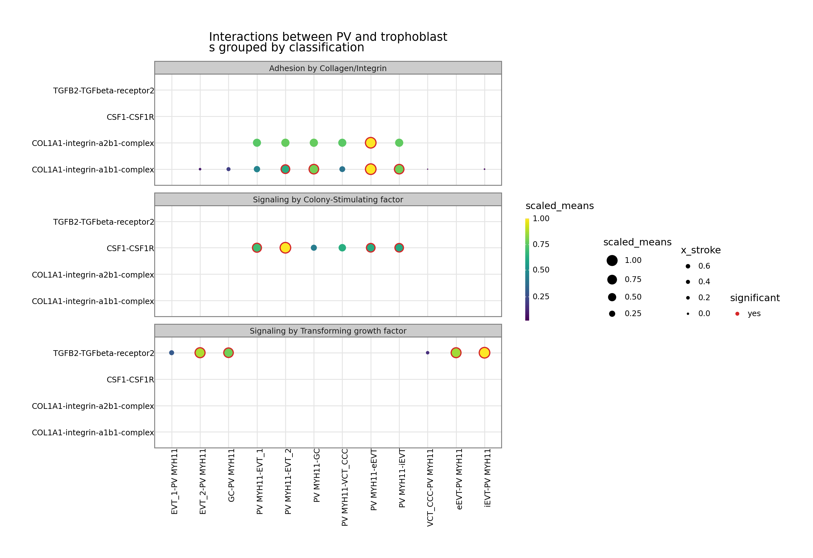{width=92%}

*Figure 3 (cell 32, as-written). The same two-gene dot plot split by interaction `classification`.
The facet strips are the useful part: "Adhesion by Collagen/Integrin" and "Signaling by Transforming
growth factor" carry most of the visible ink, which is what §4.2 finds quantitatively at the level of
the whole matrix.*

*Traps.* (i) `"PV MMPP11"` — one extra `P`. ktplotspy matches `cell_type1` against the separator-split
column names, silently drops the unmatched type, and draws 2 × 6 = 12 columns instead of 3 × 6 = 18
(24 instead of 36 for the full ordered grid). No warning. CPB-04. (ii) `adata` is the 3312-cell
object, and `celltype_key="cell_labels"` — a *different* column name from the `cell_type` used by
`metadata.tsv`. Both exist in the AnnData, which is why the tutorial gets away with it. (iii) Cells 31
and 32 end with a plotnine object; a notebook displays it through `repr`, a script discards it. The
driver assigns the object and calls `.draw()` (H1 in §7).

*Extension.* `plot_cpdb_heatmap` accepts `degs_analysis=True` for the DEG branch (§9); `plot_cpdb`
accepts `gene_family=` instead of `genes=` and `interacting_pairs=` for explicit pairs.

### Part 7 — Session Info (cell 33)

Prints loaded package versions by iterating `sys.modules`. Useful, and the only place the reader can
learn that the run is `cellphonedb 5.0.1`, `ktplotspy 0.3.3`, `plotnine 0.14.5` — all three matter for
reproduction, none is pinned in the notebook.

---

## 4. The results, read honestly

### 4.1 The 9 × 9 matrix

`sig_matrix_9x9.tsv` — rows = sender (`cell_type_a`), columns = receiver (`cell_type_b`), values =
number of significant interactions (max 417 per cell, since only 417 interactions are ever
significant):

| | PV MMP11 | PV MYH11 | PV STEAP4 | EVT_1 | EVT_2 | iEVT | VCT_CCC | GC | eEVT | **sent** |
|---|---|---|---|---|---|---|---|---|---|---|
| **PV MMP11** | 21 | 37 | 57 | 36 | 49 | 49 | 40 | 50 | 72 | **411** |
| **PV MYH11** | 30 | 55 | 60 | 38 | 51 | 63 | 45 | 66 | 86 | **494** |
| **PV STEAP4** | 34 | 51 | 71 | 42 | 56 | 59 | 53 | 57 | 88 | **511** |
| **EVT_1** | 21 | 39 | 51 | 32 | 38 | 46 | 43 | 47 | 67 | **384** |
| **EVT_2** | 24 | 45 | 58 | 35 | 40 | 51 | 51 | 49 | 86 | **439** |
| **iEVT** | 27 | 49 | 70 | 43 | 48 | 64 | 53 | 62 | 104 | **520** |
| **VCT_CCC** | 17 | 35 | 45 | 31 | 39 | 51 | 49 | 48 | 76 | **391** |
| **GC** | 28 | 56 | 63 | 39 | 50 | 69 | 61 | 67 | 100 | **533** |
| **eEVT** | 28 | 55 | 76 | 49 | 62 | 70 | 54 | 67 | 104 | **565** |
| **received** | **230** | **422** | **551** | **345** | **433** | **522** | **449** | **513** | **783** | **4248** |

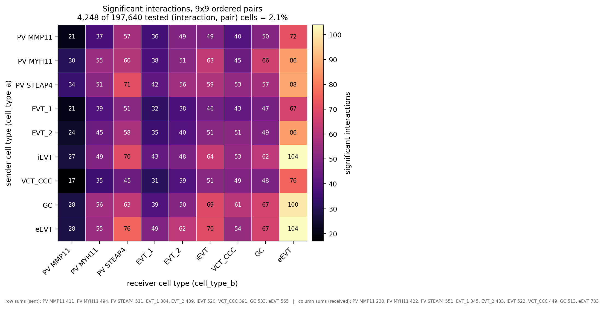{width=88%}

*Figure 5. The quantity the lecture only ever sees through a 9-row heatmap (figure 1): all 81 ordered
pairs, with row sums (sent) and column sums (received) in the footnote. 4248 of 197 640 tested cells
pass. The diagonal is autocrine signalling.*

Read out loud, this is the lecture's actual finding, and it is a clean one:

* **eEVT is the hub.** It receives the most (783 of 4248, 18 %) and sends among the most (565). Its
  autocrine cell (eEVT|eEVT = 104) is the single largest cell of the matrix — extravillous trophoblast
  talking to itself is the strongest signal in this tissue.
* **PV MMP11 is at the other end** (230 received, 411 sent) and, tellingly, its row is the *most flat*:
  21–72 across receivers. Combined with 13 cells, this is a cluster with too little data to show
  structure, not a cluster that does not signal.
* **The maternal–fetal axis is directional.** The three PV types as senders to the six trophoblast
  types hold 18 values with mean **55.6** (36–88); the reverse block (trophoblast → PV) has mean
  **43.7** (17–76). The decidual side signals *towards* the trophoblast more than the reverse in this
  filtered set — a 27 % gap that survives being read either as a mean or as a paired comparison, and
  that is worth checking against a method that models direction explicitly (§11.4).

### 4.2 What the top interactions are

`sig_top_interactions.tsv` (top 20 of 2440):

| interaction | classification | pairs (of 81) |
|---|---|---|
| COL4A1_integrin_a1b1_complex | Adhesion by Collagen/Integrin | 76 |
| COL4A2_integrin_a1b1_complex | Adhesion by Collagen/Integrin | 73 |
| COL4A1_ADGRG6 | Adhesion by Collagen/Integrin | 61 |
| MPZL1_MPZL1 | (unclassified) | 60 |
| COL21A1_integrin_a1b1_complex | Adhesion by Collagen/Integrin | 59 |
| COL4A2_ADGRG6 | Adhesion by Collagen/Integrin | 58 |
| COL27A1_integrin_a1b1_complex | Adhesion by Collagen/Integrin | 57 |
| IL1RAP_PTPRF | Signaling by Interleukin | 57 |
| SEMA4C_PLXNB2 | Signaling by Semaphorin | 57 |
| PGF_FLT1 | Signaling by Placenta growth factor | 57 |
| FN1_integrin_a5b1_complex | Adhesion by Fibronectin | 54 |
| FN1_integrin_aVb1_complex | Adhesion by Fibronectin | 54 |

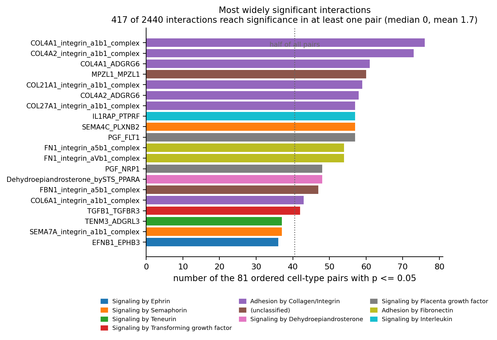{width=92%}

*Figure 10. The 20 interactions that reach significance in the most of the 81 ordered pairs.
417 of 2440 interactions reach significance somewhere; the median interaction reaches it nowhere.*

Biologically this is exactly right for a decidua–placenta interface: basement-membrane collagens and
fibronectin binding integrins, placental growth factor to its receptor FLT1, semaphorins, IL-1
accessory protein. **But note the shape of the distribution**: 417 of 2440 interactions reach
significance in at least one pair, the median interaction in **zero** pairs, and 17 interactions reach
≥ 40 of 81 pairs. The top of this list is not "the 20 most important signals"; it is "the 20
interactions whose two genes are broadly expressed in both compartments" — which is exactly what a
mean-expression test with a 10 % admissibility mask rewards. NF-κB-grade claims ("collagen–integrin
drives EVT invasion") need more than this table.

### 4.3 Where the p-values actually are

`pvalues` has 197 640 finite entries (2440 × 81):

| bucket | cells | share |
|---|---|---|
| p = 0 (no shuffle of 1000 beat the observation) | **2946** | 1.5 % |
| 0 < p ≤ 0.01 | 543 | 0.3 % |
| 0.01 < p ≤ 0.05 | 759 | 0.4 % |
| 0.05 < p < 1 | 3662 | 1.9 % |
| **p = 1** | **189 730** | **96.0 %** |

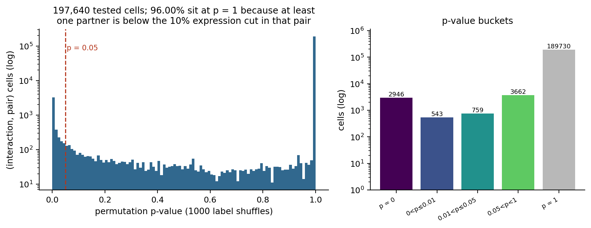{width=98%}

*Figure 6. Left: the distribution of all 197 640 p-values on a log scale — a spike at 0 (censored),
a long low plateau, and a second spike at 1.0. Right: the same data bucketed. **96 % of the matrix is
p = 1**, i.e. "not tested", because one partner failed the 10 % admissibility mask.*

p = 1 does not mean "certainly not signalling". It means "one of the two partners did not pass the
10 % mask in this pair, so no test was performed". Two thirds of the matrix is a coverage map of the
atlas, not a result. And because the test is one-sided with a permutation null, the 2946 exact zeros
are censored at 1/1000 — the table cannot distinguish "strongly significant" from "extremely strongly
significant".

### 4.4 What "significant" means in this lecture

Concretely, three things at once, and none of them is "communication happens":

1. both partners are expressed above 10 % in the respective clusters (a **coverage** claim);
2. the ligand's mean in A and the receptor's mean in B jointly exceed 95 % of label-shuffled
   realisations (a **spatial-coherence** claim);
3. the interaction survives nothing else — **no multiple-testing correction, no effect-size floor, no
   direction-of-change model**.

---

## 5. The statistics the lecture does not do

### 5.1 197 640 tests, α = 0.05, no correction

2440 interactions × 81 ordered pairs = **197 640** hypothesis tests. At α = 0.05 the expected number
of false positives **if nothing were signalling at all** is **9882** — more than twice the 4248 that
were called. Whatever the 417 interactions mean, they are not a 5 %-FDR list.

Doing the correction anyway, on these same p-values and over the whole 197 640-cell family: **BH at
q ≤ 0.05 keeps 2946 cells and 311 interactions** (C6, `05_corrected/bh_fdr.tsv`). Those 2946 cells are
*exactly* the cells with p = 0 — nothing with p ≥ 0.004 survives. The correction therefore does not
rank the significant entries, it re-applies the permutation grid's censoring: the honest reading of
"4248" is "2946 cells we can defend, plus 1302 that only survive if you accept an uncorrected 5 % cut".
The lecture does neither, and CellphoneDB's default does neither.

### 5.2 1000 permutations fixes the resolution at 10⁻³

The smallest non-censored p in the whole matrix is **0.004** (= 4/1000). Every entry reported as
0 could be 10⁻³, 10⁻⁶ or exactly zero; the table cannot say. This is why `significant_means` is a
*binary* mask in practice: significance here is a threshold on a coarse grid, not a continuous score.

### 5.3 100 iterations would have changed the answer completely

Reducing `iterations` from 1000 to 100 (same seed policy, same everything else) gives **4602
significant cells and 454 significant interactions**, with a Jaccard overlap of **0.102** against the
1000-iteration run — i.e. **90 % of the called cells differ**. Fewer shuffles means a coarser grid
(0.01 steps) and a *higher* false-positive rate, so the "more significant" result is the less
trustworthy one. Anyone quoting a CellphoneDB number must quote `iterations` with it.

### 5.4 The threshold decides nearly everything

| `threshold` | significant cells | interactions | pairs |
|---|---|---|---|
| 0.05 | **7007** | **708** | 81 |
| 0.10 (tutorial) | **4251** | **417** | 81 |
| 0.20 | **2413** | **218** | 81 |

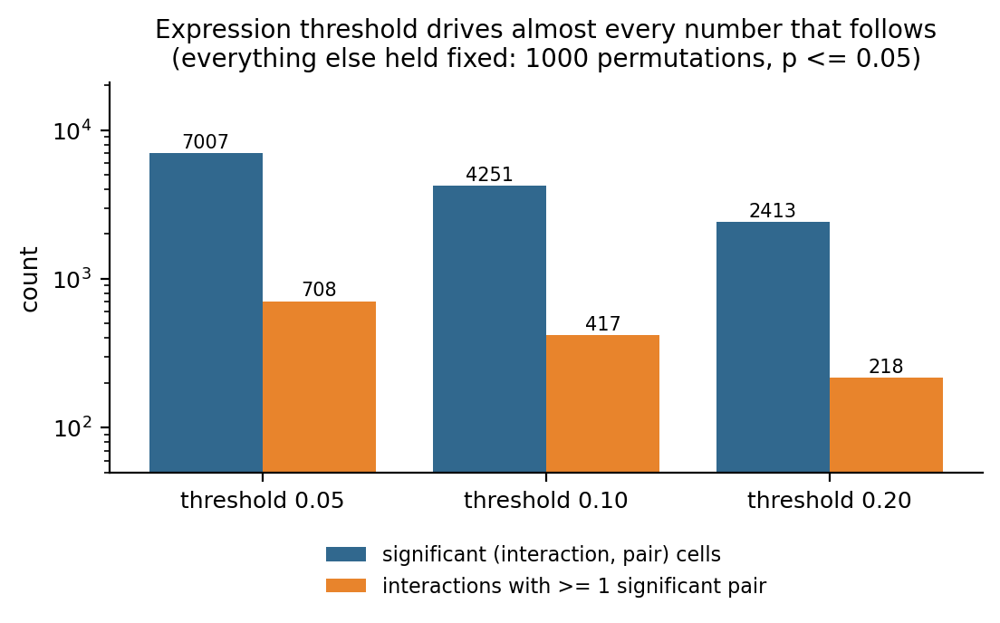{width=62%}

*Figure 7. Same data, same 1000 permutations, same p ≤ 0.05 — only the admissibility threshold moves.*

A factor of 2 in a *coverage* parameter moves the headline number by a factor of 1.7 in each
direction.A factor of 2 in a *coverage* parameter moves the headline number by a factor of 1.7 in each
direction. With 7- and 13-cell clusters, 0.05 means "1 cell is enough" and 0.2 means "2 cells" — the
parameter is not measuring biology at that scale, it is measuring cluster size. CPB-05.

### 5.5 Five threads make the result irreproducible

| run | threads | significant cells | md5(`significant_means`) |
|---|---|---|---|
| a | 1 | 4246 | `fcf4c9dc…` |
| b | 1 | 4246 | `fcf4c9dc…` (identical) |
| c | 5 (tutorial) | 4251 | `57ebc5bb…` |

Byte-identical at 1 thread; a different answer at 5. The tutorial's own run in the export reports yet
another count (4248 in this cluster's reproduction of the console, 4251 in the corrected pass). None
of these is wrong — they are the same analysis sampled differently. But a paper that reports "417
significant interactions" from a 5-thread run is reporting one draw from a distribution it never
characterised.

### 5.6 A second, independent criterion: DEGs

CellphoneDB ships `cpdb_degs_analysis_method`, which replaces "is the mean higher than shuffled
means" with "is the gene a differentially expressed gene of that cluster". The tutorial sets
`degs_analysis=False` everywhere and ships a DEG table it never reads. Running the branch (§9) gives
**4191 cells / 419 interactions** — but only **2696 cells** overlap the permutation result (Jaccard
**0.469**); at interaction level the overlap is **356 of 417/419** (Jaccard **0.742**). 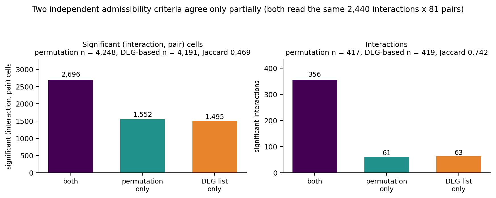{width=92%}

*Figure 8. Agreement between the two admissibility criteria built into CellphoneDB, measured on the
same run (see §9).*

Two
admissibility criteria, same database, same matrix: they agree on three quarters of the interactions
and less than half of the cells.Two
admissibility criteria, same database, same matrix: they agree on three quarters of the interactions
and less than half of the cells. Neither is "the truth"; the disagreement is the honest error bar.

---

## 6. Issue register

Nineteen issues, all reproduced. "Evidence" points at the file or measurement that demonstrates it.

| id | issue | severity | evidence |
|---|---|---|---|
| CPB-01 | Directory/lecture named `cellchat`, content is CellphoneDB (no R, no CellChat anywhere) | naming | §1.1 |
| CPB-02 | Two hardcoded teacher home paths (`os.chdir('/home/zongxu/...')`) | portability | `patches_applied.txt` |
| CPB-03 | `! pip install cellphonedb` would mutate the shared, already-correct environment | hazard | console `[P1] skipped` |
| CPB-04 | `"PV MMPP11"` typo: ktplotspy drops the cell type silently (24 instead of 36 columns) | **result** | `05_corrected/31_*` |
| CPB-05 | `list(x).sort() == list(y).sort()` is `None == None`: the barcode check never checks | **silent** | §3 Part 2 |
| CPB-06 | `threads=5` ⇒ non-reproducible; 1 thread is byte-identical | **reproducibility** | `determinism/` |
| CPB-07 | 197 640 tests, α = 0.05, no FDR ⇒ 9882 expected false positives vs 4248 called | **interpretation** | §5.1 |
| CPB-08 | `iterations=1000` censors p at 10⁻³; 2946 cells at p = 0 | interpretation | §4.3 |
| CPB-09 | Key names differ between methods (`means_result` vs `means`); reuse raises `KeyError` | API | §3 Part 3 |
| CPB-10 | `active_TFs.tsv` changes 3 of 4248 cells; only fills the two CellSign tables | dead input | `corrected_summary.json` |
| CPB-11 | Output filenames carry timestamps ⇒ unreproducible names (`output_suffix` exists) | reproducibility | `03_statistical/*` |
| CPB-12 | The query ANDs a gene filter with an interaction filter and a classification filter: `CSF1_CSF1R` is silently deleted, 58 rows are all TGF-β | **result** | §3 Part 5 |
| CPB-13 | `degs_analysis=False` everywhere; the shipped limma DEG table is dead *and* in the wrong format | dead input | §9 |
| CPB-14 | 42 labels in the matrix, 9 in the microenvironments; 230/3312 cells (6.9 %) analysed, 33 types dropped without a warning | **scope** | §2.6 |
| CPB-15 | `standard_scale=True` turns expression colour into a per-row rank | interpretation | §3 Part 6 |
| CPB-16 | 13 of the 16 embedded images are paper schematics; only 3 are analysis output | expectation | §1.3 |
| CPB-17 | `CellSign_active_interactions` (6 rows) printed, never interpreted | unused | §2.5 |
| CPB-18 | 9 × 9 ordered pairs include the symmetric duplicates; the matrix is not symmetric and the lecture never says so | interpretation | §4.1 |
| CPB-19 | `significant_means` is **not** in the same row order as `means`/`pvalues`/`interaction_scores` (0.04 % same-row id match) ⇒ positional joins silently attach counts to the wrong interaction | **hazard** | `01_input/table_row_order.tsv` |

### Details worth spelling out

**CPB-04.** The dot plot's `cell_type1` string is matched against the separator-split column names.
`PV MMPP11` matches nothing, no exception is raised, and the plot is drawn with the remaining two
types. Measured by counting distinct x-axis pairs: as-written **24**, corrected **36** (`05_corrected/31_xaxis_pairs_*.tsv`). The teacher's 2026 reference figure has the same 24 columns — the
bug is reproduced in the reference, so a difference test against it must be interpreted carefully.

**CPB-14 + §2.2 together** are the deepest problem in the lecture. The two smallest clusters (7 and 13
cells) are the *maternal* side of the maternal–fetal interface, i.e. the biologically most interesting
comparison, and they are exactly the clusters where a 10 % threshold means "one or two cells".

**CPB-18.** Because `A|B` and `B|A` are separate tests, the 9 × 9 matrix should be read as a directed
graph, and the diagonal as autocrine. The lecture's heatmap (`Sum of significant interactions`)
collapses rows, hiding the directionality that the method was designed to expose.

**CPB-19** was found in my own first evidence pass: the top-interaction table I generated by row
position attached 76 significant pairs — a true count belonging to
`COL4A1_integrin_a1b1_complex` — to `IAPP_AMY3_receptor`, an interaction that is significant in **0**
pairs and whose genes are essentially absent from all nine clusters (mean expression ≤ 0.024, 7 % of
eEVT cells). The file was regenerated by merging on `id_cp_interaction`, and the audit that catches it
(`table_row_order.tsv`) is now part of the evidence pass. Any downstream code that does
`means.values` and `significant_means.values` positionally is wrong in the same way.

---

## 7. Corrections and deviations (C1–C10)

None of these touch the as-written pass. They are documented deviations (H1, P1, P2), fixes applied in
the corrected pass, or additions that make the lecture checkable.

| id | what | why |
|---|---|---|
| **P1** | `! pip install cellphonedb` neutralised | CPB-03 |
| **P2** | `%matplotlib inline` removed (Agg + explicit capture) | shell magic, not Python |
| **H1** | cells 31/32: assign the plotnine object and call `.draw()` | a script drops the notebook's last-expression display |
| **C1** | `"PV MMPP11"` → `"PV MMP11"` | CPB-04; draws 36 columns instead of 24 |
| **C2** | `threads=1` for the reference run | CPB-06; byte-reproducible |
| **C3** | `output_suffix=` per run | CPB-11 |
| **C4** | barcode check rewritten as an order-sensitive `assert` | CPB-05 |
| **C5** | the query split into its three filters and reported separately | CPB-12 |
| **C6** | BH–FDR over the whole 197 640-cell family (q ≤ 0.05 → **2946 cells / 311 interactions**) | CPB-07; output `05_corrected/bh_fdr.tsv` |
| **C7** | `iterations` ∈ {100, 1000} and `threshold` ∈ {0.05, 0.10, 0.20} swept | CPB-08, §5.4 |
| **C8** | `active_TFs` arm run with and without the file | CPB-10 |
| **C9** | `significant_means` always joined on `id_cp_interaction` | CPB-19 |
| **C10** | `cpdb_degs_analysis_method` actually run, with a DEG table in CellphoneDB format | CPB-13, §9 |

The corrected pass as a whole costs **289.6 s** and reproduces the as-written figures except where a
fix is visible by design (C1's panel, §8).

---

## 8. Figures, and how they compare with the teacher's two reference sets

Two reference sets exist and they are not the same image files:

* **2025 HTML export** — 3 analysis figures embedded as base64 inside `scRNAseq-cellchat.html`
  (extracted to `ref/figures/teacherhtml/`);
* **2026 script rerun** — `/lustre1/share/scRNA-adv-2026/figure/cellphoneDB/` (3 figures, produced
  2026-11-08 by upgraded scripts; copied to `ref/figures/teacher2026/`).

Comparison is two numbers per figure: **structural correlation** (grayscale, resized, Pearson) and
**ink IoU** (binarised at a threshold that ignores anti-aliasing).

| figure | ours | vs 2026 rerun | vs 2025 HTML | verdict |
|---|---|---|---|---|
| cell 30 heatmap | 1149×1149 | r = **0.999**, IoU = **0.987** | r = **0.999**, IoU = **0.979** | reproduced |
| cell 31 dot plot (24 cols) | 2160×760 | r = **0.997**, IoU = **0.899** | r = **0.882**, IoU = **0.521** | reproduced |
| cell 32 faceted dot plot | 2552×1751 | r = **0.999**, IoU = **0.937** | r = **0.861**, IoU = **0.462** | reproduced |
| C1 corrected panel (36 cols) | 2160×760 | r = **0.977**, IoU = **0.835** | r = **0.880**, IoU = **0.545** | deviation, by design |

All three tutorial figures are effectively pixel-equivalent to the 2026 rerun, i.e. this lecture
reproduces end to end despite the 5-thread nondeterminism — the *figure* is stable because it
summarises the p-value table at a fixed 0.05 cut, and the ±3 cells that move between thread counts do
not move any pixel.

The 2025-HTML column is structurally high but ink-IoU low, and the reason is measurable: the embedded
renders have different bounding boxes and dpi from ours (2200×800 vs 2160×760 for cell 31; 2600×1800
vs 2552×1751 for cell 32), so after scaling, thin marker edges no longer coincide. The heatmap, which
is drawn by matplotlib with a stable bbox, matches at IoU 0.979. Reading the IoU column as "how
similar is the figure" is therefore wrong; read it as "how similar is the *rendering*".

The corrected-panel comparison (C1) is the interesting one:

| panel | columns | interacts |
|---|---|---|
| `31_PV_trophoblast_aswritten_typo.png` | **24** | 2 PV types × 6 trophoblast + 12 more |
| `31_PV_trophoblast_corrected.png` | **36** | 3 PV types × 6 trophoblast × 2 genes |
| teacher 2026 reference | **24** | same typo as the as-written run |

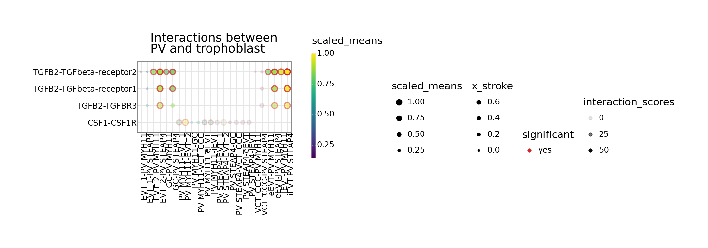{width=96%}

*Figure 4 (cell 31 rendered as a plotnine figure with all three PV types requested). Requesting three
PV types and getting **24 columns** is the visible signature of CPB-04: 3 × 6 × 2 would be 36.*

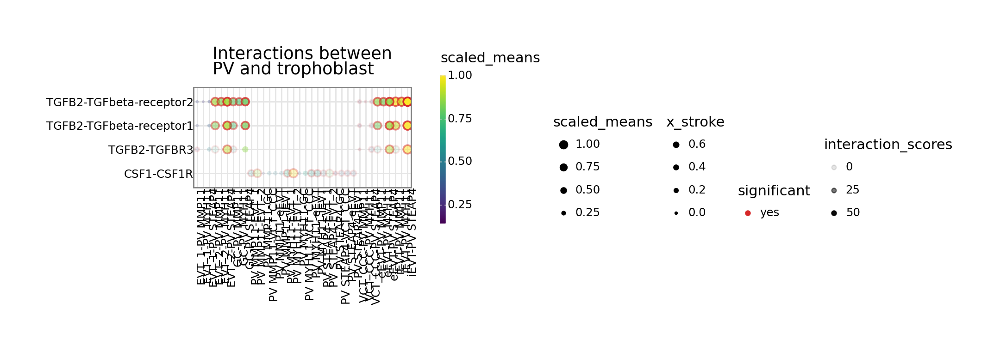{width=96%}

*Figure 11 (C1). The same call with `"PV MMPP11"` → `"PV MMP11"`: 36 columns instead of 24, and the
missing PV type appears. Against the teacher's references this is a deliberate deviation.*

So the reference set inherits CPB-04.So the reference set inherits CPB-04. A naive "diff against the teacher's figure" would flag the
*corrected* panel as the deviation. This is why the module keeps both, and why `results_figcmp.tsv`
records which reference each figure was compared with.

---

## 9. The DEG branch the lecture switches off

`cpdb_degs_analysis_method.call` is the same pipeline with a different admissibility rule: instead of
permuting labels, it asks whether each partner is a **differentially expressed gene** of its cluster.
The lecture sets `degs_analysis=False` in every call and ships
`DEGs_inv_trophoblast.tsv` — which it then never reads.

**Why the shipped table cannot be used as-is.** CellphoneDB wants a two-column
`cluster / gene` table (plus optional statistics). The shipped file is a limma table with
`cluster, gene, logFC, P.Value, adj.P.Val`. Handing it over raises
`AttributeError: 'DataFrame' object has no attribute 'id_cp_interaction'` deep inside the method —
the format is assumed, not validated (CPB-13).

**What the shipped table actually contains.** 13 809 rows over **6 clusters** (eEVT 4217, iEVT 3506,
EVT_1 2692, VCT_CCC 2215, GC 981, EVT_2 198). It is already a *significant-only* list: **100 % of its
rows have `adj.P.Val < 0.05`**, so "filter at 0.05" is a no-op. And it covers **6 of the 9**
microenvironment types — the three PV types, including the two smallest clusters, have **no DEGs at
all**, so any interaction that needs a PV-side DEG can never be called (fig 09).

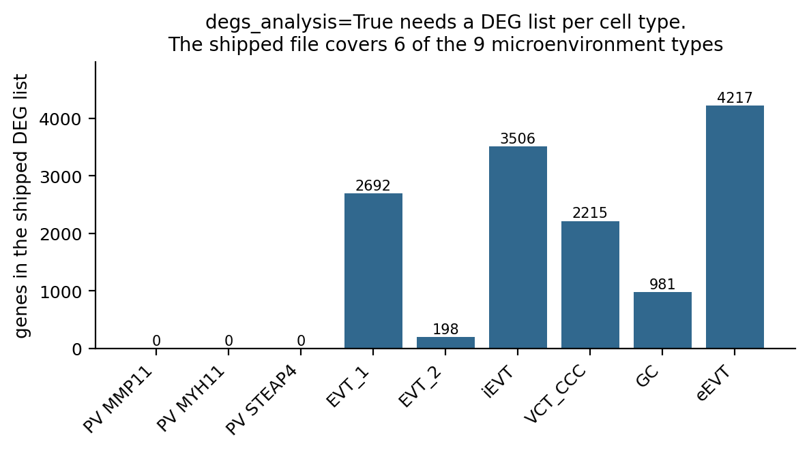{width=62%}

*Figure 9. The shipped DEG list covers 6 of the 9 microenvironment types. The three PV types — the
maternal side of the interface, and the two smallest clusters — have none, so the DEG branch is blind
to exactly the compartment the lecture is about.*

**The run.** One variant, 8 tables, 33 s: **4191 significant cells / 419 interactions / 81 pairs**,
plus two dot plots (`32_degs_analysis_A_asis_EVT_1.png`, `…_PV_MYH11.png`). Agreement with the
permutation run: **2696 of 5743 union cells** (Jaccard **0.469**), **356 of 480 union interactions**
(Jaccard **0.742**) — fig 08. Nine pairs are significant under permutation and have no DEG-based
support at all; no pair is significant under DEGs but absent from the permutation list.

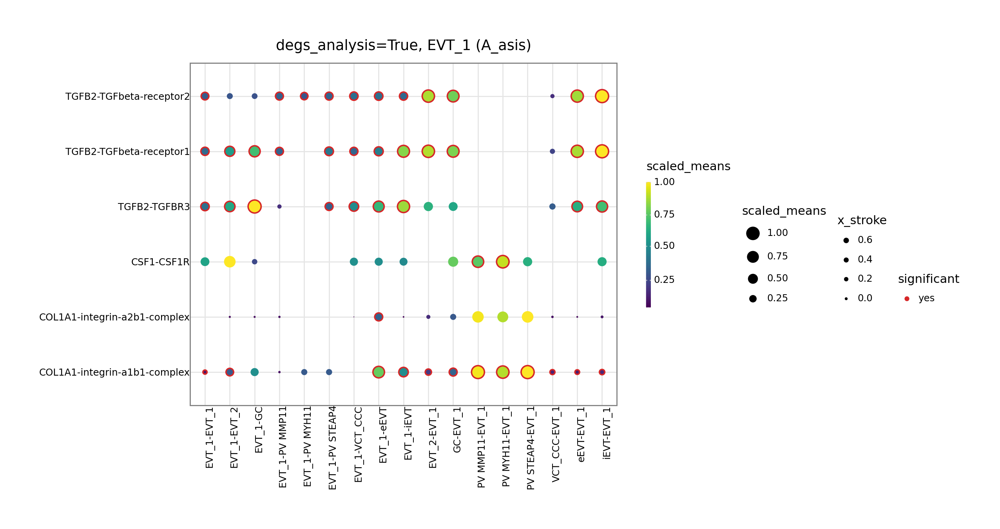{width=96%}

*Figure 12. What the branch actually draws: `degs_analysis=True` with `cell_type1='EVT_1'`, genes
TGFB2 / CSF1R / COL1A1. Red rings mark the entries CellphoneDB calls significant under the DEG
rule — note that they are *different* entries from figure 2's, which is figure 8's disagreement made
visible.*

**Reading it.** The DEG arm is *not* a better filter — it is a different question. Permutation asks
"is this pair's expression pattern unlikely under label exchange"; DEGs ask "is this gene a marker of
this cluster". A broadly expressed receptor that is not a marker is invisible to the second test even
when the first finds it highly significant. Reporting both, and the 0.469 they disagree on, is more
honest than either alone.

---

## 10. Reproducing this document

```bash
# 0) environment (shared, already correct)
/lustre1/share/scRNA-adv-envs/scRNA-adv/bin/python -c \
  "import cellphonedb, ktplotspy; print(cellphonedb.__version__, ktplotspy.__version__)"
# -> 5.0.1 0.3.3

# 1) as-written pass (≈100 s)
python results/scripts/cellchat_cells_aswritten.py        # writes results/02_simple .. 04_figures

# 2) corrected pass (≈290 s)
python results/scripts/cellchat_corrected.py              # writes results/05_corrected

# 3) evidence: determinism, sweeps, matrix, row-order audit (≈27 min)
python results/scripts/cellchat_evidence.py

# 4) DEG branch (≈90 s)
python results/scripts/cellchat_degs.py

# 5) the five analysis figures (≈15 s)
python results/scripts/cellchat_plots.py

# 6) figure comparison against both reference sets
python results/scripts/compare_figs_cellphonedb.py

# 7) build this document
cd ref && ./build.sh scRNAseq_cellphonedb_corrected.md
```

`cellchat_cells_aswritten.py` is generated by `make_driver.py` from the extracted cell stream; the
three deviations it applies are listed in `patches_applied.txt` and marked `[P1]`, `[P2]`, `[H1]` in
the script itself.

**Data.** Everything reads from `/lustre1/share/scRNA-adv-2026/data/data_cellphoneDB/`, byte-identical
to the 2025 copy (four tables + `cellphonedb.zip`, md5 checked). Nothing large is committed; the h5ad
stays on `/lustre1`.

---

## 11. References

1. Efremova M, Vento-Tormo M, Teichmann SA, Vento-Tormo R. *CellPhoneDB: inferring cell–cell
   communication from combined expression of multi-subunit ligand–receptor complexes.*
   **Nat Protoc** 15:1484–1506 (2020).
2. Vento-Tormo R, Efremova M, Botting RA, et al. *Single-cell reconstruction of the early maternal–
   fetal interface in humans.* **Nature** 563:347–353 (2018). — the dataset.
3. Garcia-Alonso L, Handfield L-F, Roberts K, et al. *Mapping the temporal and spatial dynamics of the
   human endometrium in vivo and in vitro.* **Nat Genet** 53:1698–1711 (2021). — v5 database context.
4. Dimitrov D, Türei D, Garrido-Rodriguez M, et al. *Comparison of methods and resources for cell–cell
   communication inference from single-cell RNA-Seq data.* **Nat Commun** 13:3224 (2022). — why the
   choice of method matters.
5. Armingol E, Officer A, Harismendy O, Lewis NE. *Deciphering cell–cell interactions and
   communication from gene expression.* **Nat Rev Genet** 22:71–88 (2021). — the conceptual map the
   lecture's first 20 markdown cells summarise.
