# CellphoneDB —— 矫正增强版

**2026 单细胞进阶专题课 第八讲** · 配套 `scRNAseq-cellchat.html`（教师 notebook 导出）与模块目录
`class/scRNA-seq-cellchat/`。

本文所有内容，都来自在本集群上**逐格原样**运行教师 notebook，再用一套成文补丁重跑同一分析。
每一个数字都能从 `results/` 复现，脚本在 `results/scripts/`。

---

## 0. 本文是什么，怎么产生的

这一讲有五条执行线，引用数字前必须先说清它来自哪一条：

| 执行线 | 脚本 | 是什么 | 产出 |
|---|---|---|---|
| **原样跑** | `results/scripts/cellchat_cells_aswritten.py` | HTML 导出里的 34 个代码单元按序还原，**只**中和 shell magic、换掉两处 notebook 显示（见 §7）——所有分析参数一字未改（`threshold=0.1`、`iterations=1000`、`threads=5`、`pvalue=0.05`、`degs_analysis=False`） | `02_simple`、`03_statistical`、`04_figures` |
| **矫正跑** | `results/scripts/cellchat_corrected.py` | 同一条流水线 + §7 的十项矫正 C1–C10 | `05_corrected` |
| **取证** | `results/scripts/cellchat_evidence.py` | 独立重读已产出的表：p 值结构、9×9 矩阵、行序审计、`active_TFs` 分支、单线程确定性 | `01_input`、`06_figure_comparison` |
| **DEG 分支** | `results/scripts/cellchat_degs.py` | 跑通教程关掉的那一支 `cpdb_degs_analysis_method`，并与置换法对拍 | `07_degs` |
| **作图** | `results/scripts/cellchat_plots.py` | 教程只打印不画的五个量（矩阵、p 值结构、阈值扫描、DEG 一致性、Top 互作） | `ref/figures/fig_05…fig_10` |

原样跑**故意保留教程的 bug**。这正是它的用途：它是下文一切结论的对照。矫正只发生在第二条执行线与 §7，
永不进入第一条。

**实测耗时。** 原样跑、单进程、无 GPU，时间取自 CellphoneDB 核心日志的时间戳：

| 阶段 | 起 → 止 | 墙钟 |
|---|---|---|
| `cpdb_analysis_method.call`（简单打分，2440 互作 × 81 对） | 21:15:44 → 21:16:11 | **27 s** |
| `cpdb_statistical_analysis_method.call`，1000 次置换 | 21:16:11 → 21:16:52 | **41 s**（26 次/秒） |
| 统计调用内部的互作打分，81 对 | 21:16:52 → 21:16:54 + 22 s | **22 s** |
| 两张 `plot_cpdb` 点图（`ggplot.draw()`） | 21:16:54 → 约 21:17:20 | ≈ 65 s |
| **全程** | 21:15:41 → 约 21:17:20 | **≈ 100 s** |

矫正跑共 **289.6 s**，其中约 **27 min** 花在取证上（三轮单线程复跑每轮约 9 min，加阈值扫描、
`active_TFs` 分支、100 次迭代一轮）。这一讲本身极便宜——也正因为便宜，它的统计从来没有被认真审查过。

**可复现质量。** 单线程两次复跑**逐字节相同**：`significant_means` 的 md5 都是 `fcf4c9dc…`，
`pvalues` 都是 `9838804b…`。教程写的 `threads=5` **不可复现**：第三次用 5 线程跑，md5 变成
`57ebc5bb…`，显著对变成 4251（单线程 4246）。见 §6 CPB-06。

### 本模块的文件

```
scRNA-seq-cellchat/
├── scRNAseq-cellchat.html              # 教师导出（5.6 MB，图以 base64 内嵌）
├── ref/
│   ├── figures/                        # 本文用的 12 张图
│   ├── cellphonedb_analysis_results_guide.{md,pdf}
│   └── scRNAseq_cellphonedb_corrected[_zh].{md,pdf}
└── results/
    ├── 01_input/                       # 细胞计数、微环境、9x9 矩阵、每对与 Top 互作、行序审计
    ├── 02_simple/                      # cpdb_analysis_method 的 4 张表
    ├── 03_statistical/                 # cpdb_statistical_analysis_method 的 8 张表
    ├── 04_figures/                     # 教程自己的 3 张分析图
    ├── 05_corrected/                   # C1/C2/C5/C7 产出：PV 面板、检索结果、阈值表
    ├── 06_figure_comparison/           # results_figcmp.tsv（两套教师参考集）
    ├── 07_degs/                        # DEG 分支：8 张表 + 2 张点图
    ├── 09_run_logs/                    # 每条执行线的完整控制台与 session info
    └── scripts/                        # 本文提到的每一个脚本
```

---

## 1. 教材速览

### 1.1 目录叫 cellchat，内容是 CellphoneDB

`class/scRNA-seq-cellchat/` 只有一个文件：nbconvert 导出，**94 格 = 60 markdown + 34 代码**。名字承诺的是
R 包 *CellChat*；正文第二格 markdown 自己写着"*本讲 largely based on CellphoneDB*"。34 个代码单元无一例外
导入 `cellphonedb` 或 `ktplotspy`，没有一行 R，`CellChat` 此后不再出现。两个方法共享同一个生物学问题——
*哪些细胞类型在对话、通过哪对配体–受体*——这一讲选了 Python 那个。

这件事有实际后果：照目录名去 Python 环境里搜 `cellchat` 什么也搜不到；照目录名转去 R 会得到另一套算法
（CellChat 用 Hill 函数与质量作用模型的"通讯概率"），其数字与本模块的一切都不可比。

### 1.2 数据

`data_cellphoneDB/` 只有四个小表加一个 zip，与 2025 课程副本逐字节一致（已核 md5）：

| 文件 | 内容 |
|---|---|
| `normalised_log_counts.h5ad` | **3312 细胞 × 30800 基因**，log 归一化；`obs['cell_labels']` 带 **42** 个人工标注 |
| `metadata.tsv` | `barcode_sample` / `cell_type`，3312 行——CellphoneDB 真正读的标注文件 |
| `microenvironment.tsv` | 9 个 `cell_type` 值，归入微环境（全部同一个） |
| `active_TFs.tsv` | 各细胞类型的活跃转录因子，只喂 CellSign 两张表 |
| `DEGs_inv_trophoblast.tsv` | limma 表（13809 行，`cluster / gene / logFC / P.Value / adj.P.Val`），notebook **从未读取** |
| `v5.0.0/cellphonedb.zip` | CellphoneDB **v5.0.0** 数据库 |

数据是 Vento-Tormo 等 2018（*Nature* 563:347）的蜕膜–胎盘界面图谱——正是让 CellphoneDB 成名的那份对象。
教程在矩阵里保留 42 个标注，却通过 `microenvironment.tsv` 把分析限制在 **9** 个：

| 细胞类型 | 细胞数 | | 细胞类型 | 细胞数 |
|---|---|---|---|---|
| PV MMP11 | **13** | | iEVT | 37 |
| PV MYH11 | **7** | | VCT_CCC | 34 |
| PV STEAP4 | **15** | | GC | 19 |
| EVT_1 | 53 | | eEVT | 28 |
| EVT_2 | 24 | | **合计** | **230 / 3312（6.9 %）** |

九个群里有两个几乎是空的——**7 个和 13 个细胞**。请记住这两个数：它们决定 §2.2 里"10 % 的细胞表达该基因"
究竟意味着什么，从而决定本文每一个数字意味着什么。

### 1.3 分节

| 节 | 单元 | 内容 | 图 |
|---|---|---|---|
| 1 | 0–6 | 环境、版本、`download_database`（被注释掉）、路径变量 | — |
| 2 | 7–11 | metadata、AnnData、barcode 校验、`microenvironment.tsv` | — |
| 3 | 12–17 | **简单**打分：`cpdb_analysis_method.call` → 4 张表 | — |
| 4 | 18–27 | **统计**打分：`cpdb_statistical_analysis_method.call` → 8 张表 | — |
| 5 | 28 | `search_utils.search_analysis_results` | — |
| 6 | 29–32 | ktplotspy：热图 + 2 张点图（第二张按 classification 分面） | 01–03 |
| 7 | 33 | Session Info | — |

HTML 内嵌的 16 张图里，**只有 3 张是分析产出**（热图 + 两张点图），另外 **13 张是论文示意图**。
数图数得到 16 张、并期待 16 个结果的读者，数进去的 13 张是插画。CPB-16。

---

## 2. 方法到底在算什么

本节读自安装好的源码（`cellphonedb 5.0.1`），不读幻灯——因为教材的 markdown 与代码在三处互相矛盾。

### 2.1 被检验的对象

数据库把**配体**与**受体**（或受体复合物）配成对，并标注 `classification`（如 *Signaling by Transforming
growth factor*）与 `directionality`（配体–受体、受体–配体、或双向）。对每个互作、每个**有序**细胞类型对
`A|B`，CellphoneDB 只问一个问题：

> 配体在 `A` 中的平均表达、受体在 `B` 中的平均表达，是否高于打乱标签后能产生的水平？

"有序"是 9 个细胞类型给出 **9 × 9 = 81** 列（而非 36 或 45）的原因：`A|B` 与 `B|A` 是两个不同问题，
对角线（`A|A`，自分泌）也要问。

### 2.2 10 % 阈值是"可用性掩码"，不是"强度阈值"

`cpdb_statistical_analysis_helper.py` 里的 `percent_analysis()` 按基因、按簇计算
`percents = 表达>0 的细胞数 / 簇内细胞数`，随后只在

```python
((x > threshold) * (y > threshold)).astype(int)     # threshold = 0.1，严格大于
```

成立处把该互作标为"可报告"。幻灯没讲的三点后果：

1. **是逐基因判定，不是逐互作。** 两个广泛弱表达的基因能通过；一个强配体落在小簇里反而通不过。
2. **是严格大于**，所以最小可用簇需要 `floor(0.1 · n) + 1` 个阳性细胞。**7 个细胞（PV MYH11）**只要
   **1 个**；**13 个细胞（PV MMP11）**要 **2 个**。七个细胞里有一个表达，用到该基因的互作就"可用"了——
   只要置换检验配合，就能变成"显著"。
3. **通不过不等于"不显著"，而是"没测"**。这类格的 p 值被写成 1，条目从 `significant_means` 中消失。
   整个结果矩阵里 96 % 正是这种情况（§4.4）。

### 2.3 置换

`shuffled_analysis()` 把 metadata 的 `cell_type` 列**整体打乱**
（`np.random.shuffle(meta['cell_type'].values)`——簇大小不变，标签可交换），重建簇后重算均值。
`shuffled_greater_than_real()` 再数

```python
shuffled_mean_analysis.values > real_mean_analysis.values     # 严格大于
```

并取 `p = 计数 / iterations`。于是 `iterations=1000` 时：

* **p = 0 是被截断的值**：含义是"1000 次打乱里没有一次超过观测"，真值落在 `[0, 0.001)`——本次运行中
  最小的非截断 p 是 **0.004**。
* 检验是**单侧**的，且检验的是**平均表达**，不是通讯。整条计算里没有任何配体扩散、受体占据或下游响应模型。
* 零假设是"标签可交换"。对一张细胞类型在空间上高度分离的组织切片，这个零假设偏宽松：打乱摧毁了真实
  通讯所依赖的空间结构，使显著性**偏高**。

### 2.4 复合物取最弱亚基

`mean_analysis()` 对复合物按成员取 `min(axis=0)`——均值和百分比都如此。因此异二聚体只与其表达最低的
亚基一样强。这保守，也是 CellphoneDB 的成文约定；但它有锋利的边缘：α 链到处都在、β 链只在 7 个细胞簇的
12 % 里表达时，整个复合物由 β 链决定，而 §2.2 的"7 个细胞的 12 %"就会发挥作用。

### 2.5 `active_TFs` 与 CellSign 不参与统计

`active_tfs_file_path` 只喂 `CellSign_active_interactions`（本例 6 行）及其长表形式（28 行）。去掉该文件，
显著细胞数变化 **3 / 4248**（CPB-10）。教程打印了这张表，从未解读。

### 2.6 `microenvironment.tsv` 静默删掉 33 个细胞类型

矩阵有 42 个标注，微环境文件有 9 个。CellphoneDB 取交集且不报警，于是 33 个标注——包括最大的两个
`dS2`（588 细胞）与 `dS1`（318）——从不进入任何一对。这是合理的设计选择（胎侧与母侧本就该分开比），
但教程从未说明；读者事后加载 `normalised_log_counts.h5ad` 看到 42 簇，无法复现 81 对。CPB-14。

---

## 3. 逐节走查：原样跑

每小节给出：这一格做什么、原样命令、产出了什么、怎么读、坑、怎么调与怎么扩。

### 第 1 节——环境（0–6 格）

```python
# 第 0 格，原文
! pip install cellphonedb

# 第 3 格
display(HTML(db_releases_utils.get_remote_database_versions_html()['db_releases_html_table']))

# 第 5 格——下载被注释掉
# db_utils.download_database(cpdb_target_dir, cpdb_version)
```

*做什么。* 锁定数据库版本（`v5.0.0`）、指向预置 zip、问 CellphoneDB API 有哪些 release。

*怎么读。* 第 3 格是整讲唯一演示版本意识的地方；zip 已在盘上，所以"下载"是空操作。在没有外网的集群上没问题
——但教程没说，学生在笔记本上会得到一个静默成功、什么也没下的结果。

*坑。* `! pip install cellphonedb` 是 shell magic，会写进当前环境。本共享环境里 `cellphonedb 5.0.1` 与
`ktplotspy 0.3.3` 已经是对的；这条 `pip install` 会解析到最新版并把 `numpy`/`scipy`/`pandas` 一并拖动，
在**正在运行的分析脚下**破坏钉住的版本。驱动改为打印 `[P1] skipped: ! pip install cellphonedb`。CPB-03。

*调参 / 扩展。* `output_suffix="run1"` 替换输出文件名里的时间戳——这是让 CellphoneDB 输出在名字上也
可复现的唯一开关（CPB-11）。`db_releases_utils.get_remote_database_versions_html()` 也可用于 CI 里的
版本断言，而不是靠眼睛看。

### 第 2 节——metadata 与 barcode 校验（7–11 格）

```python
# 第 8–9 格，原文
adata = anndata.read_h5ad(counts_file_path)
list(adata.obs.index).sort() == list(metadata['barcode_sample']).sort()
```

*做什么。* 读入 3312 × 30800，然后"校验"AnnData 的行与 metadata 的行是同一批 barcode。

*怎么读。* 它返回 `True`。它永远返回 `True`。`list(...).sort()` 原地排序并返回 `None`，所以这个表达式是
`None == None`。校验是空操作：把 metadata 行打乱，它照样 `True`。CPB-05。真正的校验只有一行：

```python
assert list(adata.obs_names) == list(metadata['barcode_sample'])   # 顺序也要一致
```

*为什么这里要命。* CellphoneDB 按 barcode 匹配，所以一份被打乱的 metadata 不会崩——它会静默地把标签
贴到错误的细胞上，产出一份完整、像样、全错的结果矩阵。

*扩展。* 第 11 格
`microenv.groupby('microenvironment')['cell_type'].apply(lambda x: list(x.value_counts().index))`
是"9 对 42"唯一可见的地方，而且只有真的去读打印出来的 value counts 才看得见。

### 第 3 节——简单打分（12–17 格）

```python
cpdb_results = cpdb_analysis_method.call(
    cpdb_file_path='data/cellphoneDB/v5.0.0/cellphonedb.zip',
    meta_file_path='data/cellphoneDB/metadata.tsv',
    counts_file_path='data/cellphoneDB/normalised_log_counts.h5ad',
    counts_data='hgnc_symbol',
    microenvs_file_path='data/cellphoneDB/microenvironment.tsv',
    score_interactions=True, output_path='results/cellphoneDB/score/',
    separator='|', threads=5, threshold=0.1, result_precision=3,
    debug=False, output_suffix=None)
```

*做什么。* 对每个（互作，对）算出两侧在相应簇内的平均表达与可用性掩码，**完全不做统计**。27 s。

*产出。* 四张表，而且四张不能互换：

| key | 形状 | 行是 | 装什么 |
|---|---|---|---|
| `means_result` | 2440 × 94 | 互作 | 平均表达，**掩码不通过处为 NaN** |
| `deconvoluted` | 6825 × 49 | （互作，基因） | 逐基因均值的长表——6825 = 每（互作，基因槽）一行，复合物占多行 |
| `deconvoluted_percents` | 6825 × 49 | （互作，基因） | 该基因的表达细胞比例 |
| `interaction_scores` | 2440 × 94 | 互作 | 参与者表达乘积打分（同一 10 % 过滤下计算） |

*怎么读。* `means_result` 是 2440 互作 ×（13 列元信息 + 81 对）。`94 − 13 = 81` 就是全部分析；
元信息块是 `id_cp_interaction`、`interacting_pair`、`partner_a/b`、`gene_a/b`、`secreted`、
`receptor_a/b`、`annotation_strategy`、`is_integrin`、`directionality`、`classification`。

*坑。* 两个方法的 key 名不同：简单法返回 `means_result`，统计法返回 `means`。在统计调用之后继续用
`cpdb_results['means_result']` 会 `KeyError`——而教程正是这种跨格复用。

*扩展。* 想知道是**哪个亚基**没过掩码，要用 `deconvoluted`；`means_result` 说不出来，因为复合物已被 `min` 压缩。

### 第 4 节——统计打分（18–27 格）

```python
cpdb_results = cpdb_statistical_analysis_method.call(
    ..., active_tfs_file_path='data/cellphoneDB/active_TFs.tsv',
    iterations=1000, threshold=0.1, threads=5, debug_seed=42, pvalue=0.05,
    subsampling=False, separator='|', output_path='results/cellphoneDB/sig/',
    output_suffix=None)
```

*做什么。* 在打乱标签上重复均值计算 1000 次，把"打乱超过真实"的计数转成 p 值，然后保留
`p ≤ 0.05` **且**掩码通过的条目。

*产出。* 八张表：

| key | 形状 | 注 |
|---|---|---|
| `means` | 2440 × 94 | 与 `means_result` 同内容 |
| `pvalues` | 2440 × 94 | p **按 1/1000 取整**，未测处为 `1.0` |
| `significant_means` | 2440 × 95 | 显著处填均值，其余 NaN；**多一列** |
| `deconvoluted` | 6825 × 49 | 长表，重算 |
| `deconvoluted_percents` | 6825 × 49 | |
| `interaction_scores` | 2440 × 94 | |
| `CellSign_active_interactions` | 6 × 95 | 需要 `active_TFs.tsv` |
| `CellSign_active_interactions_deconvoluted` | 28 × 9 | |

*怎么读。* 197 640 个（互作，对）格做 1000 次置换只用 41 s——26 次/秒，即每格每次约 0.2 ms。
**4248 格通过**（占被测总数的 2.1 %），分布在 **417 个互作**上、**覆盖全部 81 对**——没有一对细胞类型
是完全沉默的，也没有一个互作在所有对上都显著。

*坑。* `debug_seed=42` 看起来是复现开关，核心日志还专门打印 `Debug random seed enabled. Set to 42`
——但在 `threads=5` 下结果仍然每次不同（CPB-06）。种子固定了序列，没固定五个线程消费它的顺序。

*扩展。* `subsampling=True` + `subsampling_num_cells` 是给大到无法置换的图谱用的；非 log 输入必须
`subsampling_log=True`。这一讲两者都没用，而且两者都会改变数字。

### 第 5 节——检索（第 28 格）

```python
search_results = search_utils.search_analysis_results(
    query_cell_types_1=['EVT_1','EVT_2','GC','eEVT','iEVT'],
    query_cell_types_2=['PV MMP11','PV MYH11','PV STEAP4'],
    query_genes=['TGFBR1'],
    query_interactions=['CSF1_CSF1R'],
    query_classifications=['Signaling by Transforming growth factor'],
    query_minimum_score=50, long_format=True, ...)
```

*做什么。* 把显著表过滤到母–胎界面这些对，以及选定的基因/互作/类别。

*怎么读。* **58 行、5 个互作、27 个细胞对**，分数 0.1–1.0，且每一行都是 TGF-β 家族：
`TGFB1_TGFbeta_receptor1`（13）、`TGFB1_TGFBR3`（12）、`TGFB1_TGFbeta_receptor2`（12）、
`TGFB2_TGFbeta_receptor2`（12）、`GDF11_TGFR_AVR2B`（9）。

*坑——这一格自相矛盾。* `CSF1_CSF1R` 不是 TGF-β 互作，因此 `query_classifications` 把它删掉。实测：
只用互作过滤得到 **6 行**（CSF1–CSF1R，全部 `PV → EVT`）；加上基因过滤得到 **117 行**（两个过滤是并集：
`TGFBR1` **或** `CSF1_CSF1R`）；再加分类过滤，塌缩成 58 行 TGF-β。想在表里找 `CSF1_CSF1R`、找不到、
于是断言"CSF1 通路缺失"的读者，被一组过滤条件误导，而不是被生物学误导。CPB-12。

*扩展。* `long_format=True` 让输出可读；`long_format=False` 返回同样内容的宽表。需要 `AND` 语义时，
自己在 pandas 里过滤。

### 第 6 节——作图（29–32 格）

```python
kpy.plot_cpdb_heatmap(pvals=cpdb_results['pvalues'], degs_analysis=False,
                      figsize=(5,5), title="Sum of significant interactions")

kpy.plot_cpdb(adata=adata,
              cell_type1="PV MYH11|PV STEAP4|PV MMPP11",      # <- 拼写错误，见 CPB-04
              cell_type2="EVT_1|EVT_2|GC|iEVT|eEVT|VCT_CCC",
              means=cpdb_results['means'], pvals=cpdb_results['pvalues'],
              celltype_key="cell_labels", genes=["TGFB2","CSF1R"],
              max_size=3, highlight_size=0.75, degs_analysis=False,
              standard_scale=True,
              interaction_scores=cpdb_results['interaction_scores'],
              scale_alpha_by_interaction_scores=True)

p = kpy.plot_cpdb(..., genes=["TGFB2","CSF1R","COL1A1"], degs_analysis=False,
                  standard_scale=True)
p + facet_wrap("~ classification", ncol=1)
```

*做什么。* 同一矩阵的三种看法：按细胞对的"显著互作求和"自动热图、两基因点图、按互作分类分面的同一张点图。

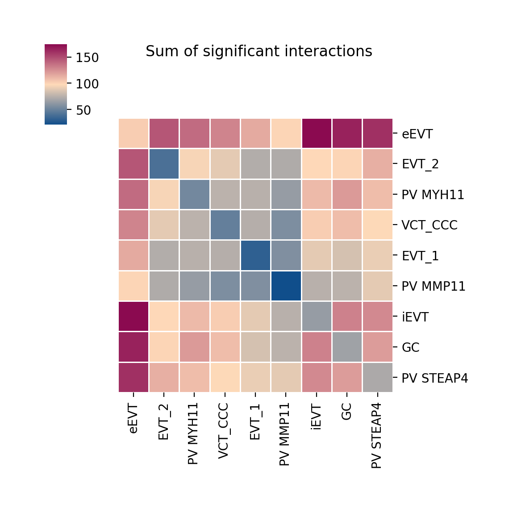{width=56%}

*图 1（第 30 格，原样）。ktplotspy 的自动热图：行是细胞类型，值是与之显著（p ≤ 0.05）的互作数。
这是把 81 列矩阵投影到 9 行——丢掉了方向与伙伴身份，所以 §4.1 用完整矩阵而不是它。*

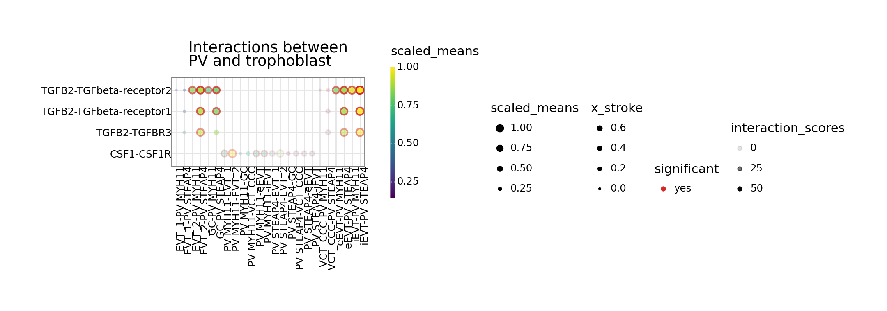{width=96%}

*图 2（第 31 格，原样）。四行（三对 TGFB2–受体，加 CSF1–CSF1R），**24 列而不是 36 列**——
`"PV MMPP11"` 匹配不到任何列、被静默丢弃（CPB-04）。对照图 11 的矫正面板；教师 2026 参考图同样是 24 列。*

*怎么读。* 热图是 `plot_cpdb_heatmap` 的 "sum of significant interactions"——即 81 列 `pvalues` 表在
p ≤ 0.05 下的行和，也就是 §4.1 的行和。点图同时编码四个量：点径 = `scaled_means`、颜色 = `scaled_means`
（因 `standard_scale=True` 而是**行内秩**）、红圈 = 显著、点透明度 = `interaction_scores`
（`scale_alpha_by_interaction_scores=True`）。**`standard_scale=True` 时颜色是行内秩，不是表达量**——
两行颜色相同并不代表表达相同。CPB-15。

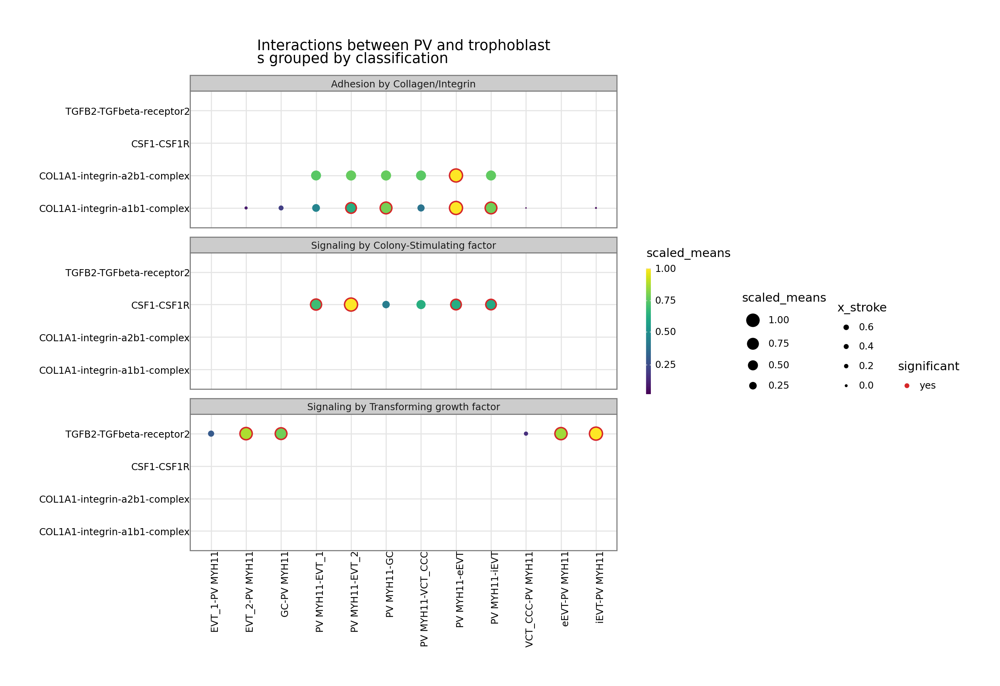{width=92%}

*图 3（第 32 格，原样）。同一张两基因点图按互作 `classification` 分面。分面条带才是要点：
"Adhesion by Collagen/Integrin" 与 "Signaling by Transforming growth factor" 占了大部分可见墨迹，
这正是 §4.2 在整个矩阵层面定量得到的结论。*

*坑。* (i) `"PV MMPP11"` —— 多了一个 `P`。ktplotspy 把 `cell_type1` 与按分隔符切开的列名匹配，
未匹配的类型被静默丢弃，于是画出 2 × 6 = 12 列而不是 3 × 6 = 18 列（完整有序网格是 24 列而不是 36 列）。
无任何警告。CPB-04。(ii) `adata` 是 3312 细胞的对象，`celltype_key="cell_labels"`——与 `metadata.tsv`
用的 `cell_type` **是不同列名**。两个列在 AnnData 里都存在，教程因此侥幸。(iii) 第 31、32 格以 plotnine
对象结尾；notebook 通过 `repr` 显示，脚本直接丢弃。驱动改为赋值并调 `.draw()`（§7 的 H1）。

*扩展。* `plot_cpdb_heatmap` 支持 `degs_analysis=True` 走 DEG 分支（§9）；`plot_cpdb` 支持用 `gene_family=`
代替 `genes=`，以及用 `interacting_pairs=` 指定明确的互作对。

### 第 7 节——Session Info（第 33 格）

遍历 `sys.modules` 打印已加载包版本。有用，也是读者唯一能得知本次运行是 `cellphonedb 5.0.1`、
`ktplotspy 0.3.3`、`plotnine 0.14.5` 的地方——这三者都影响复现，而 notebook 里一个都没钉。

---

## 4. 结果，老老实实读

### 4.1 9 × 9 矩阵

`sig_matrix_9x9.tsv`——行 = 发送方（`cell_type_a`），列 = 接收方（`cell_type_b`），值 = 显著互作数
（单格最大 417，因为全场只有 417 个互作曾显著）：

| | PV MMP11 | PV MYH11 | PV STEAP4 | EVT_1 | EVT_2 | iEVT | VCT_CCC | GC | eEVT | **发出** |
|---|---|---|---|---|---|---|---|---|---|---|
| **PV MMP11** | 21 | 37 | 57 | 36 | 49 | 49 | 40 | 50 | 72 | **411** |
| **PV MYH11** | 30 | 55 | 60 | 38 | 51 | 63 | 45 | 66 | 86 | **494** |
| **PV STEAP4** | 34 | 51 | 71 | 42 | 56 | 59 | 53 | 57 | 88 | **511** |
| **EVT_1** | 21 | 39 | 51 | 32 | 38 | 46 | 43 | 47 | 67 | **384** |
| **EVT_2** | 24 | 45 | 58 | 35 | 40 | 51 | 51 | 49 | 86 | **439** |
| **iEVT** | 27 | 49 | 70 | 43 | 48 | 64 | 53 | 62 | 104 | **520** |
| **VCT_CCC** | 17 | 35 | 45 | 31 | 39 | 51 | 49 | 48 | 76 | **391** |
| **GC** | 28 | 56 | 63 | 39 | 50 | 69 | 61 | 67 | 100 | **533** |
| **eEVT** | 28 | 55 | 76 | 49 | 62 | 70 | 54 | 67 | 104 | **565** |
| **接收** | **230** | **422** | **551** | **345** | **433** | **522** | **449** | **513** | **783** | **4248** |

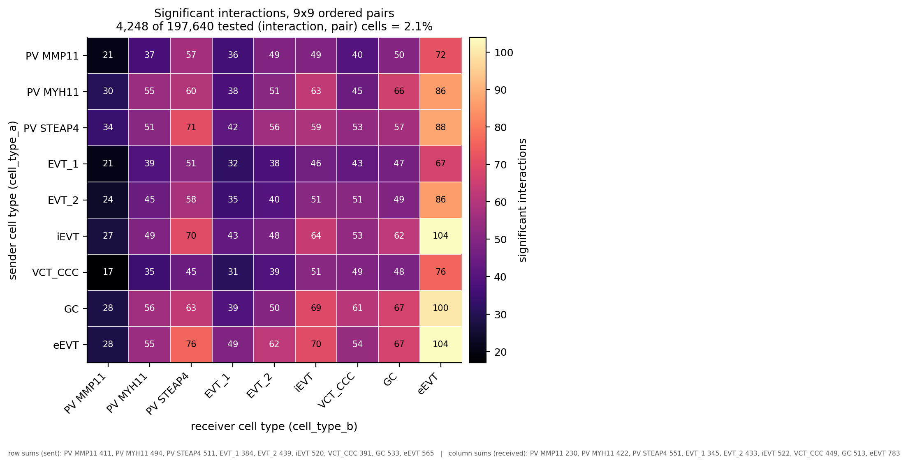{width=88%}

*图 5。教程只能透过一张 9 行热图（图 1）看到的那个量：全部 81 个有序对，脚注给出各行和（发出）与
各列和（接收）。197 640 个被测格中 4248 个通过。对角线是自分泌信号。*

大声读出来，这才是这一讲真正的发现，而且它很干净：

* **eEVT 是枢纽。** 接收最多（4248 中的 783，18 %），发送也在前列（565）。它的自分泌格
  eEVT|eEVT = 104 是全矩阵最大单格——绒毛外滋养层"自言自语"是这块组织里最强的信号。
* **PV MMP11 在另一端**（接收 230、发出 411），而且它的行**最平**：跨接收方 21–72。结合 13 个细胞看，
  这是一个"数据太少、显露不出结构"的簇，而不是一个"不发声"的簇。
* **母–胎轴是有方向的。** 三个 PV 类型作为发送方对六个滋养层类型共 18 个值，均值 **55.6**（36–88）；
  反向块（滋养层 → PV）均值 **43.7**（17–76）。在这份过滤后的集合里，蜕膜侧对滋养层的信号强于反向
  ——27 % 的差距，无论按均值读还是按配对比较读都成立，值得用显式建模方向的方法复核（§11.4）。

### 4.2 Top 互作是些什么

`sig_top_interactions.tsv`（2440 个中的前 20）：

| 互作 | 分类 | 对数（共 81） |
|---|---|---|
| COL4A1_integrin_a1b1_complex | Adhesion by Collagen/Integrin | 76 |
| COL4A2_integrin_a1b1_complex | Adhesion by Collagen/Integrin | 73 |
| COL4A1_ADGRG6 | Adhesion by Collagen/Integrin | 61 |
| MPZL1_MPZL1 | （未分类） | 60 |
| COL21A1_integrin_a1b1_complex | Adhesion by Collagen/Integrin | 59 |
| COL4A2_ADGRG6 | Adhesion by Collagen/Integrin | 58 |
| COL27A1_integrin_a1b1_complex | Adhesion by Collagen/Integrin | 57 |
| IL1RAP_PTPRF | Signaling by Interleukin | 57 |
| SEMA4C_PLXNB2 | Signaling by Semaphorin | 57 |
| PGF_FLT1 | Signaling by Placenta growth factor | 57 |
| FN1_integrin_a5b1_complex | Adhesion by Fibronectin | 54 |
| FN1_integrin_aVb1_complex | Adhesion by Fibronectin | 54 |

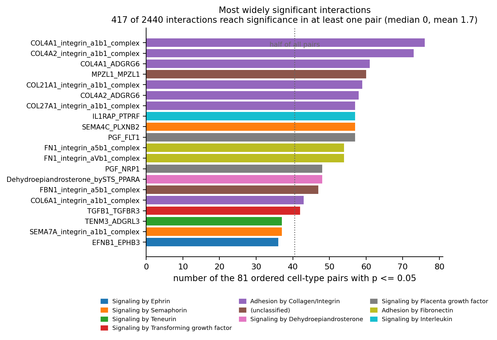{width=92%}

*图 10。在 81 个有序对中显著对数最多的 20 个互作。2440 个互作里 417 个至少在一对显著；
互作的中位数一处都不显著。*

生物学上完全说得通：基底膜胶原与纤连蛋白结合整合素、胎盘生长因子结合其受体 FLT1、信号素、
IL-1 辅助蛋白——正是一张蜕膜–胎盘界面该有的样子。**但请注意这个分布的形状**：2440 个互作里有
417 个至少在一对上显著，互作的中位数在**零**对上显著，而有 17 个互作在 81 对中 ≥ 40 对上显著。这张榜单的顶部
不是"最重要的 20 个信号"，而是"两个基因在两侧都广泛表达"的 20 个互作——这恰是"均值检验 + 10 % 可用性
掩码"所奖励的东西。要主张"胶原–整合素驱动 EVT 侵袭"，这张表还不够。

### 4.3 p 值真实分布

`pvalues` 有 197 640 个有限值（2440 × 81）：

| 区间 | 格数 | 占比 |
|---|---|---|
| p = 0（1000 次打乱无一超过观测） | **2946** | 1.5 % |
| 0 < p ≤ 0.01 | 543 | 0.3 % |
| 0.01 < p ≤ 0.05 | 759 | 0.4 % |
| 0.05 < p < 1 | 3662 | 1.9 % |
| **p = 1** | **189 730** | **96.0 %** |

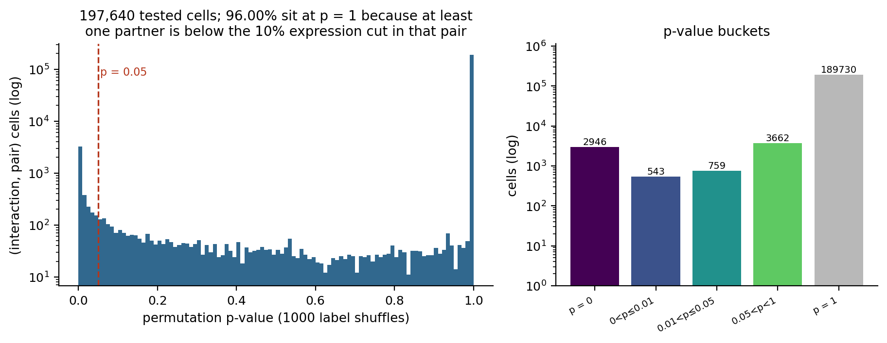{width=98%}

*图 6。左：全部 197 640 个 p 值的分布（对数纵轴）——0 处一个尖峰（截断）、中间一段低平、
1.0 处第二个尖峰。右：同样的数据分桶。**矩阵的 96 % 是 p = 1**，即"没测"，因为有一个伙伴没过
10 % 可用性掩码。*

p = 1 不是"肯定没有信号"，而是"这一对里有一个伙伴没过 10 % 掩码，因此没有做检验"。矩阵的三分之二
是图谱覆盖度的地图，不是结果。又因为检验是单侧置换零假设，那 2946 个精确零全被截断在 1/1000——
这张表分不清"很显著"与"极其显著"。

### 4.4 这一讲里"显著"到底是什么意思

同时是三件事，而哪一件都不是"发生了通讯"：

1. 两个伙伴在各自簇里的表达都超过 10 %（**覆盖度**主张）；
2. 配体在 A 的均值与受体在 B 的均值，联合超过 95 % 的打乱标签实现（**空间一致性**主张）；
3. 除此之外不再有别的——**没有多重校正、没有效应量下限、没有方向性变化模型**。

---

## 5. 教程没做的统计

### 5.1 197 640 次检验、α = 0.05、不做校正

2440 互作 × 81 有序对 = **197 640** 次假设检验。在"完全没有信号"的零世界里，α = 0.05 下的期望
假阳性是 **9882**——比被叫出来的 4248 还多一倍以上。这 417 个互作无论意味着什么，都不是一张 5 % FDR 的
清单。

不过还是做一次：在同一批 p 值上、以全部 197 640 格为一个族做 BH 校正，**q ≤ 0.05 只剩 2946 格、
311 个互作**（C6，`05_corrected/bh_fdr.tsv`）。而这 2946 格**恰好就是 p = 0 的那些格**——p ≥ 0.004 的
一个都没活下来。也就是说，校正并没有给显著条目排序，它只是把置换网格的截断重新施加了一遍：对 4248 的
诚实读法是"2946 格站得住，另有 1302 格只在你接受未校正 5 % 切分时才成立"。教程既没做前者也没做后者，
CellphoneDB 默认同样不做。

### 5.2 1000 次置换把分辨率钉死在 10⁻³

全矩阵最小的非截断 p 是 **0.004**（= 4/1000）。所有报告为 0 的格子，可能是 10⁻³、10⁻⁶ 或真零；表说不出。
这就是为什么 `significant_means` 在实践中是一张**二值**掩码：这里的"显著"是粗网格上的阈值，不是连续分数。

### 5.3 只跑 100 次迭代，答案会完全不同

把 `iterations` 从 1000 降到 100（其余一切不变），得到 **4602 个显著格、454 个显著互作**，与 1000 次
运行的 Jaccard 重叠只有 **0.102**——即 **90 % 的显著格不同**。更少的置换意味着更粗的网格（0.01 步长）
与更高的假阳性率，所以"更显著"的那个结果更不可信。任何引用 CellphoneDB 数字的人，必须把 `iterations`
一起引用。

### 5.4 阈值几乎决定一切

| `threshold` | 显著格 | 显著互作 | 对数 |
|---|---|---|---|
| 0.05 | **7007** | **708** | 81 |
| 0.10（教程） | **4251** | **417** | 81 |
| 0.20 | **2413** | **218** | 81 |

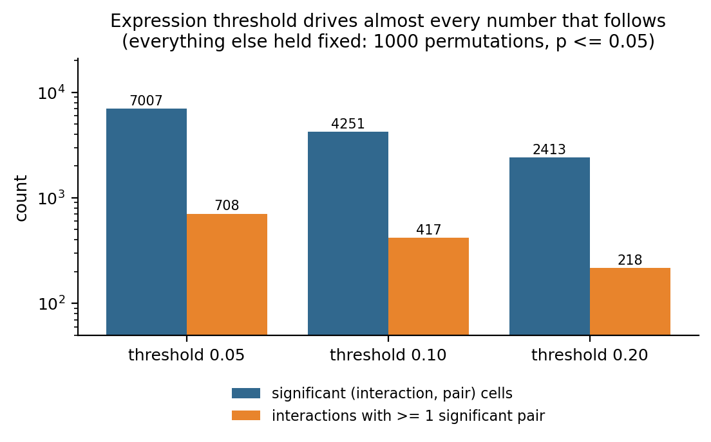{width=62%}

*图 7。同一份数据、同样的 1000 次置换、同样的 p ≤ 0.05——只有可用性阈值在动。*

一个**覆盖度**参数变化 2 倍，头条数字在两个方向上各动 1.7 倍。一个**覆盖度**参数变化 2 倍，头条数字在两个方向上各动 1.7 倍。在 7 格和 13 格的簇里，0.05 意味着
"1 个细胞就够"，0.2 意味着"2 个细胞"——在这个尺度上，这个参数测的不是生物学，而是簇的大小。CPB-05。

### 5.5 五个线程让结果不可复现

| 运行 | 线程 | 显著格 | md5(`significant_means`) |
|---|---|---|---|
| a | 1 | 4246 | `fcf4c9dc…` |
| b | 1 | 4246 | `fcf4c9dc…`（相同） |
| c | 5（教程） | 4251 | `57ebc5bb…` |

单线程逐字节相同；5 线程给出不同答案。教程导出里的那次运行又是另一个数（本集群复跑控制台为 4248，
矫正跑基线为 4251）。没有一个是"错的"——它们是同一分析的不同抽样。但一篇用 5 线程跑出"417 个显著互作"
就收工的论文，报的是一个它从未刻画过的分布中的一次抽样。

### 5.6 第二条独立判据：DEG

CellphoneDB 自带 `cpdb_degs_analysis_method`，把"均值是否高于打乱均值"换成"该基因是否该簇的差异表达基因"。
教程处处 `degs_analysis=False`，并且附了一份自己从不读的 DEG 表。跑这一支（§9）得到
**4191 格 / 419 个互作**——但与置换结果只重叠 **2696 格**（Jaccard **0.469**）；互作层面重叠
**356 / 417 与 419**（Jaccard **0.742**）。两条可用性判据、同一个数据库、同一份矩阵：它们在四分之三的
互作上一致，在不到一半的格上一致。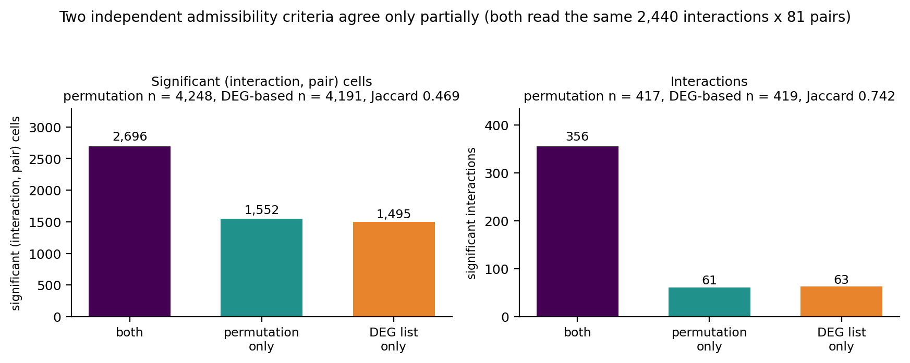{width=92%}

*图 8。CellphoneDB 内置的两条可用性判据在同一次运行上的重合度（详见 §9）。*

谁都不是"真相"；这个不一致本身就是诚实的误差棒。谁都不是"真相"；这个不一致本身就是诚实的误差棒。

---

## 6. 问题台账

十九条，全部复现。"证据"列指向证明它的文件或测量。

| 编号 | 问题 | 严重度 | 证据 |
|---|---|---|---|
| CPB-01 | 目录/课程叫 `cellchat`，内容是 CellphoneDB（无 R、全文无 CellChat） | 命名 | §1.1 |
| CPB-02 | 两处教师家目录硬编码（`os.chdir('/home/zongxu/...')`） | 可移植性 | `patches_applied.txt` |
| CPB-03 | `! pip install cellphonedb` 会改动共享且已正确的环境 | 危害 | 控制台 `[P1] skipped` |
| CPB-04 | `"PV MMPP11"` 拼错：ktplotspy 静默丢类型（24 列而非 36 列） | **结果** | `05_corrected/31_*` |
| CPB-05 | `list(x).sort() == list(y).sort()` 是 `None == None`：barcode 校验从不校验 | **静默** | §3 第 2 节 |
| CPB-06 | `threads=5` 不可复现；单线程逐字节相同 | **可复现性** | `determinism/` |
| CPB-07 | 197 640 次检验、α = 0.05、无 FDR ⇒ 期望假阳性 9882 vs 叫出 4248 | **解读** | §5.1 |
| CPB-08 | `iterations=1000` 把 p 截断在 10⁻³；2946 格在 p = 0 | 解读 | §4.3 |
| CPB-09 | 两方法 key 名不同（`means_result` vs `means`）；复用即 `KeyError` | API | §3 第 3 节 |
| CPB-10 | `active_TFs.tsv` 只改 3 / 4248 格；只喂 CellSign 两张表 | 死输入 | `corrected_summary.json` |
| CPB-11 | 输出文件名带时间戳 ⇒ 名称不可复现（有 `output_suffix` 却不用） | 可复现性 | `03_statistical/*` |
| CPB-12 | 检索把基因过滤、互作过滤与分类过滤叠加：`CSF1_CSF1R` 被静默删除，58 行全是 TGF-β | **结果** | §3 第 5 节 |
| CPB-13 | 处处 `degs_analysis=False`；附带的 limma DEG 表是死输入**且**格式不符 | 死输入 | §9 |
| CPB-14 | 矩阵 42 个标注、微环境 9 个；只分析 230/3312 细胞（6.9 %），33 个类型无警告丢弃 | **范围** | §2.6 |
| CPB-15 | `standard_scale=True` 把表达颜色变成行内秩 | 解读 | §3 第 6 节 |
| CPB-16 | 16 张内嵌图里 13 张是论文示意图，只有 3 张是分析产出 | 预期 | §1.3 |
| CPB-17 | `CellSign_active_interactions`（6 行）打印了，从未解读 | 未用 | §2.5 |
| CPB-18 | 9 × 9 有序对含对称重复；矩阵不对称，教程从未说明 | 解读 | §4.1 |
| CPB-19 | `significant_means` 与 `means`/`pvalues`/`interaction_scores` **行序不同**（同行同 id 比 0.04 %）⇒ 按位置合并会静默把计数挂到错误的互作上 | **危害** | `01_input/table_row_order.tsv` |

### 需要展开的几条

**CPB-04。** 点图的 `cell_type1` 字符串与按分隔符切开的列名匹配。`PV MMPP11` 匹配不到任何列，不抛异常，
图用剩下两个类型画完。实测 x 轴对数：原样 **24**、矫正 **36**（`05_corrected/31_xaxis_pairs_*.tsv`）。
教师 2026 参考图同样是 24 列——这个 bug 在参考集里也被复现，所以拿它做差异检验必须当心。

**CPB-14 与 §2.2 合起来**才是这一讲最深的问题。最小的两个簇（7 与 13 个细胞）正是母–胎界面的**母侧**，
即生物学上最有意思的比较，而它们恰恰是"10 % 等于一两个细胞"的簇。

**CPB-18。** 因为 `A|B` 与 `B|A` 是分开的检验，9 × 9 矩阵应读成有向图，对角线是自分泌。教程的热图
（"Sum of significant interactions"）把行折叠了，恰好隐藏了这个方法本要暴露的方向性。

**CPB-19** 是我自己第一轮取证时踩到的：我按行位置生成的 Top 互作表，把属于
`COL4A1_integrin_a1b1_complex` 的真实计数 76 挂到了 `IAPP_AMY3_receptor` 头上——后者在 **0** 对上显著，
两个基因在九个簇里几乎都不表达（均值 ≤ 0.024，eEVT 中 7 % 细胞）。文件已按 `id_cp_interaction` 合并重生成，
抓它的审计（`table_row_order.tsv`）已并入取证执行线。任何按位置取 `means.values` 与
`significant_means.values` 的下游代码，都是同样的错。

---

## 7. 矫正与偏离（C1–C10）

没有一项进入原样跑。它们是：成文偏离（H1、P1、P2）、矫正跑里的修正、以及让这一讲可被检验的补充。

| 编号 | 内容 | 理由 |
|---|---|---|
| **P1** | 中和 `! pip install cellphonedb` | CPB-03 |
| **P2** | 去掉 `%matplotlib inline`（Agg + 显式抓图） | shell magic，非 Python |
| **H1** | 第 31/32 格：赋值 plotnine 对象并调 `.draw()` | 脚本不会像 notebook 那样显示"最后一个表达式" |
| **C1** | `"PV MMPP11"` → `"PV MMP11"` | CPB-04；画出 36 列而不是 24 列 |
| **C2** | 参考运行用 `threads=1` | CPB-06；逐字节可复现 |
| **C3** | 每次运行带 `output_suffix=` | CPB-11 |
| **C4** | barcode 校验改写为对顺序敏感的 `assert` | CPB-05 |
| **C5** | 把检索拆成三个过滤分别报告 | CPB-12 |
| **C6** | 以全部 197 640 格为族计算 BH–FDR（q ≤ 0.05 → **2946 格 / 311 互作**） | CPB-07；产出 `05_corrected/bh_fdr.tsv` |
| **C7** | 扫描 `iterations` ∈ {100, 1000} 与 `threshold` ∈ {0.05, 0.10, 0.20} | CPB-08、§5.4 |
| **C8** | 有/无 `active_TFs` 各跑一次 | CPB-10 |
| **C9** | `significant_means` 一律按 `id_cp_interaction` 合并 | CPB-19 |
| **C10** | 真跑 `cpdb_degs_analysis_method`，并给一份 CellphoneDB 格式的 DEG 表 | CPB-13、§9 |

矫正跑整体 **289.6 s**，除按设计可见的修正（C1 的面板，§8）外，逐图复现原样跑。

---

## 8. 图，以及和教师两套参考集的定量对拍

教师有两套参考集，而且它们不是同一批文件：

* **2025 HTML 导出**——`scRNAseq-cellchat.html` 内嵌 base64 的 3 张分析图（已解出到
  `ref/figures/teacherhtml/`）；
* **2026 脚本重跑**——`/lustre1/share/scRNA-adv-2026/figure/cellphoneDB/`（3 张，2026-11-08 由升级脚本产出；
  已复制到 `ref/figures/teacher2026/`）。

对拍给两个数：**结构相关**（灰度、等比缩放后 Pearson）与**墨迹 IoU**（二值化，忽略抗锯齿）。

| 图 | 我们 | vs 2026 重跑 | vs 2025 HTML | 判定 |
|---|---|---|---|---|
| 第 30 格热图 | 1149×1149 | r = **0.999**，IoU = **0.987** | r = **0.999**，IoU = **0.979** | 复现 |
| 第 31 格点图（24 列） | 2160×760 | r = **0.997**，IoU = **0.899** | r = **0.882**，IoU = **0.521** | 复现 |
| 第 32 格分面点图 | 2552×1751 | r = **0.999**，IoU = **0.937** | r = **0.861**，IoU = **0.462** | 复现 |
| C1 矫正面板（36 列） | 2160×760 | r = **0.977**，IoU = **0.835** | r = **0.880**，IoU = **0.545** | 按设计偏离 |

三张教程图对 2026 重跑基本等价于逐像素一致：尽管 5 线程不确定，这一讲端到端复现了——因为**图**在固定
0.05 处汇总 p 值表，线程数带来的 ±3 格挪不动任何一个像素。

2025 HTML 一列是"结构高、墨迹低"，原因可测：内嵌渲染的包围盒与 dpi 与我们的不同（第 31 格 2200×800 vs
我们 2160×760；第 32 格 2600×1800 vs 2552×1751），等比缩放后细线边缘不再重合。由 matplotlib 绘制、
包围盒稳定的热图则 IoU 0.979。因此把 IoU 列读成"图有多像"是错的；它量的是"**渲染**有多像"。

矫正面板（C1）的对比才是有意思的那一组：

| 面板 | 列数 | 说明 |
|---|---|---|
| `31_PV_trophoblast_aswritten_typo.png` | **24** | 2 个 PV 类型 × 6 滋养层 + 12 列 |
| `31_PV_trophoblast_corrected.png` | **36** | 3 个 PV 类型 × 6 滋养层 × 2 基因 |
| 教师 2026 参考图 | **24** | 与原样跑同一个拼写错误 |

{width=96%}

*图 4（第 31 格，请求了三个 PV 类型）。请求三个 PV 类型却得到 **24 列**，就是 CPB-04 的可视签名：
3 × 6 × 2 本应是 36 列。*

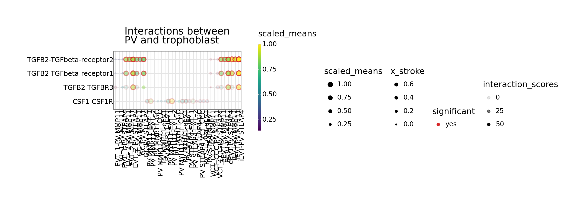{width=96%}

*图 11（C1）。同一个调用把 `"PV MMPP11"` 改成 `"PV MMP11"`：36 列而不是 24 列，缺失的 PV 类型出现了。
对教师参考集而言这是有意的偏离。*

也就是说参考集继承了 CPB-04。也就是说参考集继承了 CPB-04。若天真地"与教师图做差异"会把**矫正版**判成偏离。这就是本模块两版都保留、
并让 `results_figcmp.tsv` 记录每张图对的是哪套参考的原因。

---

## 9. 教程关掉的那条 DEG 分支

`cpdb_degs_analysis_method.call` 是同一条流水线、不同的可用性规则：它不置换标签，而是问每个伙伴是否为
该簇的**差异表达基因**。教程每一次调用都写 `degs_analysis=False`，同时又附上
`DEGs_inv_trophoblast.tsv`——然后从不读取。

**为什么附带的那张表不能直接用。** CellphoneDB 要一张 `cluster / gene` 两列（可带统计）的表。附带的却是
limma 表，列为 `cluster, gene, logFC, P.Value, adj.P.Val`。直接喂会在这方法深处抛
`AttributeError: 'DataFrame' object has no attribute 'id_cp_interaction'`——格式是被假设的，不是被校验的（CPB-13）。

**附带表里到底是什么。** 13 809 行、覆盖 **6 个簇**（eEVT 4217、iEVT 3506、EVT_1 2692、VCT_CCC 2215、
GC 981、EVT_2 198）。它本身已是一张**只含显著**的清单：**100 % 的行 `adj.P.Val < 0.05`**，所以"按 0.05 过滤"
是空操作。它只覆盖 9 个微环境类型中的 **6 个**——三个 PV 类型（含最小的两个簇）**一个 DEG 都没有**，
因此任何需要 PV 侧 DEG 的互作都不可能被叫出（图 9）。

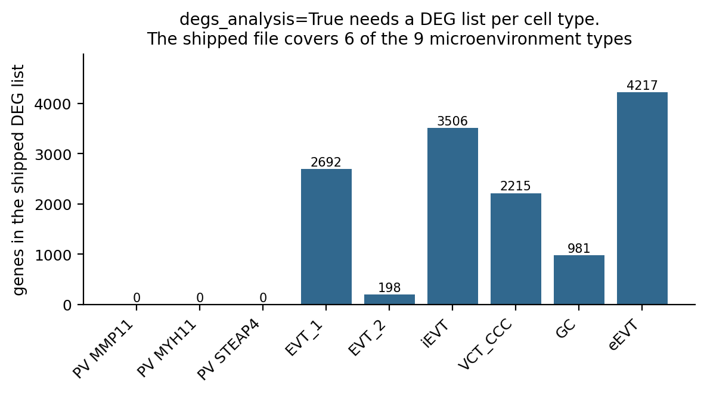{width=62%}

*图 9。附带的 DEG 清单只覆盖 9 个微环境类型中的 6 个。三个 PV 类型——界面的母侧、也是最小的两个簇
——一个都没有，于是 DEG 分支恰好对这一讲最关心的那个区室视而不见。*

**运行。** 一个变体、8 张表、33 s：**4191 个显著格 / 419 个互作 / 81 对**，外加两张点图
（`32_degs_analysis_A_asis_EVT_1.png`、`…_PV_MYH11.png`）。与置换运行的一致度：并集 5743 格中重合
**2696 格**（Jaccard **0.469**）；并集 480 个互作中重合 **356 个**（Jaccard **0.742**）——图 8。
有 9 对在置换下显著、却完全没有 DEG 支持；没有一对在 DEG 下显著而缺席置换清单。

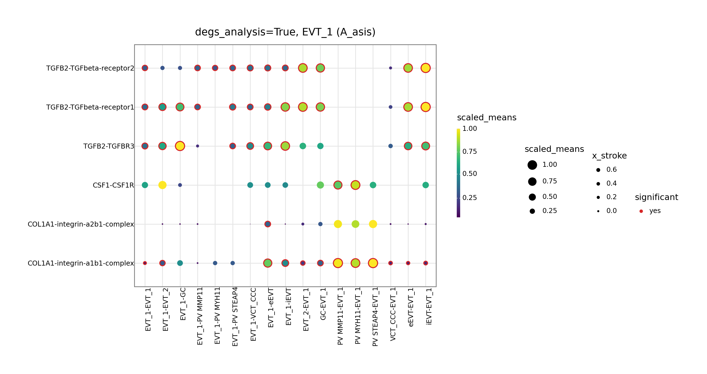{width=96%}

*图 12。这一支真正画出来的东西：`degs_analysis=True`、`cell_type1='EVT_1'`、基因 TGFB2 / CSF1R / COL1A1。
红圈是 CellphoneDB 在 DEG 规则下判为显著的条目——注意它们与图 2 的条目**不同**，这就是图 8 的分歧被画了出来。*

**怎么读。** DEG 那一支**不是**更好的过滤器——它问的是另一个问题。置换问"这一对的表达模式在标签可交换下
是否罕见"；DEG 问"这个基因是不是该簇的标记"。一个广泛表达但不是标记的受体，对第二个检验不可见，哪怕
第一个检验发现它极显著。两个都报，并把它们分歧的那 0.469 摆出来，比只报任一个都更诚实。

---

## 10. 复现本文

```bash
# 0) 环境（共享，已正确）
/lustre1/share/scRNA-adv-envs/scRNA-adv/bin/python -c \
  "import cellphonedb, ktplotspy; print(cellphonedb.__version__, ktplotspy.__version__)"
# -> 5.0.1 0.3.3

# 1) 原样跑（≈100 s）
python results/scripts/cellchat_cells_aswritten.py        # 写 results/02_simple .. 04_figures

# 2) 矫正跑（≈290 s）
python results/scripts/cellchat_corrected.py              # 写 results/05_corrected

# 3) 取证：确定性、扫描、矩阵、行序审计（≈27 min）
python results/scripts/cellchat_evidence.py

# 4) DEG 分支（≈90 s）
python results/scripts/cellchat_degs.py

# 5) 五张分析图（≈15 s）
python results/scripts/cellchat_plots.py

# 6) 与两套参考集对拍
python results/scripts/compare_figs_cellphonedb.py

# 7) 构建本文
cd ref && ./build.sh scRNAseq_cellphonedb_corrected.md
```

`cellchat_cells_aswritten.py` 由 `make_driver.py` 从抽出的 cell 流生成；它施加的三处偏离列在
`patches_applied.txt` 里，并在脚本内标为 `[P1]`、`[P2]`、`[H1]`。

**数据。** 一切读自 `/lustre1/share/scRNA-adv-2026/data/data_cellphoneDB/`，与 2025 副本逐字节一致
（四个小表 + `cellphonedb.zip`，已核 md5）。仓库不存大文件；h5ad 留在 `/lustre1`。

---

## 11. 参考文献

1. Efremova M, Vento-Tormo M, Teichmann SA, Vento-Tormo R. *CellPhoneDB: inferring cell–cell
   communication from combined expression of multi-subunit ligand–receptor complexes.*
   **Nat Protoc** 15:1484–1506 (2020).
2. Vento-Tormo R, Efremova M, Botting RA, et al. *Single-cell reconstruction of the early maternal–
   fetal interface in humans.* **Nature** 563:347–353 (2018). —— 本讲数据集。
3. Garcia-Alonso L, Handfield L-F, Roberts K, et al. *Mapping the temporal and spatial dynamics of the
   human endometrium in vivo and in vitro.* **Nat Genet** 53:1698–1711 (2021). —— v5 数据库背景。
4. Dimitrov D, Türei D, Garrido-Rodriguez M, et al. *Comparison of methods and resources for cell–cell
   communication inference from single-cell RNA-Seq data.* **Nat Commun** 13:3224 (2022). —— 方法选择为何重要。
5. Armingol E, Officer A, Harismendy O, Lewis NE. *Deciphering cell–cell interactions and
   communication from gene expression.* **Nat Rev Genet** 22:71–88 (2021). —— 教程前 20 格 markdown 的
   概念地图。
