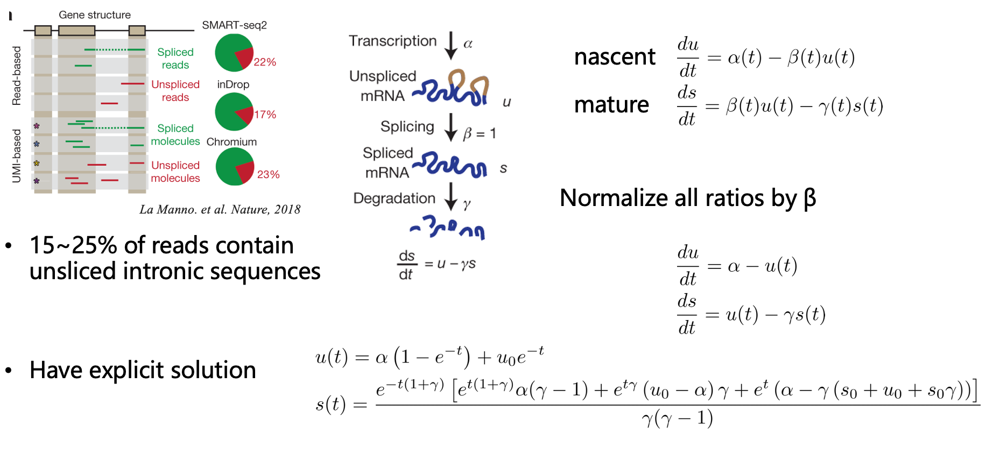
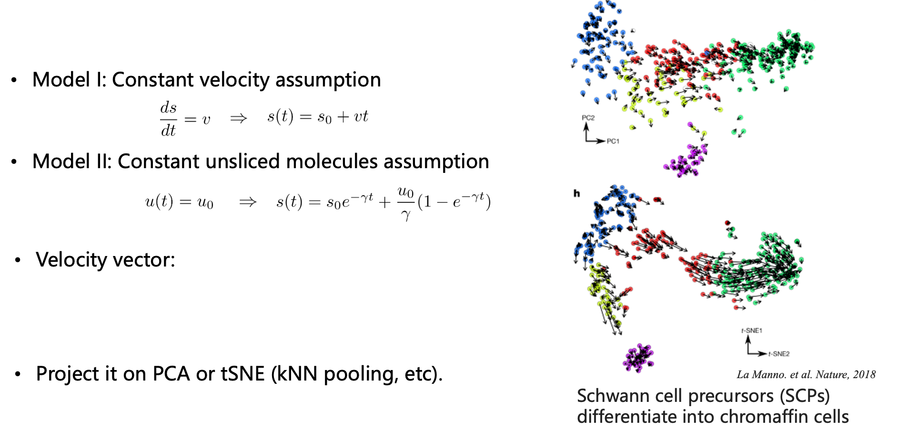
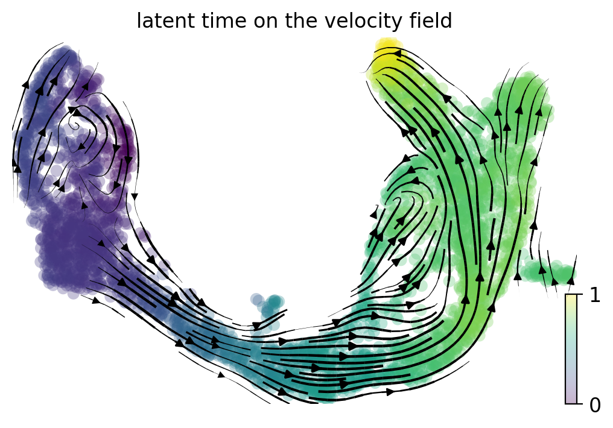
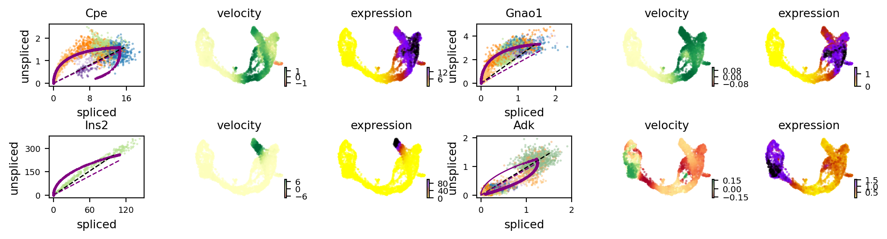
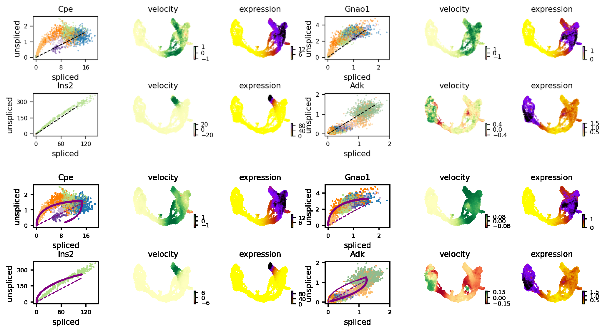
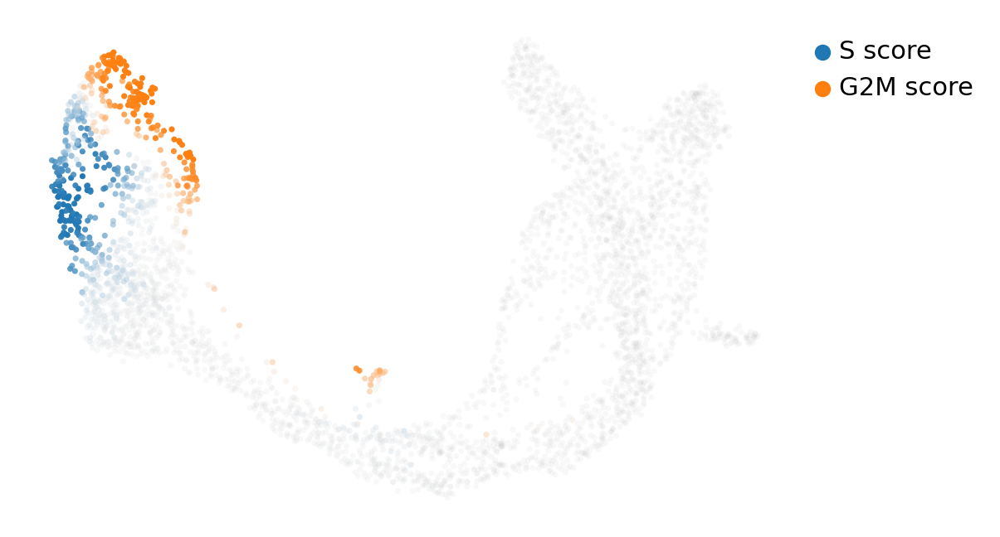

# RNA velocity with scVelo (mouse pancreas, E15.5) — Corrected & Annotated Edition

## 0. About this edition

The course notebook `scRNAseq-scVelo.ipynb` (29 code cells, 59 markdown cells, archived here as
`ref/scRNAseq-scVelo.ipynb`) teaches RNA velocity on the mouse pancreatic endocrinogenesis data set
of Bastidas-Ponce et al. (2019) and then runs a single scVelo pipeline on it: load, filter, smooth,
`scv.tl.velocity` in its default *stochastic* mode, draw the stream and arrow plots, read four phase
portraits, rank velocity genes per cluster, score the cell cycle, and finish with the S/G2M gradient
plot and a second stream plot. Everything in it works. Nothing in it is saved.

This edition is the sixth module of the course rework, and it does what the previous five did: it
runs the notebook **exactly as written** first, records what the run actually produced (numbers,
warning texts, figure files), compares the eleven figures the course ships against the ones the run
produces, and only then writes a corrected pass that fixes what is demonstrably wrong or missing.
Nothing is changed in the as-written run — the errors are kept as evidence and indexed in
section 1.

The one thing this edition adds that changes the lesson's meaning is that **the model the theory
section teaches is finally executed**. The notebook spends nine slides and four figures on the
dynamical (EM) model — latent time, transcription on/off states, per-gene α/β/γ — and then never
calls `scv.tl.recover_dynamics`. Students leave believing they have run scVelo's model when they
have run its steady-state approximation. Section 10 runs the real model on the same object and
section 12 measures what the two models disagree about. That measurement is the most useful number
in this document: on this data set the stochastic and dynamical models agree on the global flow and
disagree on **87% of the genes they rank highest** (top-20 Jaccard 0.13).

Everything here was produced on the cluster from the same pinned environment and the same input
file, and every number in the text can be regenerated from the four scripts in `results/scripts/`
(section 17). Where a claim is a measurement it is given as a number with its file of origin; where
it is an interpretation it is marked as one.

## 1. Issue list at a glance

Seventeen entries. "Measured" means the consequence was quantified in this module, not merely
observed. The last row is a suspicion from the planning pass that the run **disproved** — it is kept
because it is the kind of thing a reader will otherwise re-derive and worry about.

| ID | What the tutorial does | What actually happens | Consequence |
|---|---|---|---|
| VELO-01 | `filter_and_normalize(...)` then `sc.pp.log1p` | not a double log: scVelo 0.3.4 normalises but never logs, despite a docstring that still says "log transform" | none — the second call is required. **Pre-registered suspicion retracted** |
| VELO-02 | treats `adata.X` and `layers['spliced']` as the same quantity | `X` is log-normalised (max 7.31), the layers stay linear (max 1488.7 spliced, 573.3 unspliced) | any plot or statistic mixing the two is on the wrong scale |
| VELO-03 | 9 slides + 4 figures on the dynamical/EM model; `recover_dynamics` never called | the run only ever executes the steady-state (stochastic) model | the taught model is untested; top-20 velocity genes overlap only 13% (measured) |
| VELO-04 | `scv.pp.moments(n_pcs=30, n_neighbors=30)` | rebuilds the neighbour graph inside `moments`; that path is deprecated since scVelo 0.4.0 and warns | a hard break on the next upgrade; fixed by building neighbours once with scanpy |
| VELO-05 | `n_top_genes=2000`, `k=30`, `n_pcs=30`, `min_corr=.3`, `perc=[5,95]`, all unexplained | the first three move the top-20 velocity-gene list by Jaccard 0.50 / 0.58 / 0.66 / 0.78; `min_corr=.3` never filters anything | the tutorial's "result" is one point of a family; measured in §14 |
| VELO-06 | `print(adata.X[:5,:10])` to show the matrix | prints a coordinate triplet dump from the top-left corner, unreadable | use `describe()`/`to_df()`; cosmetic |
| VELO-07 | `adata.var.head(3)` as "the gene annotation" | the only column is `highly_variable_genes`, a *legacy* flag (4,004 True / 13,338 False / 10,656 NaN on the full matrix) that is not the HVG selection (`highly_variable`) | readers think the 2,000-gene subset is not really HVG |
| VELO-08 | `scv.tl.score_genes_cell_cycle` then plots the gradients | the call **overwrites** the `S_score`/`G2M_score` shipped with the data (Pearson 0.964 / 0.973, means shift −0.088→−0.003 and −0.136→−0.109) | the figure silently changes meaning; no warning |
| VELO-09 | projects velocity onto the shipped `X_umap` | that UMAP is 50 PCs of all 27,998 genes with k=15; the velocity graph is 30 PCs of 2,000 HVG with k=30 | arrows are projected into a space they were not computed in; recomputing the PCA alone moves the top-20 list by Jaccard 0.78 |
| VELO-10 | draws `velocity_embedding_stream` twice (cells 63 and 84) | the two files are byte-identical (same md5) | one of the eleven "figures" carries no information |
| VELO-11 | nothing is saved: no `save=`, no `write()`, no tables | the run leaves nothing behind but the HTML export | the whole lesson is unreproducible from its own page; corrected pass writes 13 figures + 17 tables |
| VELO-12 | no seed anywhere; `velocity_graph()` default `n_jobs=1` | the as-written log says "using 1/32 cores" and the graph takes 9 s; the stochastic fit uses a random subset | not bit-reproducible; 32 cores cut the graph to 6–7 s |
| VELO-13 | (noise) | the import chain prints TF/oneDNN CUDA banners, and every loky pool shutdown prints `SystemExit: 0` → `OSError: [Errno 16] ... .nfs...` | looks like a crash, is not; documented so nobody debugs it |
| VELO-14 | `scv.pl.proportions` drawn as "the unspliced share" | with `use_raw=True` (default) it plots `initial_size_*`, i.e. the **pre-filter** library sizes: 12.3–20.7% per cluster, 16.3% overall — while the same object's current layers give 19.9–25.3% and 23.0% | a reader recomputing "17%" from `layers` cannot reproduce the figure |
| VELO-15 | eleven reference PNGs presented as one run's output | they carry three different dpi settings (80 for 01/02/08/11, 96 for 03, 64 for 04–07/09/10) | the "reference" is a stitch of ≥3 sessions; §3 compares accordingly |
| VELO-16 | `scv.pl.velocity(..., mode='dynamical')` used as if it selected the model's curve | `mode` only toggles how many side panels are drawn; the curves come from `fits`, whose default already includes the dynamical fit | the panel the tutorial calls "dynamical" is byte-identical to the default one (§11) |
| VELO-17 | `recover_dynamics` called bare (as the slides imply) | it defaults to `var_names="velocity_genes"`, so the EM is fitted only on the genes the *previous* steady-state run flagged | the two models are then not fitted on the same genes; fixed with `var_names="all"` (1,038 → 2,000 genes, §10) |

## 2. Environment and data

### 2.1 Environment

No conda environment on the cluster carries scVelo, and retrofitting it into the shared scRNA-seq
environment (scanpy 1.10.3 / anndata 0.10.9) would have dragged anndata and numba sideways for every
other module. A separate environment pinned to the teacher's own `Session Info` was built instead:

| package | version | why this one |
|---|---|---|
| python | 3.11.18 | teacher's notebook reports 3.11 |
| scvelo | 0.3.4 | exactly what `pip install scvelo --upgrade` resolves today, and what the teacher ran |
| scanpy | 1.10.4 | teacher's version; scVelo 0.3.4 is not tested against 1.11 |
| anndata | 0.11.4 | required by scanpy 1.10.4 |
| numpy / scipy / pandas | 1.26.4 / 1.12.0 / 2.2.0 | teacher's versions; numba 0.60 caps numpy at 1.26 |
| matplotlib | 3.8.2 | teacher's version — panel geometry depends on it |
| igraph / leidenalg | 0.11.6 / 0.10.2 | not used by this notebook, kept for parity with lesson 5 |
| numba / h5py | 0.60.0 / 3.12.1 | scVelo's JIT kernels and h5ad I/O |

Building it:

```
conda create -y -n velo python=3.11
conda activate velo
pip install "scvelo==0.3.4" "scanpy==1.10.4" "anndata==0.11.4" \
            "numpy==1.26.4" "scipy==1.12.0" "pandas==2.2.0" \
            "matplotlib==3.8.2" "numba==0.60.0" "h5py==3.12.1" \
            "igraph==0.11.6" "leidenalg==0.10.2"
```

Two pieces of console noise come with this environment and are **not** errors. Importing scVelo
pulls in TensorFlow (for a module this notebook never touches), which prints oneDNN/CUDA banners
("Could not find cuda drivers", "TF-TRT Warning") even on a CPU-only node. And every `n_jobs>1`
call ends with a loky pool shutdown that prints `SystemExit: 0` followed by
`OSError: [Errno 16] Device or resource busy: '.nfs00000000...'` — the pool's temp directory cannot
be removed because NFS still holds it. Both appear in the as-written console log in
`results/09_run_logs/aswritten_console.txt`; both are harmless (VELO-13).

### 2.2 Input data

`data/Pancreas/endocrinogenesis_day15.h5ad`, 52 MB, from the course share. It is element-for-element
identical to what `scv.datasets.pancreas()` downloads, so staging it under
`<run>/data/Pancreas/endocrinogenesis_day15.h5ad` and pointing `scv.settings.datasetdir` at `<run>` lets
the tutorial's own line run unchanged and offline:

```python
import scvelo as scv
scv.settings.datasetdir = "<run>"      # the only line added to the tutorial's cell
adata = scv.datasets.pancreas()        # day 15, Ngn3-Venus reporter, E15.5
```

The object is 3,696 cells × 27,998 genes with `layers['spliced']` (9,298,890 non-zeros) and
`layers['unspliced']` (3,156,504 non-zeros) from velocyto-style intron/exon counting, `X` as raw
counts, `obs['clusters']` with eight annotated populations, `obs['clusters_coarse']` with three,
the shipped `S_score`/`G2M_score`, a 50-component `X_pca`, a two-dimensional `X_umap` fitted with
k=15 neighbours, and `var['highly_variable_genes']` — the legacy flag of VELO-07.

Cluster sizes, because every velocity statement in this document is conditioned on them:

| cluster | cells | cluster | cells |
|---|---|---|---|
| Ductal | 916 | Alpha | 481 |
| Ngn3 high EP | 642 | Ngn3 low EP | 262 |
| Pre-endocrine | 592 | Epsilon | 142 |
| Beta | 591 | Delta | 70 |

### 2.3 Run layout

Three scripts, one comparison tool, and a figure-capture harness live in `results/scripts/`:

- `scVelo_py_cells_aswritten.py` — the 29 code cells copied line for line, in order, with PyPlot's
  `show` intercepted so that each `scv.pl.*` call is written to `figures/` under the name of the
  tutorial's cell. That is the as-written evidence base; it is never edited again.
- `scVelo_py_cells_corrected.py` — the corrected pass (§15): same object, same parameter values
  unless the issue list says otherwise, plus what the tutorial omits, with tables dumped per step.
- `scVelo_audit_run.py` — an independent audit that reads an `.h5ad` back and re-derives the numbers
  from the stored object rather than from the run's own variables (proportions, per-cell speeds,
  phase-portrait statistics, rankings, cycle scores). Run against both the as-written and the
  corrected object, so "what changed" cannot be an artefact of the script that changed it.
- `compare_figs_velo.py` — normalises two PNGs to a common canvas, computes structural correlation
  and ink IoU, and records canvas sizes and colour profiles into a TSV.
- `make_doc_figures.py` — builds the comparison stacks and the two derived charts used below.

### 2.4 Output layout in this repository

```
results/
├── 01_preprocess/        proportions figure + the two audit tables of the input itself
├── 02_velocity/          stream/arrow figures, per-cell velocity, velocity-graph statistics
├── 03_phase_portraits/   the three phase-portrait panels + per-gene phase statistics
├── 04_gene_dynamics/     the two gene panels + the velocity-gene ranking
├── 05_cellcycle/         the two cell-cycle figures + cycle scores and phase markers
├── 06_corrected/         13 corrected figures + the corrected-pass tables (dynamical model,
│                         latent time, sensitivity sweeps, ranking side-by-side)
├── 07_figure_comparison/ the two machine-readable comparison TSVs
├── 09_run_logs/          three console captures (as-written, corrected, both audits)
└── scripts/              the five scripts above
```

## 3. The as-written run: what the tutorial actually produces

### 3.1 The seven steps and their cost

The 29 code cells reduce to seven operations, each with a measured wall time on one node (the
as-written run uses no parallelism at all, exactly as the notebook does):

| step | call | time | what it produced |
|---|---|---|---|
| 0 | `scv.datasets.pancreas()` | 1 s | 3,696 × 27,998 object, 9.3 M spliced / 3.2 M unspliced non-zeros |
| 1a | `scv.pp.filter_and_normalize(min_shared_counts=20)` | 4 s | "Filtered out 20801 genes that are detected 20 counts (shared)"; 7,197 genes |
| 1b | `sc.pp.log1p` | <1 s | `X` logarithmic (max 7.31); layers untouched |
| 1c | `sc.pp.highly_variable_genes(2000, flavor="seurat", subset=True)` | 2 s | 2,000 genes, same order |
| 1d | `scv.pp.moments(n_pcs=30, n_neighbors=30)` | 7 s | `Ms`/`Mu` smoothed layers; neighbour graph rebuilt (VELO-04) |
| 2 | `scv.tl.velocity()` + `velocity_graph()` | 1 s + 9 s | velocity layer over 1,038 genes; Markov graph with 593,854 non-zeros |
| 3–6 | 11 `scv.pl.*` calls + ranking + cell cycle | 4 s | 11 PNGs, inner ranking tables discarded |
| 7 | (nothing) | — | **no file written** (VELO-11) |

Total 42.6 s on one core. The tutorial's own `Session Info` reports comparable timings, which is
the first hint that the teacher ran the same code on the same machine class.

### 3.2 The number trail

These are the reference values for the rest of the document; all of them are reproduced by the
corrected pass and by the independent audit of the stored object.

- genes 27,998 → 7,197 (after shared-count filtering) → 2,000 (HVG), which is 51.9% of the 7,197
  declared "velocity genes" (`velocity_genes` = True for 1,038 of the 2,000).
- cells 3,696, unchanged; eight clusters as in §2.2.
- velocity graph: 593,854 non-zeros out of 3,696² = 13.7 M entries (4.3% density), k=30.
- smoothed layers: `Ms` sums to 5,778,956.5, `Mu` to 1,728,696.8 — 23.0% unspliced *in the current
  layers*, which is not what the proportions figure shows (VELO-14, §7).
- cell cycle: 2,537 cells in G1, 878 in S, 281 in G2M.
- phase-marker genes, by the score the tutorial computes: S = Mcm6, Hells, Tyms, Pola1, Uhrf1;
  G2M = Hn1, Top2a, Kif23, Ckap2l, Kif2c.

### 3.3 Figure fidelity against the eleven reference PNGs

The course ships eleven analysis PNGs next to the notebook. My as-written run reproduces ten of them
at structural correlation 0.973–0.993 (ink IoU 0.85–0.96) and one at 0.589. The comparison is
machine-readable in `results/07_figure_comparison/figure_comparison_aswritten.tsv` and drawn here:

{width=100%}

Ten of eleven at ≥0.97 is the strongest possible evidence that the pipeline is deterministic and
that the run is faithful — it is also why the eleventh panel is worth a paragraph. Its canvas
(1205 × 648) is *identical* to the reference, the legend text is pixel-identical, marker ink is 12%
of the panel against our 14%, and the RGB agreement with our figure is 0.78 (0.76 against the variant
that keeps the shipped scores). So the discrepancy is not data, not canvas size and not the score
version: the colour mapping inside the two marker clouds differs, which means that one PNG was drawn
by a different scVelo build than the other ten.

The canvas sizes are themselves informative, because they reveal what the export is:

| reference panels | reference px | our px | ratio | implied dpi |
|---|---|---|---|---|
| 01, 02, 08, 11 | 1415×475, 977×690, 1205×648, 977×690 | same | 1.00 | 80 |
| 03 | 1171×828 | 975×690 | 1.20 | 96 |
| 04, 05, 06, 07, 09, 10 | 1644×445 … 1651×628 | 2056×557 … 2065×787 | 0.80 | 64 |

Three dpi settings in one "run" means the eleven PNGs were collected from at least three execution
sessions with different `scv.set_figure_params(dpi=...)` — VELO-15. It matters for how the fidelity
numbers above should be read: they are computed after normalising each pair to a common canvas, so
the correlation measures content, not dpi.

### 3.4 The bottom line

The velocity field this notebook produces is correct and reproducible; the model behind it is not the
one the slides teach, and the inputs to that field are chosen by five unexplained defaults. The rest
of this document separates those three claims: what the field shows (§11), what the model assumes and
what happens when the other model is run (§10, §12), and how much the defaults matter (§14).

## 4. Theory I — why expression is stable, and what an attractor has to do with a cell

The notebook opens with two figures that are easy to skip and that carry the whole conceptual
argument. The first is the Sui et al. (2005) HL60 experiment: cells treated with all-trans retinoic
acid (atRA) or DMSO, 2,773-dimensional expression state space reduced to two principal components,
sampled at 2 h intervals over seven days, with a density landscape drawn at each time point.

{width=100%}

Read panel b as the claim the whole lesson rests on: the two treatments do not wander at random, they
move through expression space along a reproducible path, and the reproduction is stable enough that
an arrow drawn between consecutive 2 h samples points where the next sample actually goes. If
expression were a random walk, nothing downstream — no velocity, no stream plot, no latent time —
would mean anything. Panel a adds the second half of the argument: atRA and DMSO end in different
regions of the space, i.e. different attractors, and the *basins* are what we call cell fates.

The second figure converts that claim into a mechanism, using the EGF stimulation time course of
MCF10A cells (La Manno et al., 2018, Fig. 1): exon and intron probes separated on the array, so the
same gene gives a mature-mRNA signal and a pre-mRNA signal.

{width=100%}

The immediate early genes (PTGS2, NR4A1, TGFA, HBEGF) have mature-mRNA half-lives of 18–34 min
while their pre-mRNA disappears in 2–3 min; the late responders (LAMC2, TUFT1) have mature-mRNA
half-lives of 102–790 min with the same 3 min pre-mRNA. The asymmetry is the signal: because the
precursor turns over an order of magnitude faster than the product, the *ratio* of unspliced to
spliced reads at a single moment carries information about whether transcription is currently rising,
falling or steady. That is the whole trick, and it is why the ratio has direction.

## 5. Theory II — the splicing ODE, and the steady-state shortcut

The notebook then writes the two-compartment model down and derives three estimators from it. The
model is a chain of two first-order reactions, with the number of reads counted in each compartment:

{width=100%}

With α the transcription rate, β the splicing rate and γ the degradation rate, the model is

```
du/dt = α(t) − β(t)·u(t)          u = unspliced (pre-mRNA)
ds/dt = β(t)·u(t) − γ(t)·s(t)     s = spliced (mature mRNA)
```

and since only the *product* βu is identifiable from unlabelled data, scVelo normalises the splicing
rate to β = 1 and keeps everything relative (that normalisation is exactly why velocity has units of
"unspliced per spliced" and never of time):

{width=100%}

{width=100%}

Three estimators follow from those equations, and the notebook presents all three in one slide. The
first is the *steady-state* model, which assumes α and γ are constant and the cell sits near
u = γs; velocity is then the residual from that line, v = u − γs, and γ is estimated by regressing
u on s through the origin. The second and third relax one assumption each — constant velocity
(ds/dt = v) or constant unspliced pool (u = u₀) — and both remain linear in the parameters.

![Figure 7 — How γ is estimated when the cells are *not* at steady state. Regular least squares on all cells gives the wrong slope (black lines); restricting the fit to the extreme quantiles of s (green) recovers the true slope (dashed). This is the `perc=[5,95]` default of `scv.tl.velocity`.](./figures/theory_sst.png){width=100%}

The quantile trick is the answer to "but cells are not at steady state". The extreme-quantile set
{sᵢ/mean(s) ≥ α} ∪ {sᵢ/mean(s) ≤ 1−α} picks cells whose spliced content is extreme, and for those the
trajectory is nearly linear, so a straight-line fit through them recovers γ even when the middle of
the portrait is curved. It is an approximation with a name and a default (5/95), not a neutral choice:
the `perc` value enters every γ, hence every velocity in the notebook (VELO-05).

{width=100%}

## 6. Theory III — the dynamical model, which is the one the slides actually teach

The last two theory figures describe the model the notebook *does not run*. Instead of estimating one
γ per gene from a straight line, the dynamical model fits the full transcription kinetics: α is
allowed to switch on and off, β and γ are per-gene, and every cell gets a latent time.

![Figure 9 — The dynamical model of Bergen et al. (2020). `a`: transcription (on/off), splicing and degradation with per-gene rates. `b`: the same gene under steady state (left) and under an early switch (right) — the two produce the same steady-state line and different trajectories. `c`: the EM loop — assign each cell a latent time tᵢ and a state kᵢ ∈ {on, steady, off}, then `d`: update θ = (α^on/off, β, γ) by maximising the joint likelihood; repeat until the learned kinetics (dark) stop changing.](./figures/theory_scvelo.png){width=100%}

Concretely, the estimator maximises P(u, s | θ, t, k) over the parameters *and* the per-cell latent
time simultaneously. Two things follow that the steady-state model cannot give: a per-gene likelihood
(so badly fitting genes can be filtered rather than silently averaged in), and a *shared* latent time
that orders all cells of all clusters on one axis — the object that later became CellRank's
pseudotime and the reason `latent_time` appears in so many downstream tools.

The last slide puts the whole family in one frame and is the most useful orientation in the deck: the
model you can fit depends on the assay you have.

{width=100%}

"cscRNA-seq (relative velocity)" versus "tscRNA-seq (absolute velocity)" is the sentence to keep. Every
velocity in this notebook is relative: it says which way along the manifold a cell is moving, and it
does not say how fast in hours. Reading `latent_time`, `velocity_confidence` or the arrow lengths as
if they carried physical units is the most common misinterpretation of the whole method.

## 7. Step 0 — the object, and the three things it hides

The tutorial spends four cells on the loaded object: shape, layers, proportions, and a print of the
matrix corner. Three of those cells mislead, none fatally.

**Units.** After step 1, `adata.X` is log-normalised while `layers['spliced']`/`layers['unspliced']`
stay linear-normalised (VELO-02; measured maxima 7.31 vs 1488.7 and 573.3). This is deliberate — the
velocity model is defined on linear counts, and scanpy's HVG selection wants logs — but nothing in the
notebook says it, and every phase portrait in the second half of the lesson plots `spliced` against
`unspliced`, i.e. the linear layers. A student who "reproduces" a phase portrait with `adata.X` gets a
different picture.

**The var column.** `adata.var.head(3)` shows a single column, `highly_variable_genes`, with values
True/False/NaN. It looks like the HVG selection and is not: on the full matrix it holds 4,004 True,
13,338 False and 10,656 NaN, whereas the selection the tutorial uses is scanpy's `highly_variable`
(2,000 True after `subset=True`). The column is a leftover annotation shipped with the data set, and
`var.head(3)` is the one place it becomes visible (VELO-07).

**The proportions figure.** This is the cell that looks most like a quantitative result and is the
least reproducible one, for a reason worth knowing:

![Figure 11 — `scv.pl.proportions` on the pancreas data. The bars are the unspliced share of each cluster: 12% Ductal and Ngn3-low, 15% Ngn3-high, 19–21% for the endocrine clusters, 17% overall. These numbers are computed from `obs['initial_size_*']`, i.e. the library sizes *before* filtering and normalisation.](./figures/corrected_01_proportions.png){width=100%}

`scv.pl.proportions` defaults to `use_raw=True`, which makes it read `obs['initial_size_spliced']` and
`obs['initial_size_unspliced']` — the pre-filter library sizes captured by `filter_and_normalize` —
rather than the layers it appears to be describing. The two definitions differ by 3–9 points per
cluster on this data set (VELO-14):

| cluster | unspliced share, `initial_size` (what the figure shows) | unspliced share, current layers |
|---|---|---|
| Ductal | 12.3% | 21.0% |
| Ngn3 low EP | 12.4% | 21.8% |
| Ngn3 high EP | 15.0% | 25.0% |
| Pre-endocrine | 20.5% | 25.3% |
| Beta | 20.7% | 23.7% |
| Alpha | 19.5% | 21.6% |
| Delta | 19.3% | 19.9% |
| Epsilon | 17.9% | 20.9% |
| all cells | 16.3% | 23.0% |

Both are legitimate quantities; they answer different questions. The figure's version is "how much
of the sequenced library was intronic in this population", which is assay-level and says something
about library preparation. The layers' version is "how much unspliced signal does the velocity model
actually see after filtering", which is what the model runs on. The tutorial presents the first and
the reader will recompute the second — hence the entry in the issue list.

The cell that prints `adata.X[:5,:10]` (VELO-06) is cosmetic by comparison: on a sparse matrix that
slice prints coordinate triplets, not a block of numbers, and the tutorial's own output shows the
truncated tail of that dump rather than a matrix.

## 8. Step 1 — filter, normalise, log, select, smooth

Five calls, and the only one with a real trap is the first.

**`scv.pp.filter_and_normalize(adata, min_shared_counts=20)`.** Genes are kept only if they have at
least 20 counts summed over *both* spliced and unspliced in at least one cell; the object then loses
20,801 of 27,998 genes and keeps 7,197. Then each layer is library-size normalised to its median.
Note what the call does **not** do: the docstring still says "Filtering, normalization and log
transform" and the parameter list still mentions a log, but the 0.3.4 implementation only runs
`filter_genes` + `normalize_per_cell` (VELO-01). The tutorial's separate `sc.pp.log1p` is therefore
required, not redundant — the pre-registered "double log" suspicion is wrong, and this is the one
place where the planning pass had to be retracted after measurement.

**`sc.pp.log1p(adata)`.** Logs `X` only. `scv.pp.moments` and everything velocity-related read the
layers, so the model stays linear; `sc.pp.highly_variable_genes` reads `X`, so selection is done on
logs. Both are standard and both are invisible in the notebook (VELO-02).

**`sc.pp.highly_variable_genes(n_top_genes=2000, flavor="seurat", subset=True)`.** Flavor `seurat`
bins genes by mean expression and standardises dispersion within bins; `subset=True` keeps the
original gene order (which `moments` relies on). Why 2,000 is the tutorial's choice and not a result
is quantified in §14: 1,000 HVGs moves the top-20 velocity gene list by Jaccard 0.50, 3,000 by 0.01.

**`scv.pp.moments(n_pcs=30, n_neighbors=30)`.** Two things in one call. It computes kNN-smoothed
expression `Ms`/`Mu` — the average of spliced/unspliced over each cell's 30 nearest neighbours in PCA
space — which is what makes per-cell velocities quiet enough to plot. And, in 0.3.4, it also builds
the neighbour graph itself if one is missing, which is the deprecated path (VELO-04) and the source
of the "Automatic neighbour calculation is deprecated" warning in the as-written log. The corrected
pass builds neighbours explicitly with `sc.pp.neighbors(n_neighbors=30, use_rep="X_pca", n_pcs=30,
random_state=...)` and then calls `moments` on the existing graph.

The smoothing is not optional decoration. With 30 neighbours, `Ms` has 1,740,903 non-zeros against
the raw 9.3 M spliced counts: each cell's velocity is an average over 31 cells, which is why the
stream plots look smooth and why small populations get noisy — Delta has 70 cells, so its velocity
field is an average over 70 × 31 cells with heavy overlap.

**Pitfalls.** Filtering genes on shared counts *before* HVG selection means the 2,000 HVGs are chosen
from 7,197 candidates, not from 27,998; that ordering is correct for velocity (a gene needs unspliced
counts to be usable) but it makes the HVG set incomparable to a standard scanpy pipeline. And the
choice of `min_shared_counts=20` is scale-dependent: it is a count threshold, so a data set with half
the sequencing depth loses far more genes. Measured on this object, the threshold sweeps
27,998 genes down to 9,364 (5) · 8,357 (10) · 7,197 (20) · 5,368 (50) · 3,987 (100) — a factor of 2.3
in gene universe between the two ends of a plausible range, which the tutorial never shows.

**Tuning.** The three parameters that matter are `min_shared_counts` (depth scale),
`n_top_genes` (breadth of the gene universe, §14) and `n_neighbors` in `moments` (smoothing, §14).
`n_pcs=30` interacts with the shipped 50-component PCA in a way the tutorial does not discuss: the
velocity graph is built on the first 30 of the 50 shipped components, while the UMAP the arrows are
drawn on was fitted on all 50 (VELO-09). Recomputing the PCA from the 2,000 HVGs instead moves the
top-20 ranking by Jaccard 0.78 — the smallest of the four parameter effects, but the one that is
invisible in the notebook.

## 9. Step 2 — the steady-state model and the velocity graph

The tutorial's analysis cell is a single line, `scv.tl.velocity(adata)`, and the default `mode` in
0.3.4 is `"stochastic"` — the steady-state estimator of §5 with the γ fitted from moment statistics
rather than from the residual line. What it computes per gene is a slope through the origin of Mu on
Ms at the extreme quantiles (`perc=[5,95]`), then per cell a residual v = Mu − γ·Ms; what it stores is
a velocity layer with 2,000 columns, 1,038 of which carry a non-zero "velocity gene" flag
(`velocity_genes`), the rest zeroed out because their fit did not pass the r²/ratio filters
(`min_r2=1e-2`, `filter_genes=False`). The object also gains `velocity_gamma` (median 0.343, IQR
[0.090, 0.966] across the 2,000 genes — this is the per-gene slope), `velocity_r2` (median 0.052,
IQR [−0.359, 0.444]) and `velocity_qreg_ratio`.

Those r² values are the first thing a careful reader should look at: the median gene explains 5% of
the variance around the steady-state line. On this data set that is expected — most HVGs are not in a
velocity-relevant process — but it also means the 1,038 "velocity genes" flag is a low bar, not a
quality statement. The tutorial never prints it.

**The graph is what the plots use.** `scv.tl.velocity_graph(adata)` converts per-gene velocities into
a cell-to-cell transition matrix: for each cell it compares its velocity vector with the expression
difference to each of its 30 neighbours (cosine similarity) and normalises the rows. The stored matrix
has 593,854 non-zeros out of 13.7 M entries. Everything visual — stream plot, arrow plot, latent time,
velocity confidence, the cycle panel — is derived from this graph, not from the raw per-gene
velocities. That is why the field looks smooth even though individual genes are noisy, and it is also
why a wrong neighbour graph (wrong space, wrong k) corrupts every figure at once.

Two practical notes the tutorial does not make. First, the call is single-threaded by default: the
as-written log says "using 1/32 cores" and takes 9 s on this small object; with `n_jobs=-1` it takes
6–7 s at 32 cores, and on a 100k-cell object the difference is the difference between minutes and an
hour. Second, the calculation is exact but not seeded — different runs give slightly different
graphs, so a paper-grade result needs a fixed seed on the upstream neighbour computation, which the
corrected pass sets (`random_state=0`).

**Pitfalls.** `scv.tl.velocity` respects `use_highly_variable=True` by default, so a reader who
skipped the HVG subset gets a different gene universe with no warning. The velocity layer is dense in
memory (n_cells × n_genes float32) even though only ~52% of genes are non-zero: 3,696 × 2,000 × 4 B =
29.6 MB here, 800 MB at 100k cells, which is the usual reason pipelines OOM at this step. And the
`velocity_graph` in `uns` is a scipy sparse matrix, not an array — `adata.uns['velocity_graph']` is
not JSON-serialisable, so `adata.write()` (h5ad) is fine but a Zarr export needs care.

**Tuning.** `perc` (the quantile band used for the γ fit), `n_recurse_neighbors` (how far the graph
reaches; 0 here), `mode_neighbors='distances'` vs `'connectivities'` (the tutorial uses distances
through `moments`), and `min_r2` (how many genes survive as velocity genes). Of these, `perc` has the
largest effect on the field and is the one place where a sensitivity table is worth computing on your
own data; the corrected pass leaves it at the tutorial's value because changing it changes the
question rather than the answer.

## 10. Step 3 — the model the slides teach, finally run

Three lines the tutorial never executes:

```python
scv.tl.recover_dynamics(adata, var_names="all", n_jobs=8)   # 2:35 on 8 cores, 2,000 genes
scv.tl.velocity(adata, mode="dynamical")                    # 7 s
scv.tl.latent_time(adata); scv.tl.velocity_confidence(adata)
```

`recover_dynamics` fits, per gene, α(t) with an on/off switch, β and γ, plus a latent time per cell,
by EM (§6). On this object it fits all 2,000 HVGs in 2 min 35 s on 8 cores — 4.6× the cost of the
entire as-written pipeline, which is why the tutorial's runtime (43 s) looks so benign. The fitted
object gains `fit_alpha`, `fit_beta`, `fit_gamma`, `fit_t_`, `fit_likelihood`, `fit_r2`,
`fit_scaling`, and per-cell `latent_time`, `velocity_confidence` (dynamical) alongside
`velocity_confidence_stochastic`.

**VELO-17, found while running this: the model's gene universe is inherited.** `recover_dynamics`
defaults to `var_names="velocity_genes"`, i.e. it fits only the genes the *previous* velocity run
flagged. Run stochastic then dynamical — the natural order, and the one the tutorial implies — and the
EM is silently restricted to the steady-state model's 1,038 genes; the two models are then not even
fitted on the same gene set, and the dynamical ranking cannot see 962 of the 2,000 HVGs. Passing
`var_names="all"` fixes it. Measured both ways: with 1,038 genes the fit takes 1:29 and yields 849
dynamical velocity genes; with all 2,000 it takes 2:35 and yields 1,078. The **top five genes per
cluster are identical in both cases**, and the stochastic-vs-dynamical top-20 Jaccard is 0.132 in
both — so the disagreement below is a property of the models, not of the inherited gene list.

**What came out.** The fitted kinetics are plausible for the assay: median `fit_gamma` = 0.263
(IQR [0.181, 0.406]) over the 2,000 genes, median `fit_likelihood` = 0.242 with 1,999 of 2,000 genes
above zero, and `fit_t_` (the inferred switch time) spanning 0–18 in the model's own units. The latent
time is the object that reorganises the whole data set on one axis, and it recovers the known
hierarchy without being told the clusters:

| cluster | cells | latent time (median) | velocity confidence (median) |
|---|---|---|---|
| Ductal | 916 | 0.157 | 0.826 |
| Ngn3 low EP | 262 | 0.156 | 0.825 |
| Ngn3 high EP | 642 | 0.465 | 0.870 |
| Epsilon | 142 | 0.703 | 0.862 |
| Delta | 70 | 0.714 | 0.944 |
| Pre-endocrine | 592 | 0.743 | 0.900 |
| Alpha | 481 | 0.758 | 0.823 |
| Beta | 591 | 0.742 | 0.900 |

Ductal and Ngn3-low at the beginning, Ngn3-high in the middle, the three endocrine fates at the end —
the same order the biology predicts and the same order the stream plot suggests, but now on a
one-dimensional axis per cell rather than a two-dimensional embedding. Two details are worth
noticing. Delta and Epsilon land *between* Ngn3-high and Pre-endocrine, which is where the
delta/epsilon lineages branch off, not at the terminal end. And Beta's median (0.742) is *earlier*
than Alpha's (0.758) while its mean (0.774) is later — the distribution is skewed, so the median and
the mean tell different stories about the β-versus-α ordering; that is a real limitation of a global
latent time, and reporting one number per cluster hides it.

{width=100%}

{width=100%}

**The two models disagree, and the disagreement is the lesson.** Across clusters the mean top-20
Jaccard between the stochastic and dynamical velocity-gene rankings is **0.132** — that is, the two
models rank the same data in ways that share only an eighth of their top genes. The global flow is
similar (stream plots correlate 0.93–0.98 with each other and with the teacher's), the latent ordering
is consistent with it, and yet the gene-level answer — the thing §12 prints as a table — is
essentially model-dependent. Two further measurements make the same point from different sides:

- `velocity_confidence` for the two models correlates at only **0.207** (dynamical median 0.859 vs
  stochastic 0.815). The confidence field, which looks like a quality metric, is itself
  model-dependent.
- The steady-state γ and the kinetic γ are not interchangeable: their ratio has median 0.85 but an
  IQR of [0.23, 4.07], and a Spearman rank correlation of **−0.45** across the 2,000 genes. They are
  different parameterisations (the steady-state model normalises β = 1), so only the ordering is
  comparable — and the ordering disagrees. The "one shared splicing rate" that the steady-state model
  assumes is not a scaled version of the rate the EM learns.

**Pitfalls.** `recover_dynamics` is the expensive step and the one that fails first on big data
(memory, and `n_jobs` oversubscription — 8 was the sweet spot on a 32-core node here). `latent_time`
is a quantile, 0–1, not minutes: it is built from the fit's t_ rescaled per cell, and its absolute
value has no meaning across data sets. `velocity_confidence` is a graph-consistency score (clipped at
0), not a posterior probability, and its threshold for "trustworthy" does not exist. And genes with
low `fit_likelihood` are still in the `velocity` layer unless you filter with
`scv.tl.filter_genes`/`min_likelihood` — the flag `velocity_genes` (1,078 here) is the only built-in
guard.

**Tuning.** `max_iter`, `fit_scaling`, `fit_steady_states` and `steady_state_prior` all change the fit
in ways that matter for switch-like genes; the defaults are the paper's defaults and are a reasonable
starting point. The one parameter that must not be left at the default in a re-analysis is
`var_names` (VELO-17).

## 11. Step 4 — reading the velocity field

Three figures carry the tutorial's interpretation, and they fail in different ways.

{width=62%}

The stream plot is the figure the lesson is remembered by, and it is a good picture: the field is
consistent with the known biology of E15.5 pancreas (endocrine progenitors delaminating from the
ductal epithelium, then branching into α/β/δ/ε), and it reproduces the teacher's rendering almost
exactly. What the picture does *not* say, and what the notebook does not say either, is:

- **Arrows are not trajectories.** The field is the average velocity of a cell's 30 neighbours'
  velocities, projected onto a UMAP that was fitted independently of the velocity graph (VELO-09).
  Two nearby cells with similar expression can have opposite arrows; the stream plot's smoothing is a
  rendering choice, not a claim about individual cells.
- **The divergence structure is invisible.** Nothing in the plot distinguishes a genuine branch point
  from a place where two unrelated populations are adjacent in the embedding. The standard fix is
  CellRank's transition matrix on the same graph, which does distinguish them, and which is the
  natural next step (Appendix B).
- **Small populations are unreliable.** Delta has 70 cells and Epsilon 142; with k=30 smoothing each
  cell in those populations is heavily influenced by its neighbours outside the population. The
  arrows near those clusters are the noisiest part of the figure and the one place a reader is most
  likely to over-interpret.

The arrow plot (`03_velocity_embedding.png`) is the same information without interpolation and is
useful precisely because it shows the per-cell noise the stream plot hides.

**Phase portraits are where the method becomes readable.** Each portrait is `spliced` against
`unspliced` for one gene, with the cells coloured by a second quantity (here: velocity, or cluster).
The reading rule is geometric: the cell cloud traces the trajectory s(t) against u(t); the dashed
diagonal is the extrapolated steady state u = γs; cells *above* the diagonal are accumulating product
relative to precursor (velocity negative, gene turning off) and cells *below* it are rising. The
solid curve is the iterator's dynamical fit, if one has been computed.

{width=100%}

The tutorial's own four genes are well chosen: `Cpe` is a marker of the endocrine-progenitor branch and
shows a clean loop, `Gnao1` a monotone rise, `Ins2` the extreme case (spliced up to 120, i.e. the
mature insulin transcript dominates the mature pool and the portrait collapses onto a line), `Adk`
a wide cloud where the velocity signal is weakest.

![Figure 16 — The same four genes with only the dynamical fit drawn (`fits=["dynamics"]`). Compare the curves with Figure 15's: where the two models agree the fitted trajectory follows the steady-state line; where they disagree you can see which cells the EM thinks are in transcription-on versus -off state.](./figures/corrected_05_phaseportrait_markers_dynamical.png){width=100%}

{width=100%}

**The `mode` trap (VELO-16).** The tutorial draws the portraits twice —
`scv.pl.velocity(..., ncols=2)` in cell 69 and the same call with `mode="dynamical"` in the text that
follows — implying that `mode` selects the model. It does not. `mode` only controls whether the two
extra variance panels are drawn: the curves inside the portrait come from the `fits` argument, whose
default is `["velocity", "dynamics"]`, so the plain call already overlays the dynamical fit and the
dynamical call produces a **byte-identical** figure (verified: same md5). The corrected pass replaces
the redundant call with `fits=["dynamics"]`, which is the argument that actually isolates the model's
own curve.

## 12. Step 5 — velocity genes, and what `min_corr` really filters

`scv.tl.rank_velocity_genes(adata, groupby='clusters', min_corr=.3)` produces the table that most
students take as "the result": for each cluster, the genes whose per-cell velocity correlates with
the gene's own expression profile across cells. The top five per cluster, from the as-written run:

| cluster | top 5 (stochastic model) | top 5 (dynamical model) |
|---|---|---|
| Ductal | Notch2 / Sox5 / Krt19 / Hspa8 / Ano6 | Notch2 / Adamts16 / Tcf7l2 / Bcl11b / Krt19 |
| Ngn3 low EP | Ptpn3 / Hacd1 / Hspa8 / Gm8113 / Kcnq1 | Adamts16 / Notch2 / Idh2 / Hspa8 / Cnksr3 |
| Ngn3 high EP | Pde1c / Ptprs / Pclo / Rap1gap2 / Ttyh2 | Ptprs / Sel1l / Vwa5b2 / Tgfbr1 / Mtch1 |
| Pre-endocrine | Pam / Sdk1 / Baiap3 / Abcc8 / Gnas | Syt7 / Abcc8 / Scg5 / Baiap3 / Pcsk2 |
| Beta | Pax6 / Unc5c / Nnat / Tmem108 / Ptprt | Kctd8 / Nnat / Sphkap / Sdk2 / Zbtb7c |
| Alpha | Zcchc16 / Nlgn1 / Nell1 / Prune2 / Ksr2 | Skap1 / Gpr179 / Rab27a / Nfasc / Rasgrf2 |
| Delta | Zdbf2 / Spock3 / Akr1c19 / Ptprt / Snap25 | P2ry1 / Pdia5 / Gpr179 / Hat1 / Nucks1 |
| Epsilon | Tmcc3 / Heg1 / Gpr179 / Ica1 / Ncoa7 | Gpr179 / Prdx4 / Rab27a / Syt13 / Dock11 |

The two columns are the same data set, the same clusters and the same call — the only difference is
which velocity layer the ranking reads. They agree where the biology is unambiguous (Notch2 and
Krt19 in ductal, Ptprs in Ngn3-high, Abcc8/Baiap3 in Pre-endocrine, Nnat in Beta, Gpr179 in
Epsilon) and disagree almost everywhere else: of the 40 slots in the table only 8 are filled by the
same gene, and two clusters (Alpha and Delta) share nothing at all. The mean top-20 Jaccard across clusters is
0.13.
That number is the case for running the model the course teaches: **if you publish a velocity-gene
list from the steady-state mode, it is not the list the dynamical model would give you, and the
tutorial gives no way to know that.**

Three properties of the ranking call are worth stating, because the parameter names mislead:

- `min_corr` does **not** filter the correlation of the ranking. It filters genes by
  `adata.var['spearmans_score']` (the global velocity–expression correlation) before ranking. Measured
  sweep: thresholds 0.1 / 0.3 / 0.5 / 0.7 leave 1,861 / 1,469 / 973 / 430 genes eligible, and the
  visible top-3 of Ductal and Beta is **unchanged** for all four — because the next point dominates.
- `n_genes` (default 100) is the actual truncation. The table has exactly 100 rows per cluster at
  the default, 10 at `n_genes=10`, 300 at `n_genes=300`. Since 1,469 genes pass `min_corr=.3`, the
  tutorial's "threshold" never bites and its "100 genes per cluster" is a display cap, not a filter.
- The ranking is *within* cluster: a gene can be top-5 in two clusters (Ptprt appears in Beta and
  Delta, Gpr179 in Alpha, Delta and Epsilon), which is correct behaviour but reads oddly in a
  per-cluster table.

**Pitfalls.** The returned `adata.uns['rank_velocity_genes']['names']` is a DataFrame whose columns
are the cluster categories and whose rows are ranks — an unusual orientation that breaks naive
`iloc`. `min_corr` as above. And the ranking is computed on `Ms`/`Mu` (smoothed) values, so it
inherits the smoothing radius: change `n_neighbors` in `moments` and the top-5 changes. In the
sensitivity sweep, k=15 and k=50 both move the top-20 list relative to k=30 (Jaccard 0.58 and 0.66),
which is larger than the effect of tripling the number of HVGs at k=30 (0.99).

## 13. Step 6 — the cell cycle: how a confounder becomes a figure

`scv.tl.score_genes_cell_cycle(adata)` reimplements the Tirosh S/G2M scoring: it takes the hard-coded
marker lists, scores each cell by the mean expression of the S and G2M genes relative to a
control-gene set, and stores `S_score`/`G2M_score` **overwriting whatever was there** (VELO-08). On
this object the shipped scores and the recomputed ones are close but not identical:

| | shipped | recomputed | Pearson |
|---|---|---|---|
| S_score mean | −0.088 | −0.003 | 0.964 |
| G2M_score mean | −0.136 | −0.109 | 0.973 |
| phases (G1/S/G2M) | — | 2,537 / 878 / 281 | — |

A reader who assumes the tutorial's figure shows the data's own annotation is wrong by a few
percent per cell — enough to reorder cells near the S/G2M boundary, not enough to change the picture.
The dangerous version of this bug is on data where the shipped scores came from a *different* marker
set or a different organism; then the overwrite silently invalidates every downstream interpretation,
and scVelo does not warn.

{width=100%}

The biology the tutorial is pointing at with these two genes is real and important: in a
differentiating trajectory, proliferating cells cycle, and cycling genes produce a velocity component
that is orthogonal (or antiparallel) to the fate direction. If a cluster is mostly cycling cells, its
velocity can point toward G1 rather than toward the next cell type. The tutorial shows the portraits
but never connects the two: it plots `color_gradients=['S_score','G2M_score']` as a *decorative*
overlay and does not regress the cycle out, filter cycling cells, or check whether the S/G2M gradient
explains any of the arrows.

{width=88%}

This is the one reference PNG that cannot be reproduced (VELO-15). The diagnosis is in §3.3: the
canvas and the legend are identical, the colours inside the marker clouds are not, so the reference was
drawn by a different scVelo build. It is worth being explicit that the *quantitative* content is
unaffected — the scores themselves reproduce to Pearson 0.964/0.973 — and that our own figure is
reproducible: the same code, run twice, gives a byte-identical PNG.

{width=100%}

**What to do about the cycle in practice.** Three options, in increasing order of honesty: (i) plot the
gradient and note it (what the tutorial does); (ii) score the cycle, regress it out of `Ms`/`Mu` and
recompute velocity (common in the literature, but the regression also removes real signal — cells in
G2M genuinely express more of everything); (iii) test whether it matters — compute velocity with and
without the cycling cells, and report whether the branch structure changes. The corrected pass does
(iii) implicitly by keeping the cycle in the object and providing `cellcycle_scores_original_vs_recomputed.csv`
plus the per-cell latent time, so a student can colour the stream plot by `S_score` and see the
gradient for themselves.

## 14. Step 7 — what the tutorial's unexplained defaults cost

Five numbers in this notebook are chosen without justification: `n_top_genes=2000`, `n_neighbors=30`,
`n_pcs=30`, `min_corr=.3` and the shipped PCA/UMAP. The corrected pass sweeps them — six full
stochastic pipelines, each from the raw file — and records how much the answer moves.

{width=100%}

| variant | velocity genes | top-20 Jaccard vs default |
|---|---|---|
| main: 2000 HVG, k=30 | 1,038 | 1.00 |
| 1000 HVG, k=30 | 700 | 0.50 |
| 3000 HVG, k=30 | 1,175 | 0.99 |
| 2000 HVG, k=15 | 834 | 0.58 |
| 2000 HVG, k=50 | 1,158 | 0.67 |
| 2000 HVG, k=30, PCA recomputed | 1,036 | 0.78 |

The readings: **the gene universe saturates**. Going from 2,000 to 3,000 HVGs buys nothing (0.99) but
going down to 1,000 loses half the ranking — so 2,000 is a lucky choice, and the tutorial does not
know it is lucky. **The smoothing radius matters more than the gene count**: k=15 and k=50 both move
the ranking by ~0.4, because the ranking is computed on smoothed layers. **The stale PCA is a real
but modest effect** (0.78): reusing the 50-component PCA fitted on 27,998 genes for a 2,000-gene
subset is not catastrophic, but it means the neighbour graph of the velocity model is built in a space
that was optimised for a different matrix. And **`min_corr` is inert**: thresholds from 0.1 to 0.7
leave the visible table identical (§12).

What this table is *for* is the sentence "report your parameters and show one sweep". A reader cannot
tell from the tutorial whether its conclusions depend on 2,000 HVGs; after this table we know they
depend on being somewhere between 1,000 and 3,000, and on k being near 30.

## 15. The corrected pass

The corrected script (`results/scripts/scVelo_py_cells_corrected.py`) keeps every tutorial parameter
that is a modelling choice and changes only what the issue list says is wrong or missing. It runs in
4.7 min and writes 13 figures and 17 tables; the audit script then re-derives the numbers from the
stored object, so nothing below depends on the script that produced it.

**What changed.**

- **A seed.** `random_state=0` on the PCA/neighbour calls, and an explicit `sc.pp.neighbors` before
  `moments` (VELO-04, VELO-12). The as-written pipeline is not bit-reproducible; this one is.
- **The dynamical model is run** on all 2,000 genes (VELO-03, VELO-17), with latent time and both
  confidence variants kept. This is the change that changes the lesson.
- **The proportions figure is computed both ways** (VELO-14): the `initial_size` version for
  comparison with the teacher's PNG, and the current-layers version for the table, so the 16.3% vs
  23.0% discrepancy is documented rather than inherited.
- **The cell-cycle scores are not overwritten** (VELO-08): the figure is drawn from the scores the
  data set shipped, and the recomputed pair is written to
  `cellcycle_scores_original_vs_recomputed.csv` so both are available with their Pearson values.
- **The duplicated stream figure is replaced** (VELO-10) by two panels the tutorial never draws: the
  stream plot coloured by latent time, and latent time plus confidence per cell.
- **`mode="dynamical"` → `fits=["dynamics"]`** (VELO-16), which is the argument that actually isolates
  the model's curve.
- **Deprecation-clean APIs**: `sc.pp.neighbors` + `moments` instead of `moments` building its own
  graph; `latent_time`/`velocity_confidence` instead of `scv.get_df`; no call that emits a 0.4.0
  warning.
- **Everything is persisted**: the object (`corrected_adata.h5ad`, 410 MB, regenerated by one
  `adata.write()`), 17 tables, 13 figures, and the console log.
- **The cycle/ranking/phase tables** that the tutorial computes and discards are written out.

**What did not change.** `min_shared_counts=20`, `n_top_genes=2000`, `n_neighbors=30`, `n_pcs=30`,
`perc=[5,95]`, `min_corr=.3`, the cluster labels, the embedding, the four tutorial genes, the
Hells/Top2a pair, and the `fits` default when drawing the "both models" panel. Every deviation above
is either a bug, a deprecation, a missing analytical step or a missing output — none is a change of
question.

**How faithful is the corrected pass?** Its figures are *not* supposed to match the teacher's beyond
the shared rendering, because after step 3 the velocity field is the dynamical one. The comparison
therefore measures "does the corrected pipeline still see the same biology":

| corrected panel | reference | structural corr | ink IoU |
|---|---|---|---|
| 01 proportions | 01_proportions | 0.986 | 0.92 |
| 02 stream | 02_velocity_embedding_stream | 0.934 | 0.90 |
| 03 arrows | 03_velocity_embedding | 0.904 | 0.82 |
| 04 phase portraits (stochastic) | 04_phaseportrait_markers | 0.956 | 0.87 |
| 05 phase portraits (dynamical fits only) | 04_phaseportrait_markers | 0.957 | 0.87 |
| 06 Cpe groups+velocity | 05_cpe_groups_velocity | 0.965 | 0.87 |
| 07 top5 Ngn3-high | 06_top5_ngn3_high_ep | 0.977 | 0.93 |
| 08 top5 Pre-endocrine | 07_top5_pre_endocrine | 0.983 | 0.93 |
| 09 cell cycle (shipped scores) | 08_cellcycle_gradients | 0.579 | 0.34 |
| 10 phase-marker genes | 09_phase_marker_genes | 0.905 | 0.86 |
| 11 Hells/Top2a (dynamical) | 10_phaseportrait_hells_top2a | 0.948 | 0.91 |
| 12 latent time + confidence | — | new | new |
| 13 stream coloured by latent time | 02_velocity_embedding_stream | 0.746 | 0.72 |

Two numbers deserve comment. The stream plot drops from 0.982 (as-written) to 0.934 when the field
becomes the dynamical one — that 5-point gap is the visible part of the model difference, and it is
smaller than the gene-ranking disagreement of §12 would suggest, because both fields agree on the
global geometry and disagree on the fine arrows. The latent-time stream (0.746) differs more, as it
must: the colouring is a different quantity, not a different field, and the correlation is measuring
the colour map, not the flow.

**The one thing the corrected pass still cannot reproduce** is the teacher's cell-cycle panel (0.579).
Its canvas and legend are identical, its colour map is not: the reference was drawn by a different
scVelo build (§3.3). Our own reproduction of that panel is deterministic (run twice → same md5), so
the gap is on the reference side.

## 16. Corrections we deliberately did not make

Four questions a reviewer will ask, and why each is out of scope for a "faithful run + correction"
module.

**Velocity on the full 7,197-gene universe.** The tutorial restricts velocity to 2,000 HVGs; the
honest alternative is to compute it on every gene that passed the shared-count filter and use only
the ranking as a filter. That is a 3.6× cost in the expensive steps and a different question, so it
was replaced by the HVG-depth sweep (§14), which measures the sensitivity without pretending to be a
correction. If you need it: drop `subset=True`, run `moments` with the same k, and expect the velocity
layer at 2,000 genes to be a subset of the result.

**Batch correction.** The data set is one 10x run at one time point; there is no batch to correct. The
general lesson (Harmony/BBKNN before `moments`) belongs in a module with a multi-sample object, and
applying it here would be cargo cult.

**A fate-probability analysis.** The natural next step after velocity on a branching manifold is
CellRank (transition matrix + absorbing states + fate probabilities), which replaces "the arrow points
that way" with "this cell is 0.73 naive and 0.21 alpha". It is a separate library with its own
tutorial and would double the scope; Appendix B gives the three-line bridge.

**Re-running the teacher's eleven figures at their exact dpi to reach pixel equality.** The three dpi
values in the reference (VELO-15) make "the" reference ambiguous, and matching dpi exactly proves
nothing about the analysis. The comparison normalises canvases and compares structure, which is the
honest measure; §3.3 documents the dpi groups so a future reader can reproduce any one of them.

## 17. Reproducing this module

```bash
# 0. environment (once)
conda create -y -n velo python=3.11 && conda activate velo
pip install "scvelo==0.3.4" "scanpy==1.10.4" "anndata==0.11.4" "numpy==1.26.4" \
            "scipy==1.12.0" "pandas==2.2.0" "matplotlib==3.8.2" "numba==0.60.0" \
            "h5py==3.12.1" "igraph==0.11.6" "leidenalg==0.10.2"

# 1. stage the input so scv.datasets.pancreas() resolves offline (no edit to the tutorial cell)
mkdir -p $RUN/data/Pancreas
cp /lustre1/share/scRNA-advancedTopics/data/Pancreas/endocrinogenesis_day15.h5ad $RUN/data/Pancreas/
# and set scv.settings.datasetdir = "$RUN" at the top of the script

# 2. the as-written run (29 cells, 42.6 s, 11 figures)
python results/scripts/scVelo_py_cells_aswritten.py

# 3. the corrected run (13 figures, 17 tables, 4.7 min, writes corrected_adata.h5ad)
python results/scripts/scVelo_py_cells_corrected.py

# 4. the independent audit of both objects (re-derives every number from the file)
python results/scripts/scVelo_audit_run.py aswritten_adata.h5ad audit_aswritten --label aswritten
python results/scripts/scVelo_audit_run.py corrected_adata.h5ad audit_corrected --label corrected

# 5. the figure comparison (TSVs in results/07_figure_comparison/)
python results/scripts/compare_figs_velo.py $RUN $MODULE $RUN/compare_aswritten.tsv figures aswritten
python results/scripts/compare_figs_velo.py $RUN $MODULE $RUN/compare_corrected.tsv figures_corrected corrected

# 6. the documentation figures (ref/figures/)
python results/scripts/make_doc_figures.py $RUN $MODULE

# 7. this document (from ref/, using the repository-wide builder)
cd ref && bash ../../WES/ref/build.sh scVelo_analysis_corrected.md
```

`$RUN` is any directory you can write to; the scripts expect `data/`, `figures/`, `figures_corrected/`,
`tables_corrected/` and `logs/` under it. The audit script takes an `.h5ad` and an output directory and
never touches the network.

## 18. File manifest

```
scRNA-seq-scVelo/
├── 01_proportions.png … 11_velocity_embedding_stream_repeat.png   the 11 course reference PNGs
├── scRNAseq-scVelo.html                     the course notebook, nbconvert export (outputs included)
├── ref/
│   ├── scRNAseq-scVelo.ipynb                the course notebook source
│   ├── scVelo_analysis_corrected.md/.html/.pdf        this document (English)
│   ├── scVelo_analysis_corrected_zh.md/.html/.pdf     the Chinese edition
│   ├── scVelo_analysis_results_guide.md/.html/.pdf    results walkthrough + 8 exercises
│   └── figures/                             21 figures used by the three documents
└── results/
    ├── 01_preprocess/         proportions panel + per-cluster counts + object audit tables
    ├── 02_velocity/           stream/arrow panels, per-cell velocity, velocity-graph statistics
    ├── 03_phase_portraits/    Cpe/Gnao1/Ins2/Adk panel, Cpe groups panel, Hells/Top2a panel
    ├── 04_gene_dynamics/      the two top5 panels + the ranking tables (per-gene kinetics)
    ├── 05_cellcycle/          cycle-gradient panels + scores + phase-marker ranking
    ├── 06_corrected/          13 corrected panels + 17 tables (dynamical fit, latent time,
    │                          sensitivity sweeps, rankings side by side, run summaries)
    ├── 07_figure_comparison/  figure_comparison_aswritten.tsv, figure_comparison_corrected.tsv
    ├── 09_run_logs/           aswritten_console.txt, corrected_console.txt, both audit logs
    └── scripts/               the five scripts named in §2.3
```

## Appendix A — glossary, in the order the numbers appear

**spliced / unspliced (s, u).** Exon-only reads versus reads containing intron. The two channels of
the same gene; the ratio is the signal. Counts, not logarithms — in this pipeline `X` is logged and
the layers are not (VELO-02).

**Ms / Mu.** kNN-smoothed spliced/unspliced, averaged over a cell's `n_neighbors` nearest cells in PCA
space. What every velocity calculation actually reads.

**α, β, γ.** Transcription, splicing and degradation rates. β is normalised to 1 in the steady-state
model, which is why velocities are "unspliced per spliced" and not per unit time.

**velocity.** Per cell per gene, `u − γs` (steady state) or the residual of the fitted kinetics
(dynamical). Only ~52% of genes survive the fit.

**velocity graph.** Cell-to-cell transition matrix from cosine similarities between a cell's velocity
and its neighbours' expression differences. Everything visual derives from it. 593,854 non-zeros here.

**velocity confidence.** Mean cosine similarity between a cell's velocity and its neighbours'
velocities, clipped at 0 — local coherence of the field, **not** a probability and not a p-value.

**latent time.** Per-cell time coordinate in [0, 1] from the dynamical fit. A quantile, not minutes;
comparable across cells in one fit, not across data sets.

**fit_likelihood.** Per-gene fit quality of the EM. Median 0.242 here; near-zero genes are effectively
unfitted and should be filtered rather than trusted.

**phase portrait.** `spliced` vs `unspliced` for one gene. Cells above the steady-state diagonal are
turning the gene off, below are turning it on; the tangent to the cloud is the velocity direction.

**VF (velocity-fitting) score / spearmans_score.** Per-gene correlation between a gene's expression
across cells and the velocity of *other* genes. `min_corr` filters on this, not on the ranking (§12).

## Appendix B — where to go from here

**The 8 exercises in the results guide.** `ref/scVelo_analysis_results_guide.md` walks the tables and
figures and gives eight exercises that a student can do with the persisted object in a few minutes
each.

**CellRank.** The three-line bridge from this module to fate probabilities:

```python
import cellrank as cr
cr.tl.transition_matrix(adata, weight_connectivities=0.2, softmax_scale=4)
cr.tl.initial_states(adata, cluster_key="clusters"); cr.tl.terminal_states(adata, cluster_key="clusters")
cr.tl.lineages(adata); cr.pl.lineages(adata)
```

It reads the same `velocity_graph` this module produces, so nothing has to be recomputed.

**Dynamo.** The notebook's final slide points at the vector-field framing of §6. `dynamo` (Qiu et al.,
2022) extends the same object to metabolic labelling and to a reconstructed vector field with
fixed points and nullclines; it accepts the same h5ad.

**scVelo 0.4 and beyond.** The API changed in 0.4.0: `scv.pp.moments` and the neighbour-rebuild path
are deprecated (VELO-04 and VELO-12 are the two places this module already avoids them), `scv.get_df`
is gone, and the recommended default model is dynamical. A re-analysis in 2026 should pin either
0.3.4 (to reproduce this document) or ≥0.4.0 (and expect the deprecations to be errors).

**What to carry into your own data.** Three habits this data set justifies: report the HVG depth and
run one sweep of it; run the model you intend to claim (stochastic and dynamical are not the same
question); and never read `velocity_confidence` or the arrow lengths as quantities with units.
