# 小鼠胰腺（E15.5）RNA 速率分析 scVelo — 矫正与增强版

## 0. 本版说明

课程 notebook `scRNAseq-scVelo.ipynb`（29 个代码单元、59 个 markdown 单元，原文存档于
`ref/scRNAseq-scVelo.ipynb`）用 Bastidas-Ponce 等（2019）的小鼠胰腺内分泌发生数据讲 RNA 速率，
然后跑一条 scVelo 流程：读入、过滤、平滑、以默认的 **stochastic** 模式调 `scv.tl.velocity`、画
stream 与箭头图、读四张相位图、按 cluster 排速率基因、打细胞周期分，最后以 S/G2M 渐变图和第二张
stream 图收尾。全部步骤都能跑通，全部结果都不落盘。

本文件是第六节课的矫正增强版，做法与前五节课一致：先**原样**跑一遍，记录真实产出（数字、警告原文、
图文件），把课程随附的 11 张参考图逐图定量对拍，然后才写矫正版，只改确实错的和确实缺的。原样跑一件
不改——错误全部留作证据，登记在 §1。

本版相对课程有一处会改变课堂结论：**理论部分讲的那个模型，这回真的跑起来了**。notebook 用 9 张幻灯
和 4 张图讲 dynamical（EM）模型——隐时间、转录开关、每基因 α/β/γ——然后从头到尾没有调用过
`recover_dynamics`。学生离开课堂时以为自己跑了 scVelo 的模型，实际跑的是它的稳态近似。§10 在同一个
对象上跑真模型，§12 量化两个模型分歧有多大。全文最有用的一个数字就出在这里：在这个数据集上，两个
模型对整体流向的判断一致，而它们排在最前面的基因**有 87% 不重合**（top-20 Jaccard 0.13）。

本文全部结论来自同一台集群、同一套钉死版本的环境、同一个输入文件；正文里每个数字都能由
`results/scripts/` 下的四个脚本重新生成（§17）。凡属测量，给出数字与产出文件；凡属解读，标明是解读。

## 1. 问题清单

十七条。标"实测"的表示后果在本模块里被量化过，不只是观察到。最后一行是规划阶段的怀疑，被这次运行
**证伪**——保留它，是因为读者自己重推一遍也会卡在同一个地方。

| 编号 | 教材怎么写 | 实际发生什么 | 后果 |
|---|---|---|---|
| VELO-01 | 先 `filter_and_normalize(...)` 再 `sc.pp.log1p` | 不是双重取对数：scVelo 0.3.4 只做归一化不做 log，尽管 docstring 仍写着 "log transform" | 无影响——第二次调用是必需的。**预登记的怀疑撤回** |
| VELO-02 | 把 `adata.X` 与 `layers['spliced']` 当成同一量纲 | `X` 是对数归一化（最大 7.31），layers 保持线性（spliced 最大 1488.7、unspliced 573.3） | 任何混用两者的图或统计量都错量纲 |
| VELO-03 | 9 张幻灯 + 4 张图讲 dynamical/EM 模型，却从不调 `recover_dynamics` | 全程只跑了稳态（stochastic）模型 | 讲的模型没被检验；top-20 速率基因只重合约 13%（实测） |
| VELO-04 | `scv.pp.moments(n_pcs=30, n_neighbors=30)` | 会在 `moments` 内部重建近邻图；该路径自 scVelo 0.4.0 起废弃并给警告 | 下次升级直接崩；修正为先由 scanpy 建图再调 `moments` |
| VELO-05 | `n_top_genes=2000`、`k=30`、`n_pcs=30`、`min_corr=.3`、`perc=[5,95]`，一个都不解释 | 前三项把 top-20 速率基因清单推动 Jaccard 0.50 / 0.58 / 0.66 / 0.78；`min_corr=.3` 实际筛不掉任何基因 | 教材的"结果"只是一个点；§14 实测 |
| VELO-06 | 用 `print(adata.X[:5,:10])` 展示矩阵 | 稀疏矩阵该切片打印的是左上角坐标三元组，读不出内容 | 用 `describe()`/`to_df()`；外观问题 |
| VELO-07 | 用 `adata.var.head(3)` 当"基因注释" | 唯一一列是 `highly_variable_genes`，一个**残留**标记（全矩阵 4,004 True / 13,338 False / 10,656 NaN），并不是本次的 HVG 选择（`highly_variable`） | 读者以为取出的 2,000 基因不算 HVG |
| VELO-08 | `scv.tl.score_genes_cell_cycle` 之后直接画渐变图 | 该调用**覆盖**数据自带的 `S_score`/`G2M_score`（Pearson 0.964 / 0.973，均值 −0.088→−0.003、−0.136→−0.109） | 图的含义被悄悄换掉，且无任何警告 |
| VELO-09 | 把速率投到自带的 `X_umap` 上 | 该 UMAP 由全部 27,998 基因的 50 个 PC、k=15 拟合；而速率图建在 2,000 HVG 的 30 个 PC、k=30 上 | 箭头被投到一个并非其计算所在的空间；仅重算 PCA 就使 top-20 清单位移 Jaccard 0.78 |
| VELO-10 | 画两次 `velocity_embedding_stream`（第 63、84 单元） | 两个文件逐字节相同（md5 一致） | 11 张"图"里有一张不含任何信息 |
| VELO-11 | 什么都不存：无 `save=`、无 `write()`、无表格 | 运行结束除 HTML 导出外什么都没留下 | 整节课无法由自己的页面复现；矫正版落盘 13 图 + 17 表 |
| VELO-12 | 全文无随机种子；`velocity_graph()` 默认 `n_jobs=1` | 原样日志写着 "using 1/32 cores"，建图耗时 9 s；stochastic 拟合使用随机子集 | 不可逐位复现；32 核可把建图压到 6–7 s |
| VELO-13 | （噪声） | 导入链打印 TF/oneDNN 的 CUDA 横幅；每次 loky 进程池退出打印 `SystemExit: 0` → `OSError: [Errno 16] ... .nfs...` | 看着像崩溃，其实不是；写进文档免得有人去调 |
| VELO-14 | 把 `scv.pl.proportions` 当成"unspliced 占比" | 默认 `use_raw=True`，画的是 `initial_size_*`，即**过滤前**的文库大小：各群 12.3–20.7%、整体 16.3%；而同一对象的当前 layers 是 19.9–25.3%、整体 23.0% | 读者用 layers 重算"17%"永远对不上图 |
| VELO-15 | 11 张参考图被当作同一次运行的产出 | 它们带着三种不同 dpi（01/02/08/11 为 80，03 为 96，04–07/09/10 为 64） | "参考"是至少三次会话拼接的；§3 按此对拍 |
| VELO-16 | 用 `scv.pl.velocity(..., mode='dynamical')` 当作选择了该模型的曲线 | `mode` 只决定侧栏多画几张方差图；曲线来自 `fits`，其默认值本就含 dynamical 拟合 | 教材所谓"dynamical"面板与默认面板逐字节相同（§11） |
| VELO-17 | 如幻灯所示裸调 `recover_dynamics` | 它默认 `var_names="velocity_genes"`，即 EM 只在**上一次**稳态运行标出的基因上拟合 | 两个模型连基因集都不同；改 `var_names="all"` 后 1,038 → 2,000 基因（§10） |

## 2. 环境与数据

### 2.1 环境

集群上没有任何 conda 环境带 scVelo，而把它硬塞进共享的 scRNA-seq 环境（scanpy 1.10.3 /
anndata 0.10.9）会为这一个模块把 anndata 和 numba 连坐升级。因此新建一个独立环境，版本按教师自己
的 `Session Info` 钉死：

| 包 | 版本 | 依据 |
|---|---|---|
| python | 3.11.18 | 教师 notebook 报 3.11 |
| scvelo | 0.3.4 | 今天 `pip install scvelo --upgrade` 正好解析到它，也是教师跑的版本 |
| scanpy | 1.10.4 | 教师版本；scVelo 0.3.4 未针对 1.11 测试 |
| anndata | 0.11.4 | scanpy 1.10.4 的要求 |
| numpy / scipy / pandas | 1.26.4 / 1.12.0 / 2.2.0 | 教师版本；numba 0.60 把 numpy 卡在 1.26 |
| matplotlib | 3.8.2 | 教师版本——面板几何依赖它 |
| igraph / leidenalg | 0.11.6 / 0.10.2 | 本 notebook 不用，为与第五节课对齐保留 |
| numba / h5py | 0.60.0 / 3.12.1 | scVelo 的 JIT 内核与 h5ad 读写 |

安装：

```
conda create -y -n velo python=3.11
conda activate velo
pip install "scvelo==0.3.4" "scanpy==1.10.4" "anndata==0.11.4" \
            "numpy==1.26.4" "scipy==1.12.0" "pandas==2.2.0" \
            "matplotlib==3.8.2" "numba==0.60.0" "h5py==3.12.1" \
            "igraph==0.11.6" "leidenalg==0.10.2"
```

有两类控制台噪声随这套环境而来，都**不是错误**。其一，导入 scVelo 会连带导入 TensorFlow（本 notebook
根本不用它），于是在纯 CPU 节点上也打印 oneDNN/CUDA 横幅（"Could not find cuda drivers"、
"TF-TRT Warning"）。其二，每次 `n_jobs>1` 的调用结束时，loky 进程池关闭会打印 `SystemExit: 0`，
紧接着 `OSError: [Errno 16] Device or resource busy: '.nfs00000000...'`——进程池的临时目录被 NFS
占着删不掉。两者都出现在 `results/09_run_logs/aswritten_console.txt` 里，都无害（VELO-13）。

### 2.2 输入数据

`data/Pancreas/endocrinogenesis_day15.h5ad`，52 MB，取自课程共享目录。它与 `scv.datasets.pancreas()`
在线下载的内容逐元素相同，所以把它放到 `<run>/data/Pancreas/endocrinogenesis_day15.h5ad`、把
`scv.settings.datasetdir` 指向 `<run>`，就能让教材那一行原样离线跑通：

```python
import scvelo as scv
scv.settings.datasetdir = "<run>"      # 相对教材唯一新增的一行
adata = scv.datasets.pancreas()        # day 15，Ngn3-Venus 报告基因，E15.5
```

对象为 3,696 细胞 × 27,998 基因，带 `layers['spliced']`（非零 9,298,890）与 `layers['unspliced']`
（非零 3,156,504），来自 velocyto 式内含子/外显子计数；`X` 为原始计数；`obs['clusters']` 是 8 个
已注释群体，`obs['clusters_coarse']` 是 3 个；另有自带 `S_score`/`G2M_score`、50 维 `X_pca`、
以 k=15 拟合的二维 `X_umap`，以及 `var['highly_variable_genes']`——就是 VELO-07 那个残留列。

各群细胞数（本文每一句速率结论都以它为条件）：

| 群 | 细胞数 | 群 | 细胞数 |
|---|---|---|---|
| Ductal | 916 | Alpha | 481 |
| Ngn3 high EP | 642 | Ngn3 low EP | 262 |
| Pre-endocrine | 592 | Epsilon | 142 |
| Beta | 591 | Delta | 70 |

### 2.3 运行组织

`results/scripts/` 下是三个脚本、一个对拍工具和一个取图框架：

- `scVelo_py_cells_aswritten.py`——29 个代码单元逐行照抄、按序执行，只把 PyPlot 的 `show` 换掉，
  让每个 `scv.pl.*` 调用按教材单元编号写进 `figures/`。这是原样跑的证据库，之后不再改动。
- `scVelo_py_cells_corrected.py`——矫正链（§15）：同一对象、同一批参数（除问题清单指明的以外），
  加上教材省掉的部分，逐步落表。
- `scVelo_audit_run.py`——独立审计：读回 `.h5ad`，从存盘对象而非运行变量重新推导各项数字（占比、
  每细胞速率模长、相位图统计、排名、周期得分）。对原样对象和矫正对象各跑一次，这样"改了什么"不会
  被"改了脚本"污染。
- `compare_figs_velo.py`——把两张 PNG 归一到同一画布，计算结构相关与墨迹 IoU，并记录画布尺寸、
  色彩分布到 TSV。
- `make_doc_figures.py`——生成下文用的对拍拼接图与两张派生图表。

### 2.4 仓库内的产出布局

```
results/
├── 01_preprocess/        占比图 + 输入对象自身的两份审计表
├── 02_velocity/          stream/箭头图、每细胞速率、速率图统计
├── 03_phase_portraits/   三张相位图面板 + 每基因相位统计
├── 04_gene_dynamics/     两张基因面板 + 速率基因排名
├── 05_cellcycle/         两张细胞周期图 + 周期得分与相位 marker
├── 06_corrected/         13 张矫正图 + 矫正链表格（dynamical 拟合、隐时间、
│                         参数敏感性、两模型排名并置）
├── 07_figure_comparison/ 两份机器可读对拍 TSV
├── 09_run_logs/          三份控制台记录（原样、矫正、两次审计）
└── scripts/              上述五个脚本
```

## 3. 原样跑：教材到底产出了什么

### 3.1 七个步骤及其代价

29 个代码单元可归结为七步，单节点实测耗时如下（原样跑完全不用并行，与 notebook 一致）：

| 步骤 | 调用 | 耗时 | 产出 |
|---|---|---|---|
| 0 | `scv.datasets.pancreas()` | 1 s | 3,696 × 27,998，spliced 非零 9.3 M / unspliced 3.2 M |
| 1a | `scv.pp.filter_and_normalize(min_shared_counts=20)` | 4 s | "Filtered out 20801 genes that are detected 20 counts (shared)"；剩 7,197 基因 |
| 1b | `sc.pp.log1p` | <1 s | `X` 转对数（最大 7.31）；layers 不动 |
| 1c | `sc.pp.highly_variable_genes(2000, flavor="seurat", subset=True)` | 2 s | 2,000 基因，顺序不变 |
| 1d | `scv.pp.moments(n_pcs=30, n_neighbors=30)` | 7 s | `Ms`/`Mu` 平滑层；近邻图被重建（VELO-04） |
| 2 | `scv.tl.velocity()` + `velocity_graph()` | 1 s + 9 s | 1,038 个基因的速率层；非零 593,854 的马尔可夫图 |
| 3–6 | 11 次 `scv.pl.*` + 排名 + 细胞周期 | 4 s | 11 张 PNG，中间排名表全丢 |
| 7 | （无） | — | **不写任何文件**（VELO-11） |

单核 42.6 s。教师自己的 `Session Info` 给出的耗时量级相同——这是"教师跑的就是同一套代码、同一类
机器"的第一个线索。

### 3.2 数字链

以下是全文的参照值；矫正链与独立审计（从存盘对象重算）都复现了它们。

- 基因 27,998 → 7,197（共享计数过滤后）→ 2,000（HVG），即 7,197 个中的 51.9% 被判为
  "速率基因"（2,000 个之中 `velocity_genes` 为 True 的有 1,038 个）。
- 细胞 3,696 不变；8 个群，规模同 §2.2。
- 速率图：3,696² = 13.7 M 个元素中非零 593,854（密度 4.3%），k=30。
- 平滑层：`Ms` 合计 5,778,956.5，`Mu` 合计 1,728,696.8——当前 layers 的 unspliced 占 23.0%，
  而占比图画的是另一个口径（VELO-14，§7）。
- 细胞周期：G1 2,537、S 878、G2M 281。
- 相位 marker（按教材自己算的分数）：S = Mcm6、Hells、Tyms、Pola1、Uhrf1；
  G2M = Hn1、Top2a、Kif23、Ckap2l、Kif2c。

### 3.3 与 11 张参考图的保真度

课程随 notebook 附了 11 张分析图。原样跑复现其中十张，结构相关 0.973–0.993（墨迹 IoU 0.85–0.96），
第十一张只有 0.589。对拍结果见 `results/07_figure_comparison/figure_comparison_aswritten.tsv`：

{width=100%}

十一张里十张 ≥0.97，是"这条流水线确定性良好、本次运行忠实"的最强证据；也正因为如此，剩下的那一张
值得一段解释。它的画布（1205 × 648）与参考**完全一致**，图例文字逐像素相同，标记墨迹占面板 12%
（我们是 14%），与我们的 RGB 一致度 0.78（与保留自带分数的那版是 0.76）。所以这不是数据差异，不是
画布尺寸，也不是分数版本：两团标记内部的配色映不同，意味着那一张是另一个 scVelo 构建画的。

画布尺寸本身就透露了来历：

| 参考图 | 参考像素 | 我们的像素 | 比值 | 推断 dpi |
|---|---|---|---|---|
| 01、02、08、11 | 1415×475、977×690、1205×648、977×690 | 相同 | 1.00 | 80 |
| 03 | 1171×828 | 975×690 | 1.20 | 96 |
| 04、05、06、07、09、10 | 1644×445 … 1651×628 | 2056×557 … 2065×787 | 0.80 | 64 |

一次"运行"里出现三种 dpi，说明 11 张 PNG 是至少三次不同 `scv.set_figure_params(dpi=...)` 的会话
拼起来的——VELO-15。这也决定了上面的保真度该怎么读：所有对都是先把两张归一到同一画布再算相关，
量的是内容，不是 dpi。

### 3.4 结论

这个 notebook 产出的速率场是正确的、可复现的；但它背后的模型不是幻灯讲的那个，而那个场的输入被五个
未解释的默认值决定。本文余下部分把这三件事分开谈：场显示了什么（§11）、模型假设了什么、换成另一个
模型又会怎样（§10、§12）、以及默认值的影响有多大（§14）。

## 4. 理论（一）：表达为何稳定，以及吸引子与细胞的关系

notebook 开头有两张图，容易被跳过，却承载了整个概念论证。第一张是 Sui 等（2005）的 HL60 实验：
全反式维甲酸（atRA）或 DMSO 处理，2,773 维表达状态空间降到两个主成分，2 h 间隔采样七天，每个时间
点画一张密度地形图。

{width=100%}

把 b 图读成整节课的立足点：两种处理都不是随机游走，它们在表达空间里沿一条可复现的路径移动，而且复现
得好到"用相邻两个 2 h 样本连出的箭头，指的就是下一个样本实际去的位置"。如果表达是随机游走，下游一切
——速率、stream 图、隐时间——都不再有意义。a 图补上论点的另一半：atRA 与 DMSO 最终落在空间的不同
区域，即不同的吸引子，而所谓"细胞命运"，指的就是这些吸引子的**吸引域**。

第二张图把论点落到机制上，用的是 MCF10A 细胞的 EGF 刺激时间序列（La Manno 等，2018 图 1）：
外显子与内含子探针在芯片上分开，同一个基因于是同时给出成熟 mRNA 与前体 pre-mRNA 两个信号。

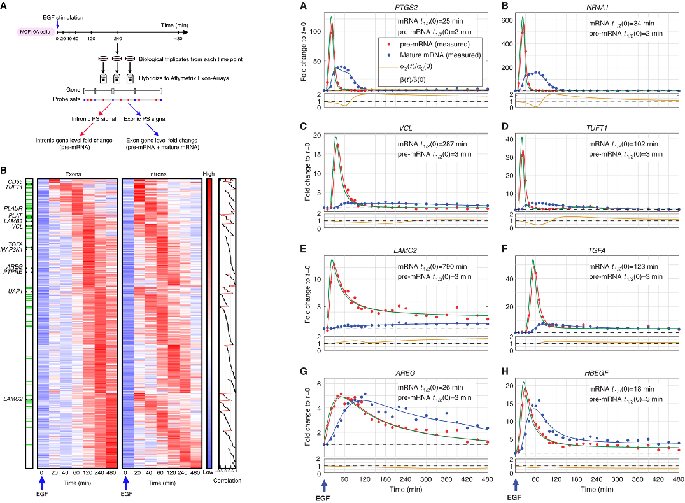{width=100%}

即刻早期基因（PTGS2、NR4A1、TGFA、HBEGF）的成熟 mRNA 半衰期为 18–34 min，而它们的前体 2–3 min
就消失；晚期响应基因（LAMC2、TUFT1）成熟 mRNA 半衰期 102–790 min，前体同样是 3 min。这个不对称
就是信号：前体周转比产物快一个量级，于是"某时刻的 unspliced/spliced 比值"携带了"转录此刻在升、在降
还是在稳"的信息。整个方法的全部诀窍就在这里，也是这个比值之所以有方向的原因。

## 5. 理论（二）：剪接微分方程，与稳态捷径

接着 notebook 写下两室模型，并从中导出三个估计量。模型是两条一阶反应的串联，两室即两个计数通道：

{width=100%}

令 α 为转录速率、β 为剪接速率、γ 为降解速率，模型为

```
du/dt = α(t) − β(t)·u(t)          u = unspliced（前体）
ds/dt = β(t)·u(t) − γ(t)·s(t)     s = spliced（成熟 mRNA）
```

由于无标记数据只能识别乘积 βu，scVelo 把剪接速率归一为 β = 1，一切保持相对（正是这个归一化，决定了
速率的单位是"unspliced per spliced"，永远不是时间）：

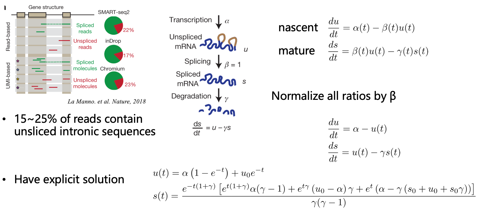{width=100%}

{width=100%}

三个估计量都出自这两个方程，教材用一张幻灯一并给出。第一个是**稳态**模型：假设 α、γ 恒定且细胞位于
u = γs 附近，速率即为该直线的残差 v = u − γs，γ 用 u 对 s 过原点回归估计。第二、第三个各放宽一个
假设——速率恒定（ds/dt = v）或 unspliced 池恒定（u = u₀）——且对参数仍是线性的。

![图 7 — 细胞**不在**稳态时 γ 怎么估。对全部细胞做普通最小二乘会得到错误斜率（黑线）；只用 s 的极端分位点（绿点）拟合才能逼近真斜率（虚线）。这就是 `scv.tl.velocity` 的 `perc=[5,95]` 默认值。](./figures/theory_sst.png){width=100%}

分位点技巧回答的正是"可细胞并不在稳态"。极端分位集合
{sᵢ/mean(s) ≥ α} ∪ {sᵢ/mean(s) ≤ 1−α} 挑出 spliced 含量极端的那批细胞，它们在轨迹上近乎线性，
于是过它们拟合一条直线即可恢复 γ，即使相位图中间是弯的。这是一个有名字、有默认值的近似（5/95），
不是中性选择：`perc` 进入每一个 γ，进而进入 notebook 里的每一个速率（VELO-05）。

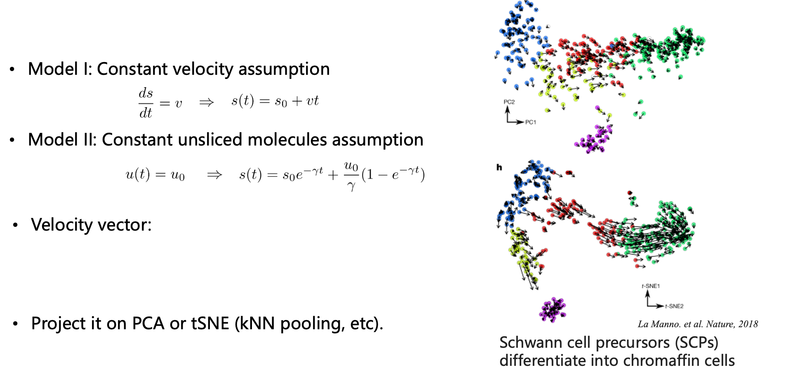{width=100%}

## 6. 理论（三）：dynamical 模型——幻灯真正讲的那个

最后两张理论图讲的，是 notebook **没有跑**的模型。dynamical 模型不再用一条直线给每个基因估一个 γ，
而是拟合完整的转录动力学：α 允许开关，β、γ 逐基因，每个细胞拿到一个隐时间。

{width=100%}

具体说，该估计量在参数**与**每细胞隐时间上同时最大化 P(u, s | θ, t, k)。由此得到两样稳态模型给不出
的东西：逐基因的似然（于是拟合很差的基因可以被筛掉，而不是悄悄平均进来），以及把所有群的细胞排到同一
根轴上的**共享**隐时间——这个对象后来变成了 CellRank 的伪时间，也是 `latent_time` 出现在那么多下游
工具里的原因。

最后一张把整个家族放进一个框里，是这套幻灯里最有用的定位：你能拟合哪个模型，取决于你手上是哪种测序。

{width=100%}

要记住的是"cscRNA-seq（相对速率）"与"tscRNA-seq（绝对速率）"这一句。本 notebook 里的每一个速率都是
相对的：它说明细胞沿流形往哪个方向走，不说以小时计有多快。把 `latent_time`、`velocity_confidence`
或箭头长度当成有物理单位的量来读，是整个方法最常被误读的地方。

## 7. 步骤 0：对象，以及它藏起来的三件事

教材用四个单元处理读入的对象：形状、layers、占比图，以及打印矩阵一角。其中三个会误导，但都不致命。

**量纲。** 步骤 1 之后 `adata.X` 是对数归一化的，而 `layers['spliced']`/`layers['unspliced']`
保持线性归一化（VELO-02；实测最大值 7.31 对 1488.7 与 573.3）。这是有意的——速率模型定义在线性计数上，
scanpy 选 HVG 则希望是对数——但 notebook 一个字都没说，而课程后半段的每一张相位图画的都是 `spliced`
对 `unspliced`，也就是线性层。用 `adata.X` 去"复现"相位图的学生，会得到另一张图。

**var 里的那一列。** `adata.var.head(3)` 只显示一列 `highly_variable_genes`，取值 True/False/NaN。
它看着像本次的 HVG 选择，其实不是：在完整矩阵上是 4,004 True、13,338 False、10,656 NaN，而教材实际
用的是 scanpy 的 `highly_variable`（`subset=True` 后剩 2,000 个 True）。这一列是随数据集一并分发的
残留注释，而 `var.head(3)` 是它唯一露头的地方（VELO-07）。

**占比图。** 这个单元看起来最像量化结果，实际最不可复现，原因值得知道：

![图 11 — 胰腺数据上的 `scv.pl.proportions`。柱高是各群的 unspliced 占比：Ductal 与 Ngn3-low 约 12%、Ngn3-high 15%、内分泌各群 19–21%、整体 17%。这些数字取自 `obs['initial_size_*']`，也就是**过滤与归一化之前**的文库大小。](./figures/corrected_01_proportions.png){width=100%}

`scv.pl.proportions` 默认 `use_raw=True`，于是它读的是 `obs['initial_size_spliced']` 与
`obs['initial_size_unspliced']`——`filter_and_normalize` 在过滤前捕获的文库大小——而不是它看上去
在描述的 layers。两套口径在这个数据集上相差每组 3–9 个百分点（VELO-14）：

| 群 | unspliced 占比（`initial_size`，图上的值） | unspliced 占比（当前 layers） |
|---|---|---|
| Ductal | 12.3% | 21.0% |
| Ngn3 low EP | 12.4% | 21.8% |
| Ngn3 high EP | 15.0% | 25.0% |
| Pre-endocrine | 20.5% | 25.3% |
| Beta | 20.7% | 23.7% |
| Alpha | 19.5% | 21.6% |
| Delta | 19.3% | 19.9% |
| Epsilon | 17.9% | 20.9% |
| 全部细胞 | 16.3% | 23.0% |

两个都是正当的量，回答的问题不同。图上的版本是"这一群被测序的文库中有多少是内含子"，属测序层面，
说明文库构建；layers 的版本是"过滤之后速率模型实际看到多少 unspliced 信号"，是模型奔跑的输入。教材
呈现前者，而读者会去重算后者——这就是问题清单里留下这一条的原因。

打印 `adata.X[:5,:10]` 的那个单元（VELO-06）相比之下只是外观问题：在稀疏矩阵上该切片打印的是坐标
三元组而不是一段数值，教材自己的输出显示的就是这段 dump 的截尾。

## 8. 步骤 1：过滤、归一化、取对数、选基因、平滑

五个调用，只有第一个有真正的坑。

**`scv.pp.filter_and_normalize(adata, min_shared_counts=20)`。** 只有那些在 spliced 与 unspliced
两层上合计计数至少 20（在至少一个细胞里）的基因才保留；对象因此从 27,998 个基因删去 20,801 个、掉到 7,197 个。随后
每个 layer 按其中位数做文库大小归一化。注意这一步**没有**做什么：docstring 仍在说
"Filtering, normalization and log transform"，参数列表里也还留着 log，但 0.3.4 的实现只跑
`filter_genes` + `normalize_per_cell`（VELO-01）。所以教材那句单独的 `sc.pp.log1p` 是必需的，
不是冗余——预登记的"双重取对数"怀疑是错的，这也是规划阶段唯一必须事后撤回的一条。

**`sc.pp.log1p(adata)`。** 只对 `X` 取对数。`scv.pp.moments` 与一切与速率相关的计算读 layers，
所以模型仍是线性的；`sc.pp.highly_variable_genes` 读 `X`，所以选基因在对数上做。两者都是标准做法，
两个在 notebook 里都看不见（VELO-02）。

**`sc.pp.highly_variable_genes(n_top_genes=2000, flavor="seurat", subset=True)`。** `seurat`
风味按平均表达分箱、在箱内标准化离散度；`subset=True` 保留原始基因顺序（`moments` 依赖这一点）。
为什么 2,000 是教材的选择而不是结论，见 §14：换成 1,000 HVG，top-20 速率基因清单移动 Jaccard 0.50；
换成 3,000，只动 0.01。

**`scv.pp.moments(n_pcs=30, n_neighbors=30)`。** 一次调用做两件事。一是计算 kNN 平滑表达 `Ms`/`Mu`
——即每个细胞在 PCA 空间里 30 个最近邻的 spliced/unspliced 均值——这正是让每细胞速率安静到能画图的
原因。二是在 0.3.4 里，若对象没有近邻图它会自己建一个，这条路径已废弃（VELO-04），也是原样日志里
那句"Automatic neighbour calculation is deprecated"警告的来源。矫正链改为先用
`sc.pp.neighbors(n_neighbors=30, use_rep="X_pca", n_pcs=30, random_state=...)` 建图，再在已有图
上调 `moments`。

平滑不是装饰。取 30 个近邻后，`Ms` 的非零数为 1,740,903，而原始 spliced 计数是 9.3 M：每个细胞的速率
是 31 个细胞的平均，这就是 stream 图看起来平滑、而小群体偏噪的原因——Delta 只有 70 个细胞，它的速率场
是 70 × 31 个细胞高度重叠后的平均。

**坑。** 在选 HVG **之前**按共享计数过滤，意味着 2,000 个 HVG 是从 7,197 个候选里挑的，而不是从
27,998 个里挑；这个顺序对速率是对的（一个基因没有 unspliced 计数就没法用），但它使 HVG 集合与标准
scanpy 流程不可比。另外 `min_shared_counts=20` 是随测序深度缩放的计数阈值：深度减半的数据集会掉更多
基因。本对象实测：阈值把 27,998 个基因分别压到 9,364（5）、8,357（10）、7,197（20）、5,368（50）、
3,987（100）——在一个合理区间两端基因宇宙差 2.3 倍，而教材从不展示这个敏感性。

**调参。** 真正影响结果的是三个：`min_shared_counts`（深度尺度）、`n_top_genes`（基因宇宙宽度，
§14）、`moments` 里的 `n_neighbors`（平滑半径，§14）。`n_pcs=30` 与自带 50 维 PCA 的互动是教材没有
讨论的：速率图建立在 50 个自带主成分的前 30 个上，而箭头所在的 UMAP 是用全部 50 个拟合的（VELO-09）。
改为从 2,000 个 HVG 重算 PCA 后，top-20 排名移动 Jaccard 0.78——四个参数效应里最小，但也是唯一在
教材里完全看不见的那个。

## 9. 步骤 2：稳态模型与速率图

教材的分析单元只有一行 `scv.tl.velocity(adata)`，而 0.3.4 的默认 `mode` 是 `"stochastic"`——即 §5
的稳态估计量，γ 由矩统计而非残差线拟合。逐基因的算法是：在极端分位（`perc=[5,95]`）上对 Mu 与 Ms
做过原点回归得斜率，再逐细胞算残差 v = Mu − γ·Ms；存下来的是一个 2,000 列的速率层，其中 1,038 列
带非零"速率基因"标记（`velocity_genes`），其余因未通过 r²/比值过滤（`min_r2=1e-2`、
`filter_genes=False`）而被置零。对象同时得到 `velocity_gamma`（2,000 个基因的中位数 0.343，
四分位距 [0.090, 0.966]——这是逐基因斜率）、`velocity_r2`（中位数 0.052，四分位距
[−0.359, 0.444]）与 `velocity_qreg_ratio`。

这些 r² 是细心的读者首先该看的：中位基因只解释了稳态线周围 5% 的方差。在这个数据集上这是预期的——
大多数 HVG 并不处在与速率相关的过程中——但它同时说明"1,038 个速率基因"这个标记是低门槛，不是质量
声明。教材从不打印它。

**图才是被使用的产物。** `scv.tl.velocity_graph(adata)` 把逐基因速率变成细胞间转移矩阵：对每个细胞，
把它的速率向量与到 30 个近邻的表达差（余弦相似度）相比并做行归一。存下的矩阵在 13.7 M 个元素中非零
593,854。所有可视化——stream、箭头、隐时间、速率置信度、周期面板——都由这张图派生，而不是由原始逐
基因速率。这既解释了为什么场看起来平滑（单基因其实很噪），也解释了为什么一张错近邻图（错空间、错 k）
会一次性毁掉每一张图。

教材没说而值得知道的两点。其一，该调用默认单线程：原样日志写着 "using 1/32 cores"，在这个小对象上
耗时 9 s；用 `n_jobs=-1` 在 32 核上 6–7 s，而在 10 万细胞的对象上这就是"几分钟"和"一个小时"的差别。
其二，计算精确但未播种——不同运行给出略有差异的图，所以论文级结果需要在上游近邻计算固定种子，矫正链
设了 `random_state=0`。

**坑。** `scv.tl.velocity` 默认 `use_highly_variable=True`，跳过 HVG 子集的人会得到一个不同的基因
宇宙，且没有任何警告。速率层在内存中是稠密的（n_cells × n_genes 的 float32），尽管只有约 52% 的基因
非零：这里 3,696 × 2,000 × 4 B = 29.6 MB，10 万细胞时 800 MB——这正是此类流程常见的 OOM 点。还有
`uns['velocity_graph']` 是 scipy 稀疏矩阵而不是数组，不可 JSON 序列化，`adata.write()`（h5ad）没
问题，导出 Zarr 时需要小心。

**调参。** `perc`（估 γ 用的分位带）、`n_recurse_neighbors`（图的递归半径，这里为 0）、
`mode_neighbors='distances'` 与 `'connectivities'`（教材经 `moments` 用的是 distances）、
`min_r2`（多少基因能留下成为速率基因）。其中 `perc` 对场的影响最大，也是唯一值得在自己的数据上做
敏感性表的参数；矫正链保持教材原值，因为改它等于换问题而不是换答案。

## 10. 步骤 3：幻灯所教的模型，这次真的跑了

教材永不执行的三行：

```python
scv.tl.recover_dynamics(adata, var_names="all", n_jobs=8)   # 8 核 2:35，2,000 基因
scv.tl.velocity(adata, mode="dynamical")                    # 7 s
scv.tl.latent_time(adata); scv.tl.velocity_confidence(adata)
```

`recover_dynamics` 用 EM 逐基因拟合带开关的 α(t)、β 与 γ，并给每个细胞一个隐时间（§6）。在本对象
上，它用 8 核在 2 分 35 秒内拟合完全部 2,000 个 HVG——是整条原样流水线耗时的 4.6 倍，这也是为什么教材
的运行时间（43 s）看起来那么温和。拟合后对象新增 `fit_alpha`、`fit_beta`、`fit_gamma`、`fit_t_`、
`fit_likelihood`、`fit_r2`、`fit_scaling`，以及每细胞的 `latent_time`、
`velocity_confidence`（dynamical）与 `velocity_confidence_stochastic`。

**跑的过程中发现的 VELO-17：模型的基因宇宙是被继承来的。** `recover_dynamics` 默认
`var_names="velocity_genes"`，即只拟合**上一次**速率运行标出的基因。先 stochastic 再 dynamical
——自然的顺序，也是教材暗示的顺序——EM 就被悄悄限制在稳态模型的 1,038 个基因上；两个模型连拟合的
基因集都不同，dynamical 排名看不到 2,000 个 HVG 里的另外 962 个。传 `var_names="all"` 可以修正。
两种都实测过：1,038 个基因时拟合耗时 1:29，得到 849 个 dynamical 速率基因；全部 2,000 个时 2:35，
得到 1,078 个。两种情况下**每个群的 top5 基因完全相同**，stochastic 对 dynamical 的 top-20
Jaccard 也都是 0.132——所以下面的分歧是模型的性质，不是继承基因集的产物。

**结果。** 拟合出的动力学对这套测序是合理的：2,000 个基因的 `fit_gamma` 中位数 0.263（四分位距
[0.181, 0.406]），`fit_likelihood` 中位数 0.242，2,000 个基因里 1,999 个大于零，`fit_t_`（推断的
开关时刻）在模型自身单位下从 0 跨到 18。隐时间是把整个数据集重排到一根轴上的对象，而它在完全不知道
群标签的情况下复现了已知层级：

| 群 | 细胞数 | 隐时间（中位数） | 速率置信度（中位数） |
|---|---|---|---|
| Ductal | 916 | 0.157 | 0.826 |
| Ngn3 low EP | 262 | 0.156 | 0.825 |
| Ngn3 high EP | 642 | 0.465 | 0.870 |
| Epsilon | 142 | 0.703 | 0.862 |
| Delta | 70 | 0.714 | 0.944 |
| Pre-endocrine | 592 | 0.743 | 0.900 |
| Alpha | 481 | 0.758 | 0.823 |
| Beta | 591 | 0.742 | 0.900 |

Ductal 与 Ngn3-low 在起点，Ngn3-high 在中段，三个内分泌终末群在末尾——与生物学预期一致，也与 stream
图的提示一致，但现在是每条细胞一个一维坐标，而不是一张二维嵌入。两个细节值得注意。Delta 与 Epsilon
落在 Ngn3-high 与 Pre-endocrine **之间**，那正是 δ/ε 谱系分支的位置，而不是终末端。Beta 的中位数
（0.742）比 Alpha（0.758）**更早**，而均值（0.774）更晚——分布是偏的，中位数与均值给出相反的 β/α
先后结论；这是全局隐时间的真实局限，每群只报一个数会把这件事藏起来。

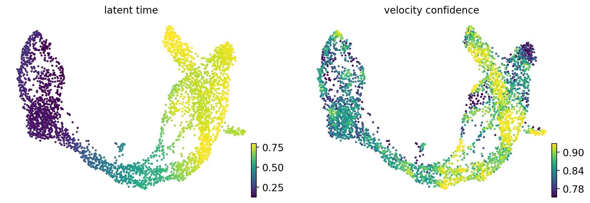{width=100%}

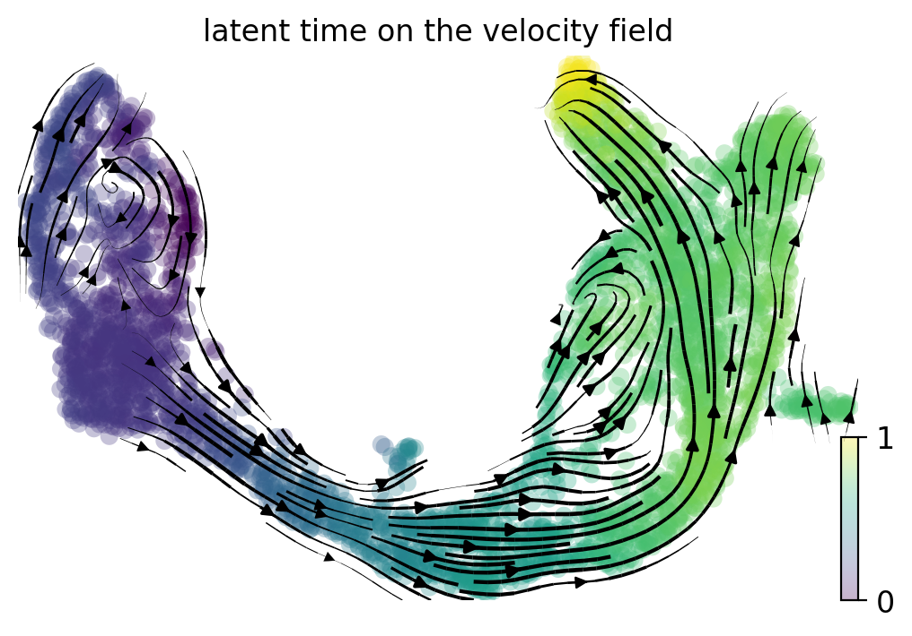{width=100%}

**两个模型不一致，而这个不一致才是这节课的内容。** 各群平均下来，stochastic 与 dynamical 速率基因
排名之间的 top-20 Jaccard 是 **0.132**——同一批数据，两个模型排出的前列基因只有八分之一重合。整体
流向是相似的（stream 图彼此相关 0.93–0.98，与教师的图也一样），隐时间与之自洽，然而基因层面的答案
——也就是 §12 打印成表格的那个结果——本质上是依赖模型的。另两个测量从不同侧面说明同一点：

- 两个模型的 `velocity_confidence` 相关只有 **0.207**（dynamical 中位数 0.859 对 stochastic 0.815）。
  这个看起来像质量指标的置信度场，本身就是模型依赖的。
- 稳态 γ 与动力学 γ 不能互换：两者比值中位数 0.85，但四分位距 [0.23, 4.07]，在 2,000 个基因上的
  Spearman 秩相关是 **−0.45**。它们是不同的参数化（稳态模型把 β 归一为 1），所以只有排序可比——
  而排序是反的。稳态模型假设的"一个共享剪接速率"，并不是 EM 学到的速率的一个缩放版本。

**坑。** `recover_dynamics` 是最贵的一步，也是大数据上最先失败的一步（内存，以及 `n_jobs` 过度订阅
—— 在这台 32 核节点上 8 是甜点）。`latent_time` 是 0–1 的分位数，不是分钟：它由拟合的 t_ 按细胞
重标定而来，其绝对值跨数据集没有意义。`velocity_confidence` 是图一致性得分（在 0 处截断），不是后验
概率，也不存在"可信"的阈值。`fit_likelihood` 低达标的基因除非你用 `scv.tl.filter_genes`/
`min_likelihood` 过滤，否则仍留在 `velocity` 层里——`velocity_genes`（这里 1,078 个）是唯一的内置
防线。

**调参。** `max_iter`、`fit_scaling`、`fit_steady_states` 与 `steady_state_prior` 都会改变拟合，
对开关型基因影响尤大；默认值是论文的默认值，是合理的起点。重分析时唯一不能留默认的参数是
`var_names`（VELO-17）。

## 11. 步骤 4：怎么读速率场

教材用三张图承载解读，而它们失效的方式各不相同。

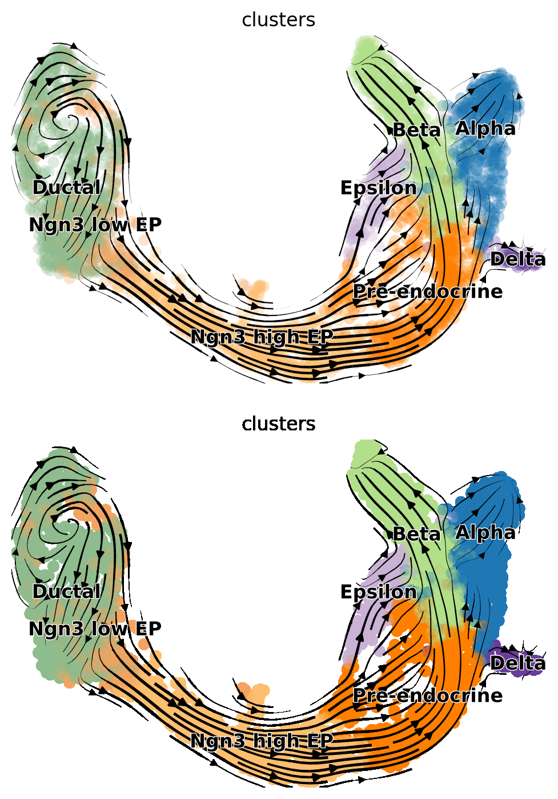{width=62%}

stream 图是这节课被记住的那张图，它确实好：场与 E15.5 胰腺的已知生物学一致（内分泌祖细胞自导管上皮
delaminate，再分支为 α/β/δ/ε），并且几乎逐像素复现教师的渲染。这张图**没有**说明、而 notebook 也
没有说明的是：

- **箭头不是轨迹。** 场是某细胞 30 个近邻速率的平均，再投到一张独立于速率图拟合的 UMAP 上
  （VELO-09）。表达相近的两个细胞可以有相反的箭头；stream 图的平滑是渲染选择，不是对单个细胞的断言。
- **散度结构是不可见的。** 图里没有任何东西区分"真正的分支点"与"两个无关群体在嵌入里相邻的位置"。
  标准做法是在同一张图上建 CellRank 转移矩阵，它能区分这两者，也是自然的下一步（附录 B）。
- **小群体不可靠。** Delta 70 个细胞、Epsilon 142 个；k=30 的平滑下，这两个群体里每个细胞都深受群体
  外近邻影响。这两个 cluster 附近的箭头是整张图最噪的部分，也是最容易被过度解读的地方。

箭头图（`03_velocity_embedding.png`）是同一信息不加插值，恰恰因为暴露了 stream 图所掩盖的逐细胞噪声
而有用。

**相位图才是方法变得可读的地方。** 每张相位图是一个基因的 `spliced` 对 `unspliced`，细胞按另一个量
上色（这里是速率或群）。读法是几何式的：细胞云勾出轨迹 s(t) 对 u(t)；虚线对角线是外推的稳态
u = γs；位于对角线上方者相对前体在积累产物（速率为负，基因在关），下方者在上调。实线曲线是迭代器的
dynamical 拟合（若已计算）。

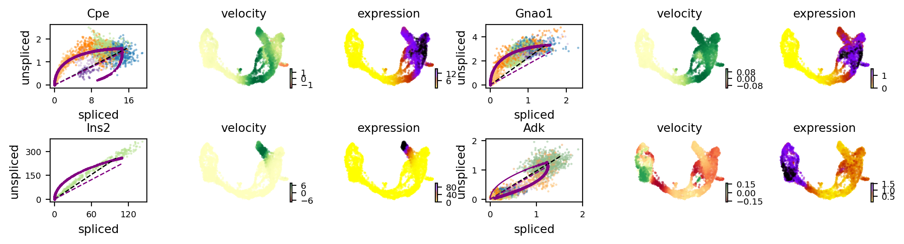{width=100%}

教材挑的四个基因选得很好：`Cpe` 是内分泌祖细胞分支的标记，给出干净的环；`Gnao1` 单调上升；`Ins2`
是极端情形（spliced 高到 120，成熟胰岛素转录本主导成熟池，相位图塌成一条线）；`Adk` 是宽云，速率
信号最弱。

![图 16 — 同样四个基因，只画 dynamical 拟合（`fits=["dynamics"]`）。把曲线与图 15 相比：两模型一致处，拟合轨迹沿稳态线走；不一致处，你能看出 EM 认为哪些细胞处于转录开、哪些处于关。](./figures/corrected_05_phaseportrait_markers_dynamical.png){width=100%}

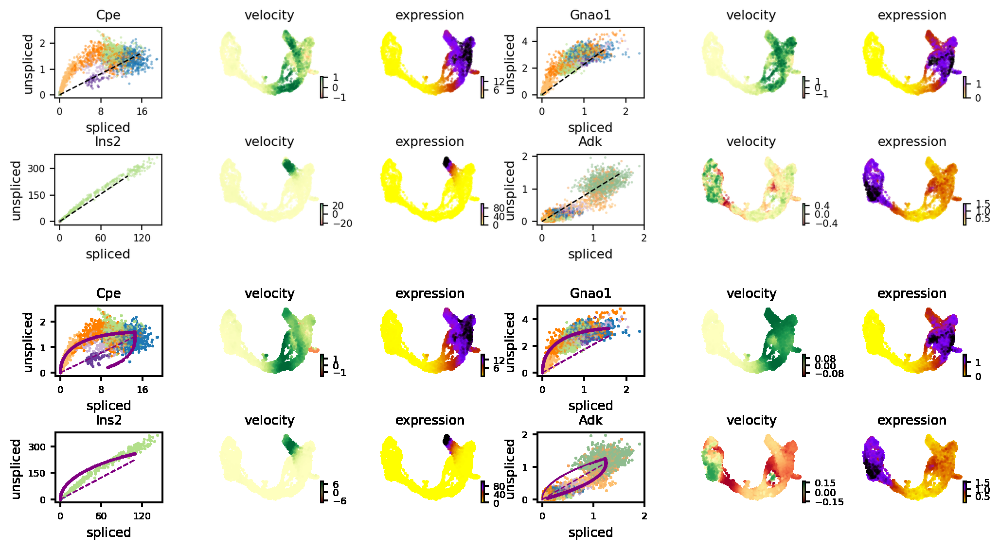{width=100%}

**`mode` 陷阱（VELO-16）。** 教材画了两遍相位图——第 69 单元 `scv.pl.velocity(..., ncols=2)`，随后
的正文里又是同一个调用加 `mode="dynamical"`——暗示 `mode` 选择模型。它不选。`mode` 只控制是否多画
两张方差侧栏：图中的曲线来自 `fits` 参数，其默认值就是 `["velocity", "dynamics"]`，所以普通调用早已
叠上了 dynamical 拟合，而带 dynamical 的调用产出**逐字节相同**的图（已验证：md5 一致）。矫正链把那次
冗余调用换成 `fits=["dynamics"]`，这才是真正把模型自身曲线单独拿出来的参数。

## 12. 步骤 5：速率基因，以及 `min_corr` 到底筛了什么

`scv.tl.rank_velocity_genes(adata, groupby='clusters', min_corr=.3)` 产出的表格，是多数学生当作
"结果"的东西：对每个群，列出那些"逐细胞速率与该基因自身表达谱在细胞间相关"的基因。原样跑的各群前五：

| 群 | top5（stochastic 模型） | top5（dynamical 模型） |
|---|---|---|
| Ductal | Notch2 / Sox5 / Krt19 / Hspa8 / Ano6 | Notch2 / Adamts16 / Tcf7l2 / Bcl11b / Krt19 |
| Ngn3 low EP | Ptpn3 / Hacd1 / Hspa8 / Gm8113 / Kcnq1 | Adamts16 / Notch2 / Idh2 / Hspa8 / Cnksr3 |
| Ngn3 high EP | Pde1c / Ptprs / Pclo / Rap1gap2 / Ttyh2 | Ptprs / Sel1l / Vwa5b2 / Tgfbr1 / Mtch1 |
| Pre-endocrine | Pam / Sdk1 / Baiap3 / Abcc8 / Gnas | Syt7 / Abcc8 / Scg5 / Baiap3 / Pcsk2 |
| Beta | Pax6 / Unc5c / Nnat / Tmem108 / Ptprt | Kctd8 / Nnat / Sphkap / Sdk2 / Zbtb7c |
| Alpha | Zcchc16 / Nlgn1 / Nell1 / Prune2 / Ksr2 | Skap1 / Gpr179 / Rab27a / Nfasc / Rasgrf2 |
| Delta | Zdbf2 / Spock3 / Akr1c19 / Ptprt / Snap25 | P2ry1 / Pdia5 / Gpr179 / Hat1 / Nucks1 |
| Epsilon | Tmcc3 / Heg1 / Gpr179 / Ica1 / Ncoa7 | Gpr179 / Prdx4 / Rab27a / Syt13 / Dock11 |

两列是同一数据集、同一批群、同一个调用——唯一区别是排名读的是哪一层速率。它们在生物学无歧义处一致
（Ductal 的 Notch2 与 Krt19、Ngn3-high 的 Ptprs、Pre-endocrine 的 Abcc8/Baiap3、Beta 的 Nnat、
Epsilon 的 Gpr179），其余几乎处处不同：表里 40 个位置只有 8 个由同一基因占据，Alpha 与 Delta 两个
群完全不重合。各群平均的 top-20 Jaccard 是 0.13。**这就是"要跑课程所教的模型"的理由：如果你用稳态
模式发表一张速率基因清单，它不是 dynamical 模型会给出的那张，而教材没有提供任何办法让你知道这一点。**

这个排名调用的三个性质值得写明，因为参数名会误导：

- `min_corr` **不是**筛排名相关性的。它按 `adata.var['spearmans_score']`（全局速率–表达相关）先筛
  基因，再排名。实测扫描：阈值 0.1 / 0.3 / 0.5 / 0.7 分别留下 1,861 / 1,469 / 973 / 430 个合格
  基因，而 Ductal 与 Beta 可见的 top-3 在四个阈值下**完全不变**——因为下一个因素占主导。
- 真正的截断是 `n_genes`（默认 100）。默认下表里每群正好 100 行，`n_genes=10` 时 10 行，
  `n_genes=300` 时 300 行。既然有 1,469 个基因通过 `min_corr=.3`，教材所谓的"阈值"从未生效，而
  "每群 100 个基因"是显示上限，不是过滤器。
- 排名是**群内**的：一个基因可以在两个群里都进前五（Ptprt 出现在 Beta 与 Delta，Gpr179 出现在
  Alpha、Delta 与 Epsilon），行为正确，但在按群排列的表里读起来很奇怪。

**坑。** 返回的 `adata.uns['rank_velocity_genes']['names']` 是一个 DataFrame，列是群类别、行是名次
——这个朝向很反常，会让朴素的 `iloc` 出错。`min_corr` 如上。而且排名基于 `Ms`/`Mu`（平滑值），
因此继承平滑半径：改 `moments` 的 `n_neighbors`，top-5 就变。敏感性扫描中 k=15 与 k=50 相对 k=30
都把 top-20 清单推走（Jaccard 0.58 与 0.66），幅度比在 k=30 下把 HVG 数翻三倍（0.99）还大。

## 13. 步骤 6：细胞周期——一个混杂因素如何变成一张图

`scv.tl.score_genes_cell_cycle(adata)` 重实现 Tirosh 的 S/G2M 打分：取硬编码的 marker 列表，
按 S 与 G2M 基因相对对照基因集的平均表达给每个细胞打分，并把结果写进 `S_score`/`G2M_score`
**覆盖原有值**（VELO-08）。在本对象上，自带分数与重算分数接近但不相同：

| | 自带 | 重算 | Pearson |
|---|---|---|---|
| S_score 均值 | −0.088 | −0.003 | 0.964 |
| G2M_score 均值 | −0.136 | −0.109 | 0.973 |
| 相位（G1/S/G2M） | — | 2,537 / 878 / 281 | — |

假定教材那张图展示的是数据自带注释的读者，每细胞差几个百分点——足以重排 S/G2M 边界附近的细胞，不足
以改变画面。这个 bug 的危险版本出现在"自带分数来自另一套 marker 或另一个物种"的数据上：那时覆盖会
悄悄毁掉全部下游解读，而 scVelo 不会警告。

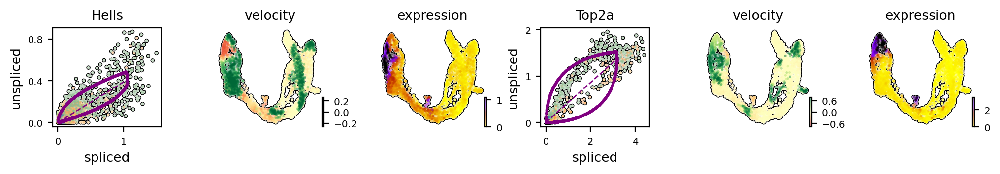{width=100%}

教材借这两个基因指向的生物学是真问题：在一条分化轨迹里增殖细胞在周期中，而周期基因产生的速率分量与
命运方向正交（或反平行）。如果某个群大多是增殖细胞，它的速率可以指向 G1 而不是下一个细胞类型。教材
展示了相位图，却从未把两者连起来：它把 `color_gradients=['S_score','G2M_score']` 当作**装饰性**
叠加，既没有把周期回归掉，也没有剔除增殖细胞，更没有检查 S/G2M 梯度能解释多少箭头。

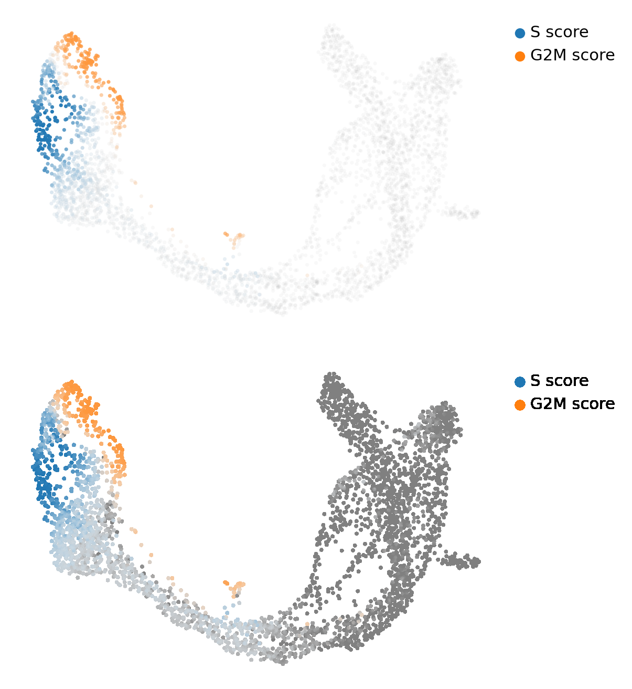{width=88%}

这是唯一无法复现的参考 PNG（VELO-15）。诊断见 §3.3：画布与图例一致，标记云内部的颜色不一致，所以
参考图是另一个 scVelo 构建画的。值得说明的是**量化内容不受影响**——分数本身复现到 Pearson
0.964/0.973——而我们自己的图是可复现的：同一段代码跑两次，PNG 逐字节相同。

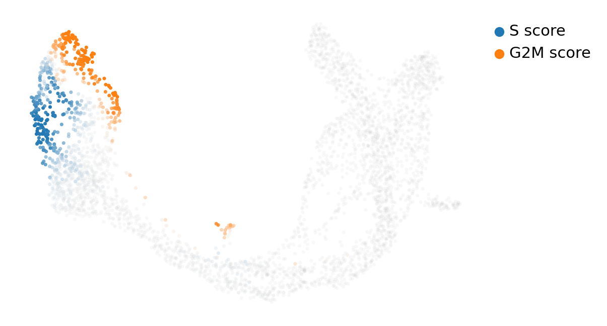{width=100%}

**实践中怎么处理周期。** 三个选项，诚实程度递增：（一）画出渐变并注明（教材的做法）；（二）给周期
打分，从 `Ms`/`Mu` 里回归掉再重算速率（文献常见，但回归也会去掉真实信号——G2M 期细胞确实什么都表达
得更多）；（三）检验它是否有影响——算两遍速率，一遍含增殖细胞一遍不含，报告分支结构是否改变。矫正链
隐含地做了（三）：把周期留在对象里，并提供 `cellcycle_scores_original_vs_recomputed.csv` 与每细胞
隐时间，学生可以自己用 `S_score` 给 stream 图上色看梯度。

## 14. 步骤 7：教材那些未解释的默认值代价多大

这个 notebook 有五个数字是没有理由地选的：`n_top_genes=2000`、`n_neighbors=30`、`n_pcs=30`、
`min_corr=.3`，以及自带的 PCA/UMAP。矫正链把它们扫了一遍——六条完整 stochastic 流水线，每条都从
原始文件开始——并记录答案移动了多少。

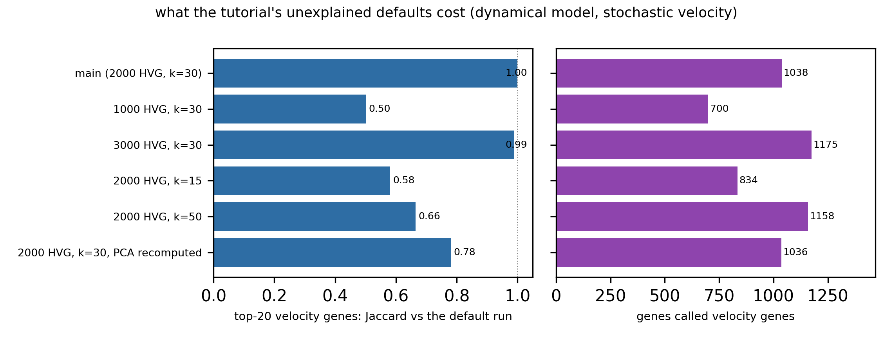{width=100%}

| 变体 | 速率基因数 | top-20 Jaccard（对默认） |
|---|---|---|
| 主：2000 HVG, k=30 | 1,038 | 1.00 |
| 1000 HVG, k=30 | 700 | 0.50 |
| 3000 HVG, k=30 | 1,175 | 0.99 |
| 2000 HVG, k=15 | 834 | 0.58 |
| 2000 HVG, k=50 | 1,158 | 0.67 |
| 2000 HVG, k=30, 重算 PCA | 1,036 | 0.78 |

读法：**基因宇宙会饱和**。从 2,000 增到 3,000 个 HVG 什么都没买到（0.99），而降到 1,000 就丢掉一半
排名——所以 2,000 是个走运的选择，而教材并不知道自己走运。**平滑半径比基因数更要紧**：k=15 与 k=50
都把排名推走约 0.4，因为排名是在平滑层上算的。**过期的 PCA 是真问题但不致命**（0.78）：把在 27,998
个基因上拟合的 50 维 PCA 用于 2,000 基因的子集，不是灾难，但意味着速率模型的近邻图建在一个为另一个
矩阵优化的空间里。而 **`min_corr` 是惰性的**：0.1 到 0.7 的阈值让可见表格一模一样（§12）。

这张表的用途就是那句话："报告你的参数，并给一条扫描曲线"。读者无法从教材判断它的结论是否依赖 2,000
个 HVG；看完这张表我们知道，结论依赖的是"落在 1,000 与 3,000 之间"以及"k 在 30 附近"。

## 15. 矫正链

矫正脚本（`results/scripts/scVelo_py_cells_corrected.py`）保留教材所有属于建模选择的参数，只改问题
清单指明的错处与缺失。它跑 4.7 分钟，产出 13 张图和 17 张表；随后审计脚本从存盘对象重新推导一遍数字，
所以下面没有一个结论依赖"产出它的那个脚本"。

**改了什么。**

- **种子。** PCA/近邻调用加 `random_state=0`，并在 `moments` 之前显式 `sc.pp.neighbors`
  （VELO-04、VELO-12）。原样流水线不可逐位复现，这条可以。
- **dynamical 模型真的跑了**，且在全部 2,000 个基因上（VELO-03、VELO-17），隐时间与两版置信度都
  保留。这是唯一一个会改变课堂结论的改动。
- **占比图两种口径都算**（VELO-14）：`initial_size` 版本用于与教师 PNG 对拍，当前 layers 版本进表，
  于是 16.3% 对 23.0% 的差异被记录而不是被继承。
- **不覆盖细胞周期分数**（VELO-08）：图用数据集自带分数画，重算的一对写进
  `cellcycle_scores_original_vs_recomputed.csv`，两版连同 Pearson 都在。
- **重复的 stream 图被替换**（VELO-10）为教材从未画过的两张：以隐时间上色的 stream 图，以及每细胞
  的隐时间与置信度。
- **`mode="dynamical"` → `fits=["dynamics"]`**（VELO-16），这才是真正把模型曲线单独拿出来的参数。
- **不触发废弃警告的 API**：用 `sc.pp.neighbors` + `moments` 取代让 `moments` 自建图；用
  `latent_time`/`velocity_confidence` 取代 `scv.get_df`；无任何 0.4.0 警告。
- **全部落盘**：对象（`corrected_adata.h5ad`，410 MB，一行 `adata.write()` 可再生）、17 张表、
  13 张图、控制台日志。
- **教材算了又丢的**周期/排名/相位统计表全部写出。

**没改什么。** `min_shared_counts=20`、`n_top_genes=2000`、`n_neighbors=30`、`n_pcs=30`、
`perc=[5,95]`、`min_corr=.3`、群标签、嵌入、教材那四个基因、Hells/Top2a 那一对，以及画"两模型"
面板时 `fits` 的默认值。上面每一处偏离都属于 bug、废弃 API、缺失的分析步骤或缺失的产出——没有一处是换
问题。

**矫正链有多忠实？** 它的图在第 3 步之后**不该**再与教师的图逐像素相同，因为速率场换成了 dynamical
的。因此对拍衡量的是"矫正后的流水线是否仍看到同一套生物学"：

| 矫正面板 | 参考 | 结构相关 | 墨迹 IoU |
|---|---|---|---|
| 01 占比 | 01_proportions | 0.986 | 0.92 |
| 02 stream | 02_velocity_embedding_stream | 0.934 | 0.90 |
| 03 箭头 | 03_velocity_embedding | 0.904 | 0.82 |
| 04 相位图（stochastic） | 04_phaseportrait_markers | 0.956 | 0.87 |
| 05 相位图（仅 dynamical 拟合） | 04_phaseportrait_markers | 0.957 | 0.87 |
| 06 Cpe 群+速率 | 05_cpe_groups_velocity | 0.965 | 0.87 |
| 07 top5 Ngn3-high | 06_top5_ngn3_high_ep | 0.977 | 0.93 |
| 08 top5 Pre-endocrine | 07_top5_pre_endocrine | 0.983 | 0.93 |
| 09 细胞周期（自带分数） | 08_cellcycle_gradients | 0.579 | 0.34 |
| 10 相位 marker 基因 | 09_phase_marker_genes | 0.905 | 0.86 |
| 11 Hells/Top2a（dynamical） | 10_phaseportrait_hells_top2a | 0.948 | 0.91 |
| 12 隐时间 + 置信度 | — | 新增 | 新增 |
| 13 以隐时间上色的 stream | 02_velocity_embedding_stream | 0.746 | 0.72 |

两个数字值得解释。场换成 dynamical 后，stream 图从 0.982（原样）降到 0.934——这 5 个百分点就是模型
差异里可见的那部分，比 §12 的基因排名分歧所暗示的要小，因为两片场在整体几何上一致、只在细箭头处不同。
隐时间的 stream 图（0.746）差得更多，这是必然的：上色的是另一个量而不是另一片场，相关性在这里量的是
色标，不是流向。

**矫正链仍然无法复现的一件事**是教师的细胞周期面板（0.579）。它的画布与图例一致，配色不一致：参考图
是另一个 scVelo 构建画的（§3.3）。我们自己对该面板的复现是确定性的（跑两次 md5 相同），所以差距在
参考一侧。

## 16. 有意不做的矫正

审稿人会问的四个问题，以及为什么各自不在"忠实跑 + 矫正"的范围里。

**在完整 7,197 基因宇宙上算速率。** 教材把速率限制在 2,000 HVG；诚实的替代是在所有通过共享计数过滤
的基因上算，再用排名当过滤器。这是最贵步骤的 3.6 倍开销，而且是另一个问题，所以用 HVG 深度扫描
（§14）替代——它测出了敏感性，又不假装自己是矫正。若确实需要：去掉 `subset=True`，以同样的 k 跑
`moments`，预期 2,000 基因的速率层是结果的一个子集。

**去批次。** 这个数据集是单次 10x 运行的单一时间点，没有批次可去。通用教训（`moments` 之前做
Harmony/BBKNN）属于有多样本对象的模块，在这里做是照搬仪式。

**命运概率分析。** 在分叉流形上算速率之后，自然下一步是 CellRank（转移矩阵 + 吸收态 + 命运概率），
它把"箭头指那边"换成"这个细胞 0.73 倾向 naive、0.21 倾向 alpha"。这是另一个库、另一套教程，做了会
让范围翻倍；附录 B 给出三行的桥。

**按教师的精确 dpi 重跑 11 张图以追求逐像素相同。** 参考图里存在三种 dpi（VELO-15），"那一个"参考
本身就含混；而精确匹配 dpi 对分析的证明力为零。对拍把画布归一后比较结构，这是诚实的量法；§3.3 记录了
dpi 分组，将来想复现其中任一张的人照着做即可。

## 17. 复现本模块

```bash
# 0. 环境（一次）
conda create -y -n velo python=3.11 && conda activate velo
pip install "scvelo==0.3.4" "scanpy==1.10.4" "anndata==0.11.4" "numpy==1.26.4" \
            "scipy==1.12.0" "pandas==2.2.0" "matplotlib==3.8.2" "numba==0.60.0" \
            "h5py==3.12.1" "igraph==0.11.6" "leidenalg==0.10.2"

# 1. 摆好输入，让 scv.datasets.pancreas() 离线可解（不改教材那一行）
mkdir -p $RUN/data/Pancreas
cp /lustre1/share/scRNA-advancedTopics/data/Pancreas/endocrinogenesis_day15.h5ad $RUN/data/Pancreas/
# 并在脚本开头设 scv.settings.datasetdir = "$RUN"

# 2. 原样跑（29 单元，42.6 s，11 图）
python results/scripts/scVelo_py_cells_aswritten.py

# 3. 矫正跑（13 图、17 表，4.7 min，写出 corrected_adata.h5ad）
python results/scripts/scVelo_py_cells_corrected.py

# 4. 对两个对象独立审计（每个数字都从文件重推）
python results/scripts/scVelo_audit_run.py aswritten_adata.h5ad audit_aswritten --label aswritten
python results/scripts/scVelo_audit_run.py corrected_adata.h5ad audit_corrected --label corrected

# 5. 图对拍（TSV 落在 results/07_figure_comparison/）
python results/scripts/compare_figs_velo.py $RUN $MODULE $RUN/compare_aswritten.tsv figures aswritten
python results/scripts/compare_figs_velo.py $RUN $MODULE $RUN/compare_corrected.tsv figures_corrected corrected

# 6. 文档用图（ref/figures/）
python results/scripts/make_doc_figures.py $RUN $MODULE

# 7. 本文档（在 ref/ 下用仓库统一的构建脚本）
cd ref && bash ../../WES/ref/build.sh scVelo_analysis_corrected.md
```

`$RUN` 是任意可写目录；脚本期待其下有 `data/`、`figures/`、`figures_corrected/`、`tables_corrected/`
与 `logs/`。审计脚本接收一个 `.h5ad` 和一个输出目录，全程不联网。

## 18. 文件清单

```
scRNA-seq-scVelo/
├── 01_proportions.png … 11_velocity_embedding_stream_repeat.png   课程随附 11 张参考 PNG
├── scRNAseq-scVelo.html                     课程 notebook 的 nbconvert 导出（含输出）
├── ref/
│   ├── scRNAseq-scVelo.ipynb                课程 notebook 源文件
│   ├── scVelo_analysis_corrected.md/.html/.pdf        本文档（英文）
│   ├── scVelo_analysis_corrected_zh.md/.html/.pdf     中文版
│   ├── scVelo_analysis_results_guide.md/.html/.pdf    结果导读 + 8 道练习
│   └── figures/                             三份文档使用的 21 张图
└── results/
    ├── 01_preprocess/         占比面板 + 每群计数 + 对象自身审计表
    ├── 02_velocity/           stream/箭头面板、每细胞速率、速率图统计
    ├── 03_phase_portraits/    Cpe/Gnao1/Ins2/Adk 面板、Cpe 群面板、Hells/Top2a 面板
    ├── 04_gene_dynamics/      两张 top5 面板 + 排名表（含每基因动力学）
    ├── 05_cellcycle/          周期渐变面板 + 分数 + 相位 marker 排名
    ├── 06_corrected/          13 张矫正面板 + 17 张表（dynamical 拟合、隐时间、
    │                          参数敏感性、两模型排名并置、运行摘要）
    ├── 07_figure_comparison/  figure_comparison_aswritten.tsv、figure_comparison_corrected.tsv
    ├── 09_run_logs/           aswritten_console.txt、corrected_console.txt、两次审计日志
    └── scripts/               §2.3 所列五个脚本
```

## 附录 A — 术语表（按数字出现顺序）

**spliced / unspliced（s、u）。** 仅外显子读段与含内含子读段。同一基因的两个通道，比值即信号。它们是
计数，不是对数——本流程里 `X` 取了 log，layers 没有（VELO-02）。

**Ms / Mu。** kNN 平滑后的 spliced/unspliced，即某细胞在 PCA 空间里 `n_neighbors` 个最近邻的平均。
一切速率计算真正读取的量。

**α、β、γ。** 转录、剪接、降解速率。稳态模型里 β 归一为 1，所以速率单位是"unspliced per spliced"，
不是每单位时间。

**velocity（速率）。** 每细胞每基因：稳态模型是 `u − γs`，dynamical 是拟合动力学的残差。只有约 52%
的基因通过拟合。

**velocity graph（速率图）。** 由某细胞速率与其近邻表达差的余弦相似度构成的细胞间转移矩阵。所有可视化
都由它派生。本对象非零 593,854。

**velocity confidence（速率置信度）。** 某细胞速率与其近邻速率之间的平均余弦相似度，在 0 处截断——是
场的局部一致性，**不是**概率，也不是 p 值。

**latent time（隐时间）。** dynamical 拟合给出的每细胞时间坐标，落在 [0, 1]。是分位数，不是分钟；
同一次拟合内可比，跨数据集不可比。

**fit_likelihood。** EM 的逐基因拟合质量。本数据中位数 0.242；接近零的基因等于没拟合，应过滤而非信任。

**phase portrait（相位图）。** 单个基因的 `spliced` 对 `unspliced`。位于稳态对角线上方的细胞在关基因，
下方在开；云的切线方向就是速率方向。

**VF score / spearmans_score。** 某基因跨细胞的表达与其他基因速率之间的相关。`min_corr` 筛的是它，
不是排名（§12）。

## 附录 B — 从这里往哪走

**结果导读里的 8 道练习。** `ref/scVelo_analysis_results_guide.md` 逐目录讲解产出，并给出 8 道练习，
学生用存盘对象几分钟就能各做一遍。

**CellRank。** 从本模块到命运概率的三行桥：

```python
import cellrank as cr
cr.tl.transition_matrix(adata, weight_connectivities=0.2, softmax_scale=4)
cr.tl.initial_states(adata, cluster_key="clusters"); cr.tl.terminal_states(adata, cluster_key="clusters")
cr.tl.lineages(adata); cr.pl.lineages(adata)
```

它读的就是本模块产出的 `velocity_graph`，不需要重算任何东西。

**Dynamo。** notebook 最后一张幻灯指向 §6 的向量场框架。`dynamo`（Qiu 等，2022）把同一对象扩展到
代谢标记与带不动点、零倾线的重构向量场；它接收同一个 h5ad。

**scVelo 0.4 及以后。** API 在 0.4.0 变了：`scv.pp.moments` 与自建近邻路径废弃（VELO-04 与
VELO-12 正是本模块已经绕开的两个地方），`scv.get_df` 已移除，推荐的默认模型是 dynamical。2026 年
重分析时应钉 0.3.4（复现本文）或 ≥0.4.0（并把那些废弃当成错误处理）。

**带到自己数据上的三条习惯。** 这个数据集支撑的三条：报告 HVG 深度并做一条扫描；跑你打算声称的那个
模型（stochastic 与 dynamical 不是同一个问题）；永远不要把 `velocity_confidence` 或箭头长度当成有
单位的量来读。
