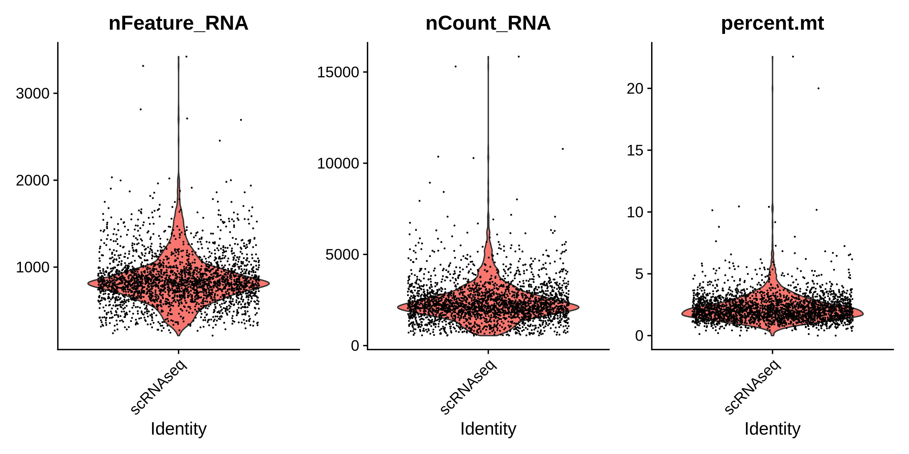
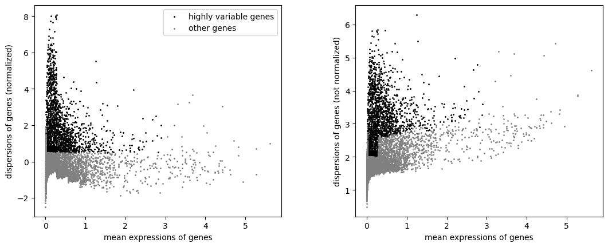
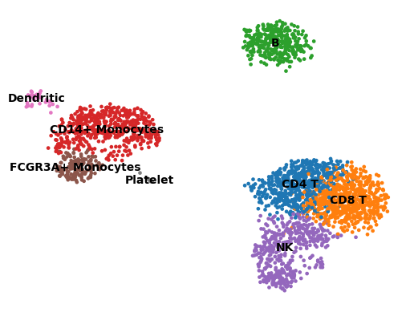

# Single-cell RNA-seq (PBMC 3k) — Corrected & Annotated Edition

**Course module 5 · scRNA-seq analysis**
Source tutorial: *Single Cell RNA-seq Analyze Tutorial*, Bowen Qin & Zexian Zeng, Center for Life Sciences / Center for Quantitative Biology / Academy for Advanced Interdisciplinary Studies, Peking University (`scRNA_seq_analyze_totorial_2026.html` in this directory).

---

## 0. About this edition

This document is the corrected and annotated edition of the fifth course module. It follows the same protocol as the WES, RNA-seq, RNA-seq-application and TBCR-analysis modules of this repository:

1. the tutorial was executed **as written** — every code cell verbatim, in tutorial order, with no optimisation and no mid-run fixes;
2. every problem encountered or predicted was **recorded, not fixed**, during that run (§1 lists them, the Part where each occurs explains it);
3. a **second, corrected pass** was then run so that the effect of every correction can be measured rather than asserted (§13);
4. documents, scripts, logs, figures and tables are committed together.

Two properties make this module different from the previous four.

**It is the first module with two toolchains on one dataset.** Parts 1-7 are R/Seurat, Part 8 is Python/scanpy, both starting from the same `matrix.mtx`. The tutorial never reconciles the two, and they do not agree: the R half keeps 32,738 features and finds 9 clusters, the Python half keeps 13,714 features and finds 8. §12 quantifies that difference cell by cell.

**It is the first module where the tutorial cannot run to the end in either language.** One missing `library()` call kills the R DEG cell, and one doubled comma kills a whole Python cell — together they cost 7 of the 25 figures and both deliverable objects (§3).

What this edition adds on top of the original tutorial:

- the run itself, with per-cell timings, warnings and the exact error text (§3);
- twenty verified pitfalls (`SC-01` … `SC-20`), each with the corrected code and, where it matters, a measured effect;
- a pixel-level comparison of every regenerated figure against the 28 reference PNGs shipped with the course (§3.4, `results/08_figure_comparison/`);
- a cross-tool reconciliation: what "9 clusters vs 8 clusters" actually means (§12);
- a corrected pass that reproduces the as-written numbers exactly, and adds the objects and tables the tutorial leaves in memory (§13).

Severity ordering used throughout: **fatal** (the as-written code cannot produce its output), **changes results** (runs, but the labels/numbers are unreliable), **robustness** (works here, breaks elsewhere), **hygiene** (style, naming, unexported results).

---

## 1. Issue list at a glance

| ID | Part | What goes wrong | Severity | Correction |
|:-------|:------|:---------------------------------------------|:-----------|:---------------------------------|
| SC-01 | 4 | `ScaleData(features = rownames(seurat_obj))` scales all 32,738 features although the text says "using the selected features" (2,000 HVGs). It is not an error: `DoHeatmap()` draws markers from `scale.data`, so scaling only the HVGs would break the heatmap of arbitrary marker genes. It is a cost: 0.73 GB of objects and 4.2 s, versus 0.35 GB / 2.2 s for the 13,714-feature variant. | robustness | Keep it, state the reason, and scale `unique(c(VariableFeatures, marker genes))` when memory matters. |
| SC-02 | 6 | The cluster → cell-type mapping is written **twice and inconsistently**: the table in cell 39 says cluster 1 = CD14+ Mono, cluster 2 = Memory CD4 T; the `new.cluster.ids` vector in cell 43 says cluster 1 = Memory CD4 T, cluster 2 = CD14+ Mono. In this run the vector is right and the table is wrong (cluster 1 = CCR7/LEF1/NOSIP, i.e. CD4; cluster 2 = S100A8/FCN1/CD14, i.e. monocytes). Renumbering by Louvain is not stable: with a 30-HVG perturbation (§13.2) the same fixed vector mislabels 957 cells (36%). | changes results | Derive labels from markers, assert the cluster count, and emit an audit table. |
| SC-03 | 6 | `seurat_obj.markers %>% group_by(cluster) %>% dplyr::filter(avg_log2FC > 1)` is a pipe whose value is discarded; `top10` is then taken from the **unfiltered** table with `slice_max(avg_log2FC)`, which ignores `p_val_adj` entirely. Filters are not applied. | changes results | Assign the filtered table, filter on `p_val_adj < 0.05` too, then `slice_max()`. |
| SC-04 | 6 | `naive_cd4_genes` and `memory_vs_naive_genes` are computed and never used again; the volcano maps `-log10(p_val_adj)`, which is `Inf` when `p_val_adj` underflows to 0 (not triggered here — the smallest is 1.24e-115 — but one fewer decimal in the test would trigger it); no DEG table is exported. | robustness | Use `pmax(p_val_adj, .Machine$double.xmin)`, export both tables, use the gene lists. |
| SC-05 | 7 | `data_pbmc_multi <- load("pbmc_stim.RData")` assigns the **names** of the loaded objects, not the objects, and dumps `ctrl.sparse`/`stim.sparse` into the global environment; the code then retrieves them with `get()`. Inside a function or a knitted document this silently leaks or fails. | robustness | `load(..., envir = e)` into a private environment. |
| SC-06 | 7 | Part 7 integrates **raw, unfiltered** counts — no `percent.mt`, no `nFeature` cut, unlike Part 2 — and after `RunHarmony()` only plots a UMAP: no `FindNeighbors()`/`FindClusters()`, so the effect of batch correction is never quantified. | changes results | QC both samples (13,019 → 12,932 and 12,875 → 12,779 cells), and measure mixing instead of eyeballing it (§10). |
| SC-07 | 4 | `PCHeatmap()` is a deprecated alias (still present in Seurat 5.1.0, no warning emitted), and `ElbowPlot()` shows 20 PCs by default while every downstream step uses `dims = 1:10`. | robustness | `DimHeatmap(dims = 1:6)`; set `ndims = 20` explicitly and record why 10 is used. |
| SC-08 | 3 | `p <- p + plot2`, where `plot2` is itself a full ggplot built on `p`, produces a **two-panel figure** (the left panel is `p`, the right is `plot2`), not "one figure with duplicated layers". The reference `VariableFeaturePlot.png` ships with that artifact: its two halves are the same scatter, labelled differently. | hygiene | `p <- LabelPoints(plot = p, points = top_features, repel = TRUE)`, one panel. |
| SC-09 | 8 | `sc.pl.pca_variance_ratio(adata, log=True,,save="scanpy_PCA_ratio.png")` — the doubled comma is a `SyntaxError`. Python compiles a cell as a whole, so **nothing** in that cell runs: not only the ratio plot, but also `sc.tl.pca()`, `sc.pp.neighbors()` and `sc.tl.umap()`. Everything downstream then fails with `KeyError: 'No "neighbors" in .uns'`. | fatal | One comma removed. |
| SC-10 | 2, 8 | The two halves filter the same 2,700 cells with different thresholds (`nFeature_RNA < 2500` vs `n_genes_by_counts < 2000`), so they describe 2,638 versus 2,635 cells and 9 versus 8 clusters. Neither the text nor the code mentions the mismatch. | changes results | Align to one threshold; §12 shows that 2,500 on the Python side gives exactly 2,638 cells. |
| SC-11 | 8 | `sc.pp.scale(adata, max_value = 10)` is called at the end of cell 64 and again at the start of cell 67. The second call re-clips already-clipped values (a no-op on this data, but it silently rescales if `max_value` ever differs). | hygiene | Keep one call. |
| SC-12 | 8 | `rename_categories("leiden", new_cluster_names)` requires exactly one name per category and fails with `ValueError: leiden is neither in .obs nor in .var`-style errors otherwise; with 8 names and 9 categories the cell dies. The names are positional — assigned by category order, not by marker evidence — and they are **wrong**: the cluster called `CD8 T` is 78.1% Seurat Naive CD4 T cells (CD8A 0.14, CD8B 0.24, IL7R 1.61), and the cluster called `NK` is 61.8% CD8 T plus 33.3% NK. | changes results | Check the count, and build the mapping from `rank_genes_groups` output (§11.4). |
| SC-13 | 6, 8 | Neither half exports the marker tables it computes; `Scanpy`'s `save=` concatenates the function name with the string, producing `highest_expr_genesscanpy_highest_expr_genes.png`, `violinscanpy_violin_plot_QC.png`, `umapscanpy_final_umap.png`. That is exactly why the copies shipped with the course had to be renamed. | hygiene | Export `markers_all_clusters.csv`, `clusterN_markers.csv`, `cluster_label_audit*.csv`. |
| SC-14 | 1, 8 | `genes.tsv` contains 95 duplicated rows over 91 duplicated symbols (32,738 rows, 32,643 unique names; `7SK` appears 4×) and 21 symbols containing `_`. Seurat rewrites `_` to `-` ("Feature names cannot have underscores, replacing with dashes"), scanpy's `var_names_make_unique()` renames duplicates `ACE` → `ACE-1`. The two halves therefore disagree on gene names in both directions. | robustness | Record both mappings; prefer `gene_ids` for joins. |
| SC-15 | 1 | The data directory is an **old Cell Ranger 1.1.0 layout**: `barcodes.tsv`, `genes.tsv`, `matrix.mtx`, no `features.tsv`, no `*.gz`. `Read10X()` and `read_10x_mtx()` both cope, but any newer tool expecting `features.tsv.gz` will not. | robustness | None needed here; documented. |
| SC-16 | 6 | `geom_text_repel()` is called but `library(ggrepel)` never is (only Seurat, dplyr, ggplot2 are loaded). The whole DEG cell dies with `could not find function "geom_text_repel"` — which also means `saveRDS(seurat_obj, "pbmc3k_final.rds")` on its last line never executes. | fatal | `library(ggrepel)` in Part 1. |
| SC-17 | 1 | `CreateSeuratObject()` runs with its default `min.cells = 0`, keeping all 32,738 features (19,024 of them all-zero after QC) while scanpy's `filter_genes(min_cells = 3)` keeps 13,714. This is not harmless: 30 of 2,000 HVGs change, the Louvain solution moves (modularity 0.8584 vs 0.8728, cluster sizes ±5%), and the two hard-coded annotation lists stop agreeing (§13.2). | changes results | Declare the gene universe explicitly; do not change it silently. |
| SC-18 | 7 | The two Part-7 UMAPs are **not reproducible run to run**: two runs on identical input give structural correlation 0.5631 (`UMAP_without_harmony`) and 0.5676 (`UMAP_with_harmony`), the same magnitude as the difference to the reference figures (0.5664, 0.5689). uwot is multithreaded; `RunUMAP()` has no thread-invariant seed. | robustness | Compare group structure or embeddings, never pixels; set `n.threads = 1` if bitwise reproducibility is required. |
| SC-19 | 6 | The shipped reference `Marker_Heatmap.png` is 3,000 × 6,000 px, i.e. 10 × 20 inches at 300 dpi, while the tutorial's `ggsave(..., width = 10, height = 10)` gives 3,000 × 3,000. The reference figure was not produced by the code in the tutorial. | hygiene | None; documented as an inconsistency in the course materials. |
| SC-20 | 7 | `RunHarmony(merged_seurat, group.by.vars = "orig.ident")` omits `dims`, so it integrates on all 50 PCs from `RunPCA()` (default `npcs = 50`), while the following `RunUMAP(reduction = "harmony", dims = 1:10)` uses the first 10 harmony components. Batch correction and visualisation are computed on different dimensionalities. | robustness | Pass `dims = 1:10` (or `1:20`) explicitly and use the same set for the UMAP. |

Two further observations that are not code bugs but belong in the record:

- the tutorial's own `.Rmd`/HTML never mentions a random seed, yet the whole module is stochastic (Louvain, UMAP, harmony);
- the 28 reference PNGs in this directory are the teacher's 2025 output, 13 of them byte-identical to the 2024 version; three of them (`UMAP_noPCA.png`, `UMAP_three_stages.png`, `immune_markers.png`) are not produced by any code in the tutorial (§14).

---

## 2. Environment and data

### 2.1 Environment

No environment was built for this module. The teacher's own environment is shared and contains both halves:

```bash
source /lustre1/share/miniconda3/etc/profile.d/conda.sh
conda activate /lustre1/share/miniconda3/envs/scRNA_seq
```

| Component | Version | Note |
|---|---|---|
| R | 4.4.1 | |
| Seurat | 5.1.0 | SeuratObject 5.0.2; layer-based v5 objects |
| harmony | 1.2.1 | |
| ggrepel | 0.9.6 | installed, but never loaded by the tutorial (SC-16) |
| dplyr / ggplot2 / patchwork | 1.1.4 / 3.5.1 / 1.3.0 | |
| Matrix / uwot / leiden / igraph | 1.7.1 / 0.2.2 / 0.4.3.1 / 2.1.1 | |
| FNN / RANN | 1.1.4.1 / 2.6.2 | used only by the corrected mixing metric |
| presto | **absent** | without it `FindAllMarkers()` falls back to the slow Wilcoxon path: one cell takes 330 s |
| Python | 3.12.7 | |
| scanpy / anndata | 1.10.3 / 0.10.9 | |
| leidenalg / igraph | 0.11.6 | |
| numpy / pandas / seaborn | 2.0.2 / 2.2.3 / 0.13.2 | |
| Pillow | 11.0.0 | used by the figure comparison script |

This module runs on the login node, serially, as lessons 3-5 of this course do: the whole thing is 2,700 cells (plus 25,894 in Part 7), peaks at ~4 GB, and the longest single cell is `FindAllMarkers()` at 5.5 min. There is no alignment step and no scheduler involvement, so no `sbatch` wrapper was added — the same reasoning recorded for the RNA-seq and TBCR modules.

### 2.2 Input data

| Path | Content |
|---|---|
| `/lustre1/share/scRNA_seq/hg19/` | `barcodes.tsv` (2,700), `genes.tsv` (32,738), `matrix.mtx` (2,286,884 non-zero entries), Cell Ranger 1.1.0 / hg19 |
| `/lustre1/share/qinbowen/pbmc_stim.RData` | `ctrl.sparse` (35,635 × 13,019), `stim.sparse` (35,635 × 12,875), sparse `dgCMatrix` |
| `/lustre1/share/scRNA_seq_student/qinbowen_2025/` | the teacher's output, used only as reference |

The matrix is the standard 10x PBMC 3k dataset: 2,700 cells, median 817 genes and 2,197 UMIs per cell, 2.03% median mitochondrial fraction. `genes.tsv` has 95 duplicated symbols and 21 symbols containing `_` (SC-14).

### 2.3 Run layout

```
/lustre1/user/bjx131_pkuhpc/scrna_run_20261026/
├── hg19/                     copy of the count matrix (rsync, as the tutorial's cell 7 asks)
├── pbmc_stim.RData           copy of the stimulation data set
├── rr/                       R, as written  (figures produced in this directory)
├── rr_fixed/                 R, corrected  (MIN_CELLS = 0)
├── rr_mincells3/             R, corrected, gene universe aligned to scanpy (§13.2)
├── py/  py_asis/             Python, as written
├── py_fixed/                 Python, corrected (N_GENES_MAX = 2000, the tutorial value)
├── py_align2500/             Python, corrected with the Seurat threshold (§12.3)
├── logs/                     one log + one status TSV per run
└── scripts/                  cell files + drivers + analysis scripts
```

Every code cell of the tutorial was extracted from the HTML with its original numbering (cells 11, 13, 16 … for R; 54, 55, 57 … for Python) and executed by a small driver:

- `scripts/run_cells.R` — evaluates one cell at a time in **one persistent R session**, catching errors, warnings and messages per cell, recording elapsed time and the state of every object after the cell;
- `scripts/run_cells.py` — the same for Python, in one persistent namespace.

The drivers reproduce notebook semantics exactly: a cell that raises is recorded and the next cell still runs. Nothing is auto-corrected, retried or reordered. This matters here: it is what turns "the tutorial has a bug" into "18 of 25 figures exist, and here is the cell where the other 7 die".

### 2.4 Output layout in this repository

```
scRNA-seq/
├── scRNA_seq_analyze_totorial_2026.html   course material (unmodified)
├── scRNA_seq_lecture_2026.pdf             course slides (unmodified)
├── *.png                                  28 reference figures (unmodified)
├── ref/                                   this document, its Chinese edition, the results guide
└── results/
    ├── 01_qc/                  QC figures + qc_summary.csv + qc_rederivation_rawmatrix.csv
    ├── 02_hvg_pca/             variable-feature and PCA figures (both halves, both variants)
    ├── 03_clustering/          UMAP figures + cluster_sizes.csv
    ├── 04_annotation/          marker/annotation figures, marker tables, audit and correspondence tables
    ├── 05_deg/                 volcano + DEG tables + scanpy rank/dotplot figures
    ├── 06_integration/         harmony figures + integration_metrics.csv + cluster-by-sample table
    ├── 07_objects/             pbmc3k.h5ad + pbmc3k_obs.csv
    ├── 08_figure_comparison/   three comparison tables + the written comparison
    ├── 09_run_logs/            per-cell logs and status tables of all six runs
    └── scripts/                everything needed to regenerate the above
```

`pbmc3k_final.rds` is deliberately **not** committed: it is 331 MiB because Seurat keeps a dense `scale.data` matrix for all 32,738 features. One `saveRDS()` line in Part 6 regenerates it.

---

## 3. The as-written run: what the tutorial actually produces

### 3.1 R half (Parts 1-7)

| Cell | Step | s | Outcome |
|---|---|---|---|
| 11 | `Read10X` + `CreateSeuratObject` | 7.2 | 32,738 × 2,700; warning: `_` → `-` in feature names |
| 13 | mitochondrial QC + violin | 1.9 | 2,700 → 2,638 cells |
| 16 | `NormalizeData` | 0.8 | |
| 18 | `FindVariableFeatures` (vst, 2,000) | 4.2 | warning: log-10 of zero dispersion |
| 21 | `ScaleData` (all 32,738 features) | 5.8 | 0.73 GB of objects |
| 23 | `RunPCA` + 4 plots | 8.7 | 50 PCs |
| 27 | `FindNeighbors(1:10)` + `FindClusters(0.5)` | 1.3 | 9 communities, modularity 0.8584 |
| 29 | `RunUMAP(1:10)` | 6.7 | 65 messages (uwot progress) |
| 33 | 9-marker `FeaturePlot` | 3.0 | |
| 36 | `FindAllMarkers(only.pos)` + heatmap | **330.3** | 11,986 rows; no presto |
| 39 | annotation table (comments only) | 0.0 | |
| 40 | 12-marker `FeaturePlot` | 4.3 | |
| 43 | `RenameIdents` + annotated UMAP | 0.6 | 9 labels |
| 46 | DEG + volcano + `saveRDS` | 11.3 | **ERROR: `could not find function "geom_text_repel"`** |
| 48 | merge + no-harmony UMAP | 63.1 | 35,635 × 25,894 |
| 51 | harmony + UMAP | 60.1 | 20-dim harmony embedding |

Total 509 s, of which `FindAllMarkers()` is 65%. Cell 46 computed both `FindMarkers()` results (724 and 650 rows) before dying at the plotting call, so the DEG numbers exist in the log but neither the volcano nor `pbmc3k_final.rds` does. Cell 51's harmony embedding is 50-dimensional (SC-20): `RunHarmony()` defaults to every PC of the `pca` reduction, of which `RunPCA()` produced 50 for the merged object.

### 3.2 Python half (Part 8)

| Cell | Step | s | Outcome |
|---|---|---|---|
| 54 | imports | 0.0 | |
| 55 | `read_10x_mtx` + `var_names_make_unique` | 0.5 | 2,700 × 32,738 |
| 57 | `highest_expr_genes` | 0.8 | figure |
| 59 | `filter_cells(200)` + `filter_genes(3)` + QC violin | 1.1 | 2,700 × 13,714 after gene filtering |
| 61 | two scatters + thresholds + normalize + log1p | 0.4 | 2,635 cells |
| 64 | HVG + subset + scale | 0.9 | 1,833 HVGs |
| 67 | PCA + ratio plot + neighbors + UMAP | 0.0 | **SyntaxError (SC-09) — nothing in the cell ran** |
| 70 | leiden + UMAP + rank_genes_groups | 0.0 | `KeyError: 'No "neighbors" in .uns'` |
| 72 | dotplot | 0.0 | `ValueError: groupby has to be a valid observation` |
| 75 | rename + final UMAP + write h5ad | 0.0 | `ValueError: leiden is neither in .obs nor in .var` |

Total 3.8 s and five figures. There is no `pbmc3k.h5ad`.

### 3.3 The bottom line

| | Produced | Missing |
|---|---|---|
| Seurat figures | 13 of 14 | `Naive_Memory_CD4_DEG.png` |
| scanpy figures | 5 of 11 | PCA, PCA variance ratio, markers, rank, rank violin, dotplot, final UMAP |
| Objects | 0 of 2 | `pbmc3k_final.rds`, `pbmc3k.h5ad` |

**18 of 25 figures, 0 of 2 objects.** The corrected pass (§13) produces 25 of 25 plus the ratio plot the tutorial intended but never rendered, plus both objects.

### 3.4 Figure fidelity against the 28 reference PNGs

Every regenerated figure was compared with the reference by pixel size, painted-colour count and a 64 × 64 normalised structural correlation (`results/08_figure_comparison/compare_aswritten_vs_reference.tsv`).

| Figure | px (ours / ref) | correlation |
|---|---|---|
| `PCA_heatmap_ALL.png` | 3000×3000 / 3000×3000 | **1.0000** |
| `violin_mt.png` | 3000×1500 / 3000×1500 | 0.9982 |
| `marker_Features_2.png` | 6000×3000 / 6000×3000 | 0.9965 |
| `marker_Features.png` | 3000×3000 / 3000×3000 | 0.9957 |
| `UMAP_with_harmony.png` | 3000×1500 / 3000×1500 | 0.9953 |
| `UMAP_without_harmony.png` | 3000×1500 / 3000×1500 | 0.9941 |
| `UMAP.png` | 3000×1500 / 3000×1500 | 0.9914 |
| `cell annotations.png` | 3000×1500 / 3000×1500 | 0.9898 |
| `PCA_dimplot.png` | 3000×1500 / 3000×1500 | 0.9875 |
| `PCA_VizDimLoadings.png` | 3000×1500 / 3000×1500 | 0.9775 |
| `VariableFeaturePlot.png` | 3000×1500 / 3000×1500 | 0.9751 |
| `PCA.png` | 3000×1500 / 3000×1500 | 0.9603 |
| `Marker_Heatmap.png` | 3000×**3000** / 3000×**6000** | 0.7250 |
| scanpy: highest-expr, HVG, 2 scatters, QC violin | identical sizes | 0.9992 - 1.0000 |

A correlation of 1.0000 on the PC heatmap is not a coincidence: it is the same PCA, the same 100 balanced cells per PC and a deterministic plotting path, so the PNG is reproducible bit-for-bit up to re-encoding. The heatmap's 0.7250 is entirely an aspect-ratio effect (SC-19). The two Part-7 UMAPs are the only figures whose difference is real, and it is *within* run-to-run noise (SC-18: 0.5631 between our own two runs versus 0.5664 against the reference).

---

## 4. Part 1 — Load data

### 4.1 What the tutorial does

`Read10X()` reads the three files of the old Cell Ranger layout into a 32,738 × 2,700 sparse matrix; `CreateSeuratObject()` wraps it. Two warnings appear and both are informative:

```
Feature names cannot have underscores ('_'), replacing with dashes ('-')
```

21 symbols in `genes.tsv` contain `_` (`RP11-442N24__B.1`, `Metazoa_SRP`, …). Seurat silently rewrites them, so any later lookup by the original symbol fails. The Python half does the opposite with duplicates: 95 rows are duplicates over 91 symbols (32,738 rows, 32,643 unique names) and `var_names_make_unique()` turns the second `ACE` into `ACE-1`. Gene-name joins between the two halves therefore need `gene_ids`, not symbols.

```
Default search for "data" layer in "RNA" assay yielded no results; utilizing "counts" layer instead.
```

A Seurat 5 message: `PercentageFeatureSet()` asked for a `data` layer that does not exist yet, because `NormalizeData()` has not run. Functionally harmless.

### 4.2 Observed

| | |
|---|---|
| matrix | 32,738 features × 2,700 cells, 2,286,884 non-zero |
| median genes / UMIs / mt% | 817 / 2,197 / 2.03% |
| range, genes | 212 - 3,422 |
| range, mt% | 0 - 22.6% |

### 4.3 Pitfalls and tuning

SC-14 (symbol rewriting, duplicates) and SC-15 (old layout, no `features.tsv`) live here. `Read10X()` accepts the old layout; `scanpy.read_10x_mtx()` does too, via its `gex_only` default.

Tuning: `CreateSeuratObject(min.cells = 3)` is the natural way to bring the R gene universe in line with scanpy's `filter_genes(min_cells = 3)`. Do not do it casually — SC-17 quantifies what it costs.

### 4.4 Extensions

`Read10X_h5()` if the run came from Cell Ranger 3+; `ReadMtx()` for anything else; and for multimodal data the `features.tsv` type column decides which features are gene expression.

---

## 5. Part 2 — Quality control

### 5.1 What and why

Three filters, three failure modes: too few genes = empty or dead droplet; too many genes = doublet; high mitochondrial fraction = stressed or dying cell whose cytoplasmic mRNA leaked out.

### 5.2 Observed

| | |
|---|---|
| rule | `nFeature_RNA > 200 & nFeature_RNA < 2500 & percent.mt < 5` |
| cells kept | **2,638** of 2,700 (97.7%) |
| dropped, too few genes | 0 |
| dropped, too many genes | 5 |
| dropped, mt ≥ 5% | 57 |
| after QC: median genes / UMIs / mt% | 820 / 2,214 / 2.01% (max mt 4.99%) |

The scanpy half keeps **2,635** cells with `n_genes < 2000` (SC-10). An independent recount on the raw matrix with the same numbers gives 2,634 — the difference is one borderline cell whose mitochondrial fraction scanpy computes on the *gene-filtered* matrix (13,714 genes) while Seurat uses all 32,738. It is recorded in `results/01_qc/qc_rederivation_rawmatrix.csv`.

{width=100%}

Read the violins against the rule `nFeature_RNA > 200 & nFeature_RNA < 2500 & percent.mt < 5`. The nFeature distribution has the healthy shape of a shallow 2016 run — median 817 genes, a long left tail that never reaches 200 (hence **0** cells lost on that side) and a thin right shoulder above 2,500 (5 cells, the only candidates for doublets this pipeline ever removes). The mitochondrial violin is nearly flat below 5% with a small right shoulder; that shoulder is the 57 cells removed. There is no second mode at high UMI, which is why nothing more elaborate than these three numbers is warranted here.

{width=100%}

The Python panel is not a copy of the R panel and the difference matters: these distributions are computed on the **13,714-gene** filtered matrix, while Seurat's are computed on all 32,738 features. The mitochondrial percentage is a ratio, so removing 19,024 all-zero genes moves its denominator for the borderline cells — this is exactly the one-cell discrepancy that makes Seurat keep 2,638 and scanpy 2,635 (SC-10).

{width=70%}

This pair is the doublet test the tutorial never names. The main cloud is almost perfectly linear — every extra UMI buys genes at a constant rate — and doublets sit *above* that line (two cells' worth of genes for the same UMI count). Here the cloud is tight and there is no separated upper branch, so 2,500 genes as the upper cut is doing the doublet job by proxy.

{width=70%}

The opposite reading applies: dying cells lose cytoplasmic mRNA while mitochondrial transcripts stay inside the still-intact organelle, so they drift up and to the left. The vertical cut at 5% is drawn through the sparse upper cloud rather than through a gap, which is the honest description of any mitochondrial threshold — it is a convention, not a physical boundary.

### 5.3 Pitfalls

The threshold disagreement (SC-10) is the substantive one: it is the origin of the 9-versus-8-cluster confusion of §12. Note also that the mitochondrial pattern `^MT-` matches only the 13 genes actually present; a `^MT\.` pattern (MitoCarta-style) or a mouse dataset (`^mt-`) needs a different string, and the tutorial's pattern silently returns zero genes if it does not match — `PercentageFeatureSet()` then errors in a way that is easy to misread as a data problem.

### 5.4 Tuning

`nFeature` upper bound is dataset-specific: PBMC 3k is a shallow 2016 run (median 817 genes), so 2,500 is generous; a modern 10x run has a median above 2,000 and the same cut would delete most cells. Plot `nFeature` vs `nCount` and `nFeature` vs `mt%` (the tutorial's two scanpy scatters) before choosing.

---

## 6. Part 3 — Highly variable features

`FindVariableFeatures(selection.method = "vst", nfeatures = 2,000)` fits a loess curve of variance against mean expression and ranks the standardised residuals. Output: `VariableFeaturePlot.png`, 2,000 features out of 32,738.

Two observations:

- the `log-10 transformation introduced infinite values` warning is expected: `vst` works on `log10` of the dispersion, and genes with zero variance give `-Inf`. Seurat drops them; the message is informational.
- `LabelPoints()` labels the 20 highest-variance genes: PPBP, LYZ, S100A9, IGLL5, FTL, GNLY, PF4, FTH1, GNG11, S100A8, FCER1A, HLA-DRA, CD74, CLU, NKG7, CST3, GZMB, CCL4, C1QA, HLA-DPB1. All are leukocyte markers, which is the sanity check that the method works.

SC-08 is here: `p <- p + plot2` renders **two panels**, and the reference figure carries that artifact. Both variants are in `results/02_hvg_pca/`: `VariableFeaturePlot.png` (as written, two panels, 0.9751 against the reference) and `VariableFeaturePlot_corrected.png` (one panel).

{width=100%}

Both halves show the same 32,738 genes with the 2,000 HVGs in red; the left half has no gene labels, the right half labels twenty. This is the cleanest example in the module of code that runs, produces a usable-looking file, and still does something other than what its author meant — and the next figure shows that the teacher's own reference figure carries the same artefact.

{width=100%}

Comparing this with Figure 5 is how "reproduction" should be judged: our as-written run agrees with the reference at a structural correlation of 0.9751 (identical size, identical point cloud, identical labels), because both were produced by the same two-panel bug. A student who "fixes" the plot and then compares to the reference would conclude, wrongly, that their analysis had diverged.

{width=100%}

The corrected version draws one scatter with the twenty labels attached by `LabelPoints(repel = TRUE)`. Its correlation with the reference drops to 0.0713 *by construction*: the panels are different pictures of the same data. The labels themselves are the sanity check — PPBP, LYZ, S100A9, IGLL5, FTL, GNLY, PF4, FTH1, GNG11, S100A8, FCER1A, HLA-DRA, CD74, CLU, NKG7, CST3, GZMB, CCL4, C1QA, HLA-DPB1 are all leukocyte genes, which is what `vst` should select on PBMCs.

{width=100%}

The two methods are not interchangeable and this figure is where you can see why: `vst` standardises a loess fit of variance on log-mean and can promote a gene with modest mean (PF4, PPBP), while scanpy's `min_mean 0.0125 / max_mean 3 / min_disp 0.5` cuts on the dispersion of the normalised, binned data and returns 1,833 genes from a 13,714-gene universe. Neither number is wrong; they answer "which genes vary more than their expression level predicts" with different variance models.

---

## 7. Part 4 — Scaling and PCA

`ScaleData(features = rownames(seurat_obj))` centres and scales all 32,738 features (SC-01), then `RunPCA(features = VariableFeatures(...))` uses the 2,000 HVGs and returns 50 PCs.

| | |
|---|---|
| scaled features | 32,738 (13,714 non-empty) |
| objects after scaling | 0.73 GB |
| `ScaleData` time | 4.2 s |
| PCs | 50 |
| plots | `PCA_VizDimLoadings.png`, `PCA.png` (elbow, 20 dims), `PCA_dimplot.png`, `PCA_heatmap_ALL.png` (6 heatmaps × 100 cells) |

`PCHeatmap()` is a deprecated alias of `DimHeatmap()`; in Seurat 5.1.0 it still works and emits no warning, so it is easy to keep using it for years (SC-07). The elbow shows the usual PBMC 3k shape — a break around PC 7-10 — which is why `dims = 1:10` is defensible; but the elbow is drawn for 20 PCs and the choice of 10 is never justified in the text.

{width=100%}

Loadings are the interpretable half of a PCA. PC1 is dominated by the monocyte-versus-lymphocyte axis (LYZ, S100A8, S100A9, CD14 on one side; IL7R, CD3D, LTB on the other), PC2 separates FCGR3A+ monocytes and NK cells. If a component had no coherent gene list, that would be the signal to stop using it — here the first components are biologically legible, which is a weak but real argument for `dims = 1:10`.

{width=100%}

The elbow bends around PC 7-10 and then flattens, which is the (informal) justification for the `dims = 1:10` used by `FindNeighbors`, `FindClusters` and `RunUMAP`. Note what the plot does *not* do: it shows 20 components although `RunPCA` computed 50, and it offers no criterion — the choice of 10 is a visual convention, and SC-07 records that the tutorial never reconciles the 20 drawn with the 10 used.

{width=100%}

Do not read clusters into this panel: with one identity level the colour carries no information, and the reference figure is single-coloured in exactly the same way (correlation 0.9875). What it does show is the *shape* of the data before any clustering — a dense central T-cell cloud, a separate arm to the right, and a small outlying lobe at the lower left — which is enough to conclude "more than one population exists" and not nearly enough to name any of them. The colour-coded version only becomes meaningful after `FindClusters()`, and it appears as Figure 19.

{width=100%}

Each row is a gene, each column a cell, and the panels are self-describing: PC1 is the monocyte-versus-lymphocyte axis (CD14, LYZ, S100A8/S100A9, FCN1 against MALAT1, IL7R, CD3D), PC2 is B-cell identity (MS4A1, CD79B, CD74, HLA-DRA/DRB1), PC3 is the platelet plate (GP9, ITGA2B, PPBP, SPARC, TREM1) — the 14-cell platelet cluster earns a component of its own, which is exactly why it survives clustering. The block structure is what a "good" component looks like: a set of co-regulated genes switching on together across the sampled cells. This figure is also our strongest reproduction evidence — its structural correlation with the teacher's reference PNG is **1.0000**, i.e. the same PCA, the same balanced sampling and the same plotting path reproduce the file essentially bit for bit.

{width=70%}

Comparing this with Figure 11 is instructive: the same biology appears, but the axes are oriented and scaled differently, because scanpy scaled each gene to unit variance (clipping at 10) over 1,833 genes while Seurat scaled 32,738 and then projected the 2,000 HVGs. Neither orientation is canonical — components are only defined up to sign and rotation — so a "different-looking PCA" between the two halves is expected and not a bug.

{width=70%}

This panel is missing from the 28 reference figures for a mundane reason: the cell that draws it contains the doubled comma (SC-09), and Python compiles a cell as a unit, so the `SyntaxError` also deleted the PCA, the neighbour graph and the UMAP that were written in the same cell. Ours comes from the corrected pass; the cumulative curve reaching ~95% only around PC 40 is why the tutorial's `n_pcs = 40` for the neighbour graph is defensible on this dataset.

`PCA_heatmap_ALL.png` is also the figure that proves our PCA is identical to the teacher's: 1.0000 structural correlation.

---

## 8. Part 5 — Clustering and UMAP

```
FindNeighbors(seurat_obj, dims = 1:10)      # SNN graph on 10 PCs
FindClusters(seurat_obj, resolution = 0.5)  # Louvain
RunUMAP(seurat_obj, dims = 1:10)
```

| | |
|---|---|
| graph | 2,638 nodes, 95,650 edges |
| Louvain | modularity 0.8584, **9 communities** |
| cluster sizes | 657 / 503 / 471 / 339 / 307 / 175 / 144 / 28 / 14 |
| UMAP | `UMAP.png`, `num_epochs` defaults; warnings about uwot replacing Python UMAP |

Cluster sizes are already the answer to "is this a real biological split": 657 and 503 are the two CD4 compartments, 471 monocytes, 339 B, 307 CD8, 175 FCGR3A+ monocytes, 144 NK, and then the two tiny ones — 28 dendritic cells and 14 platelets. The platelet cluster is 0.5% of the data; at `resolution = 0.5` it survives, at 0.3 it would not.

{width=100%}

The topology is the PBMC 3k textbook picture: one large T-cell lobe (clusters 0, 1 and 4), a monocyte arm (2 and 5) that is separated by a long bridge of empty space, a compact B island (3), and the two small satellites — NK (6) and the immune-poor corner holding DC (7) and platelets (8). What to check first is not the colours but the two tiny clusters: 28 and 14 cells out of 2,638 are 1.1% and 0.5%, they are visually separate from everything, and their marker panels (FCER1A/CLEC10A vs PPBP/PF4) are unambiguous. The visual caveat: UMAP distances between clusters are not quantitative, so "cluster 2 is far from cluster 0" must never be read as "monocytes are more different from CD4 T than B cells are".

{width=100%}

One figure that replaces nine: the first panel is the leiden solution (8 groups at the tutorial's threshold), and the rest are the marker genes overlaid on the same embedding. Read it as a consistency check between two independent tools — B cells light up MS4A1/CD79A in exactly one group, monocytes light up CD14/LYZ/FCGR3A, platelets light up PPBP — and note where it disagrees with Seurat: NK markers (GNLY, NKG7, KLRF1) are spread over two groups here, because the 40-PC neighbour graph merges CD8 T and NK into one neighbourhood that this resolution then splits on a different boundary.

---

## 9. Part 6 — Annotation and differential expression

### 9.1 The two hard-coded mappings disagree (SC-02)

The tutorial states the cluster → cell-type mapping twice:

| cluster | table in cell 39 | `new.cluster.ids` in cell 43 | what the markers say |
|:--------|:-----------------|:--------------------------------|:------------------------------------------|
| 0 | Naive CD4 T | Naive CD4 T | CD4 (LDHB, IL7R, LTB, CD3D, IL32) |
| 1 | **CD14+ Mono** | **Memory CD4 T** | **CD4** (CCR7, NOSIP, LEF1, FHIT, NELL2) |
| 2 | **Memory CD4 T** | **CD14+ Mono** | **monocyte** (LGALS2, S100A8, FCN1, S100A9, CD14) |
| 3 | B | B | B (CD79A, MS4A1, CD79B) |
| 4 | CD8 T | CD8 T | CD8 (GZMK, CCL5, GZMA, CST7) |
| 5 | FCGR3A+ Mono | FCGR3A+ Mono | FCGR3A+ mono (CDKN1C, HES4, MS4A7, FCGR3A) |
| 6 | NK | NK | NK (GZMB, FGFBP2, SPON2, PRF1) |
| 7 | DC | DC | DC (SERPINF1, FCER1A, CLEC10A) |
| 8 | Platelet | Platelet | platelet (GP9, ITGA2B, LY6G6F) |

In this run the **vector** is right and the **table** is wrong: a student who copies the table into `new.cluster.ids` mislabels 503 CD4 T cells as monocytes and 471 monocytes as CD4 T. Both outputs are in `results/04_annotation/cluster_label_audit.csv`, with the observed programme per cluster derived from a marker panel (`marker_panel_mean_expression_seurat.csv`).

The final object's labels, checked the same way, are all correct:

| label | cells | evidence (mean log-normalised) |
|---|---|---|
| Naive CD4 T | 657 | IL7R 1.70, CCR7 0.58, LEF1 0.57, CD14 0.03 |
| Memory CD4 T | 503 | IL7R 1.19, CCR7 0.84, CD14 0.03 |
| CD14+ Mono | 471 | CD14 1.53, LYZ 5.09, S100A8 3.91 |
| B | 339 | MS4A1 2.17, CD79A 2.80 |
| CD8 T | 307 | CD8A 1.01, CD8B 0.79, NKG7 3.36 |
| FCGR3A+ Mono | 175 | FCGR3A 2.75, MS4A7 1.71 |
| NK | 144 | GNLY 4.17, GZMB 3.68, KLRF1 0.52 |
| DC | 28 | FCER1A 2.11, CLEC10A 1.28 |
| Platelet | 14 | PPBP 5.85, PF4 4.93 |

They are correct *by luck*: §13.2 shows that a change of 30 HVGs (1.5% of the 2,000) is enough to renumber clusters 1 and 2 and turn the same fixed vector into 957 mislabelled cells.

{width=100%}

This is the coarse pass, and it is worth reading marker by marker, noting which cluster lights up *and which ones stay dark*. PTPRC (CD45) is bright everywhere — the built-in positive control that every retained cell really is a leukocyte. ITGAM (CD11b) and CD68 light the monocyte arm (clusters 2 and 5); CD3D and CD4 light the T lobe (0, 1, 4); CD8A marks the cytotoxic edge of that lobe (4) and, faintly, NK; CD19 lights exactly one compact island, cluster 3, the B cells; CD14 the classical monocytes (2); NCAM1 (CD56) the NK group (6). Two limitations are visible immediately and they motivate the second panel: CD4 versus CD8A does not resolve clusters 0 and 1 (both are CD4 T cells), and the 28-cell DC and 14-cell platelet clusters barely register on markers chosen at this level of generality.

{width=100%}

This panel settles seven of the nine clusters: MS4A1 alone isolates the B island, GNLY/NKG7 the NK group, FCER1A/CST3 the 28-cell DC cluster, PPBP the 14-cell platelet cluster, FCGR3A separates non-classical monocytes (5) from the CD14/LYZ classical ones (2), and CD8A tags the cytotoxic T compartment. Note what it does *not* settle: clusters 0 and 1 are indistinguishable on all twelve markers — IL7R and CD3E are bright in both, and neither carries a naive- or memory-specific marker. The tutorial's `Naive CD4 T` / `Memory CD4 T` split therefore cannot be verified from any figure in the tutorial; it rests entirely on `FindMarkers` (Figure 23) and on where a fixed name vector happens to land (SC-02). Two of the twelve markers are also shared rather than specific — LYZ is expressed at 0.96 in naive CD4 T and 5.09 in monocytes, CD68 stains monocytes *and* a fraction of DC — which is why annotation is done with marker *pairs*.

{width=100%}

Nine labels drawn on the data, one per cluster, matching the audit table in §9.1. Use this figure as the reference for everything downstream: the monocyte arm is `CD14+ Mono` (cluster 2, 471 cells) and `FCGR3A+ Mono` (cluster 5, 175), the upper T lobe is `Naive CD4 T` (0, 657) plus `Memory CD4 T` (1, 503), and the far cluster 4 is `CD8 T` (307). Any claim in a later section that touches a compartment can be checked against this colour, which is why the mislabelling risk in §13.2 (cluster 1/2 swapped after a 30-HVG perturbation) would have looked completely normal in this picture.

### 9.2 Markers and the heatmap

| | |
|---|---|
| `FindAllMarkers(only.pos = TRUE)` | 11,986 rows over 9 clusters, 330 s (no presto) |
| passing `p_val_adj < 0.05 & avg_log2FC > 1` | 3,483 |
| used for the heatmap | 90 (10 per cluster) |
| per-cluster significant counts | 89 (cluster 0) … 753 (cluster 5) |

SC-03: the filter is computed and discarded, so `top10` comes from the unfiltered table and `slice_max(avg_log2FC)` happily picks a gene with `p_val_adj = 0.2`. The corrected pass filters first (3,483 rows), then takes the top 10 per cluster; the resulting heatmap differs from the reference at 0.9865.

{width=85%}

The block structure is reassuring — each cluster has a bright gene set that is dark everywhere else — but this figure is the visual form of SC-03. Because the filter was computed and discarded (`dplyr::filter()` inside a pipe whose value nobody assigned), `slice_max(avg_log2FC)` ranks by effect size alone and can, and does, put a gene with `p_val_adj = 0.2` next to a gene with `p_val_adj = 1e-40`. A reader cannot see that from the colours: the values plotted are normalised counts, so a non-significant gene still looks convincing if it is high in a few cells.

{width=85%}

Same nine blocks, same colours, different gene list. The interesting comparison is which blocks *stay* sharp: B cells (CD79A/MS4A1/TCL1A), monocytes (LYZ/S100A8/S100A9) and platelets (PPBP/PF4) look the same in both versions because their effects are overwhelming; the CD4 blocks change most, because "naive vs memory" is a subtle contrast (log2FC of 2-4 rather than 20) and that is exactly where a significance filter earns its keep. Correlation with the reference: 0.7586 — the visible gap is the removed genes, not a different clustering.

{width=50%}

The tutorial's `ggsave("Marker_Heatmap.png", width = 10, height = 10)` can only produce 3,000 × 3,000. The reference is twice as tall (SC-19), so it was **not** produced by the code in the tutorial — presumably a taller canvas was used to give the nine blocks room. This is why its comparison score with our 3,000 × 3,000 output is 0.7250 while everything else in the module sits above 0.96: the difference is aspect ratio, not data.

### 9.3 The DEG cell dies (SC-16)

`geom_text_repel()` needs `library(ggrepel)`. The tutorial loads Seurat, dplyr and ggplot2 only. The cell therefore fails *after* the expensive part:

| | |
|---|---|
| `FindMarkers(ident.1 = "Naive CD4 T")` | 724 genes, 353 with `p_val_adj < 0.05`, 199 also `|log2FC| > 0.5` |
| `FindMarkers("Memory CD4 T", "Naive CD4 T")` | 650 genes, 129 at `p_val_adj < 0.05` |
| error | `could not find function "geom_text_repel"` |
| consequence | no `Naive_Memory_CD4_DEG.png`, **and no `pbmc3k_final.rds`** |

The volcano's top genes by `p_val_adj` are LDHB (1.2e-115), IL7R (1.8e-102), LTB (1.9e-97), CD3D (2.0e-91), IL32 (7.7e-86) — i.e. "naive CD4 T" is distinguished from the rest mostly by *higher* naive markers plus absence of monocyte/B/NK genes, which is what `avg_log2FC > 0` means here.

SC-04: the `-log10(p_val_adj)` axis is finite on this dataset (smallest 1.24e-115) but is one rounding away from `Inf`; the two gene lists are computed and never used; nothing is exported.

{width=100%}

The plot has two crests, and reading both is the point. The higher one (y > 85) sits on the positive side — LDHB, IL7R, LTB, CD3D, IL32, CD3E — i.e. naive CD4 T cells are *defined by having* the T-cell programme. The second, lower crest (y 55-80) sits on the negative side and is dominated by antigen-presentation and myeloid genes: HLA-DRA, HLA-DRB1, HLA-DRB5, HLA-DPA1, HLA-DPB1, CD74, TYROBP, CYBA. The naive state is therefore described just as much by *absence* — no MHC-II, no myeloid machinery — which is exactly what the tutorial's one-sided `only.pos = TRUE` marker table never shows. Of the 724 genes tested, 353 pass `p_val_adj < 0.05` and 199 pass both criteria; the vertical gap between the red envelope and the grey mass is the effect-size filter at work. Two code details worth noticing: this cell exists only because `library(ggrepel)` was added (SC-16), and the Y axis is finite only because `p_val_adj` was floored at `.Machine$double.xmin` (SC-04) — on ~13k genes it is one rounding away from `Inf`.

---

## 10. Part 7 — Integration

### 10.1 What the tutorial does

Load `pbmc_stim.RData`, make two Seurat objects, set `orig.ident`, `merge()`, then — with no QC at all — `NormalizeData` → `FindVariableFeatures` → `ScaleData` → `RunPCA` → `RunUMAP(1:10)` → `DimPlot` (SC-06), then `RunHarmony(group.by.vars = "orig.ident")` → `RunUMAP(reduction = "harmony", dims = 1:10)` → `DimPlot`.

### 10.2 Observed

| | |
|---|---|
| ctrl / stim cells | 13,019 / 12,875 (35,635 features) |
| merged | 25,894 cells |
| after the QC the tutorial omits | 12,932 / 12,779 → **25,711** (−183, −0.7%) |
| UMAP before harmony | `UMAP_without_harmony.png` |
| UMAP after harmony | `UMAP_with_harmony.png` |
| harmony input | **all 50 PCs** (SC-20), UMAP uses first 10 |

### 10.3 Quantifying what the tutorial only shows

The corrected pass adds a metric that can be computed without clustering: for each cell, the fraction of its 30 nearest neighbours that come from the *other* sample (0 = perfectly separated, 0.5 = fully mixed).

| space | cross-sample neighbour fraction |
|---|---|
| PCA, 10 PCs, no harmony | **0.0287** |
| harmony, 10 dims | **0.4051** |

and, after clustering the harmony embedding at resolution 0.5:

| | |
|---|---|
| clusters | 12 |
| clusters with >90% of cells from one sample | **0** |
| mean absolute deviation of the ctrl share from 0.5 | 0.030 |

The largest cluster holds 6,065 cells (3,096 ctrl / 2,969 stim); the smallest, 92 (38 / 54). This is what "harmony worked" looks like as a number instead of a picture: the cross-sample neighbour fraction rises from 2.9% to 40.5% (before correction 97% of every cell's 30 neighbours come from its own sample), while the two samples stay balanced inside every cluster.

{width=100%}

Two colours, two lobes: the control and stimulated samples each occupy their own region and touch only at a thin seam. This is textbook batch confounding — the stimulation is a biological effect *and* a technical shift (different 10x run, different capture efficiency), and the uncorrected embedding lets the technical part dominate. It is also the figure the tutorial draws with **no QC at all** (SC-06): no mitochondrial cut, no feature cut, so the two lobes each carry their own burden of low-quality cells.

{width=100%}

The colours interleave across every island, which is the visual claim "batch removed". Treat the picture as a hypothesis and the numbers in the table above as the test: the cross-sample neighbour fraction rises from 0.0287 (PCA space) to 0.4051 (harmony space), and after clustering the corrected pass finds 12 clusters of which **none** has more than 90% of its cells from one sample (mean |ctrl share − 0.5| = 0.030). One caveat that this figure cannot show: harmony uses all 50 PCs here while the UMAP uses the first 10 (SC-20), and two runs of the same code produce structurally different images (0.5631 between our own runs, SC-18) — so no conclusion about mixing should ever rest on pixel similarity.

SC-18: the two UMAPs are not reproducible run to run (0.5631 / 0.5676 between two runs with identical input), which is why this section compares embeddings and cluster composition rather than pixels.

---

## 11. Part 8 — scanpy

### 11.1 What survives and what does not

Cells 54-64 run in 3.8 s and produce five figures. Cell 67 contains the doubled comma (SC-09). Because Python compiles each cell as a unit, the `SyntaxError` deletes the entire cell: PCA is never computed, so `neighbors()` cannot build, `umap()` cannot run, and cells 70, 72 and 75 fail in cascade (`KeyError: 'No "neighbors" in .uns'`, `groupby has to be a valid observation`, `leiden is neither in .obs nor in .var`).

This is also why the course's reference set has no `pca_variance_ratio` figure: the teacher's own run hit the same wall, and the shortened filename list confirms that only five scanpy figures were ever produced.

### 11.2 The numbers the Python half does reach

| | |
|---|---|
| after `filter_cells(200)` + `filter_genes(3)` | 2,700 × **13,714** genes |
| after `n_genes < 2000 & pct_mt < 5` | **2,635** cells |
| HVGs (`min_mean 0.0125, max_mean 3, min_disp 0.5`) | **1,833** |
| PCA | 50 components, `arpack` |
| neighbours / UMAP | 10 / 40 PCs |

The corrected pass completes the rest: 8 leiden communities at resolution 0.9 (534 / 643 / 340 / 497 / 432 / 142 / 35 / 12 cells), `rank_genes_groups` (Wilcoxon), dotplot, and `pbmc3k.h5ad`.

### 11.3 The positional naming is wrong (SC-12)

With the tutorial's threshold the 8 names fit exactly — and two of them land on the wrong clusters. Evidence from `rank_genes_groups` and from the cross-tool contingency table (§12.2):

| scanpy cluster | cells | name assigned | top markers | Seurat composition | verdict |
|:-------|:------|:--------------|:---------------------------|:------------------------------|:----------------|
| 0 | 534 | CD4 T | RPS12, RPS27, RPL32 | 70.6% Memory CD4 T, 26.2% Naive CD4 T | acceptable (a CD4 cluster) |
| 1 | 643 | **CD8 T** | LDHB, LTB, CD3D, IL32, TPT1 | **78.1% Naive CD4 T**, 18.2% Memory CD4 T | **wrong** (CD8A 0.14, CD8B 0.24) |
| 2 | 340 | B | CD74, CD79A, HLA-DRA | 99.1% B | correct |
| 3 | 497 | CD14+ Monocytes | LYZ, S100A9, S100A8 | 92.4% CD14+ Mono | correct |
| 4 | 432 | NK | NKG7, CST7, GZMA, CTSW | **61.8% CD8 T**, 33.3% NK | partly wrong |
| 5 | 142 | FCGR3A+ Monocytes | LST1, FCGR3A, FCER1G | 97.2% FCGR3A+ Mono | correct |
| 6 | 35 | Dendritic | HLA-DPA1, HLA-DPB1, HLA-DRA | 77.1% DC | correct |
| 7 | 12 | Platelet | PF4, PPBP, GNG11 | 100% Platelet | correct |

`rename_categories()` assigns names by category order, i.e. by "which community Louvain numbered first", which has no relationship to biology. Two of eight labels are therefore substantively wrong, and one of them (`CD8 T`, 24% of the data) is the largest cluster in the final UMAP.

### 11.4 What the corrected pass does instead

Assert the category count, build the mapping from `rank_genes_groups` top markers, print an audit table, and only then rename. With the tutorial's threshold that yields 8 categories and the renaming proceeds; with the aligned threshold (§12.3) it yields 9 and the corrected script refuses to guess, keeping numeric labels and writing `cluster_label_audit_py.csv` for a human decision.

{width=100%}

The Python counterpart of `FindAllMarkers`, and the table the tutorial never writes to disk (SC-13). Each column is one group with its top genes ranked by score; read the columns top-down and ask whether the list is coherent — RPS12/RPS27/RPL32 at the top of group 0 means that group is defined largely by ribosomal content, which is a technical axis, not a cell type. This is the figure that makes the positional-naming bug (SC-12) visible: group 1's top genes (LDHB, LTB, CD3D, IL32, TPT1) are CD4 T-cell genes, yet the tutorial names group 1 `CD8 T`.

{width=70%}

The violin view answers the question a ranked list cannot: is the "marker" specific, or merely higher? If a gene's distribution is shifted in every group with a long tail, it is a housekeeping-like difference; if it has a single tight peak in one group and a floor elsewhere, it is a real marker. Use this panel to sanity-check the first column of Figure 26 before trusting any label derived from it.

{width=100%}

This is the single most informative annotation figure in the Python half, and it is where two of the tutorial's eight names can be checked. Column `CD8 T` is the clear failure: CD8A/CD8B appear in a modest fraction of its cells with low mean, while IL7R is bright — a CD4 profile, not a CD8 one. Column `NK` is the subtler case: it *does* carry NKG7/GNLY/GZMB at high level, so calling it NK is defensible on markers, but it also expresses CD3E, CD8A and CD8B, and the cross-tool table (§12.2) shows that 61.8% of its cells are Seurat CD8 T cells — a cytotoxic NK/CD8 mixture whose honest label would be "NK/CD8 cytotoxic" rather than either single name. The visual signature of a *correct* label is a mark confined to one column: a small dark dot (high mean, few cells) or a large pale one (moderate mean, many cells). Two columns responding to the same marker set is the signal that clustering merged two populations.

{width=70%}

Compare this with Figure 19 and the two methods' disagreements become concrete rather than abstract: here the T lobe is a single `CD4 T` group plus a `CD8 T` group that is actually CD4, NK is folded into CD8, and the platelet satellite is a 12-cell island. The picture is internally consistent and biologically wrong in two places — the exact failure mode that motivates the audit tables in `results/04_annotation/`.

---

## 12. Reconciling the two halves

### 12.1 The 9-versus-8 puzzle

| | Seurat | scanpy (tutorial) | scanpy (aligned) |
|---|---|---|---|
| cells | 2,638 | 2,635 | **2,638** |
| genes | 32,738 | 13,714 | 13,714 |
| HVGs | 2,000 (vst) | 1,833 (dispersion) | 1,838 |
| PCs used | 10 | 40 | 40 |
| resolution | 0.5 (Louvain) | 0.9 (leiden) | 0.9 (leiden) |
| clusters | **9** | **8** | **9** |

The headline "R gives 9 clusters, Python gives 8" is usually explained as "different algorithms". That is not the whole story: raising the Python threshold from 2,000 to 2,500 gives **exactly the Seurat cell count** (2,638) and **9 clusters**. The cluster count is dominated by the QC threshold, not by Louvain vs leiden.

The two 9-cluster solutions still differ in composition: Seurat splits CD4 into naive/memory and separates NK from CD8, while the aligned scanpy solution has a ribosomal-high CD4 cluster and a merged CD8/NK cluster.

### 12.2 Cross-tool contingency table

Barcodes are shared, so the two partitions can be crossed directly (2,635 cells present in both objects; `results/04_annotation/cluster_correspondence_counts.csv`):

| Seurat label | CD4 T | CD8 T | B | CD14+ Mono | NK | FCGR3A+ Mono | Dendritic | Platelet |
|---|---|---|---|---|---|---|---|---|
| Naive CD4 T | 140 | 502 | 1 | 0 | 13 | 0 | 0 | 0 |
| Memory CD4 T | 377 | 117 | 1 | 0 | 8 | 0 | 0 | 0 |
| CD14+ Mono | 0 | 0 | 0 | 459 | 0 | 4 | 8 | 0 |
| B | 1 | 1 | 337 | 0 | 0 | 0 | 0 | 0 |
| CD8 T | 16 | 23 | 1 | 0 | 267 | 0 | 0 | 0 |
| FCGR3A+ Mono | 0 | 0 | 0 | 37 | 0 | 138 | 0 | 0 |
| NK | 0 | 0 | 0 | 0 | 144 | 0 | 0 | 0 |
| DC | 0 | 0 | 0 | 0 | 0 | 0 | 27 | 0 |
| Platelet | 0 | 0 | 0 | 1 | 0 | 0 | 0 | 12 |

Columns are the scanpy clusters as named by the tutorial. The table is close to diagonal for B, monocytes, DC and platelets, and completely off-diagonal for the two large T compartments: scanpy's "CD8 T" column is 78% Seurat's naive CD4 T.

### 12.3 What can and cannot be compared

Comparable, and compared in this module: cell counts after QC, cluster counts, cluster composition by marker panel, marker ranks, DEG counts, integration metrics.

Not comparable: cluster *numbers* (both methods number communities by their own rule), gene sets (32,738 vs 13,714 before HVG selection), and the resolution parameters (0.5 Louvain is not 0.9 leiden — the two happened to give 9 and 8 communities here, which is a coincidence, not a calibration).

Two settings that would let the halves meet: `CreateSeuratObject(min.cells = 3)` (13,714 genes, but see SC-17) and `n_genes < 2500` in scanpy (2,638 cells, 9 clusters). Doing both gives 2,638 cells on both sides; we did not, because the tutorial's figures are calibrated to the values it uses, and because SC-17 shows the gene-universe change is not free.

---

## 13. The corrected pass

### 13.1 What was changed, and nothing else

`results/scripts/scRNA_seq_R_cells_corrected.R` and `..._py_cells_corrected.py` are the tutorial with every change tagged `# --- FIX ... (SC-xx)` and every addition tagged `# --- ADD ...`. The corrections that matter for output are:

| fix | effect |
|---|---|
| `library(ggrepel)` (SC-16) | the DEG cell completes: volcano plot, DEG tables, `pbmc3k_final.rds` |
| one comma in `pca_variance_ratio` (SC-09) | PCA/neighbours/UMAP run; `scanpy_PCA_ratio.png` appears (it does not exist in the reference set) |
| `pmax(p_val_adj, .Machine$double.xmin)` (SC-04) | volcano axis is finite by construction |
| filtered marker table assigned (SC-03) | heatmap uses 90 significant genes instead of the top-10 by `log2FC` only |
| cluster-count guard + audit tables (SC-02, SC-12) | the mapping is derived from markers and printed; drift becomes a warning, not a silent mislabel |
| QC before integration + `dims` on harmony + clustering after (SC-06, SC-20) | 25,711 cells, 12 clusters, mixing metrics |
| `load()` into a private environment (SC-05) | no global-environment leakage |
| tables exported (SC-13) | 10 CSVs that the tutorial only had in memory |

The corrected R run reproduces the as-written numbers exactly: 2,638 cells, 9 clusters, 11,986 marker rows, 724 and 650 DEG rows, 25,894 merged cells, modularity 0.8584. Nine of their thirteen shared figures are **byte-identical** to the as-written ones (`results/08_figure_comparison/compare_aswritten_vs_corrected.tsv`); the four that differ are the two deliberate ones (`VariableFeaturePlot` single-panel, `Marker_Heatmap` with the significance filter) and the two Part-7 UMAPs (SC-18 nondeterminism).

### 13.2 The gene-universe experiment (SC-17)

Running the same corrected script with `MIN_CELLS=3` — i.e. the scanpy gene universe — keeps the same 2,638 cells but changes:

| | `MIN_CELLS = 0` (tutorial) | `MIN_CELLS = 3` |
|---|---|---|
| features | 32,738 | 13,714 |
| HVGs shared with the other setting | — | 1,970 of 2,000 (98.5%) |
| Louvain modularity | 0.8584 | 0.8728 |
| cluster sizes | 657/503/471/339/307/175/144/28/14 | 684/481/476/344/291/162/155/32/13 |
| marker rows | 11,986 | 11,629 |
| naive-CD4 DEG rows | 724 | 733 |
| memory-vs-naive DEG rows | 650 | 887 |
| final labels | correct | **clusters 1 and 2 swapped** |

The last row is the important one. With `MIN_CELLS = 3`, Louvain numbers the monocyte community 1 and the memory-CD4 community 2; the tutorial's fixed `new.cluster.ids` vector then assigns "Memory CD4 T" to a cluster whose cells have CD14 1.51 / LYZ 5.07 / IL7R 0.19, and "CD14+ Mono" to a cluster with CD14 0.03 / IL7R 1.69 — **957 cells (36% of the dataset)** carry the wrong label while every figure still looks plausible. Only an audit table catches this.

### 13.3 What the corrected Python pass adds

| | |
|---|---|
| cells / genes | 2,635 / 13,714 (tutorial threshold), 2,638 (aligned threshold, appendix) |
| HVGs | 1,833 / 1,838 |
| clusters | 8 (tutorial) / 9 (aligned) |
| figures | 12 (the 11 reference ones plus `pca_variance_ratio`) |
| tables | 8 `clusterN_markers.csv`, `cluster_label_audit_py.csv`, `pbmc3k_obs.csv` |
| object | `pbmc3k.h5ad` (2,635 cells, 19.5 MiB, gzip) |

### 13.4 Corrections we deliberately did not make

- **No seeding of Louvain/UMAP/harmony.** The tutorial has no seed and the reference figures are unseeded; adding one would make our figures less comparable, not more.
- **No unified resolution.** 0.5 Louvain and 0.9 leiden are what the tutorial uses; making them "equivalent" is impossible and pretending otherwise would hide §12.
- **No `presto` installation.** `FindAllMarkers()` takes 330 s without it; installing it would cut that to seconds but change Seurat's numerical path, so the module documents the cost instead.
- **No re-labelling of the delivered Seurat object.** Its labels are right (§9.1), and rewriting them would break comparability with the reference figures.

---

## 14. Reference figures outside the tutorial's scope

Three of the 28 reference PNGs are not produced by any code in the tutorial and were therefore not attempted:

- `UMAP_noPCA.png` and `UMAP_PCA_vs_noPCA.png` — a comparison of UMAP with and without PCA, from the teacher's 2025 slides;
- `UMAP_three_stages.png` — three-panel workflow illustration used in the lecture;
- `immune_markers.png` — the Cell Signaling Technology immune-marker cheat sheet, i.e. an external reference image, not an analysis output.

The teacher's 2025 directory also contains HIV/EBV viral quantification material (`virus_star_ref/`, `ebv.fasta`, `HIV.fasta`, `virus.fa/gtf`). None of it is referenced by the tutorial, so it is out of scope for this module.

One further inconsistency is recorded rather than fixed: the reference `Marker_Heatmap.png` is 3,000 × 6,000 px while the tutorial's `ggsave()` asks for 10 × 10 inches at 300 dpi (SC-19).

---

## 15. Reproducing this module

```bash
# 0. environment (teacher's shared env; no build needed)
source /lustre1/share/miniconda3/etc/profile.d/conda.sh
E=/lustre1/share/miniconda3/envs/scRNA_seq

# 1. stage data exactly as the tutorial's cell 7 asks
RUN=/lustre1/user/$USER/scrna_run
mkdir -p $RUN/{rr,py,logs,scripts}
rsync -r /lustre1/share/scRNA_seq/hg19 $RUN/
rsync /lustre1/share/qinbowen/pbmc_stim.RData $RUN/

# 2. the as-written run (18 of 25 figures, two fatal cells)
cp results/scripts/*.R results/scripts/*.py $RUN/scripts/
cd $RUN/rr && $E/bin/Rscript $RUN/scripts/run_cells.R \
    $RUN/scripts/scRNA_seq_R_cells_aswritten.R $RUN/logs R_aswritten
cd $RUN/py && MPLBACKEND=Agg $E/bin/python $RUN/scripts/run_cells.py \
    $RUN/scripts/scRNA_seq_py_cells_aswritten.py $RUN/logs Py_aswritten

# 3. the corrected run (25 of 25 figures + both objects)
mkdir -p $RUN/rr_fixed && cd $RUN/rr_fixed && MIN_CELLS=0 $E/bin/Rscript \
    $RUN/scripts/run_cells.R $RUN/scripts/scRNA_seq_R_cells_corrected.R $RUN/logs R_corrected
mkdir -p $RUN/py_fixed && cd $RUN/py_fixed && N_GENES_MAX=2000 MPLBACKEND=Agg \
    $E/bin/python $RUN/scripts/run_cells.py \
    $RUN/scripts/scRNA_seq_py_cells_corrected.py $RUN/logs Py_corrected

# 4. the appendix runs (gene-universe and threshold alignment)
mkdir -p $RUN/rr_mincells3 && cd $RUN/rr_mincells3 && MIN_CELLS=3 $E/bin/Rscript \
    $RUN/scripts/run_cells.R $RUN/scripts/scRNA_seq_R_cells_corrected.R $RUN/logs R_mincells3
mkdir -p $RUN/py_align2500 && cd $RUN/py_align2500 && N_GENES_MAX=2500 MPLBACKEND=Agg \
    $E/bin/python $RUN/scripts/run_cells.py \
    $RUN/scripts/scRNA_seq_py_cells_corrected.py $RUN/logs Py_align2500

# 5. tables and the figure comparison
cd $RUN && $E/bin/Rscript scripts/table_qc_clusters.R $RUN ../class/scRNA-seq/results
$E/bin/python scripts/compare_figs.py $RUN ../class/scRNA-seq \
    results/08_figure_comparison/compare_corrected_vs_reference.tsv rr_fixed py_fixed
```

The tutorial's own placeholders (`data_dir <- "yourfolder/hg19"`, `load("pbmc_stim.RData")`, `read_10x_mtx("yourfolder/hg19")`) are the only edits in the as-written cell files, and they are marked `#@@NOTE` at the top of each file. Everything else is verbatim, including the doubled comma.

---

## 16. File manifest

| Path | What it is |
|---|---|
| `ref/scRNA_seq_analyze_corrected.md` | this document (English) |
| `ref/scRNA_seq_analyze_corrected_zh.md` | Chinese edition |
| `ref/scRNA_seq_analyze_results_guide.md` | reading guide for `results/` plus exercises |
| `results/scripts/scRNA_seq_R_cells_aswritten.R` | tutorial R cells, verbatim except the two paths |
| `results/scripts/scRNA_seq_py_cells_aswritten.py` | tutorial Python cells, verbatim including the `SyntaxError` |
| `results/scripts/scRNA_seq_R_cells_corrected.R` | corrected R cells, every change tagged |
| `results/scripts/scRNA_seq_py_cells_corrected.py` | corrected Python cells, every change tagged |
| `results/scripts/run_cells.R`, `run_cells.py` | notebook-semantics drivers (one session, per-cell status) |
| `results/scripts/table_qc_clusters.R` | QC accounting and cluster-size tables |
| `results/scripts/marker_panel_audit.{R,py}` | marker-panel means per cluster, both halves |
| `results/scripts/annotation_audit.R` | the two hard-coded mappings vs the observed programmes |
| `results/scripts/cluster_correspondence.{R,py}` | cross-tool contingency table |
| `results/scripts/compare_figs.py` | figure comparison against the 28 references |
| `results/09_run_logs/*_cell_log.txt` | per-cell code, stdout, warnings, errors, object state |
| `results/09_run_logs/*_cell_summary.tsv` | one row per cell: status, seconds, warning/error counts |
| `results/08_figure_comparison/*.tsv` | three machine-readable comparison tables |
| `results/08_figure_comparison/figure_comparison.md` | the same, written out with interpretation |
| `results/07_objects/pbmc3k.h5ad` | the Part-8 deliverable object (19.5 MiB) |
| `results/07_objects/pbmc3k_obs.csv` | per-cell metadata: cluster, QC metrics |
